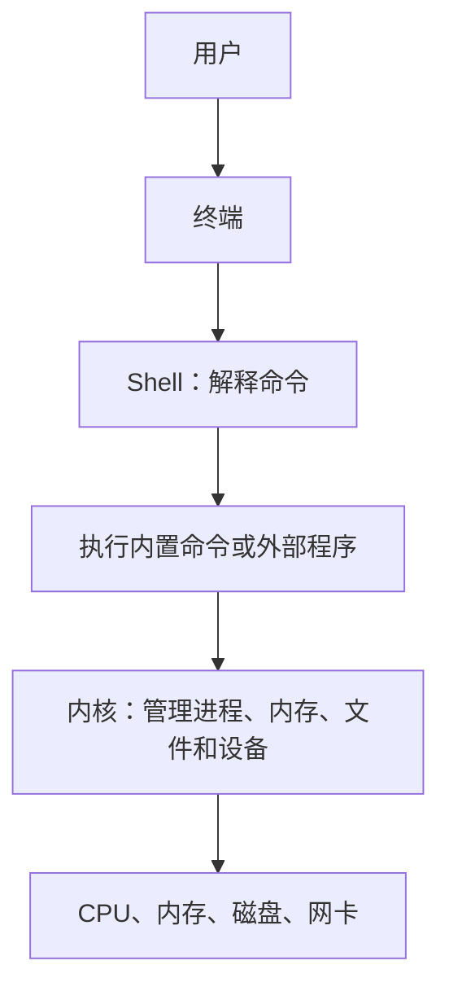
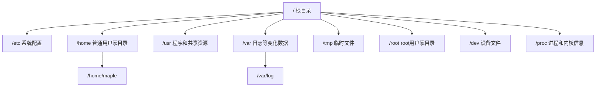
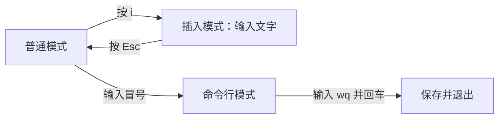

---
tags:
  - 主题/操作系统
  - 技术/Linux
  - 笔记/基础
---

> [!info] 知识关联
> - **网络基础**：[[TCP-IP]] — 理解 IP、端口与路由，再排查 Linux 网络连接。
> - **深入阅读**：[[docker基础]] — 在进程、文件系统和网络基础上理解容器。
> - **实战应用**：[[信息收集]] — 把命令行、网络检查与服务信息用于资产枚举。

# 1 快速入门

## 1.1 Linux是什么

Linux是一种开源的操作系统内核。平时说“安装一个Linux系统”，一般指安装一个以Linux内核为基础的**发行版**。

先把几个概念分开。

| 名称 | 作用 | 举例 |
| --- | --- | --- |
| 内核（Kernel） | 管理CPU、内存、设备、进程等资源 | Linux内核 |
| 发行版（Distribution） | 把内核、系统工具、软件包管理等组合成可用的系统 | Ubuntu、Debian、Fedora、Rocky Linux |
| Shell | 解释和执行命令的程序 | Bash、Zsh |
| 终端（Terminal） | 提供输入命令、查看输出的界面 | 桌面终端、SSH客户端中的终端 |

也就是说，我们在终端输入命令，由Shell解释，再由相关程序通过系统调用使用内核提供的功能。



> [!note] 终端和Shell的区别
> 终端是我们操作的界面，Shell是负责理解命令的程序。
> 同一个终端里可以运行不同的Shell，不能把它们直接当成同一个东西。

## 1.2 从哪里开始操作

可以在Linux虚拟机里练习，也可以使用Windows下的WSL。打开Linux终端后，就可以输入后面的命令。

本文主要使用**Bash和常见GNU命令工具**。精简容器中的命令可能不齐全，部分参数也可能不同。

先看一下当前系统。

```bash
cat /etc/os-release   # 查看发行版信息
uname -r             # 查看内核版本
whoami               # 查看当前用户名
pwd                  # 查看当前所在目录
```

比如`whoami`输出`maple`，说明我们现在以maple这个用户的身份操作系统。

后面会用`/home/maple`举例，这是示例路径，实际用户名以自己的环境为准。练习命令中尽量使用`~`，让它自动指向当前用户的家目录。

> [!tip] 先准备一个练习目录
> 执行`mkdir -p ~/linux-study`，再执行`cd ~/linux-study`。
> 后面的文件操作优先在这个目录里练习。如果是分开学习不同章节，记得先回到这个目录。

## 1.3 命令的基本结构

```text
命令 [选项] [参数]
```

方括号表示这一部分可以省略，**实际输入时不需要写方括号**。

举个例子：

```bash
ls -l /etc
```

- `ls`：命令，列出目录中的内容。
- `-l`：选项，使用长格式显示。
- `/etc`：参数，指定要查看的目录。

短选项通常以一个`-`开头，长选项通常以两个`--`开头。

```bash
ls -a -l
ls -al              # 对ls来说，上面两个短选项可以合写
ls --all
```

**区分大小写**，`ls`和`LS`不是同一个命令，`Demo.txt`和`demo.txt`通常也不是同一个文件。

有时教程会这样写：

```text
maple@linux:~$ pwd
```

前面是命令提示符，用户名是maple，主机名是linux，当前位置是`~`。真正需要输入的只有`pwd`。

普通用户的提示符通常以`$`结尾，root用户通常以`#`结尾，但提示符可以自定义，确认身份还是看`whoami`或`id`。

## 1.4 不记得命令时怎么办

```bash
ls --help            # 查看命令的帮助信息
man ls               # 查看手册，需要系统安装了man和对应手册
help cd              # 查看Bash内置命令的帮助
type cd              # 判断命令是内置命令还是外部程序等
command -v ls        # 查看命令的解析结果
```

`man`界面中，按`q`退出，输入`/关键词`搜索，按`n`跳到下一个匹配。

常用快捷键：

| 按键 | 作用 |
| --- | --- |
| `Tab` | 补全命令或路径；有多个候选时可能需要再按一次 |
| `↑`、`↓` | 翻看历史命令 |
| `Ctrl + C` | 中断当前前台任务，通常是发送SIGINT信号 |
| `Ctrl + L` | 清理当前屏幕显示，不会删除命令历史 |
| `Ctrl + A`、`Ctrl + E` | 在常见Bash编辑模式下，移到行首、行尾 |
| `Ctrl + D` | 空输入时表示输入结束，可能退出当前Shell |

# 2 目录和路径

## 2.1 Linux的目录结构

Linux的文件系统从`/`开始，`/`叫作**根目录**。不同磁盘或分区可以挂载到这棵目录树上。



再补充几个经常见到的目录。

| 目录 | 用途 |
| --- | --- |
| `/bin`、`/sbin` | 常用程序、系统管理程序；不少发行版中链接到`/usr`下对应目录 |
| `/boot` | 启动相关文件 |
| `/opt` | 一些额外安装的软件 |
| `/mnt`、`/media` | 常见的挂载位置 |
| `/run` | 当前启动期间产生的运行时数据 |
| `/sys` | 内核向用户空间暴露设备等信息的虚拟文件系统 |

> [!note] 根目录和root用户
> `/`是整个文件系统的起点，`root`是管理员账号，`/root`是这个账号的家目录。
> 这三个东西有联系，但含义不同。

## 2.2 绝对路径与相对路径

**绝对路径**：从根目录`/`开始写，与当前所在位置无关。

**相对路径**：从当前工作目录开始找。

假设当前位置是`/home/maple`：

```bash
cd /home/maple/linux-study   # 绝对路径
```

如果仍然位于`/home/maple`，也可以这样进入同一个目录：

```bash
cd linux-study              # 相对路径
```

几个特殊写法：

| 写法 | 含义 |
| --- | --- |
| `/` | 根目录 |
| `~` | 当前用户的家目录，由Shell展开 |
| `.` | 当前目录 |
| `..` | 上一级目录 |
| `-` | 在`cd -`中表示上一次所在的目录 |

```bash
pwd                 # 我现在在哪里
cd ~                # 回到家目录，直接输入cd也可以
cd ~/linux-study
cd ..               # 返回上一级
cd -                # 回到刚才的linux-study目录
```

## 2.3 查看目录内容

```bash
ls                  # 查看当前目录
ls -l               # 查看权限、属主、大小、修改时间等
ls -a               # 包含以.开头的隐藏项
ls -lh              # 用更易读的单位显示大小
ls -lah /etc        # 选项可以组合，并指定目录
```

Linux中以`.`开头的名称通常会被当作隐藏文件或目录，比如`.bashrc`、`.ssh`。

**隐藏只是默认不显示，不代表加密，也不代表别人不能访问。**

# 3 文件操作

## 3.1 创建文件和目录

```bash
cd ~/linux-study
mkdir notes                  # 创建目录；已存在时会提示错误
mkdir -p project/src/main    # 连同缺少的父目录一起创建
touch notes/demo.txt         # 不存在则创建空文件，存在则更新时间戳
```

这里要注意，`touch`不会把已有文件内容清空。

文件名中有空格时，要用引号把整个路径括起来。

```bash
touch "notes/hello world.txt"
ls -l "notes/hello world.txt"
```

## 3.2 复制、移动与重命名

```bash
cp notes/demo.txt notes/demo-copy.txt    # 复制文件
cp -r notes notes-backup                # 递归复制目录
cp -i notes/demo.txt notes/demo-copy.txt # 覆盖已有目标前询问
mv notes/demo-copy.txt notes/old.txt     # 同一目录下移动，相当于重命名
mv notes/old.txt ./                     # 移到当前目录
```

`cp`后面是**源路径、目标路径**，`mv`也是这个顺序。

目标如果是已经存在的目录，就会把源文件放进去。例如`mv notes/old.txt ./`最终得到的是当前目录下的`old.txt`。

> [!tip] 复制目录时注意目标是否已经存在
> `cp -r notes notes-backup`在目标不存在时创建副本；如果`notes-backup`已经是目录，则通常会把`notes`复制到它里面。
> 想把源目录的内容复制进去，可以使用`cp -a notes/. notes-backup/`。`-a`用于归档式复制，会尽量保留权限、时间和链接等属性。

## 3.3 删除文件和目录

```bash
rm -i old.txt          # 删除文件前询问
rmdir project/src/main # 只能删除空目录
rm -ri notes-backup    # 递归删除目录，并逐项询问
```

`-r`表示递归处理目录及其内容，`-f`表示强制处理，不再询问，并忽略不存在的目标。

> [!warning] rm通常不会进入回收站
> 删除前先用`pwd`确认当前位置，再用`ls`确认目标。
> 不要因为看到报错就随手加上`sudo`和`-rf`，尤其是包含通配符的路径。

文件名如果以`-`开头，可能被命令当成选项。可以使用`--`表示选项到这里结束。

```bash
touch -- -demo.txt
rm -i -- -demo.txt
```

## 3.4 查看文件内容

先写一点内容，后面几个例子都用这个文件。

```bash
printf 'hello Linux\nhello Java\nerror: demo\n' > notes/demo.txt
```

这里的`>`是把输出写进文件，后面会展开讲。

```bash
cat notes/demo.txt          # 一次性输出全部内容，适合小文件
less notes/demo.txt         # 分页查看，适合较大文件
head -n 2 notes/demo.txt    # 查看开头2行
tail -n 2 notes/demo.txt    # 查看最后2行
tail -f notes/demo.txt      # 持续查看新追加的内容，Ctrl+C退出
```

`less`里也可以用`/关键词`搜索，用`q`退出。查看持续写入且可能轮转的日志时，常会用到`tail -F app.log`，它会按文件名跟踪并重试。

`cat notes/demo.txt`的输出：

```text
hello Linux
hello Java
error: demo
```

## 3.5 编辑文件：nano和Vim

如果只想先完成简单编辑，可以使用`nano`，前提是系统已经安装。

```bash
nano notes/demo.txt
```

修改后按`Ctrl + O`保存，回车确认文件名，再按`Ctrl + X`退出。界面里的`^O`就是`Ctrl + O`。

Vim则需要先理解模式。

```bash
vim notes/demo.txt
```

刚进入通常处于**普通模式**，直接打字不会像普通编辑器那样输入正文。



| 操作 | 含义 |
| --- | --- |
| `i` | 在普通模式下进入插入模式 |
| `Esc` | 返回普通模式 |
| `:w` | 保存 |
| `:q` | 退出；有未保存修改时通常会阻止退出 |
| `:wq` | 保存并退出 |
| `:q!` | 放弃未保存修改并退出 |
| `dd` | 普通模式下删除当前行 |
| `yy`、`p` | 普通模式下复制当前行、粘贴 |
| `u` | 普通模式下撤销 |
| `/关键词` | 普通模式下开始搜索，回车后用`n`找下一个 |

先记住这条流程就够用了：**打开文件 → 按i → 修改 → 按Esc → 输入:wq → 回车**。

## 3.6 查找文件与查找内容

**find是找文件，grep是找文件里的内容。**

```bash
find ~/linux-study -type f -name '*.txt' # 按文件名查找普通文件
find ~/linux-study -type d -name notes  # 按目录名查找目录
find ~/linux-study -type f -size +10M   # 查找大于10MiB的普通文件
```

`-type f`表示普通文件，`-type d`表示目录，`-name`按名称匹配。

`'*.txt'`外面的引号不能随手省掉，否则`*`可能先被Shell展开，`find`收到的就不是原本想传入的匹配规则了。可对照[GNU Findutils的模式匹配说明](https://www.gnu.org/software/findutils/manual/html_node/find_html/Shell-Pattern-Matching.html)。

```bash
grep 'hello' notes/demo.txt     # 找包含hello的行
grep -n 'hello' notes/demo.txt  # 同时显示行号
grep -i 'linux' notes/demo.txt  # 忽略大小写
grep -v 'error' notes/demo.txt  # 输出不匹配error的行
grep -rn 'hello' notes/        # 递归搜索目录，并显示行号
grep -F 'a.b' notes/demo.txt    # 按普通字符串查找，不把.当正则符号
```

比如`grep -n 'hello' notes/demo.txt`：

```text
1:hello Linux
2:hello Java
```

# 4 管道与重定向

## 4.1 标准输入、标准输出、标准错误

一个命令执行时，可以从某个地方读取数据，也可以向某个地方输出数据。

| 名称 | 文件描述符 | 默认通常连接到 |
| --- | --- | --- |
| 标准输入 stdin | `0` | 终端输入 |
| 标准输出 stdout | `1` | 终端显示 |
| 标准错误 stderr | `2` | 终端显示 |

标准输出和标准错误默认都显示在屏幕上，但它们是两个不同的通道。

## 4.2 重定向

**重定向就是改变输入或输出的位置。**

```bash
printf 'first line\n' > output.txt    # 覆盖写入；文件不存在则创建
printf 'second line\n' >> output.txt # 追加写入
wc -l < output.txt                   # 从文件读取输入，统计行数
```

执行完以后，`output.txt`里有两行。再次运行第一条命令，原内容就会被覆盖。

```bash
ls /etc /this-path-does-not-exist > result.txt 2> error.txt
```

这里正常列出的内容进入`result.txt`，不存在路径的报错进入`error.txt`。

如果想把两种输出放在一起：

```bash
ls /etc /this-path-does-not-exist > all.txt 2>&1
```

拆开理解：

- `> all.txt`：先让标准输出指向文件。
- `2>&1`：再让标准错误指向标准输出当前指向的位置。

> [!note] 重定向有先后顺序
> Bash从左到右处理重定向。`> all.txt 2>&1`会把两种输出都放进文件；交换为`2>&1 > all.txt`时，标准错误仍然指向原来的标准输出位置。
> `2>&1`中的`&1`表示文件描述符1，不是名为1的文件。见[Bash重定向手册](https://www.gnu.org/software/bash/manual/html_node/Redirections.html)。

`/dev/null`可以理解为丢弃写入内容的特殊设备。

```bash
ls /this-path-does-not-exist 2>/dev/null # 丢弃错误输出，退出状态仍然表示失败
```

## 4.3 管道

**管道`|`把前一个命令的标准输出，交给后一个命令作为标准输入。**

```bash
grep 'hello' notes/demo.txt | wc -l
```

先找出包含hello的行，再统计有多少行，这里结果为`2`。


普通`|`默认不包含标准错误。需要一起传递时，可以使用`命令 2>&1 | 后续命令`。

再举个统计例子：

```bash
printf 'java\nlinux\njava\npython\nlinux\njava\n' > words.txt
sort words.txt | uniq -c | sort -nr
```

结果中的空格宽度可能不同：

```text
      3 java
      2 linux
      1 python
```

`sort`先排序，`uniq -c`统计**连续重复行**，最后用`sort -nr`按数字倒序排列。

注意`uniq`只处理相邻的重复行，所以这里要先排序。

## 4.4 简单文本处理

```bash
wc -l notes/demo.txt              # 统计行数，严格说是换行符数量
wc -w notes/demo.txt              # 统计单词数
wc -c notes/demo.txt              # 统计字节数
sed -n '1,2p' notes/demo.txt       # 只打印第1到第2行
sed 's/hello/Hello/g' notes/demo.txt # 替换每行中的hello并输出，原文件不变
```

`sed`后面的`s/旧内容/新内容/g`表示替换，`g`表示处理一行中所有匹配。旧内容的位置默认按正则表达式解释。

需要按列处理时，可以先认识`awk`：

```bash
printf 'maple 90\nalice 85\n' > scores.txt
awk '{print $1}' scores.txt        # 打印第一列
awk '$2 >= 90 {print $1}' scores.txt # 打印第二列不小于90的行的第一列
```

默认按空白分列，`$1`是第一列，`$2`是第二列，`$0`是整行。上面第二条命令输出`maple`。

这里外面的单引号也有作用，它让`$1`等内容原样交给awk处理，避免先被Shell解释。

# 5 用户和权限

## 5.1 用户、用户组与root

Linux是多用户系统，不同用户可以拥有不同的文件和操作权限。

- **用户**：一个账号，系统用UID标识用户。
- **用户组**：将用户组织在一起，系统用GID标识组。
- **root**：UID为0的超级用户，拥有很高的管理权限。

```bash
whoami              # 当前用户名
id                  # 当前用户的UID、GID以及所属组
groups              # 当前用户所属的组
```

普通用户需要执行某些管理操作时，通常使用`sudo`。

```bash
sudo -l             # 查看当前账号被允许通过sudo执行哪些操作
```

`sudo`能否使用取决于系统是否安装、管理员是否授权。需要验证密码时，通常输入的是当前用户的密码；终端不显示星号或字符是正常现象。

`su - 用户名`则是切换到指定用户并使用其登录环境，例如`su - root`通常需要目标账号的密码。操作完成后使用`exit`退出这一层Shell。

## 5.2 看懂ls -l中的权限

```text
-rw-r--r-- 1 maple maple 36 Nov 20 10:00 demo.txt
```

这个示例中的`36`表示文件大小为36字节，后面是修改时间和文件名。前面更值得注意：

```text
-   rw-   r--   r--
类型 属主  属组  其他用户
```

第一个字符表示类型，`-`是普通文件，`d`是目录，`l`是符号链接。

后面每组三位分别是：

- `r`：read，读。
- `w`：write，写。
- `x`：execute，执行；对目录表示搜索、访问其中条目的权限。
- `-`：没有对应权限。

`maple maple`分别是属主和属组。这里的`rw-r--r--`表示属主能读写，属组和其他用户只能读。

同一个操作会根据身份选择适用的权限类别，不能理解为“属主权限不够，就再借其他用户的权限”。ACL等机制还可能提供额外规则，入门阶段先理解这三组。

## 5.3 文件权限和目录权限的区别

| 权限 | 对普通文件 | 对目录 |
| --- | --- | --- |
| `r` | 读取内容 | 列出目录中的名称 |
| `w` | 修改内容 | 配合`x`创建、删除、重命名目录项 |
| `x` | 允许作为程序执行，还需要格式等条件成立 | 穿过目录，按名称访问其中条目 |

比如要访问`/home/maple/notes/demo.txt`，沿途目录需要有相应的`x`权限，读取文件还需要文件本身的读权限。可对照[GNU权限位说明](https://www.gnu.org/software/coreutils/manual/html_node/Mode-Structure.html)。

> [!important] 文件只读，不等于一定不能被删除
> 删除主要改变的是父目录中的目录项，所以通常取决于父目录的`w`和`x`权限。
> `/tmp`这类设置了sticky bit的目录还有额外限制，不能简单理解为“目录可写就能删所有人的文件”。

## 5.4 修改权限：chmod

先准备一个脚本文件。

```bash
cd ~/linux-study
printf '#!/usr/bin/env bash\nprintf "hello Linux\\n"\n' > hello.sh
chmod u+x hello.sh
./hello.sh
```

这里`u`表示属主，`+x`表示增加执行权限，输出是`hello Linux`。

符号方式：

```bash
chmod u+x hello.sh   # 给属主增加执行权限
chmod g-w hello.sh   # 去掉属组的写权限
chmod o-r hello.sh   # 去掉其他用户的读权限
```

`u`是属主，`g`是属组，`o`是其他用户，`a`是所有类别。`+`增加权限，`-`移除权限，`=`设置为指定权限。

也可以用数字设置，`r=4`、`w=2`、`x=1`，每组三位相加。

```text
7 = 4 + 2 + 1 = rwx
6 = 4 + 2     = rw-
5 = 4 + 1     = r-x
4 = 4         = r--
```

```bash
chmod 644 notes/demo.txt  # rw-r--r--，常见的普通文件权限
chmod 755 hello.sh        # rwxr-xr-x，属主可写，其他人可读和执行
chmod 700 notes           # rwx------，仅属主具有这三种权限
```

**不要把`chmod 777`当成通用修复方式。** 权限不够时，先确认操作用户、文件属主、父目录权限，再决定需要开放哪一种权限。

## 5.5 修改属主和属组

下面假设系统中确实存在`maple`用户和`maple`组，实际操作时换成自己的名称。

```bash
sudo chown maple:maple notes/demo.txt # 同时修改属主和属组
chgrp maple notes/demo.txt           # 只改属组，需要具有相应权限
```

`chown -R`会递归修改整个目录树，作用范围更大，执行前需要先确认路径。

# 6 进程管理

## 6.1 什么是进程

**程序**是保存在磁盘上的代码和数据，**进程**是程序运行时的实例。

拿Java举个例子，磁盘中的`.class`文件不会自己运行，执行`java Main`后，启动的JVM进程会加载和执行相关代码。

同一个程序可以同时运行多次，形成不同的进程。每个进程都有自己的PID，在其所在的PID命名空间中用于标识它。

| 名称 | 含义 |
| --- | --- |
| PID | 进程ID |
| PPID | 父进程ID |
| USER | 进程所属用户 |
| CPU、内存占用 | 观察进程资源使用情况的指标 |

进程能够执行哪些操作，与它的用户身份、权限以及系统的其他访问控制规则有关。

> [!note] 输入一条命令，不一定新建一个进程
> `cd`通常是Shell内置命令，需要直接改变当前Shell的工作目录。
> `ls`、`sleep`这类外部命令通常由Shell启动进程来执行。不能把所有命令都理解为“输入一次就一定得到一个新PID”。

## 6.2 查看进程

```bash
ps -ef                      # 查看进程快照，包含PID、PPID等信息
ps aux                      # 另一种常用格式，包含CPU和内存占比
ps -ef | grep '[s]sh'        # 筛选含ssh的行，避免匹配grep命令自身
pgrep -a -x bash            # 查找进程名恰好为bash的进程并显示命令行
top                         # 动态观察进程，按q退出
```

`ps -ef`和`ps aux`是两种不同风格的参数写法，不要随意混成`ps -aux`。

`top`里常见的`%CPU`表示CPU占用，`%MEM`表示内存占用，`RES`表示驻留内存。多核环境中，某些显示口径下单个进程的CPU占用可能超过100%。

## 6.3 前台、后台与作业

```bash
sleep 300 &
```

`sleep 300`是等待300秒，末尾的`&`让它在后台运行，当前终端可以继续输入命令。

可能看到这样的输出：

```text
[1] 12345
```

`1`是当前Shell里的**作业号**，`12345`是这次启动的进程PID，实际数字每次可能不同。

```bash
jobs                # 查看当前Shell管理的作业
fg %1               # 将1号作业切回前台，实际作业号以jobs为准
```

前台执行时按`Ctrl + Z`通常是**暂停**，再执行`bg %1`可以让它在后台继续运行。

> [!note] Ctrl+C与Ctrl+Z
> `Ctrl+C`通常请求中断前台任务，`Ctrl+Z`通常请求暂停前台任务。
> 后台运行也不代表退出SSH后一定继续运行。临时任务可了解`nohup`，需要重新接入交互会话可用`tmux`，长期服务通常交给服务管理器。

## 6.4 结束进程：kill

`kill`本质是**向进程发送信号**，不是只能用来强制结束进程。

用一个自己启动的等待进程练习：

```bash
sleep 300 &
study_pid=$!                 # $!表示最近一个后台任务的PID
ps -p "$study_pid" -o pid,comm
kill -TERM "$study_pid"     # 请求进程终止，等同于kill "$study_pid"
wait "$study_pid"           # 等待它结束，可能显示Terminated提示
```

常用信号：

| 信号 | 数字 | 作用 |
| --- | --- | --- |
| SIGINT | 2 | 请求中断，常见于Ctrl+C |
| SIGTERM | 15 | 请求终止，程序可以处理信号并清理资源 |
| SIGKILL | 9 | 强制终止，程序不能捕获、忽略这个信号 |

只有确认普通终止无效，且确认目标PID后，再考虑`kill -KILL PID`。直接强制结束可能让程序来不及保存数据。

# 7 磁盘、链接与压缩

## 7.1 查看资源占用

```bash
df -h                  # 查看已挂载文件系统的容量和使用情况
df -i                  # 查看inode使用情况
du -sh ~/linux-study   # 汇总这个目录占用的磁盘空间
du -h --max-depth=1 .  # 查看当前目录及其下一层目录的占用，GNU参数
free -h                # 查看内存和交换空间情况
lsblk                  # 查看块设备及其层级、挂载点等
```

**df看文件系统还有多少空间，du看某个目录用了多少空间。**

二者统计范围和方式不同，结果不一定相等。比如文件删除后，如果仍有进程打开它，其空间可能尚未释放。

`free`输出中，判断还能供新程序使用多少内存，可以重点看`available`。Linux会利用部分空闲内存做缓存，所以`free`较小不一定表示内存紧张。

## 7.2 挂载是什么

挂载就是把某个文件系统接入目录树中的某个位置，这个位置叫**挂载点**。

比如一个分区挂载到`/mnt/data`后，我们就通过这个目录访问它，而不是通过Windows中的`D:`这种盘符。

```bash
findmnt               # 查看当前挂载关系，通常由util-linux提供
```

初学阶段先认识概念即可。格式化磁盘和修改分区是另外一类操作，不能当作“创建一个目录”来理解。

## 7.3 硬链接和软链接

**硬链接**：给同一个文件对象增加一个目录项。

**软链接，也叫符号链接**：保存目标路径，通过路径指向目标，可以类比快捷方式。

```bash
cd ~/linux-study
printf 'hello link\n' > original.txt
ln original.txt hard.txt
ln -s original.txt soft.txt
ls -li original.txt hard.txt soft.txt
```

可以观察到：`original.txt`和`hard.txt`的inode号相同，软链接则有自己的inode，长格式输出中会显示`soft.txt -> original.txt`。

| 对比 | 硬链接 | 软链接 |
| --- | --- | --- |
| 跨文件系统 | 通常不允许 | 可以 |
| 链接到目录 | 普通用户通常不能创建 | 可以 |
| 删除原名称后 | 其他硬链接仍能访问内容 | 如果目标路径不存在，就成为失效链接 |
| 目标是什么 | 同一个文件对象 | 一个路径 |

软链接使用相对目标路径时，**相对于软链接所在的目录解析**，与访问它时终端所在目录无关。

## 7.4 打包和压缩

`tar`负责把多个文件组织成一个归档，还可以配合gzip等压缩工具。

```bash
tar -cvf notes.tar notes/        # 打包，不使用gzip压缩
tar -czvf notes.tar.gz notes/    # 打包并使用gzip压缩
tar -tzvf notes.tar.gz           # 先查看归档中的文件
mkdir -p extracted
tar -xzvf notes.tar.gz -C extracted/ # 解压到指定目录
```

参数拆开看：

| 参数 | 含义 |
| --- | --- |
| `c` | 创建归档 |
| `x` | 解开归档 |
| `t` | 列出归档内容 |
| `z` | 使用gzip |
| `v` | 显示处理过程 |
| `f` | 指定归档文件，后面紧跟文件名 |
| `-C` | 切换到指定目录进行相应操作 |

这里`c`、`x`、`t`是在做不同的事，不需要一起写。解压陌生归档时先查看内容，再解压到单独目录，方便确认文件范围。

ZIP格式则可以用：

```bash
zip -r notes.zip notes/          # 需要安装zip
unzip -l notes.zip              # 查看内容，需要安装unzip
unzip notes.zip -d zip-output/   # 解压到指定目录
```

# 8 网络与远程连接

## 8.1 IP、网卡与端口

先简单理解：**IP帮助定位网络中的主机或接口，端口帮助区分主机上的网络服务端点。**

比如`192.168.1.10:8080`中，前面是IP，后面是端口。这里是示例地址，实际连接时换成自己的目标。

```bash
ip addr              # 查看网卡和IP地址
ip link              # 查看网络接口及其状态
ip route             # 查看路由，default所在行通常是默认路由
ss -lnt              # 查看监听中的TCP套接字，地址和端口使用数字显示
sudo ss -lntp        # 增加对应进程信息，查看其他用户进程通常需要权限
```

`ss`选项中，`l`是监听，`n`是不做名称解析，`t`是TCP，`p`是进程信息。要看UDP可使用`ss -lnu`。

常见监听地址：

| 地址 | 通常表示 |
| --- | --- |
| `127.0.0.1:8080` | 只监听本机IPv4回环地址 |
| `0.0.0.0:8080` | 监听所有本地IPv4地址 |
| `[::]:8080` | 监听所有本地IPv6地址，是否同时接收IPv4取决于配置 |

**监听了端口，不等于外部一定能连接。** 还要看路由、防火墙、云安全组以及应用配置。

## 8.2 连通性与DNS

```bash
ping -c 4 192.168.1.1  # 发送4次ICMP探测，目标需换成自己的网关等
getent hosts example.com # 查看系统名称解析结果
```

如果安装了相应的DNS工具，也可以用：

```bash
dig example.com       # 查询DNS记录
nslookup example.com  # 另一种DNS查询工具
```

`dig`和`nslookup`通常不预装，Debian/Ubuntu上常由`dnsutils`提供，Fedora/Rocky Linux等常由`bind-utils`提供。

> [!note] ping不通不能直接断定服务不可用
> 有的主机或网络会禁用ICMP；反过来，ping成功也只能说明对应探测得到了回应，不能证明网站、SSH等应用服务正常。
> `getent`使用系统名称解析配置，可能包含`/etc/hosts`；`dig`主要查询DNS，两者结果也可能不同。

## 8.3 使用curl发送请求

```bash
curl https://example.com          # 发起请求，显示响应正文
curl -I https://example.com       # 发起HEAD请求，查看响应头
curl -i https://example.com       # 显示响应头和正文
curl -L https://example.com       # 跟随重定向
curl -o example.html https://example.com # 将正文保存为指定文件
```

排查自己本机的Web服务时，可以这样看连接过程，前提是确实有服务监听8080端口：

```bash
curl -v --connect-timeout 5 http://127.0.0.1:8080/
```

`-v`会显示更多连接信息，`--connect-timeout 5`限制连接阶段的等待时间。请求可能显示“连接被拒绝”，这也是判断服务是否启动的线索。

不要把下载内容直接接到`bash`执行，先保存并检查内容更容易知道自己究竟运行了什么。

## 8.4 SSH远程登录

SSH用于加密的远程连接。目标主机需要有SSH服务，网络也需要允许连接。

下面的`maple`和`192.168.1.10`需要换成实际用户名和服务器地址。

```bash
ssh maple@192.168.1.10
ssh -p 2222 maple@192.168.1.10  # 服务端使用非默认端口时
```

登录后执行命令，操作的是**远程服务器**。使用`exit`可以退出当前远程Shell。

首次连接时通常会询问是否信任主机密钥，应先核对指纹。之后如果提示主机密钥发生变化，要确认原因，不能直接当成普通密码错误处理。

生成用于登录的密钥：

```bash
ssh-keygen -t ed25519 -C "maple@linux"
```

默认路径下，`~/.ssh/id_ed25519`是私钥，`~/.ssh/id_ed25519.pub`是公钥。生成时可以设置口令，已有同名密钥时不要随意覆盖。

**私钥保留在本机，公钥可以配置到目标服务器。** 不要把私钥发给别人，也不要放进公开仓库。

## 8.5 scp复制文件

在本地终端执行，地址和用户名仍需替换：

```bash
scp notes/demo.txt maple@192.168.1.10:/home/maple/ # 上传
scp maple@192.168.1.10:/home/maple/demo.txt ./     # 下载
scp -r notes/ maple@192.168.1.10:/home/maple/     # 复制目录
scp -P 2222 notes/demo.txt maple@192.168.1.10:/home/maple/
```

注意：**ssh指定端口是小写`-p`，scp指定端口是大写`-P`。**

# 9 软件安装、服务与日志

## 9.1 包管理器

Linux通常通过包管理器安装软件，包管理器还会处理软件依赖。

| 发行版系列 | 常见工具 |
| --- | --- |
| Debian、Ubuntu等 | `apt`，底层包工具是`dpkg` |
| Fedora、Rocky Linux等 | `dnf`，底层包工具是`rpm` |
| Arch Linux等 | `pacman` |

这些是不同系统的选择，**不需要把下面两套命令都执行一遍**。

Debian/Ubuntu中，比如安装curl：

```bash
sudo apt update        # 更新软件包索引，不是升级所有已安装软件
apt search curl        # 搜索软件包
apt show curl          # 查看软件包信息
sudo apt install curl  # 安装
sudo apt remove curl   # 卸载，通常保留软件包配置文件
```

`sudo apt upgrade`用于升级已安装软件，执行前查看它准备修改哪些包。`apt purge`会进一步移除包管理器管理的相关配置，但不代表清除用户家目录下的一切数据。

Fedora/Rocky Linux等系统中：

```bash
dnf search curl
dnf info curl
sudo dnf install curl
sudo dnf remove curl
```

软件包名称、软件源和可用版本可能因发行版而异，安装前先确认当前系统。

## 9.2 进程和服务的区别

进程是运行实例。服务通常是向系统或其他程序提供功能、由管理器管理的工作单元，运行时可能包含一个或多个进程。

比如SSH服务需要持续等待远程连接，Web服务需要持续处理请求。

很多发行版使用systemd管理服务，对应的常用命令是`systemctl`。

> [!note] systemctl的使用前提
> 系统需要以systemd作为相应的服务管理器运行。在没有启用systemd的WSL环境、部分容器或其他初始化系统中，可能无法使用这些命令。
> 这时要按照实际环境的服务管理方式操作。

## 9.3 管理服务

以已经安装的nginx服务为例，没有安装时不能直接套用。

```bash
systemctl status nginx          # 查看状态
sudo systemctl start nginx      # 启动
sudo systemctl stop nginx       # 停止
sudo systemctl restart nginx    # 重启
sudo systemctl reload nginx     # 请求重新加载配置，需要服务支持
sudo systemctl enable nginx     # 配置开机启动等启用关系
sudo systemctl disable nginx    # 取消对应的启用关系
```

**start影响当前运行状态，enable影响启动时的启用关系。** 单独执行`enable`通常不会立即启动；想一起做，可以使用`sudo systemctl enable --now nginx`。

同样，`disable`通常不会停止当前已经运行的服务。`reload`也不等于`restart`，前者请求服务重载自身配置，后者会停止再启动。

```bash
systemctl list-units --type=service --state=running # 查看运行中的服务单元
```

需要查具体行为时，可以对照[systemctl官方手册](https://www.freedesktop.org/software/systemd/man/latest/systemctl.html)。SSH服务单元在不同发行版中可能叫`ssh`或`sshd`，不要只凭服务名字猜命令。

## 9.4 查看日志

```bash
journalctl -u nginx -n 50 --no-pager # 查看对应单元最近50条日志
journalctl -u nginx -f              # 持续跟踪
journalctl -b -p err                # 查看本次启动中err及更严重级别的日志
journalctl --since "1 hour ago"     # 查看最近一小时的日志
```

如果账号不能访问相关日志，需要使用具备权限的账号或`sudo`。

日志不一定全部进入journal，有的软件会另外写文件。例如nginx常见日志目录是`/var/log/nginx/`，具体仍以应用配置为准。

# 10 Shell基础

## 10.1 变量与引号

```bash
name=maple
printf 'hello %s\n' "$name"
```

输出：

```text
hello maple
```

**赋值时等号两边不能有空格。** `name = maple`会被Shell按命令去理解，不是变量赋值。

```bash
printf '%s\n' '$name'  # 单引号内按字面量处理，输出$name
printf '%s\n' "$name"  # 双引号中可以展开变量，输出maple
```

引用路径变量时通常写成`"$变量名"`，避免空格分词和通配符展开导致一个路径变成多个参数。

## 10.2 环境变量与PATH

普通Shell变量默认只属于当前Shell；使用`export`后，它会作为环境变量传给之后启动的子进程。

```bash
export STUDY_DIR="$HOME/linux-study"
printf '%s\n' "$STUDY_DIR"
printenv STUDY_DIR
printf '%s\n' "$PATH"
```

`PATH`是一组以冒号分隔的目录。输入一个不含`/`的外部命令名时，Shell会按规则到这些目录中寻找程序。

这也是为什么运行当前目录里的脚本，通常要写：

```bash
./hello.sh
```

`./`明确指定当前目录，而当前目录通常不在`PATH`里。

直接在终端中设置的变量只影响当前Shell及其后续子进程。Bash的`~/.bashrc`常用于交互式非登录Shell配置，登录Shell会读取另外的启动文件，不能把它理解成“所有程序都会读取的全局配置”。

## 10.3 通配符与正则表达式

```bash
ls notes/*.txt       # Shell把匹配到的.txt路径展开为参数
```

常见通配符：

| 写法 | 含义 |
| --- | --- |
| `*` | 匹配任意长度的字符串 |
| `?` | 匹配单个字符 |
| `[abc]` | 匹配集合中的一个字符 |

默认情况下，`*`通常不会匹配名称开头的`.`，也不会跨越路径分隔符`/`。

```bash
grep '^hello' notes/demo.txt # 正则：匹配以hello开头的行
```

**通配符一般用来匹配文件名，正则表达式用来描述文本匹配规则。** 比如通配符中的`*`与正则中的`.*`含义更接近，不能直接互换。

## 10.4 退出状态与命令组合

命令执行后会返回退出状态，通常`0`表示成功，非`0`表示失败或其他情况。

```bash
ls /etc > /dev/null
printf '%s\n' "$?"          # 查看上一条命令的退出状态，这里通常为0
```

`$?`会随着后续命令执行而更新，想检查某条命令，就要紧接着读取。

```bash
mkdir -p practice && cd practice # 前一条成功，才执行后一条
test -f missing.txt || printf '文件不存在\n' # 前一条失败，才执行后一条
pwd; whoami                     # 依次执行，不按上一条是否成功来决定
```

有些非零状态不代表程序异常，比如`grep`找不到匹配行时通常返回`1`。

## 10.5 第一个脚本

回到练习目录，用编辑器创建`check.sh`，写入：

```bash
#!/usr/bin/env bash

study_dir="$HOME/linux-study"

if [ -d "$study_dir" ]; then
    printf '练习目录存在：%s\n' "$study_dir"
else
    mkdir -p "$study_dir" || exit 1
    printf '已创建练习目录：%s\n' "$study_dir"
fi

for item in Linux Java Docker; do
    printf '正在学习：%s\n' "$item"
done
```

然后执行：

```bash
cd ~/linux-study
bash check.sh          # 让Bash读取并执行，需要具有文件读权限
chmod u+x check.sh
./check.sh             # 直接执行，还需要执行权限等条件
```

简单拆开看：

- 第一行是shebang，直接执行脚本时用于指定解释器，这里通过`env`查找bash。
- `[ -d "$study_dir" ]`判断目录是否存在，`[`、参数和`]`之间需要空格。
- `if ... then ... else ... fi`是条件分支。
- `for ... do ... done`是循环。
- `mkdir ... || exit 1`表示创建失败就结束脚本，并返回非零状态。

`bash check.sh`与`./check.sh`都会启动脚本执行环境。`source check.sh`则是在**当前Shell**中读取执行，可能修改当前变量或目录，因此不要把三种执行方式完全等同起来。

# 11 串起来练习一次

前面是一个知识点一个知识点地看，这里把常用操作串成一个小例子：**建立日志文件 → 筛选错误 → 统计 → 备份 → 解压核对**。

建议在新的子目录里练习。下面命令可以按顺序执行，目录中已有的同名示例文件会被覆盖。

## 11.1 准备数据

```bash
mkdir -p ~/linux-study/log-practice
cd ~/linux-study/log-practice
mkdir -p logs backup restored

cat > logs/app.log <<'EOF'
INFO application started
ERROR database connection failed
INFO retrying
ERROR request timeout
INFO application stopped
EOF
```

这里`<<'EOF'`叫作here-document，用来提供多行输入，最后一行`EOF`要独占一行。给开头的`EOF`加引号，可以避免正文中的变量等被Shell展开。

## 11.2 查看和筛选

```bash
cat logs/app.log
grep -n 'ERROR' logs/app.log
grep 'ERROR' logs/app.log | wc -l
grep 'ERROR' logs/app.log > errors.txt
```

带行号的错误输出：

```text
2:ERROR database connection failed
4:ERROR request timeout
```

统计结果为`2`，`errors.txt`则保存两条错误记录，不带行号。

## 11.3 备份和检查

```bash
cp logs/app.log backup/app.log
chmod 640 backup/app.log
tar -czvf logs.tar.gz logs/ errors.txt
tar -tzvf logs.tar.gz
tar -xzvf logs.tar.gz -C restored/
diff logs/app.log restored/logs/app.log
```

最后一条`diff`比较两个文件，内容相同时通常没有输出，退出状态为`0`；内容不同时显示差异并返回`1`，出现比较错误则返回更大的状态值。

再执行`ls -l backup/app.log`，可以看到权限为`-rw-r-----`：属主可读写、属组可读、其他用户没有权限。

> [!success] 这一轮练习用到了什么
> `mkdir`建目录，`cat`查看和接收多行输入，`grep`筛选，`wc`统计，`>`保存输出，`cp`备份，`chmod`设置权限，`tar`打包解压，`diff`比较内容。
> 单个命令不复杂，真正有用的是根据任务把它们组合起来。

# 12 常用命令速查

| 需求 | 命令 |
| --- | --- |
| 我在哪里、目录里有什么 | `pwd`、`ls -lah` |
| 进入目录、返回上一级 | `cd 路径`、`cd ..` |
| 新建目录、空文件 | `mkdir -p 路径`、`touch 文件` |
| 复制、移动、删除 | `cp 源 目标`、`mv 源 目标`、`rm -i 文件` |
| 查看大文件、跟踪日志 | `less 文件`、`tail -f 文件` |
| 按名字找文件 | `find 路径 -type f -name '模式'` |
| 按内容找行 | `grep -n '关键词' 文件` |
| 查看用户和权限 | `id`、`ls -l` |
| 修改权限、属主 | `chmod 权限 文件`、`chown 用户:组 文件` |
| 查看进程、动态资源占用 | `ps -ef`、`top` |
| 结束自己确认过的进程 | `kill -TERM PID` |
| 查看磁盘、目录、内存占用 | `df -h`、`du -sh 目录`、`free -h` |
| 打包、解压tar.gz | `tar -czvf 包名.tar.gz 目录`、`tar -xzvf 包名.tar.gz` |
| 查看IP、路由、监听端口 | `ip addr`、`ip route`、`ss -lnt` |
| 查看HTTP响应头 | `curl -I URL` |
| 远程登录、传文件 | `ssh 用户@主机`、`scp 源 目标` |
| 查看服务、日志 | `systemctl status 服务`、`journalctl -u 服务` |
| 不记得参数 | `命令 --help`、`man 命令`、`help 内置命令` |

> [!tip] 几个常见报错怎么理解
>
> - `command not found`：先检查拼写、命令是否安装以及`PATH`，不是直接加`sudo`。
> - `No such file or directory`：先用`pwd`和`ls`检查路径、大小写和当前目录。
> - `Permission denied`：检查身份、文件权限和沿途目录权限；其他访问控制也可能参与。
> - `Connection refused`：目标地址可能没有对应监听服务，或连接被主动拒绝。
> - `Connection timed out`：在规定时间内没有完成连接，结合地址、路由和防火墙继续排查。
