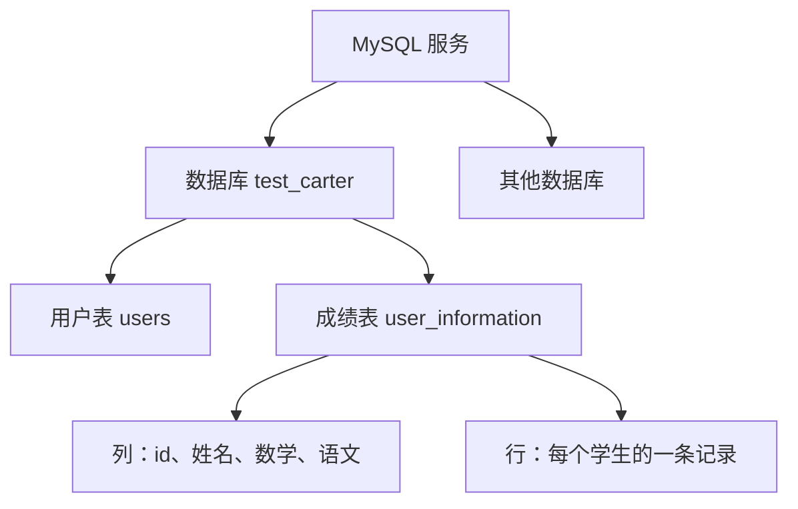
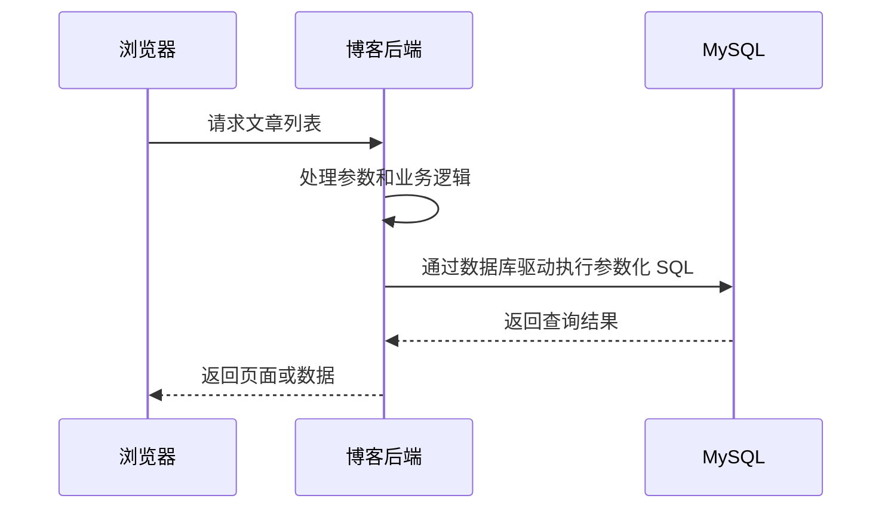
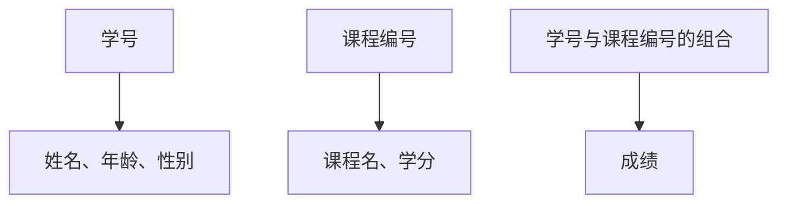
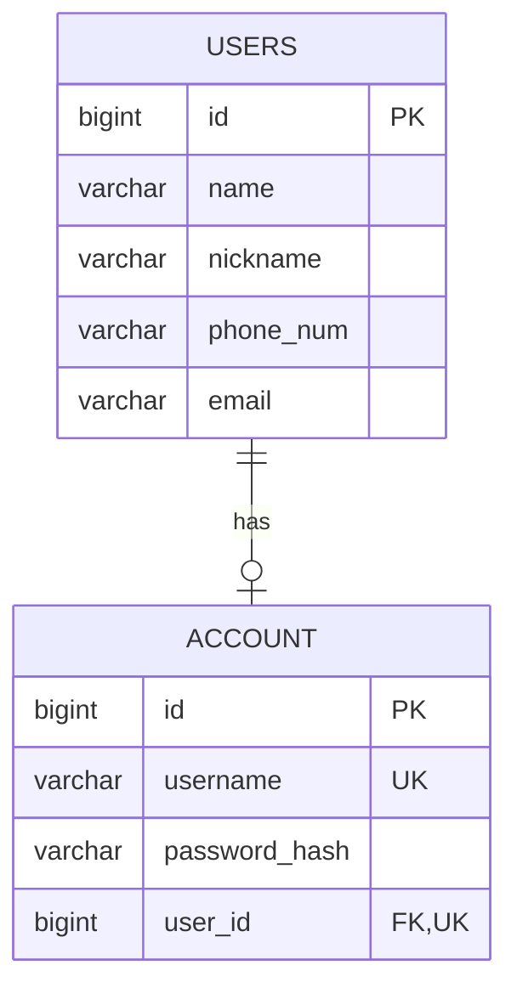
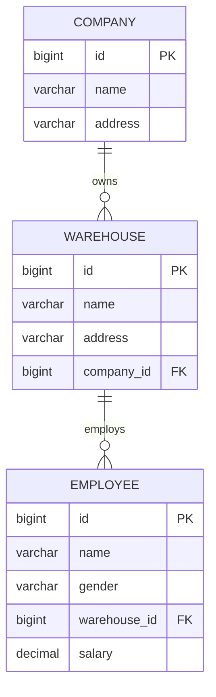
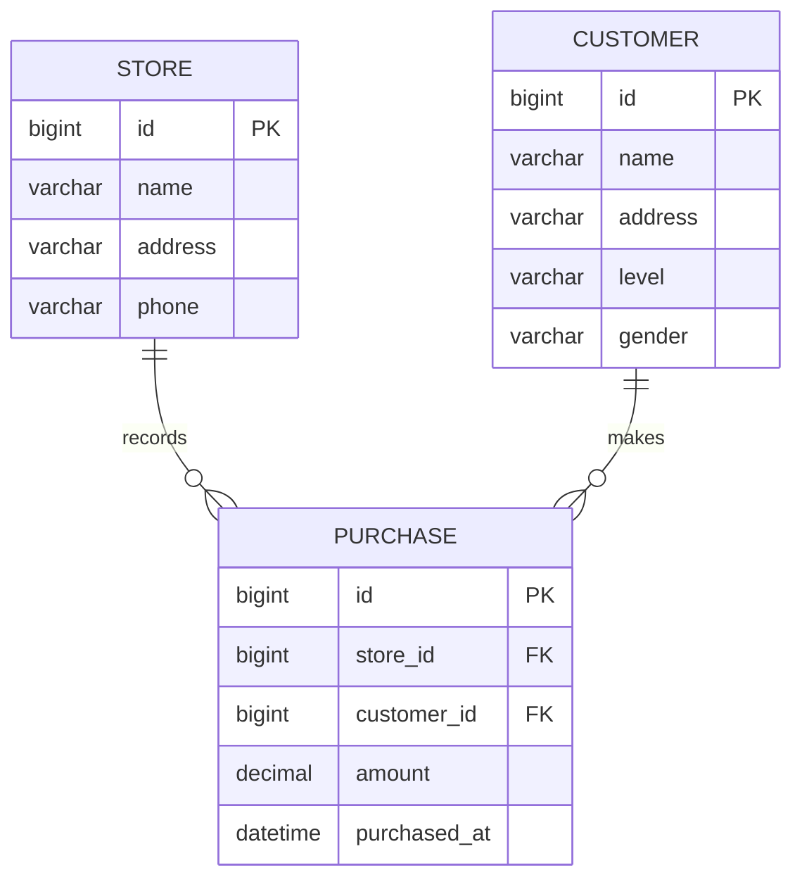
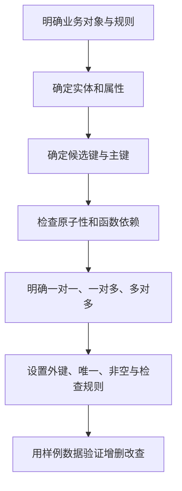

---
aliases:
  - MySQL基础
学习时间: 2025-07-11 至 2025-08-04
tags:
  - 主题/数据库
  - 技术/MySQL
  - 笔记/基础
---

> [!info] 知识关联
> - **编程应用**：[[java基础]] — 通过 JDBC 把应用程序与数据库连接起来。
> - **安全延伸**：[[sql注入漏洞]] — 理解正常查询后，再分析输入如何改变 SQL 语义。
> - **实战应用**：[[Raven2]] — 观察靶场中 MySQL 权限与 UDF 提权的关系。

> [!abstract] 学习主线
> 我把这一阶段的学习串成一条线：先理解应用为什么需要数据库，以及请求怎样到达数据库；再学习建库、建表和增删改查；最后通过约束、范式和 E-R 图，把“能存数据”推进到“能合理地组织数据”。


## 目录

- [[#一、数据库与应用之间的关系]]
- [[#二、从数据库到数据表]]
- [[#三、准备练习数据与新增记录]]
- [[#四、查询：从取出数据到得到需要的结果]]
- [[#五、更新与删除]]
- [[#六、约束：把数据规则写进表结构]]
- [[#七、范式：让每一项信息放在合适的位置]]
- [[#八、E-R 图与表关系的落地]]
- [[#九、复习时抓住的几个问题]]

> [!info] 实验版本
> 当时的截图涉及 MySQL 5.7.26 和 8.0.12，主要练习环境是 8.0.12。下面以 MySQL 8.0 的语法为主；其中 `CHECK` 真正执行约束需要 **8.0.16 及以上版本**，不能直接用 8.0.12 的实验结果判断它是否有效。

## 一、数据库与应用之间的关系

### 1.1 数据库、数据库管理系统与数据表

数据库是按照一定结构组织起来的数据集合。对数据进行存储、查询、修改和管理的软件，称为数据库管理系统，MySQL 就属于这一类软件。

日常说“连接 MySQL 数据库”，通常指客户端连接到 MySQL 服务，再操作其中的某个数据库。



我最初把数据库理解为“处理数据的工具”。进一步区分后，可以把它的作用归纳为：持久化保存数据，支持查询和更新，并通过权限、约束、备份与恢复等机制维护数据。

> [!note] 持久化不等于永远不会丢失
> 数据写入数据库后，可以在程序退出后继续保存。但误操作、设备故障等问题仍可能造成损失，备份和恢复需要单独配置与验证。

### 1.2 关系型数据库如何组织数据

关系型数据库以表组织数据。直观上可以类比 Excel：一列描述一种属性，一行表示一条记录。数据库还可以通过键和约束建立表之间的联系。

例如，把学生信息与班级信息分开保存：

| 学生编号 | 姓名 | 班级编号 |
| --- | --- | --- |
| 1 | 张三 | 1 |
| 2 | 李四 | 1 |
| 3 | 王五 | 2 |

| 班级编号 | 班级名称 |
| --- | --- |
| 1 | Java113 |
| 2 | Java78 |

两张表通过“班级编号”关联。学生表保存学生属于哪个班级，班级表保存班级本身的信息。

> [!tip] 我对“关系”的理解
> 班级编号把两张表联系起来，是理解表关系的一个入口。严格来说，关系模型中的“关系”本身就可以用一张表来表示，不能只把“关系型”理解为两张表之间有连线。

当时接触到的数据库还有 Oracle Database 和 MySQL。这里的练习围绕 MySQL 展开，使用的是其社区版环境。

### 1.3 Navicat 为什么能连接数据库

Navicat 是数据库客户端，MySQL 服务负责实际管理数据。命令行中的 `mysql` 程序也是客户端，两者只是交互方式不同。

- **C/S**：Client/Server，即客户端与服务器。例如 Navicat 连接 MySQL。
- **B/S**：Browser/Server，即浏览器与服务器。例如通过浏览器访问个人博客。

寒假做本地个人博客时，我已经接触过前后端交互。把这一经历放回数据库的学习中，请求链路就更清楚了：



后端通常通过配置文件读取数据库地址、端口、用户名和数据库名，再通过数据库驱动建立连接。业务代码负责执行 SQL，并处理返回结果。

> [!important] 配置、连接与查询各自负责什么
> 配置文件保存连接所需的信息；数据库驱动负责与 MySQL 通信；业务代码决定查什么、改什么。预处理与参数绑定可以让输入作为数据传入，避免把输入直接拼接进 SQL 结构中。

### 1.4 用类与对象理解表和记录

结合之前学习 PHP 和 Java 时对类与对象的理解，可以先做一个类比：

| 面向对象中的概念 | 数据表中的对应概念 |
| --- | --- |
| 类对一类对象的描述 | 表结构对一类数据的描述 |
| 成员属性 | 列、字段 |
| 一个对象 | 一行记录 |
| 属性的值 | 记录中某一列的值 |

这个类比能帮助入门，但数据库还需要考虑主键、外键、约束以及不同记录之间的关系。

### 1.5 SQL 负责表达操作

SQL 是 Structured Query Language，即结构化查询语言。它既能查询数据，也能定义结构、修改记录和管理权限。

| 分类 | 作用 | 常见关键字 |
| --- | --- | --- |
| DDL，数据定义语言 | 定义和修改库、表等结构 | `CREATE`、`ALTER`、`DROP` |
| DML，数据操纵语言 | 新增、修改和删除记录 | `INSERT`、`UPDATE`、`DELETE` |
| DQL，数据查询语言 | 查询记录 | `SELECT` |
| DCL，数据控制语言 | 管理访问权限 | `GRANT`、`REVOKE` |

有的分类把 `SELECT` 也归入 DML；这里将查询单独列出，便于复习。

> [!tip] 书写习惯
> SQL 关键字统一大写，库名和表名采用英文及下划线，字符串使用单引号。在 `mysql` 命令行中，我通常用分号结束一条语句；客户端看到结束符后才会提交执行。

## 二、从数据库到数据表

### 2.1 连接与查看数据库

在终端中连接：

```bash
mysql -u root -p
```

按提示输入密码后，进入 MySQL 客户端。查看版本和当前可见的数据库：

```sql
SELECT VERSION();
SHOW DATABASES;
```

`root` 是当时本地实验使用的账号。应用连接数据库时，应使用具备所需权限的专用账号。

### 2.2 创建与选择数据库

```sql
CREATE DATABASE test_carter;

CREATE DATABASE IF NOT EXISTS test_carter01;

USE test_carter;

SELECT DATABASE();
```

`IF NOT EXISTS` 表示数据库不存在时才创建。如果它已经存在，通常会返回提示信息；这不代表重新创建，也不会覆盖原来的数据。

```sql
SHOW WARNINGS;
```

> [!note] `USE` 选择的是当前默认数据库
> 在命令行中，操作表之前需要先确定数据库。Navicat 可以通过界面选择，但本质上仍然需要明确操作对象所属的数据库。也可以用 `数据库名.表名` 指定完整名称。

### 2.3 字符集与排序规则

字符集规定文字如何编码；排序规则规定字符串如何比较和排序，包括是否区分大小写、重音等。

```sql
SHOW CHARACTER SET;
SHOW COLLATION WHERE Charset = 'utf8mb4';

CREATE DATABASE IF NOT EXISTS test_carter02
    CHARACTER SET utf8mb4
    COLLATE utf8mb4_0900_ai_ci;
```

MySQL 8.0 的默认字符集是 `utf8mb4`，但实际配置可以修改，因此建库时显式指定更直观。`utf8mb4_0900_ai_ci` 中，`ai` 表示不区分重音，`ci` 表示不区分大小写。

> [!warning] 字符集与排序规则不能混用
> `CHARACTER SET` 后面写 `utf8mb4`，`COLLATE` 后面写 `utf8mb4_0900_ai_ci`。当时的截图中就出现过把完整排序规则当成字符集而报错的情况。另外，5.7 不支持 `utf8mb4_0900_ai_ci`，不能直接照搬这条 8.0 的示例。

修改数据库的默认字符集与排序规则：

```sql
ALTER DATABASE test_carter02
    CHARACTER SET utf8mb4
    COLLATE utf8mb4_0900_ai_ci;
```

> [!important] 修改默认值的影响范围
> `ALTER DATABASE` 修改的是数据库的默认设置，不会自动转换已有表中字符列的编码。已有表和列的转换需要另行处理。

### 2.4 查看与创建数据表

```sql
USE test_carter;
SHOW TABLES;
```

当时因为自己的数据库还没有表，我先查看了 `information_schema`。它保存数据库对象的元数据，例如表、列和约束信息；业务练习仍应放在自己的数据库里。

最初创建 `users` 表时，我写的是：

```sql
CREATE TABLE users (
    id BIGINT,
    username VARCHAR(20) COMMENT '用户名',
    `password` VARCHAR(30),
    birthday DATE
) CHARACTER SET utf8mb4
  COLLATE utf8mb4_0900_ai_ci;
```

| 写法 | 含义 |
| --- | --- |
| `BIGINT` | 大整数类型 |
| `VARCHAR(20)` | 最多存放 20 个字符的变长字符串 |
| `DATE` | 日期类型 |
| `COMMENT '用户名'` | 字段说明 |
| 反引号 | 引用表名、列名等标识符 |

> [!note] 反引号与单引号
> 反引号用于标识符，单引号用于字符串。最初建表时，我给 `password` 加了反引号，但不能由此推断它在任何版本中都是必须转义的保留字。这个字段只用于练习建表语法；实际账号系统保存的是密码哈希，字段长度也需要相应调整。

查看表结构与完整建表定义：

```sql
DESC users;
SHOW CREATE TABLE users;
```

### 2.5 修改表结构

`ALTER TABLE` 操作的是表结构，`UPDATE` 操作的是表中的记录。用原来的 `users` 表串起来：

```sql
-- 新增字段。
ALTER TABLE users ADD COLUMN email VARCHAR(100);

-- 修改字段类型。
ALTER TABLE users MODIFY COLUMN email VARCHAR(150);

-- 删除字段。
ALTER TABLE users DROP COLUMN email;
```

> [!tip] 先分清“改结构”还是“改数据”
> 增加一个生日字段属于改结构；把某个用户的生日改为另一天属于改数据。两者分别使用 `ALTER TABLE` 和 `UPDATE`。

### 2.6 删除表与数据库

```sql
-- 删除整张表，包括表结构及其中的数据。
DROP TABLE IF EXISTS users;

-- 删除整个数据库及其中的对象。
DROP DATABASE IF EXISTS test_carter02;
```

> [!danger] 删除前确认操作对象
> `DROP TABLE` 删除表，`DROP DATABASE` 删除库。`IF EXISTS` 只处理对象是否存在，不提供数据保护。练习时也要先核对当前连接、库名和表名。

## 三、准备练习数据与新增记录

### 3.1 用一张成绩表串起 CRUD

CRUD 分别是 Create、Read/Retrieve、Update、Delete，对应记录的新增、查询、更新和删除。

| 操作 | SQL |
| --- | --- |
| 新增记录 | `INSERT` |
| 查询记录 | `SELECT` |
| 更新记录 | `UPDATE` |
| 删除记录 | `DELETE` |

> [!note] CRUD 中的 Create
> 这里的 Create 指“创建一条记录”，对应 `INSERT`；创建数据表结构使用的是 `CREATE TABLE`。

沿用练习中的 `user_information` 表名：

```sql
USE test_carter;

CREATE TABLE user_information (
    id BIGINT PRIMARY KEY,
    user_name VARCHAR(20) NOT NULL,
    math INT,
    chinese INT
) ENGINE = InnoDB
  CHARACTER SET utf8mb4
  COLLATE utf8mb4_0900_ai_ci;
```

这里用 `id` 唯一标识学生，数学和语文允许为 `NULL`，用于保留缺考的情况。主键与非空约束在第六部分展开。

### 3.2 单行与多行插入

指定列名后，值需要与列名一一对应：

```sql
INSERT INTO user_information (id, user_name, math, chinese)
VALUES (1, '张三', 12, 11);

INSERT INTO user_information (id, user_name, math, chinese)
VALUES (2, '李四', 100, 60);
```

一次插入多条记录，用逗号分隔每一组值：

```sql
INSERT INTO user_information (id, user_name, math, chinese)
VALUES
    (3, '赵六', 70, 80),
    (4, '赵高', 100, 11),
    (5, '张飞', NULL, 20),
    (6, '赵匡胤', 20, 60),
    (7, '嬴政', 0, 100);
```

不指定列名时，需要按照表定义的列顺序提供全部值。为了明确每个值的含义，也减少表结构变化带来的影响，我更倾向于显式写出列名。

### 3.3 后续查询的统一起点

| id | user_name | math | chinese |
| --- | --- | --- | --- |
| 1 | 张三 | 12 | 11 |
| 2 | 李四 | 100 | 60 |
| 3 | 赵六 | 70 | 80 |
| 4 | 赵高 | 100 | 11 |
| 5 | 张飞 | `NULL` | 20 |
| 6 | 赵匡胤 | 20 | 60 |
| 7 | 嬴政 | 0 | 100 |

> [!important] 练习数据的状态
> 当时我在不同日期多次调整过成绩。为了方便复习，这里把查询阶段的数据固定为上表。后面的更新、删除和扩展插入按独立示例理解；需要对照查询结果时，先确认数据是否仍处于这个起点。

## 四、查询：从取出数据到得到需要的结果

### 4.1 全列查询与指定列查询

```sql
-- 查询全部列。
SELECT * FROM user_information;

-- 只查询需要的列。
SELECT id, user_name, math
FROM user_information;
```

`*` 便于初步查看数据。业务查询中，我会优先明确需要哪些列，并根据实际需求控制查询范围和返回数量。

### 4.2 表达式与别名

查询列可以是字段，也可以是表达式：

```sql
SELECT id, user_name, math + 100
FROM user_information;

SELECT id, user_name, math + chinese AS total_score
FROM user_information;
```

`AS` 为结果列起别名，使表达式的含义更清楚。例如张三的总分为 `12 + 11 = 23`，李四的总分为 `100 + 60 = 160`。

也可以使用中文别名：

```sql
SELECT id, user_name, math + chinese AS `总分`
FROM user_information;
```

> [!tip] 别名的写法
> `AS` 可以省略，但显式写出更易读。普通英文别名可以直接书写；包含空格等特殊字符时，可以使用反引号引用。MySQL 允许在定义别名时使用单引号，但在其他子句中，单引号通常表示字符串，因此这里统一采用英文别名或反引号。

表达式只改变查询结果，不会修改原表的成绩。

### 4.3 `DISTINCT`：按结果组合去重

```sql
SELECT DISTINCT math
FROM user_information;
```

李四和赵高的数学成绩都是 100，单独查询去重后的数学成绩时，100 只出现一次。

```sql
SELECT DISTINCT user_name, math
FROM user_information;
```

这时判断的是“姓名、数学成绩”这一组值是否重复。两个人虽然数学成绩相同，姓名不同，仍会保留两条结果。

> [!important] 去重的对象
> `DISTINCT` 作用于整个查询列表的值组合。查询列表里如果包含唯一的 `id`，通常就不会出现完全重复的结果行。去重也不会删除原表中的记录。

### 4.4 `WHERE`：先确定需要哪些记录

```sql
SELECT id, user_name, math
FROM user_information
WHERE math < 60;

SELECT id, user_name, math, chinese
FROM user_information
WHERE math > chinese;

SELECT id, user_name, math + chinese AS total_score
FROM user_information
WHERE math + chinese < 150;
```

这三条分别查询：数学不及格、数学高于语文、总分低于 150 的学生。

常见比较运算符包括 `=`、`<>`、`!=`、`>`、`<`、`>=`、`<=`。其中 `<>` 和 `!=` 都可以表示不等于。

> [!warning] 同层 `WHERE` 不能直接引用查询别名
> 对这一类查询，可以按 `FROM → WHERE → SELECT` 的逻辑顺序理解：筛选记录时，`SELECT` 中的别名还不能使用。因此需要写 `WHERE math + chinese < 150`，而不是 `WHERE total_score < 150`。后面的 `ORDER BY` 可以使用这个别名。

### 4.5 `AND`、`OR` 与括号

```sql
-- 数学和语文都达到 60 分。
SELECT * FROM user_information
WHERE math >= 60 AND chinese >= 60;

-- 至少有一门成绩高于 80 分。
SELECT * FROM user_information
WHERE math > 80 OR chinese > 80;

-- 姓赵，并且至少有一门成绩高于 80 分。
SELECT * FROM user_information
WHERE user_name LIKE '赵%'
  AND (math > 80 OR chinese > 80);
```

`AND` 表示条件同时成立，`OR` 表示至少一个条件成立。`AND` 的优先级高于 `OR`；条件组合较复杂时，我直接加括号表达分组。

`NOT` 对条件取反，例如查询数学成绩不在指定集合中的学生：

```sql
SELECT * FROM user_information
WHERE math NOT IN (100, 12, 70);
```

这里数学为 `NULL` 的记录不会被选中；如果需要包含缺考学生，应额外写出 `OR math IS NULL`。

> [!note] 业务描述要与符号一致
> “及格”通常写成 `>= 60`，“大于 60 分”写成 `> 60`。两者在边界值上不同。逻辑运算统一使用 `AND`、`OR`，避免依赖 `&&`、`||` 在不同 SQL 模式下的行为。

### 4.6 `BETWEEN` 与 `IN`

```sql
-- 语文成绩在 60 到 80 分之间，包含两个端点。
SELECT * FROM user_information
WHERE chinese BETWEEN 60 AND 80;

-- 数学成绩是列出的任意一个值。
SELECT * FROM user_information
WHERE math IN (100, 12, 70);
```

`BETWEEN 60 AND 80` 对这里的数值列相当于 `>= 60 AND <= 80`。`IN` 适合表达多个离散的候选值，避免重复写同一列的等值条件。

### 4.7 `LIKE`：模糊匹配

| 通配符 | 含义 | 示例 |
| --- | --- | --- |
| `%` | 任意数量的字符，可以是零个 | `'赵%'` 匹配姓赵的姓名 |
| `_` | 恰好一个字符 | `'赵__'` 匹配赵姓、总长度为三个字符的姓名 |

```sql
SELECT * FROM user_information
WHERE user_name LIKE '赵%';

SELECT * FROM user_information
WHERE user_name LIKE '赵__';
```

在当前数据中，第二条可以匹配“赵匡胤”，不会匹配“赵六”或“赵高”。

### 4.8 `NULL`：缺失值需要单独处理

`NULL` 表示缺失、未知或不适用，不能直接理解为 0，也不能理解为空字符串。

```sql
-- 数学缺考。
SELECT * FROM user_information
WHERE math IS NULL;

-- 数学有成绩。
SELECT * FROM user_information
WHERE math IS NOT NULL;
```

> [!warning] 判断空值使用 `IS NULL`
> `math = NULL` 和 `math <> NULL` 不能完成通常想要的空值判断。普通比较遇到 `NULL` 时，结果通常是未知值；`WHERE` 只保留条件结果为真的记录。

MySQL 还提供空值安全的相等比较运算符 `<=>`：两侧都是 `NULL` 时返回 1，只有一侧为 `NULL` 时返回 0。

```sql
SELECT NULL = NULL AS ordinary_equal,
       NULL <=> NULL AS null_safe_equal,
       0 <=> NULL AS zero_equal_null;
```

三个结果依次为 `NULL`、1、0。查询空值本身时，`IS NULL` 仍是更直接的写法。

张飞的数学成绩为 `NULL`，因此直接相加得到的总分也是 `NULL`：

```sql
SELECT user_name, math, chinese, math + chinese AS total_score
FROM user_information
WHERE id = 5;
```

| user_name | math | chinese | total_score |
| --- | --- | --- | --- |
| 张飞 | `NULL` | 20 | `NULL` |

如果业务明确规定“缺考按 0 分计算”，可以主动转换：

```sql
SELECT user_name,
       COALESCE(math, 0) + COALESCE(chinese, 0) AS total_score
FROM user_information;
```

> [!note] 空值规则要按具体运算理解
> 普通算术中的 `NULL + 20` 会得到 `NULL`，但不能概括成“任何涉及 NULL 的运算都返回 NULL”。例如 `IS NULL` 返回判断结果，`COALESCE` 可以提供替代值。是否把缺考计为 0，需要先由业务规则决定。

### 4.9 `ORDER BY`：明确排序规则

```sql
-- 数学从高到低；同分时按 id 从小到大。
SELECT id, user_name, math
FROM user_information
ORDER BY math DESC, id ASC;

-- 数学从低到高。
SELECT id, user_name, math
FROM user_information
ORDER BY math ASC, id ASC;

-- 按总分排序，使用查询别名。
SELECT id, user_name, math + chinese AS total_score
FROM user_information
ORDER BY total_score DESC, id ASC;
```

`ASC` 表示升序，可以省略；`DESC` 表示降序。

> [!important] 并列值不会自动按其他列排序
> 如果只写 `ORDER BY math DESC`，两位 100 分学生之间的顺序没有保证。需要稳定结果时，应继续写出排序字段，例如唯一的 `id`。没有 `ORDER BY` 时，也不能假定结果会按插入顺序或主键顺序返回。

> [!note] MySQL 对 `NULL` 的排序
> 升序时 `NULL` 排在非空值之前，降序时排在非空值之后。这是排序规则，不能据此推出“NULL 小于 0”；`NULL < 0` 的比较结果仍然是未知值。

关于空值判断与排序，参见 [MySQL：NULL 的处理](https://dev.mysql.com/doc/refman/8.0/en/working-with-null.html)。

### 4.10 `LIMIT`：数量、偏移量与分页

三种常见写法：

```sql
-- 取前 2 条。
SELECT * FROM user_information
ORDER BY id
LIMIT 2;

-- 跳过前 2 条，再取最多 4 条。
SELECT * FROM user_information
ORDER BY id
LIMIT 2, 4;

-- 与上一条等价，数量和偏移量更直观。
SELECT * FROM user_information
ORDER BY id
LIMIT 4 OFFSET 2;
```

| 语法 | 参数含义 |
| --- | --- |
| `LIMIT row_count` | 从开头取最多 `row_count` 条 |
| `LIMIT offset, row_count` | 跳过 `offset` 条，再取最多 `row_count` 条 |
| `LIMIT row_count OFFSET offset` | 同上，参数顺序不同 |

> [!warning] 第二个参数不是结束位置
> `LIMIT 2, 4` 的含义是“跳过 2 条，取 4 条”，对应有序结果中的第 3 至第 6 条。偏移量从 0 开始，它与记录的 `id` 没有直接关系。请求数量超过剩余记录数时，只返回实际存在的记录。

页码从 1 开始时：

```text
offset = (page_no - 1) × page_size
```

例如每页 3 条，第二页是：

```sql
SELECT id, user_name, math, chinese
FROM user_information
ORDER BY id
LIMIT 3 OFFSET 3;
```

把筛选、排序和数量控制组合起来，查询语文及格学生中的前三名：

```sql
SELECT id, user_name, chinese
FROM user_information
WHERE chinese >= 60
ORDER BY chinese DESC, id ASC
LIMIT 3;
```

> [!tip] 分页要配合确定的排序
> 在数据不变的前提下，使用唯一键补足排序条件，可以避免同分记录的顺序不确定。数据持续变化时，偏移分页仍可能发生记录移动，不能只靠排序解决所有翻页一致性问题。

### 4.11 把查询过程连起来

这一阶段的查询可以先按下面的逻辑顺序理解：


这解释了两个现象：`WHERE` 不能直接使用同层查询别名；先筛选、排序，再取前几条，才能得到业务所需的“前几名”。

> [!note] 逻辑顺序与实际执行计划
> 上图用于理解本阶段的语义，没有展开分组等内容。MySQL 优化器的实际访问和计算方式可能不同，不能把它当作固定的物理执行过程。

## 五、更新与删除

### 5.1 `UPDATE`：修改指定记录

将嬴政的数学成绩由 0 分改为 60 分：

```sql
SELECT * FROM user_information WHERE id = 7;

UPDATE user_information
SET math = 60
WHERE id = 7;

SELECT * FROM user_information WHERE id = 7;
```

同时修改张三的两门成绩：

```sql
UPDATE user_information
SET math = 60,
    chinese = 90
WHERE id = 1;
```

姓名可能重复，按主键定位通常更明确。

> [!warning] 更新前先确认影响范围
> `UPDATE` 不写 `WHERE`，也没有 `LIMIT` 等数量限制时，会尝试更新整张表中的记录。我的检查顺序是：先用相同条件查询，确认目标，再执行更新，最后重新查询验证。

### 5.2 按排序结果批量更新

将总分倒数前三名学生的数学成绩增加 10 分。这里先明确：两门成绩都有值的学生参与排名。

```sql
-- 先预览要调整的三名学生。
SELECT id, user_name, math, chinese,
       math + chinese AS total_score
FROM user_information
WHERE math IS NOT NULL AND chinese IS NOT NULL
ORDER BY total_score ASC, id ASC
LIMIT 3;

-- 再按相同条件和排序更新。
UPDATE user_information
SET math = math + 10
WHERE math IS NOT NULL AND chinese IS NOT NULL
ORDER BY math + chinese ASC, id ASC
LIMIT 3;
```

> [!note] 这是一条单表更新示例
> MySQL 的单表 `UPDATE` 支持 `ORDER BY` 和 `LIMIT`。预览与执行之间如果有其他操作改变数据，命中的记录可能变化；实际业务还需要结合事务和并发控制考虑。

### 5.3 `DELETE`：删除记录

```sql
-- 删除赵高对应的这条记录。
SELECT * FROM user_information WHERE id = 4;

DELETE FROM user_information
WHERE id = 4;
```

删除有数学成绩的学生中分数最低的两条记录：

```sql
DELETE FROM user_information
WHERE math IS NOT NULL
ORDER BY math ASC, id ASC
LIMIT 2;
```

> [!danger] 区分删除记录与删除表
> `DELETE FROM user_information;` 会删除表中的全部记录，但保留表结构。`DROP TABLE user_information;` 会删除整张表。两者的影响范围不同，不能混为一谈。

### 5.4 逻辑删除

当业务需要保留记录、支持恢复或审计时，可以通过状态字段表示记录是否可见。沿用当时的思路：`flag = 1` 表示正常显示，`flag = 0` 表示不显示。

```sql
ALTER TABLE user_information
ADD COLUMN flag TINYINT NOT NULL DEFAULT 1 COMMENT '1正常，0已删除';

-- 标记删除。
UPDATE user_information
SET flag = 0
WHERE id = 4;

-- 普通查询过滤已删除记录。
SELECT id, user_name, math, chinese
FROM user_information
WHERE flag = 1;

-- 恢复显示。
UPDATE user_information
SET flag = 1
WHERE id = 4;
```

> [!important] 逻辑删除需要配套查询规则
> 逻辑删除只是改变记录状态，普通查询需要主动过滤。它适用于一部分业务，不能概括成“实际项目都不使用 DELETE”。物理删除、逻辑删除和历史归档应根据具体需求选择。这个示例需要在目标记录仍存在时练习。

### 5.5 扩展插入的复习例子

后来还练习过同时插入李斯与吕不韦的信息：

```sql
INSERT INTO user_information (id, user_name, math, chinese)
VALUES
    (8, '李斯', 90, 90),
    (9, '吕不韦', 98, 100);
```

如果已经添加 `flag` 字段，这里省略它时会使用默认值 1。新增后，后续排名和分页结果也会相应变化。

## 六、约束：把数据规则写进表结构

### 6.1 为什么需要约束

SQL 能把数据写入表，不代表写入的数据一定合理。例如姓名不能缺失、学号不能重复、学生所属班级必须存在。这些规则可以由表结构承担一部分检查。

| 规则或机制 | 作用 | 需要注意 |
| --- | --- | --- |
| `NOT NULL` | 不允许空值 | 不等于禁止空字符串或 0 |
| `DEFAULT` | 提供默认值 | 显式传入 `NULL` 不等于省略该列 |
| `UNIQUE` | 限制重复值或重复组合 | MySQL 中可空唯一列允许多个 `NULL` |
| `PRIMARY KEY` | 唯一标识一条记录 | 非空且唯一，一张表最多一个主键约束 |
| `FOREIGN KEY` | 维护表之间的引用关系 | 需要约束真正建立并启用检查 |
| `CHECK` | 检查列值是否满足条件 | MySQL 8.0.16 起才真正执行 |

`DEFAULT` 严格来说是默认值机制，这里与约束一起复习。

> [!info] 本章的示例表
> 为了分别观察规则，本章使用不同的示例表名。它们与后面完整的选课设计分开练习，避免重复建表或字段定义互相覆盖。

### 6.2 `NOT NULL` 与 `DEFAULT`

```sql
CREATE TABLE student_basic (
    id BIGINT NOT NULL,
    name VARCHAR(20) NOT NULL,
    age INT DEFAULT 18
);

-- 省略 age，使用默认值 18。
INSERT INTO student_basic (id, name)
VALUES (1, '张三');

-- 显式传入 NULL，age 为 NULL。
INSERT INTO student_basic (id, name, age)
VALUES (2, '李四', NULL);

-- 显式请求使用默认值。
INSERT INTO student_basic (id, name, age)
VALUES (3, '王五', DEFAULT);
```

| id | name | age |
| --- | --- | --- |
| 1 | 张三 | 18 |
| 2 | 李四 | `NULL` |
| 3 | 王五 | 18 |

这里 `name` 不能写入 `NULL`，但 `age` 可以。

> [!important] 默认值不是优先级问题
> 对这里的普通可空整数列，省略 `age` 或使用 `DEFAULT`，才会取 18；显式提供 `NULL`，就是写入空值。如果希望年龄必须有值，需要另外声明 `NOT NULL`，并确认当前 SQL 模式下的错误处理行为。参见 [MySQL：默认值](https://dev.mysql.com/doc/refman/8.0/en/data-type-defaults.html)。

### 6.3 `UNIQUE`：不能重复

```sql
CREATE TABLE student_unique (
    id BIGINT PRIMARY KEY,
    student_no VARCHAR(20) NOT NULL,
    name VARCHAR(20),
    CONSTRAINT uk_student_no UNIQUE (student_no)
);
```

这里限制的是学号：即使学生姓名相同，学号也必须不同。多列唯一约束检查的则是这些列的值组合。

> [!warning] 唯一不自动等于非空
> 在 MySQL 中，如果唯一列允许 `NULL`，可以存在多个 `NULL`。如果一个业务标识必须“有值且不重复”，应同时设置 `NOT NULL` 和 `UNIQUE`。

### 6.4 `PRIMARY KEY` 与 `AUTO_INCREMENT`

主键为每一条记录提供唯一身份。一张表只能有一个主键约束，但这个主键可以由一列或多列组成。

```sql
CREATE TABLE student_identity (
    id BIGINT PRIMARY KEY AUTO_INCREMENT,
    name VARCHAR(20) NOT NULL
);

-- 省略 id，自动分配编号。
INSERT INTO student_identity (name) VALUES ('张三');

-- 自增列显式写 NULL，也会自动分配编号。
INSERT INTO student_identity (id, name) VALUES (NULL, '李四');
```

在默认步长为 1、没有其他插入干扰的简单实验中，两条记录依次得到 1 和 2。

```sql
DELETE FROM student_identity WHERE id = 2;
INSERT INTO student_identity (name) VALUES ('王五');

INSERT INTO student_identity (id, name) VALUES (100, '赵六');
INSERT INTO student_identity (name) VALUES ('赵高');
```

删除 2 后，下一次通常分配 3，不会自动填补 2。手动插入 100 后，接下来自动分配的通常是 101。

> [!important] 自增编号不保证连续
> 删除、失败的插入、事务回滚以及并发分配等情况都可能留下空洞。自增值用于标识记录，不能据此推算记录总数，也不能把它理解为每次都重新计算 `MAX(id) + 1`。参见 [MySQL：InnoDB 的自增处理](https://dev.mysql.com/doc/refman/8.0/en/innodb-auto-increment-handling.html)。

### 6.5 复合主键：组合唯一

如果一条记录描述的是“某个学生在某门课程中的成绩”，可以用学生编号与课程编号共同标识：

```sql
CREATE TABLE score_key_demo (
    student_id BIGINT NOT NULL,
    course_id BIGINT NOT NULL,
    grade DECIMAL(5, 2),
    PRIMARY KEY (student_id, course_id)
);
```

| student_id | course_id | 是否与已有记录冲突 |
| --- | --- | --- |
| 1 | 1 | 作为第一条记录，可以插入 |
| 1 | 2 | 组合不同，可以插入 |
| 2 | 1 | 组合不同，可以插入 |
| 1 | 1 | 再次出现同一组合，会冲突 |

> [!tip] “一个主键”与“一个主键字段”不同
> `PRIMARY KEY (student_id, course_id)` 是一个由两列组成的主键。它要求组合唯一，并不要求两个字段各自都唯一。

### 6.6 `FOREIGN KEY`：引用的对象必须存在

沿用学生与班级的例子。先创建班级表，再创建引用班级的学生表：

```sql
CREATE TABLE class (
    id BIGINT PRIMARY KEY,
    name VARCHAR(20) NOT NULL
) ENGINE = InnoDB;

CREATE TABLE student (
    id BIGINT PRIMARY KEY,
    name VARCHAR(20) NOT NULL,
    class_id BIGINT,
    CONSTRAINT fk_student_class
        FOREIGN KEY (class_id) REFERENCES class (id)
) ENGINE = InnoDB;

INSERT INTO class (id, name) VALUES (1, 'Java113');

INSERT INTO student (id, name, class_id)
VALUES (1, '张三', 1);
```

班级表是被引用的主表，学生表是保存外键的从表。外键定义为：

```sql
FOREIGN KEY (class_id) REFERENCES class (id)
```

在约束正常生效、外键检查开启的情况下，给学生填写不存在的班级编号会被拒绝。

> [!note] 外键与非空是两条规则
> 这里 `class_id` 允许 `NULL`，表示可以暂时没有班级。若每个学生都必须属于某个班级，需要把它定义为 `NOT NULL`。外键负责检查非空引用值是否有效，不会自动补上非空要求。

我在设计时优先让外键引用主键，或引用满足业务唯一性的非空唯一键；关联列的类型也应匹配，例如整数类型（`INT`、`BIGINT` 等）及是否使用 `UNSIGNED` 保持一致。

> [!info] 关于被引用列
> “优先引用主键或非空唯一键”是这里采用的设计方式，不能把它写成 MySQL 8.0 InnoDB 在所有情况下的绝对语法限制。其外键规则还包含对索引的扩展支持。参见 [MySQL：外键约束](https://dev.mysql.com/doc/refman/8.0/en/create-table-foreign-keys.html)。

### 6.7 一次外键未报错的实验

当时我向学生表插入不存在的班级编号，操作却成功了。仅凭当时的截图，还不能确定原因，也不能据此认定外键无效。

我会按下面的顺序检查：

```sql
-- 当前服务版本和当前数据库。
SELECT VERSION(), DATABASE();

-- 表的实际定义：有没有建立外键、使用什么存储引擎。
SHOW CREATE TABLE class;
SHOW CREATE TABLE student;

-- 当前会话是否开启外键检查，正常检查值应为 1。
SELECT @@SESSION.foreign_key_checks;
```

> [!warning] 先看实际表定义
> 写过外键语句不代表约束已经成功建立；图形界面与终端也可能连接到不同的服务或数据库。需要核对实际对象、引擎和检查状态。重新开启外键检查，也不会自动扫描并修复此前已经写入的不一致数据。

当时还遇到过终端连接断开、重新连接后继续操作的情况。空闲超时等因素都可能造成断线，具体要结合报错和配置判断；重连本身不能说明外键异常的根因。

### 6.8 删除主表记录时的关系处理

在默认的限制行为下，如果班级仍被学生引用，删除该班级会失败。需要先明确学生如何处理，再调整引用或删除相关记录。

| 引用动作 | 含义 |
| --- | --- |
| `RESTRICT` / InnoDB 中的 `NO ACTION` | 存在从表引用时拒绝相应操作 |
| `CASCADE` | 将主表的删除或键更新传播到从表 |
| `SET NULL` | 将从表外键置为空，要求该列允许 `NULL` |

> [!important] 级联规则属于业务设计
> “先删除从表，再删除主表”适用于一部分场景；也可以迁移学生、解除引用，或按照明确的业务规则设置级联。不能为了让删除成功，就随意关闭外键检查。

### 6.9 `CHECK`：检查取值条件

```sql
-- 需要 MySQL 8.0.16 及以上版本。
CREATE TABLE student_check (
    id BIGINT PRIMARY KEY,
    name VARCHAR(20) NOT NULL,
    age INT NOT NULL,
    CONSTRAINT chk_student_age CHECK (age >= 16)
);
```

这里年龄小于 16 的记录不满足条件，会被拒绝。

> [!warning] 版本与空值要一起考虑
> MySQL 8.0.16 之前，有限的 `CHECK` 语法会被解析但忽略。8.0.16 起，约束条件为假时会拒绝记录；为真或未知值时可以通过。因此，只有 `CHECK (age >= 16)` 不能排除 `NULL`，需要搭配 `NOT NULL`。参见 [MySQL：CHECK 约束](https://dev.mysql.com/doc/refman/8.0/en/create-table-check-constraints.html)。

## 七、范式：让每一项信息放在合适的位置

### 7.1 从“加约束”进一步走向“分清信息归属”

约束能检查记录是否符合规则，但如果把学生、课程、学分、学院电话等信息都堆在同一张表里，仍然会产生大量重复和维护问题。范式关注的就是这些信息应该如何组织。

> [!abstract] 我理解范式的三个问题
> 第一范式关注一个字段里放什么；第二范式关注非主属性是否依赖完整的候选键；第三范式关注非主属性是否通过其他非主属性间接依赖候选键。基础设计中，通常先以满足第三范式为目标，再结合业务考虑进一步调整。

### 7.2 先分清键与函数依赖

| 术语 | 含义 |
| --- | --- |
| 超键 | 能唯一标识记录的属性集合，允许包含多余属性 |
| 候选键 | 不含多余属性的超键，即最小的唯一标识属性集合 |
| 主键 | 从候选键中选定的一个 |
| 主属性 | 属于至少一个候选键的属性 |
| 非主属性 | 不属于任何候选键的属性 |
| 外键 | 表达对另一张表或本表记录的引用 |

> [!warning] 候选键不是主键、外键的统称
> 一张表可以有多个候选键，但只选一个作为主键。外键是否也是候选键，要看它能否最小化地唯一标识当前表的记录，不能因为它负责关联就认定它是候选键。非主属性也不能简单等同于“没有放进主键的字段”。

如果知道 `X` 的值，就能确定唯一的 `Y`，记作函数依赖 `X → Y`。这里说的是业务规则，例如“学号决定学生姓名”，不是程序里的函数调用。

### 7.3 第一范式：字段在当前业务中保持原子性

一张表满足第一范式时，每个属性值在所采用的数据模型和业务语义下应作为一个单值处理，不把一组重复项目塞进同一格中。

例如，学生选修多门课程，不宜在学生表的一个字段里保存：

| 学号 | 姓名 | 所选课程 |
| --- | --- | --- |
| S001 | 张三 | MySQL、Java、计算机网络 |

如果需要独立查询和管理每一次选课，应把课程及选课关系单独建模。

当时的笔记也用“学校”举例。这里需要明确字段含义：

- `school_name = '某大学'` 可以是一个明确的学校名称字段。
- 如果 `school` 同时混放学校名称、电话和地址，而这些信息需要分别查询和维护，就应该拆成独立属性，或进一步拆出学校表。

> [!important] 原子性取决于业务语义
> 不能只因为字段叫“学校”，就判断它违反第一范式；也不能只因为内容能用 `VARCHAR` 保存，就认定设计合理。关键是字段表示什么，以及业务是否需要独立处理其中的部分。

### 7.4 第二范式：消除对候选键的部分依赖

在满足第一范式的基础上，每个非主属性都应完全依赖于每一个候选键，不能只依赖某个复合候选键的一部分。

沿用学生选课的例子。假设每位学生在每门课程中只有一条成绩，先把信息全部放在一起：

| 学号 | 课程编号 | 姓名 | 年龄 | 性别 | 课程名 | 学分 | 成绩 |
| --- | --- | --- | --- | --- | --- | --- | --- |
| S001 | C001 | 张三 | 18 | 男 | MySQL | 3 | 90 |
| S001 | C002 | 张三 | 18 | 男 | Java | 4 | 85 |
| S002 | C001 | 李四 | 19 | 女 | MySQL | 3 | 95 |

用 `(学号, 课程编号)` 唯一标识一条记录。观察依赖关系：



姓名、年龄和性别只依赖学号；课程名和学分只依赖课程编号。它们都只依赖复合键的一部分，形成部分依赖。

拆成三张表后，信息各归其位：

| 表 | 保存的字段 | 标识记录的键 |
| --- | --- | --- |
| 学生表 | 学号、姓名、年龄、性别 | 学号 |
| 课程表 | 课程编号、课程名、学分 | 课程编号 |
| 选课成绩表 | 学号、课程编号、成绩 | 学号与课程编号的组合 |

> [!tip] 第二范式要检查候选键
> 这个例子中的问题通过复合主键体现，但第二范式的定义针对所有候选键。不能仅因为添加了一个单列自增主键，就认为原有的业务依赖问题自动消失。

### 7.5 第三范式：消除非主属性的传递依赖

在满足第二范式的基础上，进一步消除非主属性对候选键的传递依赖。

例如，一张学生表保存：

```text
学号、姓名、年龄、性别、学院编号、学院名称、学院电话、学院地址
```

假设每个学生属于一个学院，而学院编号能够确定学院的名称、电话和地址，就形成：


学院电话属于学院，并不应随每条学生记录重复保存。可以拆成：

| 表 | 字段 |
| --- | --- |
| 学生表 | 学号、姓名、年龄、性别、学院编号 |
| 学院表 | 学院编号、学院名称、学院电话、学院地址 |

> [!note] 判断信息属于哪个实体
> 学生属于哪个学院，是学生与学院之间的关系；学院的电话和地址，是学院本身的信息。把两者分开后，学院电话变化只需修改学院表中的一条记录。

### 7.6 不合理依赖会带来什么问题

| 问题 | 选课大表中的表现 |
| --- | --- |
| 数据冗余 | 同一学生的姓名重复，同一课程的学分也重复 |
| 更新异常 | 修改一门课的学分，需要同步修改多条记录，可能遗漏 |
| 插入异常 | 新课程尚无人选修，却无法自然地独立保存课程信息 |
| 删除异常 | 删除某门课程的最后一条选课记录时，可能连课程信息一起丢失 |

> [!important] 范式既用于设计，也用于检查
> 范式可以指导建表，也可以用于分析已有关系模式。判断依据是业务语义、候选键和函数依赖，不能只看表名、列数或眼前几行数据是否碰巧重复。

## 八、E-R 图与表关系的落地

### 8.1 先找实体、属性和关系

E-R 是 Entity-Relationship，即实体与关系。我的分析顺序是：

1. 找出需要独立保存信息的对象，例如学生、课程、班级。
2. 为每个对象确定属性和标识，例如学号、姓名、课程编号。
3. 明确对象之间是一对一、一对多还是多对多。
4. 决定关系是否还包含自己的属性，例如成绩、购买日期、消费金额。
5. 转换为表、主键、外键和唯一约束。

传统 E-R 图和 Mermaid 的实体关系图采用的符号不完全相同。下面统一使用 Obsidian 能解析的 Mermaid `erDiagram`，字段直接列在实体框内。

| 关系端点 | 含义 |
| --- | --- |
| `\|\|` | 恰好一个 |
| `o\|` | 零个或一个 |
| `o{` | 零个或多个 |
| `\|{` | 一个或多个 |

### 8.2 一对一：用户资料与账户

沿用 `users` 与 `account` 的例子：用户资料保存姓名、昵称、手机号、邮箱、性别和学校；账户保存登录信息及关联的用户编号。

这里的规则是：每个账户必须属于一个用户，每个用户至多拥有一个账户，用户可以暂时没有账户。



为了与前面的基础表练习分开，这组关系设计放在独立的数据库中：

```sql
CREATE DATABASE IF NOT EXISTS relation_practice
    CHARACTER SET utf8mb4
    COLLATE utf8mb4_0900_ai_ci;

USE relation_practice;

CREATE TABLE users (
    id BIGINT PRIMARY KEY AUTO_INCREMENT,
    name VARCHAR(20) NOT NULL,
    nickname VARCHAR(50),
    phone_num VARCHAR(20),
    email VARCHAR(254),
    gender VARCHAR(10),
    school VARCHAR(100)
) ENGINE = InnoDB;

CREATE TABLE account (
    id BIGINT PRIMARY KEY AUTO_INCREMENT,
    username VARCHAR(50) NOT NULL UNIQUE,
    password_hash VARCHAR(255) NOT NULL,
    user_id BIGINT NOT NULL UNIQUE,
    CONSTRAINT fk_account_user
        FOREIGN KEY (user_id) REFERENCES users (id)
) ENGINE = InnoDB;
```

> [!important] 一对一需要限制重复关联
> `user_id` 上的外键保证用户存在，唯一约束保证同一用户最多被一个账户引用。只有一个普通的 `user_id` 字段，无法保证一对一。也可以采用共享主键的设计，但不能单凭“哪张表字段少”决定关系结构。

> [!note] “至多一个”与“必须一个”
> 上面的 SQL 允许先建立用户资料，再建立账户；它不能单独保证每个用户都已经有账户。如果业务要求两者始终配对，需要在创建流程等环节进一步保证。

### 8.3 一对多：班级与学生

一个班级可以有多名学生，每名学生在当前模型中属于一个班级。外键放在“多”的一侧，即学生表保存 `class_id`。

不需要在班级表里保存一个逗号分隔的学生编号列表，也不应该把学生的姓名、年龄等全部重复到班级记录中。

### 8.4 多对多：学生、课程与成绩

一个学生可以选多门课程，一门课程也可以由多个学生选修。因此需要中间表 `score`，每条记录表示某个学生与某门课程的关系，并保存这门课的成绩。

```mermaid
erDiagram
    CLASS ||--o{ STUDENT : contains
    STUDENT ||--o{ SCORE : receives
    COURSE ||--o{ SCORE : records
    CLASS {
        bigint id PK
        varchar name
    }
    STUDENT {
        bigint id PK
        varchar sno UK
        varchar name
        bigint class_id FK
    }
    COURSE {
        bigint id PK
        varchar name
        decimal credits
    }
    SCORE {
        bigint id PK
        bigint student_id FK
        bigint course_id FK
        decimal score
    }
```

这里假设：每名学生必须属于一个班级；每位学生每门课程最多保存一条选课成绩记录；尚未考试时成绩可以为空。

### 8.5 用四张表实现选课设计

以下 SQL 是一组完整的新表定义，继续放在 `relation_practice` 中，与第六部分的同名示例表分开：

```sql
USE relation_practice;

CREATE TABLE class (
    id BIGINT PRIMARY KEY AUTO_INCREMENT,
    name VARCHAR(50) NOT NULL
) ENGINE = InnoDB;

CREATE TABLE student (
    id BIGINT PRIMARY KEY AUTO_INCREMENT,
    sno VARCHAR(20) NOT NULL UNIQUE,
    name VARCHAR(20) NOT NULL,
    age INT,
    gender VARCHAR(10),
    enroll_date DATE,
    class_id BIGINT NOT NULL,
    CONSTRAINT fk_student_class
        FOREIGN KEY (class_id) REFERENCES class (id)
) ENGINE = InnoDB;

CREATE TABLE course (
    id BIGINT PRIMARY KEY AUTO_INCREMENT,
    name VARCHAR(50) NOT NULL,
    credits DECIMAL(3, 1) NOT NULL
) ENGINE = InnoDB;

CREATE TABLE score (
    id BIGINT PRIMARY KEY AUTO_INCREMENT,
    student_id BIGINT NOT NULL,
    course_id BIGINT NOT NULL,
    score DECIMAL(5, 2),
    CONSTRAINT uk_student_course UNIQUE (student_id, course_id),
    CONSTRAINT fk_score_student
        FOREIGN KEY (student_id) REFERENCES student (id),
    CONSTRAINT fk_score_course
        FOREIGN KEY (course_id) REFERENCES course (id)
) ENGINE = InnoDB;
```

> [!tip] 主键与业务唯一约束可以同时存在
> 这里保留独立的自增 `id`，同时用 `UNIQUE (student_id, course_id)` 保证每个学生每门课最多一条记录。也可以去掉自增 `id`，改用这两列组成复合主键。关键是让结构准确表达业务上的唯一性。

成绩使用 `DECIMAL(5, 2)` 保存定点小数。如果业务规定分数必须在 0 到 100 之间，可在 **8.0.16 及以上版本**增加：

```sql
ALTER TABLE score
ADD CONSTRAINT chk_score_range
CHECK (score BETWEEN 0 AND 100);
```

由于 `score` 允许为空，这条检查仍允许保存尚未出分的选课记录。

> [!warning] 多次考试需要改变唯一性规则
> 如果需要保存补考、重修或多次测验，仅靠学生与课程的组合就不够了。需要增加考试编号或考试次数等标识，再确定唯一约束，避免新成绩覆盖历史记录或因重复而无法插入。

### 8.6 插入数据，再通过关联查询读回来

先插入被引用的班级和课程，再插入学生，最后记录选课成绩。下面显式指定编号，便于对应关系，适用于刚创建的这组空表：

```sql
INSERT INTO class (id, name)
VALUES (1, 'Java113');

INSERT INTO student (id, sno, name, class_id)
VALUES
    (1, '1000001', '张三', 1),
    (2, '1000002', '李四', 1);

INSERT INTO course (id, name, credits)
VALUES
    (1, 'MySQL', 3.0),
    (2, 'Java', 4.0);

INSERT INTO score (student_id, course_id, score)
VALUES
    (1, 1, 90.00),
    (1, 2, 85.00),
    (2, 1, 95.00);
```

表拆开之后，需要展示学生姓名、课程名和成绩时，可以通过关联查询重新组合：

```sql
SELECT s.sno,
       s.name AS student_name,
       c.name AS course_name,
       sc.score
FROM score AS sc
JOIN student AS s ON sc.student_id = s.id
JOIN course AS c ON sc.course_id = c.id
ORDER BY s.id, c.id;
```

| sno | student_name | course_name | score |
| --- | --- | --- | --- |
| 1000001 | 张三 | MySQL | 90.00 |
| 1000001 | 张三 | Java | 85.00 |
| 1000002 | 李四 | MySQL | 95.00 |

`s`、`c` 和 `sc` 是表别名，`ON` 指定关联条件。这里的 `JOIN` 返回能够按条件匹配的记录。

> [!note] 外键与关联查询各自解决什么问题
> 外键维护数据写入和变更时的引用完整性，`JOIN` 负责查询时组合数据。定义外键不会自动把其他表的列带进查询结果；进行关联查询也不要求一定先有外键。参见 [MySQL：JOIN 语法](https://dev.mysql.com/doc/refman/8.0/en/join.html)。

### 8.7 手绘关系中的另一类问题：关系也有属性

当时还画过公司、仓库、职工，以及商店与顾客的关系。除了判断几对几，还要判断属性属于实体还是属于一次关系行为。

公司与仓库、仓库与职工，可以先按下面的规则建模：一家公司拥有多个仓库，一名职工在当前模型中归属一个仓库。



手绘图把工资放在雇佣关系上。在“每人只有一个当前雇佣关系”的简化模型中，可以把当前工资放在职工表里；如果需要保存调动、兼职或工资变化历史，应单独建立雇佣记录表。

商店与顾客是多对多，而消费金额、购买日期属于一次购买行为：



> [!important] 中间表不只是连接两个编号
> 学生与课程之间有成绩，商店与顾客之间有购买日期和消费金额。这些信息描述的是关系本身。一个顾客也可以多次到同一家商店消费，因此购买表不能只把“商店编号、顾客编号”设为唯一组合。

## 九、复习时抓住的几个问题

### 9.1 先判断自己正在操作哪个层次

| 我想做什么 | 应使用什么 |
| --- | --- |
| 新建一个数据库 | `CREATE DATABASE` |
| 选择操作的数据库 | `USE` |
| 新建一张表 | `CREATE TABLE` |
| 增加或修改字段定义 | `ALTER TABLE` |
| 新增一条记录 | `INSERT INTO` |
| 得到符合条件的结果 | `SELECT ... WHERE ...` |
| 改变已有记录的值 | `UPDATE ... SET ...` |
| 删除已有记录 | `DELETE FROM` |
| 删除整张表 | `DROP TABLE` |

### 9.2 一条查询的常用骨架

```sql
SELECT DISTINCT id, user_name, math + chinese AS total_score
FROM test_carter.user_information
WHERE math IS NOT NULL AND chinese IS NOT NULL
ORDER BY total_score DESC, id ASC
LIMIT 3 OFFSET 0;
```

这条语句可以读成：从成绩表中找出两门成绩都有值的学生，计算总分，按总分降序、编号升序排列，取前三条。

这里的 `DISTINCT` 用于展示位置。因为查询列表包含唯一的 `id`，它不会进一步合并记录，实际写这条查询时可以省略。

### 9.3 表设计的检查顺序



> [!question]- 为什么有了主键，还可能需要唯一约束？
> 主键确定记录身份，但业务中还可能存在其他不能重复的标识。例如学生有自增 `id`，学号仍然需要唯一；成绩有自增 `id`，学生与课程的组合仍然需要唯一。

> [!question]- 为什么拆表后还要重新关联查询？
> 拆表让每项事实在合适的位置维护，减少重复。查询时再按需要组合，是数据组织与结果展示之间的配合。

> [!question]- 为什么查询、更新和删除都要先明确条件？
> 查询条件决定要看的范围，更新和删除条件决定要改变的范围。写出语法只是第一步，还要判断命中的是不是业务真正需要处理的记录。

> [!summary] 这一阶段我需要真正掌握的内容
> 能说清一次应用请求如何到达数据库；能从建库建表开始完成基本增删改查；能解释空值、排序与分页的边界；能用约束表达数据规则；能根据函数依赖拆表，并把实体关系落实为可验证的 SQL。


