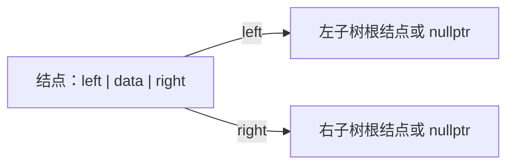
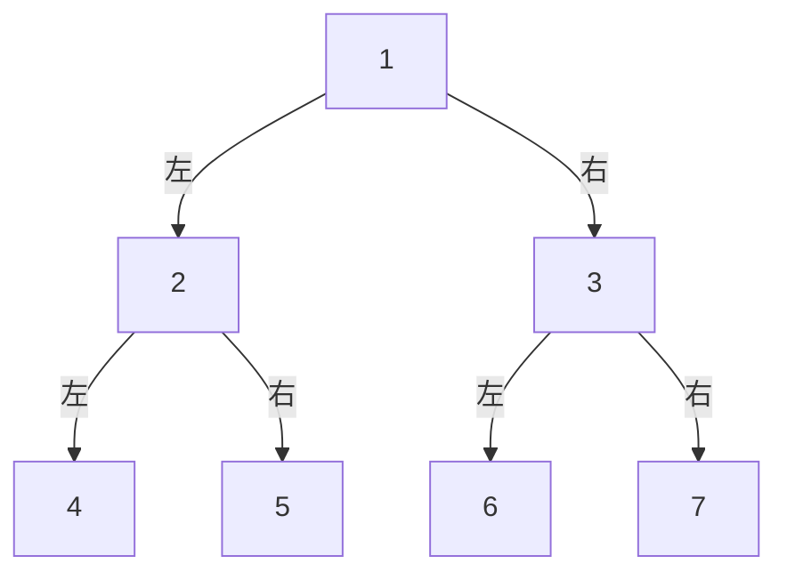
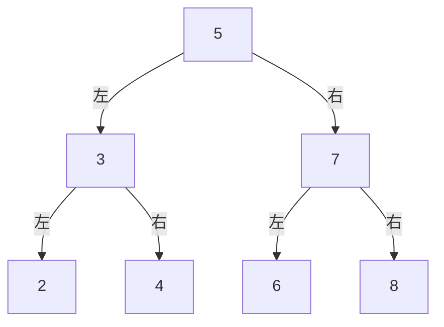
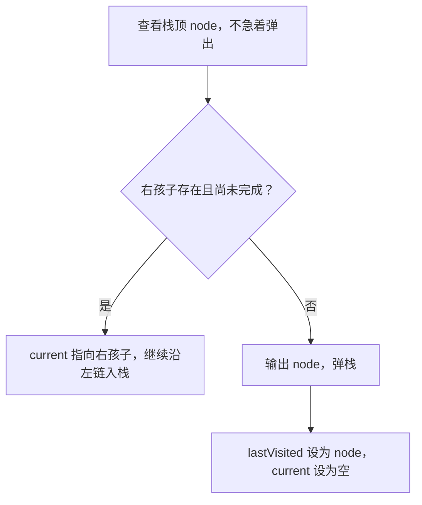
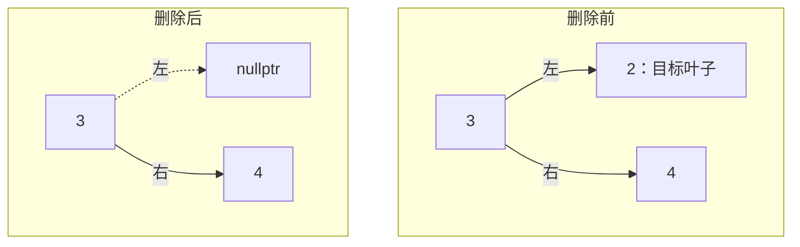
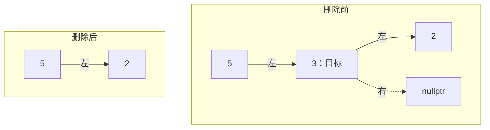
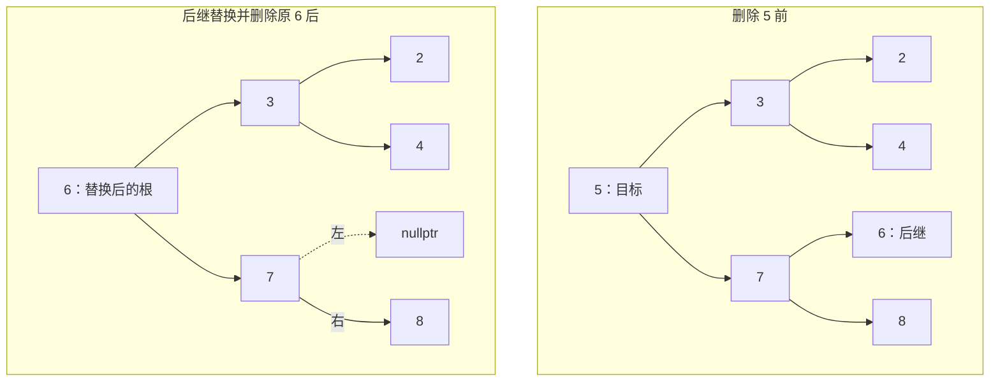
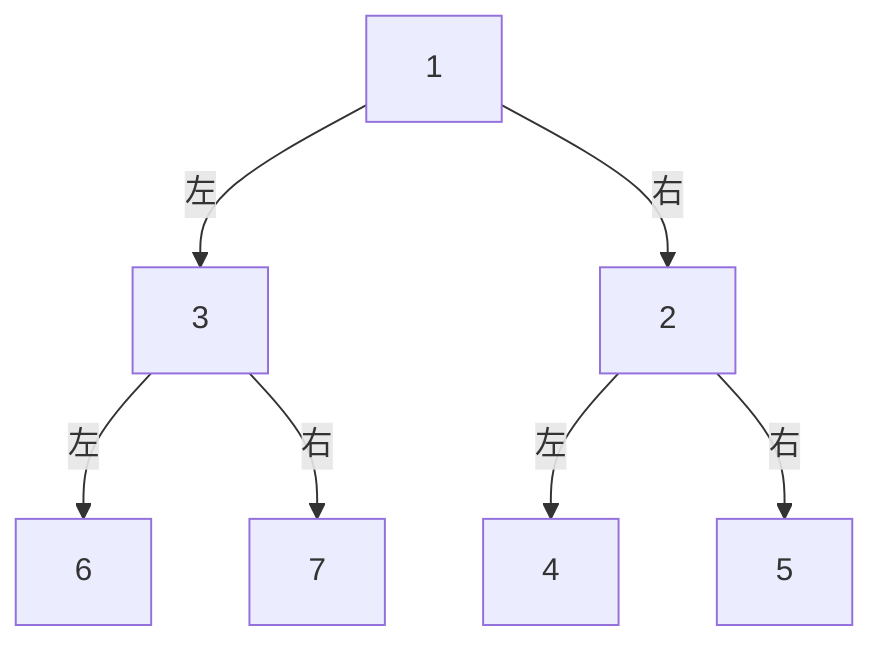

---
aliases:
  - 二叉树总结
  - 二叉树与二叉搜索树
tags:
  - 数据结构
  - 二叉树
  - Cpp
---

# 二叉树学习笔记

## 目录

- [[#1 基本概念与存储]]
- [[#2 统一示例与四种遍历]]
- [[#3 递归实现深度优先遍历]]
- [[#4 非递归实现遍历]]
- [[#5 二叉搜索树的查找与插入]]
- [[#6 二叉搜索树的删除]]
- [[#7 树高、结点数与最值]]
- [[#8 镜像交换二叉树]]
- [[#9 复杂度与选用方法]]
- [[#10 可运行示例与检查方法]]
- [[#11 易错点速查]]
- [[#12 原文对应与勘误说明]]

## 1 基本概念与存储

### 1.1 二叉树与二叉搜索树

**二叉树（Binary Tree）**中，每个结点最多有两个孩子，分别称为左孩子和右孩子。左右位置有区别：只有左孩子的树与只有右孩子的树并不是同一种结构。

**二叉搜索树（Binary Search Tree，BST）**是一种具有大小约束的二叉树。本文采用不允许重复键的约定：

- 左子树中**所有结点**的值都小于当前结点的值。
- 右子树中**所有结点**的值都大于当前结点的值。
- 左、右子树也分别满足同样的约束。

> [!warning] 普通二叉树不要求“左小右大”
> “左小右大”是 BST 的性质，且约束的是整棵子树，不只是左右孩子。遍历、求高、统计结点、镜像适用于普通二叉树；按大小查找、插入、删除和沿最左/最右路径找最值依赖 BST 性质。

术语也需要区分：**子结点/孩子**可以继续拥有孩子；**叶子结点**特指没有孩子的结点，不能把所有孩子都称为“子叶”。

### 1.2 结点结构与链式存储

链表结点通常保存数据和后继指针；二叉树的链式结点保存数据，以及两个孩子指针。



下文所有代码统一使用这一套定义。头文件只需要包含一次。

```cpp
#include <algorithm>
#include <iostream>
#include <queue>
#include <stack>
#include <utility>
#include <vector>

struct TreeNode {
    int data;
    TreeNode* left;
    TreeNode* right;

    explicit TreeNode(int value)
        : data(value), left(nullptr), right(nullptr) {}
};
```

### 1.3 数组与 vector

二叉树也可以顺序存储。若根位于数组下标 `0`，则下标为 `i` 的结点：

- 左孩子下标为 `2 * i + 1`。
- 右孩子下标为 `2 * i + 2`。

这种方式适合完全二叉树；稀疏树需要记录空位置，可能浪费空间。

`std::vector` 是动态数组，可以存储结点值、结点对象、指针或遍历结果，但它不会自动建立父子关系。若保存的是由 `new` 创建的结点指针，销毁 `vector` 也不会自动 `delete` 这些结点。

> [!note] 满二叉树与完全二叉树
> 按常见中文教材约定：满二叉树每一层都填满；完全二叉树除最后一层外均填满，最后一层的结点从左向右连续排列。满二叉树是完全二叉树的一种，二者不能直接画等号。本文以下三层七结点的示例同时属于两者。

## 2 统一示例与四种遍历

### 2.1 用编号理解结构

先用原文的七结点结构讨论遍历。图中的 `1～7` 是==位置编号==，不是 BST 的实际键值。



| 遍历方式 | 规则 | 编号输出顺序 |
| --- | --- | --- |
| 层序（BFS） | 逐层，从左到右 | `1 2 3 4 5 6 7` |
| 前序（DFS） | 根 → 左子树 → 右子树 | `1 2 4 5 3 6 7` |
| 中序（DFS） | 左子树 → 根 → 右子树 | `4 2 5 1 6 3 7` |
| 后序（DFS） | 左子树 → 右子树 → 根 | `4 5 2 6 7 3 1` |

> [!tip] 前、中、后指的是根何时被处理
> 三种 DFS 的区别在于：处理当前结点的动作放在递归左、右子树的前面、中间还是后面。“访问到结点”与“输出结点”不一定发生在同一时刻。

### 2.2 用实际数值验证 BST

将 `5 3 7 2 4 6 8` 依次插入空 BST，得到：



| 位置编号 | 1 | 2 | 3 | 4 | 5 | 6 | 7 |
| --- | --- | --- | --- | --- | --- | --- | --- |
| 实际数据 | 5 | 3 | 7 | 2 | 4 | 6 | 8 |

对应输出：

```text
层序：5 3 7 2 4 6 8
前序：5 3 2 4 7 6 8
中序：2 3 4 5 6 7 8
后序：2 4 3 6 8 7 5
```

> [!warning] 层序不等于插入顺序
> 此例恰好相同，不能推广。例如依次插入 `5 3 2 7`，层序结果是 `5 3 7 2`。有序数据依次插入普通 BST 则可能让树退化为链，例如插入 `1 2 3 4`。

## 3 递归实现深度优先遍历

### 3.1 前序：根、左、右

```cpp
void preorderRecursive(const TreeNode* node, std::vector<int>& result) {
    if (!node) return;
    result.push_back(node->data);
    preorderRecursive(node->left, result);
    preorderRecursive(node->right, result);
}
```

在编号示例中：先输出 `1`，递归处理整棵左子树 `2 4 5`，再递归处理整棵右子树 `3 6 7`。

适合需要先处理父结点的场景，例如复制树、生成表达式树的前缀表达式。若用于序列化并要求恢复任意树形，还需要额外记录空孩子或结构信息。

### 3.2 中序：左、根、右

```cpp
void inorderRecursive(const TreeNode* node, std::vector<int>& result) {
    if (!node) return;
    inorderRecursive(node->left, result);
    result.push_back(node->data);
    inorderRecursive(node->right, result);
}
```

编号示例中的关键步骤：

1. 从 `1` 向左到 `2`，再向左到 `4`。
2. `4` 的左子树为空，输出 `4`；右子树也为空，返回 `2`。
3. 输出 `2`，遍历它的右子树，输出 `5`。
4. 整棵左子树处理完毕，返回并输出 `1`。
5. 按同样规则处理右子树，得到 `6 3 7`。

BST 的中序遍历为升序结果（本文无重复键，因此严格递增）。普通二叉树仍然可以中序遍历，只是结果不一定排序；不能说普通二叉树的中序遍历“没有意义”。

### 3.3 后序：左、右、根

```cpp
void postorderRecursive(const TreeNode* node, std::vector<int>& result) {
    if (!node) return;
    postorderRecursive(node->left, result);
    postorderRecursive(node->right, result);
    result.push_back(node->data);
}
```

编号示例中：左子树先输出 `4 5 2`，右子树再输出 `6 7 3`，最后输出根 `1`。

适合父结点依赖子树结果的操作，例如求树高、统计结点数、表达式树求值，以及释放整棵树。

### 3.4 三种方法的共同点

三者都需要访问所有结点，时间复杂度均为 `O(n)`，递归辅助空间均为 `O(h)`。`n` 为结点数，`h` 为树高。

> [!warning] 后序不会因为“根最后处理”就递归得更深
> 对同一棵树，这三种常规递归实现的最大调用深度都由树高决定。平衡时为 `O(log n)`，退化为链时为 `O(n)`，都可能遇到调用栈溢出。

## 4 非递归实现遍历

递归依靠系统调用栈保存“之后还要做什么”；迭代算法用显式栈或队列保存待处理结点。

> [!note] 迭代的价值与边界
> 显式栈通常便于控制存储和避免过深的函数递归，但不意味着一定快很多、占用空间一定少很多。常规递归 DFS 与本文单栈 DFS 的时间、辅助空间量级分别都是 `O(n)` 和 `O(h)`，具体开销取决于实现。

### 4.1 层序遍历：队列，先进先出

算法：根入队；循环取出队首并处理，再将它的非空左、右孩子依次入队。

```cpp
std::vector<int> levelorder(const TreeNode* root) {
    std::vector<int> result;
    if (!root) return result;
    std::queue<const TreeNode*> q;
    q.push(root);
    while (!q.empty()) {
        const TreeNode* node = q.front();
        q.pop();
        result.push_back(node->data);
        if (node->left) q.push(node->left);
        if (node->right) q.push(node->right);
    }
    return result;
}
```

编号示例，队首写在左侧：

| 本轮处理 | 处理后队列 | 已输出 |
| --- | --- | --- |
| 初始 | `[1]` | 空 |
| 1 | `[2, 3]` | `1` |
| 2 | `[3, 4, 5]` | `1 2` |
| 3 | `[4, 5, 6, 7]` | `1 2 3` |
| 4、5、6、7 | 依次出队，直到空 | `1 2 3 4 5 6 7` |

适用于逐层处理、统计每层结点等场景。队列辅助空间为 `O(w)`，`w` 为最大层宽；最坏为 `O(n)`。

### 4.2 非递归前序：先压右，再压左

栈是后进先出。为了先处理左子树，需要让左孩子后入栈、先出栈。

```cpp
std::vector<int> preorderIterative(const TreeNode* root) {
    std::vector<int> result;
    if (!root) return result;
    std::stack<const TreeNode*> st;
    st.push(root);
    while (!st.empty()) {
        const TreeNode* node = st.top();
        st.pop();
        result.push_back(node->data);
        if (node->right) st.push(node->right);
        if (node->left) st.push(node->left);
    }
    return result;
}
```

以下栈底写在左侧，栈顶写在右侧：

| 弹出并处理 | 之后的栈 | 已输出 |
| --- | --- | --- |
| 初始 | `[1]` | 空 |
| 1 | `[3, 2]` | `1` |
| 2 | `[3, 5, 4]` | `1 2` |
| 4 | `[3, 5]` | `1 2 4` |
| 5 | `[3]` | `1 2 4 5` |
| 3 | `[7, 6]` | `1 2 4 5 3` |
| 6、7 | 最终为空 | `1 2 4 5 3 6 7` |

> [!failure] 反例：先压左，再压右
> 如果交换这两个 `push` 的顺序，结果变成“根、右、左”。编号示例输出 `1 3 7 6 2 5 4`，不是要求的前序结果。

### 4.3 非递归中序：沿左链入栈，弹出后转向右子树

```cpp
std::vector<int> inorderIterative(const TreeNode* root) {
    std::vector<int> result;
    std::stack<const TreeNode*> st;
    const TreeNode* current = root;
    while (current || !st.empty()) {
        while (current) {
            st.push(current);
            current = current->left;
        }
        current = st.top();
        st.pop();
        result.push_back(current->data);
        current = current->right;
    }
    return result;
}
```

记住循环模式：==一路向左 → 弹出并处理 → 转向右边==。

外层条件必须是 `current || !st.empty()`：当前指针为空时，栈中仍可能存在需要返回处理的祖先结点。

### 4.4 非递归后序：单栈与 lastVisited

左子树处理完返回父结点时，不能立刻输出父结点；还需要确认右子树是否处理完。用 `lastVisited` 保存==最近一次已经完成后序处理的结点==。

```cpp
std::vector<int> postorderIterative(const TreeNode* root) {
    std::vector<int> result;
    std::stack<const TreeNode*> st;
    const TreeNode* current = root;
    const TreeNode* lastVisited = nullptr;
    while (current || !st.empty()) {
        while (current) {
            st.push(current);
            current = current->left;
        }
        const TreeNode* node = st.top();
        if (node->right && lastVisited != node->right) {
            current = node->right;
        } else {
            result.push_back(node->data);
            st.pop();
            lastVisited = node;
            current = nullptr;
        }
    }
    return result;
}
```

栈顶的判断逻辑：



编号示例中，输出 `4` 后回到 `2`，因为右孩子 `5` 尚未处理，先进入 `5`；输出 `5` 后，`lastVisited == 2->right`，此时才能输出 `2`。

> [!warning] 后序不通用地遵循“先压右再压左”
> 上面是沿左链入栈，再依据右子树完成状态决定下一步。不能把非递归前序的入栈口诀套到所有后序算法。另一种后序做法是先生成“根、右、左”，最后反转为“左、右、根”；双栈、标记法也各有自己的规则。

## 5 二叉搜索树的查找与插入

### 5.1 按大小查找

查找目标值时，比当前结点小则向左，大则向右，相等则找到。

```cpp
const TreeNode* searchBST(const TreeNode* root, int value) {
    while (root) {
        if (value < root->data) root = root->left;
        else if (value > root->data) root = root->right;
        else return root;
    }
    return nullptr;
}
```

### 5.2 递归插入

走到空指针处，创建新结点；返回时，把更新后的子树根接回父结点。与原文代码一致，本文==忽略重复键==。

```cpp
TreeNode* insertBST(TreeNode* root, int value) {
    if (!root) return new TreeNode(value);
    if (value < root->data) {
        root->left = insertBST(root->left, value);
    } else if (value > root->data) {
        root->right = insertBST(root->right, value);
    }
    return root;
}
```

调用时要接住返回值：`root = insertBST(root, value);`。尤其原树为空时，这一步会更新整棵树的根指针。

插入、查找都沿一条路径进行，时间为 `O(h)`。若树较平衡则为 `O(log n)`，退化为链则为 `O(n)`；普通 BST 不会自动保持平衡。

## 6 二叉搜索树的删除

找到目标结点后，根据它的孩子数量分三种情况。以下示意沿用实际 BST 数值；图中虚线标注或文字表示空指针，不代表真实结点。

### 6.1 删除叶子结点

叶子没有孩子，释放后，将父结点指向它的位置置空。例如删除 `2`：



### 6.2 删除只有一个孩子的结点

让它唯一的孩子接替它的位置，再释放目标结点。假设 `3` 只有一个左孩子 `2`：



这与链表删除的“让前驱绕过目标结点”很相似。若目标本身是根，也要更新根指针。

### 6.3 删除有两个孩子的结点

有两种常见替换方案：

- **中序前驱**：左子树中最大的结点，即左子树一直向右找到的结点。
- **中序后继**：右子树中最小的结点，即右子树一直向左找到的结点。

以删除根 `5` 为例，采用后继 `6` 替换：

1. 找到右子树的最小结点 `6`。
2. 将 `6` 的数据复制到原来存放 `5` 的结点。
3. 在原右子树中删除原来的 `6`，并接好它可能存在的右孩子。



> [!warning] 两种替换都正确，但树形通常不同
> 选择前驱时，此例根变成 `4`；选择后继时，根变成 `6`。两者都保留删除后的键集合和 BST 性质，但不是同一棵树。前驱可能有左孩子，后继可能有右孩子，因此不能找到替换结点后直接释放而不重新连接孩子。

### 6.4 删除代码：使用中序后继

```cpp
TreeNode* eraseBST(TreeNode* root, int value) {
    if (!root) return nullptr;
    if (value < root->data) {
        root->left = eraseBST(root->left, value);
    } else if (value > root->data) {
        root->right = eraseBST(root->right, value);
    } else {
        if (!root->left) {
            TreeNode* replacement = root->right;
            delete root;
            return replacement;
        }
        if (!root->right) {
            TreeNode* replacement = root->left;
            delete root;
            return replacement;
        }
        TreeNode* successor = root->right;
        while (successor->left) successor = successor->left;
        root->data = successor->data;
        root->right = eraseBST(root->right, successor->data);
    }
    return root;
}
```

前两个分支同时覆盖“零个孩子”和“一个孩子”的情况。调用方式为 `root = eraseBST(root, value);`。目标不存在时，树保持不变。时间复杂度为 `O(h)`。

## 7 树高、结点数与最值

### 7.1 树高：统一按结点层数计算

本文约定：空树高度为 `0`，只有根结点的树高度为 `1`。

$$
H(T)=\begin{cases}
0, & T=\varnothing \\
1+\max(H(T_L),H(T_R)), & T\ne\varnothing
\end{cases}
$$

```cpp
int treeHeight(const TreeNode* root) {
    if (!root) return 0;
    return 1 + std::max(treeHeight(root->left), treeHeight(root->right));
}
```

> [!note] 高度也可能按边数定义
> 若课程定义为根到最深叶子的路径边数，则单结点树高为 `0`，非空树的高度比本文少 `1`，空树可约定为 `-1`。先明确口径，再写递推。原文的“路径长度”描述与空树返回 `0` 的代码存在口径混用，本文统一为结点层数。

### 7.2 结点总数：左子树加右子树再加自身

$$
N(T)=\begin{cases}
0, & T=\varnothing \\
1+N(T_L)+N(T_R), & T\ne\varnothing
\end{cases}
$$

```cpp
int countNodes(const TreeNode* root) {
    if (!root) return 0;
    return 1 + countNodes(root->left) + countNodes(root->right);
}
```

这里统计的是==所有结点==，不只是叶子。如果需要统计叶子，应在左右孩子都为空时返回 `1`，其他非空结点返回左右子树的叶子数之和。

### 7.3 BST 最小值与最大值

```cpp
const TreeNode* findMinBST(const TreeNode* root) {
    if (!root) return nullptr;
    while (root->left) root = root->left;
    return root;
}

const TreeNode* findMaxBST(const TreeNode* root) {
    if (!root) return nullptr;
    while (root->right) root = root->right;
    return root;
}
```

最小值在最左结点，最大值在最右结点，时间为 `O(h)`；返回空指针表示空树，调用者应先判断再访问 `data`。

> [!warning] 普通二叉树不能只沿一条路径找最值
> 普通二叉树需要遍历所有结点，最值可能出现在任意位置，时间为 `O(n)`。

## 8 镜像交换二叉树

### 8.1 镜像的含义

镜像是对==每一个结点==交换它的左右孩子指针。只交换根的两个孩子，仍然没有完成整棵树的镜像。

以编号示例说明，原树见 [[#2.1 用编号理解结构]]。仅交换根的左右子树后，中间状态是：



继续交换 `3`、`2` 及其他结点的左右孩子，最终得到：


最终镜像树的层序编号为 `1 3 2 7 6 5 4`。对实际数值示例，对应层序是 `5 7 3 8 6 4 2`。

> [!warning] BST 镜像后的顺序约束
> 原来的“左小右大”会变成“左大右小”。因此镜像后的树通常不再满足本文 BST 算法的前提，不能继续直接使用原来的按大小查找、插入、删除和最值函数。普通二叉树不需要任何大小关系也能镜像。

### 8.2 递归镜像

先处理当前结点，再递归处理交换后的两个子树。

```cpp
void mirrorRecursive(TreeNode* root) {
    if (!root) return;
    std::swap(root->left, root->right);
    mirrorRecursive(root->left);
    mirrorRecursive(root->right);
}
```

### 8.3 栈实现镜像

```cpp
void mirrorWithStack(TreeNode* root) {
    if (!root) return;
    std::stack<TreeNode*> st;
    st.push(root);
    while (!st.empty()) {
        TreeNode* node = st.top();
        st.pop();
        std::swap(node->left, node->right);
        // 以下指的是交换后的右、左孩子。
        if (node->right) st.push(node->right);
        if (node->left) st.push(node->left);
    }
}
```

这里采用“当前根 → 交换后的左子树 → 交换后的右子树”的处理顺序：

1. 处理 `1`，交换后左为 `3`、右为 `2`；先压 `2`，再压 `3`。
2. 弹出 `3`，交换后左为 `7`、右为 `6`；先压 `6`，再压 `7`。
3. 处理 `7`、`6`。
4. 弹出 `2`，交换后左为 `5`、右为 `4`；先压 `4`，再压 `5`。
5. 处理 `5`、`4`，结束。

处理顺序为 `1 3 7 6 2 5 4`。

> [!tip] 区分“最终树形”和“处理顺序”
> 单纯完成镜像时，只要每个结点恰好交换一次，先处理左子树还是右子树都可以。若还要求记录特定顺序，才需要严格对应入栈顺序。为避免原文中“原左/现右”的混淆，本文统一在交换后按当前指针命名。

### 8.4 队列实现镜像

```cpp
void mirrorWithQueue(TreeNode* root) {
    if (!root) return;
    std::queue<TreeNode*> q;
    q.push(root);
    while (!q.empty()) {
        TreeNode* node = q.front();
        q.pop();
        std::swap(node->left, node->right);
        if (node->left) q.push(node->left);
        if (node->right) q.push(node->right);
    }
}
```

编号示例中：处理 `1` 后入队 `3、2`；处理 `3` 后入队 `7、6`；处理 `2` 后入队 `5、4`，最终处理顺序为 `1 3 2 7 6 5 4`。

这里入队的是==交换后的非空孩子==，不是把已经处理完的当前结点再次入队。

### 8.5 三种方式的比较

| 方法 | 核心容器 | 辅助空间 | 特点 |
| --- | --- | --- | --- |
| 递归 | 系统调用栈 | `O(h)` | 代码短，深树可能调用栈溢出 |
| 栈迭代 | 显式栈 | `O(h)` | 显式保存待处理结点 |
| 队列迭代 | 队列 | `O(w)` | 按层处理，宽树的队列较大 |

三种方式时间均为 `O(n)`，最终树形相同，但处理顺序可能不同。镜像保持结点数和树高不变，连续镜像两次应恢复原树。

## 9 复杂度与选用方法

下表中 `n` 为结点数、`h` 为按层数定义的树高、`w` 为最大层宽。辅助空间不计输入树与返回结果容器；如果将遍历结果保存到 `vector`，还需要额外 `O(n)` 的输出空间。

| 操作 | 时间复杂度 | 辅助空间 | 适用前提 |
| --- | --- | --- | --- |
| 递归前序、中序、后序 | `O(n)` | `O(h)` | 普通二叉树 |
| 本文栈实现的前序、中序、后序 | `O(n)` | `O(h)` | 普通二叉树 |
| 层序遍历 | `O(n)` | `O(w)` | 普通二叉树 |
| BST 迭代查找 | `O(h)` | `O(1)` | 满足 BST 大小约束 |
| BST 递归插入、删除 | `O(h)` | `O(h)` | 满足 BST 大小约束 |
| 求树高、结点数 | `O(n)` | `O(h)` | 普通二叉树 |
| BST 迭代求最小、最大 | `O(h)` | `O(1)` | 满足 BST 大小约束 |
| 递归或栈镜像 | `O(n)` | `O(h)` | 普通二叉树 |
| 队列镜像 | `O(n)` | `O(w)` | 普通二叉树 |

选用方法：

- 要逐层观察：层序遍历。
- 要先处理父结点：前序。
- 要按升序枚举 BST：中序。
- 要先取得孩子结果或释放树：后序。
- 树可能很深：考虑显式栈，避免过深的函数递归；树本身仍可能占据线性空间。

## 10 可运行示例与检查方法

### 10.1 释放树与打印结果

本文代码用 `new` 创建结点，最后应使用 `delete` 释放。释放时先释放孩子，再释放父结点。

```cpp
void destroyTree(TreeNode* root) {
    if (!root) return;
    destroyTree(root->left);
    destroyTree(root->right);
    delete root;
}

void printValues(const char* label, const std::vector<int>& values) {
    std::cout << label;
    for (int value : values) std::cout << ' ' << value;
    std::cout << '\n';
}
```

### 10.2 示例主函数

将本文从上到下的所有 `cpp` 代码块依次拼接到同一个 `.cpp` 文件，即可得到完整程序。Mermaid、公式与 `text` 代码块不属于 C++ 程序。

```cpp
int main() {
    TreeNode* root = nullptr;
    for (int value : {5, 3, 7, 2, 4, 6, 8}) {
        root = insertBST(root, value);
    }

    std::vector<int> pre, in, post;
    preorderRecursive(root, pre);
    inorderRecursive(root, in);
    postorderRecursive(root, post);
    printValues("Level:", levelorder(root));
    printValues("Pre recursive:", pre);
    printValues("Pre iterative:", preorderIterative(root));
    printValues("In recursive:", in);
    printValues("In iterative:", inorderIterative(root));
    printValues("Post recursive:", post);
    printValues("Post iterative:", postorderIterative(root));
    std::cout << "Height: " << treeHeight(root) << '\n';
    std::cout << "Count: " << countNodes(root) << '\n';
    if (const TreeNode* p = findMinBST(root)) {
        std::cout << "Min: " << p->data << '\n';
    }
    if (const TreeNode* p = findMaxBST(root)) {
        std::cout << "Max: " << p->data << '\n';
    }

    root = eraseBST(root, 5);
    printValues("After deleting 5:", inorderIterative(root));
    mirrorRecursive(root);
    printValues("After mirror:", inorderIterative(root));
    mirrorRecursive(root);  // 恢复 BST，之后才能继续按原 BST 规则操作。
    destroyTree(root);
    root = nullptr;
    return 0;
}
```

编译与运行：

```bash
g++ -std=c++17 -Wall -Wextra tree_notes.cpp -o tree_notes
```

Linux/macOS 使用 `./tree_notes`；Windows PowerShell 使用 `.\tree_notes.exe`。此程序使用标准 C++，不依赖操作系统专属接口。

预期输出：

```text
Level: 5 3 7 2 4 6 8
Pre recursive: 5 3 2 4 7 6 8
Pre iterative: 5 3 2 4 7 6 8
In recursive: 2 3 4 5 6 7 8
In iterative: 2 3 4 5 6 7 8
Post recursive: 2 4 3 6 8 7 5
Post iterative: 2 4 3 6 8 7 5
Height: 3
Count: 7
Min: 2
Max: 8
After deleting 5: 2 3 4 6 7 8
After mirror: 8 7 6 4 3 2
```

### 10.3 自查清单

- [ ] 空树：遍历结果为空，树高与结点数均为 `0`，最值查找返回空指针。
- [ ] 单结点：三种 DFS 顺序相同；删除根后整棵树为空。
- [ ] 只有左孩子或只有右孩子：遍历与删除仍然正确。
- [ ] 三种 DFS：各自的递归版本与迭代版本输出相同。
- [ ] BST 删除：分别检查叶子、单孩子、双孩子和根结点。
- [ ] 不存在的键：查找返回空，删除不改变树；重复键插入被忽略。
- [ ] 镜像：三种方法得到相同结构；镜像两次恢复原结构。
- [ ] 释放：所有 `new` 出来的结点最终被释放，没有继续访问已释放结点。

## 11 易错点速查

> [!summary] 复习时先记住这些
> 1. 二叉树不一定是 BST；“左小右大”约束整棵子树。
> 2. 前序根在前，中序根在中，后序根在后。
> 3. 栈后进先出，队列先进先出。
> 4. 本文非递归前序先压右、再压左；中序沿左链；后序用 `lastVisited` 判断右子树完成状态。
> 5. 三种递归 DFS 的最大深度都由树高决定。
> 6. 插入和删除后，接住返回的子树根指针。
> 7. 删除双孩子结点可选前驱或后继；两种结果都合法，但树形可能不同。
> 8. 高度计算必须统一按边数还是按结点层数。
> 9. 结点总数是左子树总数加右子树总数再加 `1`。
> 10. 镜像要交换每个结点的左右孩子；镜像后的 BST 不能继续直接套用原来的比较规则。

