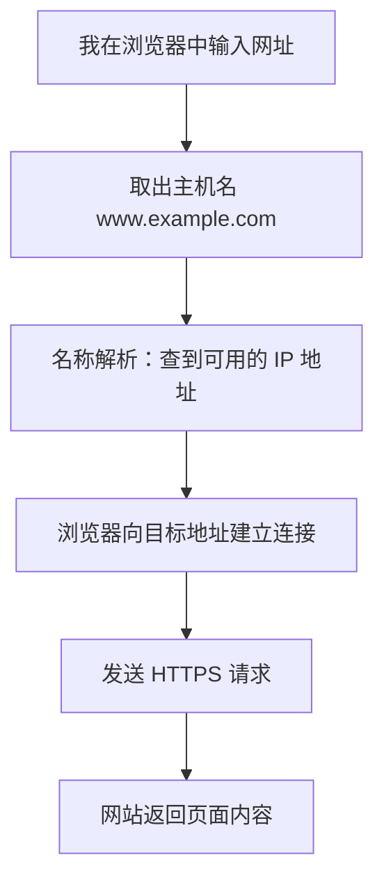
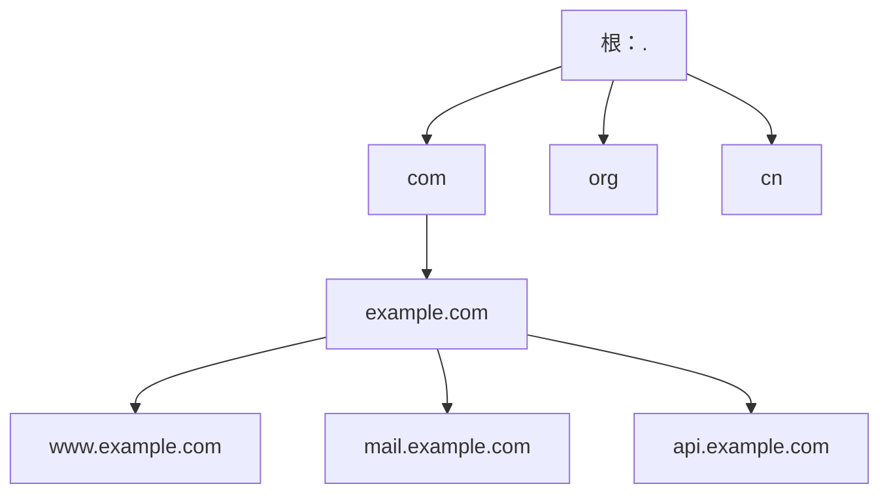
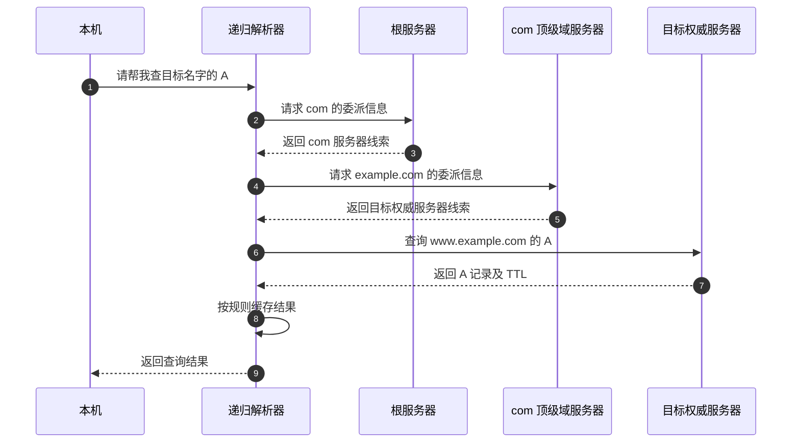
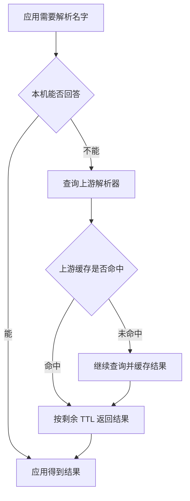

# DNS 协议学习笔记

> [!abstract] 先回答：DNS 到底是干什么的？
> **DNS 最常见的作用，是根据域名查询 IP 地址，让应用知道应该连接哪里。**
>
> DNS 的全称是 **Domain Name System**，中文叫**域名系统**。
>
> 比如，我输入 `www.example.com`，应用需要先知道这个名字对应哪些 IP，才能尝试建立连接。
>
> 再往深一点理解：DNS 是一个**分层、分布式的命名系统**；DNS 协议规定了怎样询问和返回与域名有关的数据。它能查的也不只有 IP。

> [!tip] 建议怎么读
> - **先搞清用途**：读第一至四节，理解“为什么查、谁来查、向谁查”。
> - **再理解机制**：读第五至七节，认识记录、缓存和报文。
> - **动手看一次**：做第十节的查询，再做第十一节的抓包。
> - 标着“进阶”的折叠内容可以留到第二遍。
>
> 本文使用 Obsidian 原生支持的属性、双链、Callout、脚注和 Mermaid，不依赖额外插件。

## 目录

- [[#一、为什么需要 DNS|一、为什么需要 DNS]]
- [[#二、域名、IP、URL 分别是什么|二、域名、IP、URL 分别是什么]]
- [[#三、域名为什么是一层一层的|三、域名为什么是一层一层的]]
- [[#四、一次 DNS 查询是怎样完成的|四、一次 DNS 查询是怎样完成的]]
- [[#五、DNS 实际查到的是什么|五、DNS 实际查到的是什么]]
- [[#六、为什么第二次查询通常更快|六、为什么第二次查询通常更快]]
- [[#七、从协议角度看 DNS|七、从协议角度看 DNS]]
- [[#八、查询失败分别意味着什么|八、查询失败分别意味着什么]]
- [[#九、DNS 安全机制解决什么问题|九、DNS 安全机制解决什么问题]]
- [[#十、动手实验：在 Windows 上查一次 DNS|十、动手实验：在 Windows 上查一次 DNS]]
- [[#十一、动手实验：用 Wireshark 看见 DNS|十一、动手实验：用 Wireshark 看见 DNS]]
- [[#十二、容易混淆的地方与自测|十二、容易混淆的地方与自测]]
- [[#十三、复习速记|十三、复习速记]]

> [!note] 关于示例
> 文中的 `example.com`、`example.net` 用于讲解；记录示例中的 `192.0.2.10`、`192.0.2.20`、`2001:db8::10` 是文档用地址，**不代表这些域名的真实解析结果**。命令实验应观察自己查到的结果，不要照着示例 IP 判断对错。[^examples]

## 一、为什么需要 DNS

### 1.1 人习惯记名字，网络通信需要地址

我想访问一个网站，容易记住的是：

```text
www.example.com
```

但应用要向远端发送网络数据，需要获得可用的 IP 地址。DNS 就承担了其中的“按名字查地址”这一步。



可以先把 DNS 类比成通讯录：我知道联系人的姓名，通讯录帮我找到号码；找到号码后，接下来才是拨号和通话。

> [!important] 抓住 DNS 和网站之间的分工
> **DNS 返回查询结果；浏览器随后连接网站。**
>
> 普通 DNS 服务器不会代替网站把 HTML、图片和视频传给我。它返回的地址也可能是 CDN 节点或负载均衡入口，未必是最终保存网页的那台机器。

### 1.2 为什么不直接记 IP

除了 IP 难记，名字和地址分开还有实际好处：

| 情况 | 使用 DNS 后可以怎样处理 |
| --- | --- |
| 网站迁移到新服务器 | 更新解析记录，访问者继续使用原来的域名 |
| 一个网站部署多个入口 | 一个名字可以返回多个地址 |
| 多个网站共用一个入口 | 多个域名可以解析到同一个地址 |
| 用户分布在不同地区 | 可以配合 CDN 等机制返回不同的服务入口 |

**域名与 IP 并不是一一对应的。** DNS 也不负责根据地理位置给数据包选择路线，后续通信仍依赖 IP 路由。

### 1.3 为什么不让全世界共用一份 hosts 文件

`hosts` 可以把一些名字直接映射到地址，适合本机少量配置。如果全球所有机器都靠同一份名单，就会遇到名单过大、更新困难、集中管理压力大等问题。

DNS 的做法是：**把名字组织成树，把不同部分交给不同管理者，再用统一协议查询。** 这样不需要一台服务器保存全球所有网站的完整记录。[^architecture]

## 二、域名、IP、URL 分别是什么

看一个完整网址：

```text
https://www.example.com:443/docs/dns?from=note#intro
```

| 部分 | 本例中的内容 | 用途 |
| --- | --- | --- |
| 方案 | `https` | 表示使用 HTTPS 访问 |
| 主机名 | `www.example.com` | 本例中需要进行名称解析的名字 |
| 端口 | `443` | 连接目标服务的端口；HTTPS 的默认端口是 443 |
| 路径 | `/docs/dns` | 告诉网站要访问哪个资源 |
| 查询参数 | `from=note` | 向网站传递参数 |
| 片段 | `intro` | 通常供浏览器定位页面内的位置，不作为普通 HTTP 请求目标发送 |

在最基本的地址查询里，DNS 收到的问题类似：

```text
www.example.com 的 A 记录是什么？
```

而不是把整条 URL 交给 DNS。`A` 表示查询 IPv4 地址；查询 IPv6 地址用 `AAAA`。

> [!question] 电脑网络设置里的“DNS 地址”，也是网站地址吗？
> 网络设置里的 DNS 服务器地址，表示**我的电脑向谁查询 DNS**。
>
> 查询结果里的 IP，表示**应用接下来可以尝试连接哪个服务地址**。
>
> 比如 DNS 服务器可能是家里的路由器 `192.168.1.1`，而它返回的网站地址是另一个 IP。路由器在这里可能只是把 DNS 请求转发给上游。

> [!info]- 补充：DNS 地址最初从哪里来？
> 常见来源包括网络自动配置、用户手动设置，以及 VPN 或应用自己的配置。浏览器也可能使用单独设置的加密 DNS 服务，因此它的解析路径不一定完全等于系统配置。
>
> 递归解析器则可以预先配置根服务器的地址信息，称为 **root hints（根提示）**，从而开始查询，不需要先查“根服务器的域名”。

## 三、域名为什么是一层一层的

### 3.1 从右往左看层级

更完整的写法是：

```text
www.example.com.
```

最右侧的点表示到达 DNS 的根。平时输入网址通常省略这个末尾的点。



对这个例子来说：

- `com` 是顶级域，英文缩写 **TLD**。
- `example.com` 是 `com` 下的域名。
- `www.example.com` 是 `example.com` 下的一个名字。
- 每个点之间的部分叫一个 **label（标签）**。

`www` 只是常见命名习惯，没有“必须带 www 才能访问网页”的协议要求。`example.com` 和 `www.example.com` 是两个不同的名字，需要分别配置相应记录或别名关系。

> [!warning] 不要把域名层级当成固定模板
> 这里的 `example.com` 恰好是常见的注册形式，但不能据此认为“所有可注册域名都只有两段”。不同后缀的注册规则可能不同。

### 3.2 层级怎样帮助管理

可以这样理解管理关系：

```text
根：知道各顶级域的权威服务器信息
  ↓
com：知道 example.com 被委派给哪些权威服务器
  ↓
example.com 的权威服务器：保存其负责区域中的记录
```

这里的“交给谁管理”叫 **委派（delegation）**。父级通过相关的 `NS` 等信息，让查询者找到下一层负责的服务器。

> [!info]- 进阶：域名与区域（zone）有什么区别？
> **域（domain）**强调名字树中的一棵子树；**区域（zone）**强调由一组权威服务器负责管理的数据范围。
>
> 比如 `example.com` 可以把 `dev.example.com` 委派给另一组服务器。此时 `dev.example.com` 仍属于 `example.com` 的域名子树，但它的数据主要由另一个区域负责。
>
> 如果被委派的服务器名恰好在该子域内部，父区可能还需要提供相应的地址信息，称为 **glue（胶水记录）**，避免为了找到服务器地址又必须先联系那台服务器的循环依赖。[^terminology]

## 四、一次 DNS 查询是怎样完成的

### 4.1 先认清几个角色

| 角色 | 主要任务 | 可以怎么理解 |
| --- | --- | --- |
| 应用、本机解析组件 | 发起名称解析，利用本机可用信息或向上游查询 | 提出问题的人 |
| 递归解析器 | 接受客户端请求，查询缓存，必要时向其他 DNS 服务器继续查询 | 负责把结果查回来的人 |
| 根服务器 | 对根区的数据提供权威服务，能给出顶级域的委派信息 | 帮忙找到顶级域的负责人 |
| 顶级域服务器 | 对相应顶级域提供权威服务，能给出下级域的委派信息 | 帮忙找到下一层负责人 |
| 目标区域的权威服务器 | 对自己负责的区域提供记录答案 | 负责发布这一部分资料的人 |

本机只负责向上游提问的轻量解析组件，常称为 **存根解析器（stub resolver）**。它通常不自己完成整套迭代查询。

> [!note] “权威”描述的是职责
> 根服务器和顶级域服务器，本身也是各自区域的权威服务器。上表把它们分开，是为了看清查询过程。
>
> “递归解析器”和“权威服务器”也是逻辑角色，理解时要看它当前对什么数据、为谁提供什么服务。

### 4.2 没有相关缓存时，完整过程长什么样

下面假设：查询 `www.example.com` 的 A 记录；相关缓存未命中；没有 CNAME；递归解析器自己沿委派关系查询。



抓住图里的两件事：

1. **向根、顶级域和目标权威服务器分别发起查询的，通常是递归解析器。**
2. 根和顶级域服务器通常给出下一步线索；目标区域的权威服务器才提供本例最终需要的 A 记录。

根服务器不会为了这个请求，把完整查询一路转交下去，再把网站 IP 一层层传回来。

> [!info] 这是用于理解职责的简化图
> 实际查询可能直接命中缓存、经过上游转发器、追踪别名，或遇到更多层委派。启用查询名最小化时，解析器也可能只向上级发送当前所需的较短名字。
>
> 因此，不要把图中的消息理解成“每次查 DNS 都固定发送这些报文”。

### 4.3 递归查询与迭代查询，分别指什么

| 名称 | 请求方期待什么 | 本例发生在哪里 |
| --- | --- | --- |
| **递归查询** | 请你替我完成查询，返回结果或错误 | 我的电脑向递归解析器提出请求 |
| **迭代查询** | 你知道就回答；否则告诉我可以继续问谁 | 解析器沿根、顶级域、目标区域逐步查询 |

记忆方式：

```text
递归：你替我查完。
迭代：我根据你给的线索继续查。
```

**同一次解析里，可以同时出现“客户端请求递归服务”和“解析器执行迭代查询”。** 两个词描述的是不同交互，不是两套互斥的 DNS。[^terminology]

### 4.4 查询结束后，DNS 的任务就基本完成了

浏览器拿到地址后，再尝试连接网站。对于常见的 HTTPS 访问：

- HTTP/1.1、HTTP/2 通常使用 TCP 与 TLS。
- HTTP/3 使用 QUIC，通常运行在 UDP 上。

所以需要区分：**DNS 查询使用的传输方式**，与**访问网站使用的传输方式**。两者是不同通信。

## 五、DNS 实际查到的是什么

### 5.1 DNS 查询的是资源记录

DNS 中的数据以 **资源记录（Resource Record，RR）** 表示。一次典型查询至少要说明“查哪个名字”和“查哪种记录”。

| 类型 | 用途 | 学习时先记住什么 |
| --- | --- | --- |
| `A` | 名字 → IPv4 地址 | 查 IPv4 |
| `AAAA` | 名字 → IPv6 地址 | 查 IPv6，读作四个 A |
| `CNAME` | 一个名字 → 另一个名字 | 别名，目标仍是域名 |
| `NS` | 指定区域的权威服务器名字 | 找谁负责 |
| `MX` | 指定邮件接收服务器 | 邮件投递相关；优先级数字越小通常越优先 |
| `TXT` | 保存文本数据 | 常用于域名验证、邮件策略等 |
| `PTR` | 在反向解析树中查询名字 | 常用于按 IP 反查名字 |
| `SOA` | 描述区域的管理与同步信息 | 包含序列号等区域信息，也参与否定缓存机制 |

常见基础记录的定义见 RFC 1035；AAAA 的定义见 RFC 3596。[^records]

> [!info]- 进阶：DNS 还可以帮助发现服务
> `SRV` 可以描述服务目标、端口、优先级和权重；`HTTPS` / `SVCB` 可以发布连接服务所需的相关参数。
>
> 所以，“DNS 只是域名转 IP”适合入门记忆，但不是完整定义。[^service-records]

### 5.2 看懂一条记录

```text
www.example.com.  300  IN  A  192.0.2.10
```

| 字段 | 本例 | 意思 |
| --- | --- | --- |
| 名称 | `www.example.com.` | 这条记录属于哪个名字 |
| TTL | `300` | 缓存生存时间，单位是秒 |
| 类 | `IN` | Internet 类；日常主要接触这一类 |
| 类型 | `A` | 数据是一条 IPv4 地址 |
| 记录数据 | `192.0.2.10` | 对应的 IPv4 地址 |

**TTL 控制记录能缓存多久，不是这台网站服务器还能存活多久。**

### 5.3 CNAME 为什么不是直接返回 IP

假设有这样的记录片段：

```text
www.example.com.  300  IN  CNAME  edge.example.net.
edge.example.net. 300  IN  A      192.0.2.20
```


我查 `www.example.com` 的地址时，解析过程可能需要继续追踪 `edge.example.net`，最后取得地址记录。解析器可能把别名链与最终地址一起返回，也可能需要额外查询。

> [!warning] CNAME 不等于网页跳转
> CNAME 发生在名称解析过程中，浏览器地址栏通常仍保留原来的网址。
>
> HTTP 的 `301` / `302` 等重定向发生在收到 HTTP 响应之后，是网站让浏览器改去另一个 URL。

## 六、为什么第二次查询通常更快

### 6.1 缓存减少重复查询

浏览器、本机解析组件、路由器或转发器、递归解析器等位置都可能存在缓存，具体取决于实现和配置。



> [!note] 不要死记一条固定缓存顺序
> 可以先理解为“尽量利用已有结果，再发网络查询”。不同浏览器、操作系统、VPN 和加密 DNS 设置，可能使用不同路径，不能统一写死成“浏览器 → hosts → 系统 → 路由器”。

### 6.2 TTL 怎样影响缓存

假设解析器在 10:00 收到一条 TTL 为 300 秒的记录，在正常缓存规则下：

| 时间 | 缓存状态 |
| --- | --- |
| 10:00 | 收到答案，开始缓存 |
| 10:02 | 大约还剩 180 秒，可继续使用缓存 |
| 10:05 左右 | TTL 耗尽，通常需要重新查询或刷新 |

普通缓存命中并不会因为“又有人查了一次”就自动恢复成最初的 300 秒。实现还可能采用预取、TTL 限制或故障时使用过期数据等策略，所以这是基础模型。

### 6.3 修改解析记录，为什么有人马上看到，有人还看到旧地址

因为不同解析器可能在不同时间缓存了旧记录，剩余 TTL 不同。修改权威记录，不会立即清除所有客户端和解析器手里的旧结果。

这也是所谓“DNS 生效需要时间”的常见原因，此外还可能涉及权威服务器同步、应用缓存等因素。

> [!tip] TTL 的取舍
> TTL 较短，通常更容易让后续查询看到变更，但会增加查询量；TTL 较长，通常有利于减少重复查询，但旧结果可能保留更久。
>
> 临时把 TTL 从 3600 改成 60，**不会让已经按 3600 秒缓存的旧副本立刻失效**。

### 6.4 “不存在”也可能被缓存

DNS 不只缓存查到的记录，也可以缓存“名字不存在”或“没有这个类型的记录”，这叫 **否定缓存（negative caching）**。

因此，我第一次查一个尚未配置的名字，随后才新增记录，再查询时仍可能暂时得到否定结果。[^negative-cache]

## 七、从协议角度看 DNS

### 7.1 DNS 在哪一层，用什么端口

DNS 是应用层协议。传统 DNS 通常通过 **UDP 53** 或 **TCP 53** 提供服务；这里的 53 是 DNS 服务端的端口，客户端源端口通常是临时端口。[^transport]

```text
传统 DNS over UDP 的封装关系

链路层帧
└── IP 数据包
    └── UDP 数据报
        └── DNS 消息
```

一个查询和对应响应可以理解为：

```text
请求：我的电脑:临时端口  → DNS服务器:53
响应：DNS服务器:53      → 我的电脑:原来的临时端口
```

> [!warning] DNS 并非“只用 UDP”
> 普通查询也能使用 TCP。UDP 响应被截断、需要重试时，常会转用 TCP；区域传送也是 TCP 的典型场景。
>
> 基础 DNS 的 UDP 消息曾有 512 字节限制，但 EDNS(0) 扩展可以通告更大的接收能力。不要简单记成“超过 512 字节就一定走 TCP”。[^transport]

### 7.2 查询和响应使用相同的基本结构

```text
+----------------------------------------------+
| Header：消息头，固定 12 字节                  |
+----------------------------------------------+
| Question：问题区，问什么名字、什么类型        |
+----------------------------------------------+
| Answer：回答区，与所问问题相关的答案记录     |
+----------------------------------------------+
| Authority：权威区，可含委派 NS、否定答案 SOA |
+----------------------------------------------+
| Additional：附加区，可含辅助地址、OPT 等      |
+----------------------------------------------+
```

这些区的条目数可以为零。附加区中的 `OPT` 是 EDNS 使用的伪资源记录，不是某个域名普通发布的一条地址记录。[^wire]

一个基本的 A 查询，其问题区大致是：

```text
QNAME  = www.example.com.   # 查哪个名字
QTYPE  = A                  # 查哪种记录
QCLASS = IN                 # 查哪个类，通常是 Internet
```

### 7.3 抓包时先看这些字段

| 字段 | 含义 | 怎么理解 |
| --- | --- | --- |
| `ID` | 16 位事务标识 | 帮助匹配请求和响应，还要结合地址、端口、问题等信息 |
| `QR` | 查询 / 响应标志 | 0 是查询，1 是响应 |
| `AA` | Authoritative Answer | 回答是否具有相应的权威属性 |
| `TC` | Truncated | 消息是否被截断 |
| `RD` | Recursion Desired | 客户端是否请求递归服务 |
| `RA` | Recursion Available | 服务器是否声明提供递归服务 |
| `RCODE` | 响应码 | 查询结果的状态 |
| `QDCOUNT` | 问题条目数 | 典型标准查询通常是 1 |
| `ANCOUNT` | 回答记录数 | 回答区里有多少条记录 |
| `NSCOUNT` | 权威区记录数 | 名字里的 NS 不代表该区只能放 NS 记录 |
| `ARCOUNT` | 附加区记录数 | 附加区里有多少条记录 |

> [!important] RD、RA、AA 分别回答不同问题
> - `RD=1`：客户端希望服务器替它完成查询。
> - `RA=1`：服务器声明提供递归服务，**不代表本次一定向根服务器发过查询**。
> - `AA=0`：不能据此认定结果错误；递归解析器返回的正常答案通常也不带权威回答标志。

## 八、查询失败分别意味着什么

| 状态 | 含义 | 不应该直接得出的结论 |
| --- | --- | --- |
| `NOERROR`，并有相关答案 | 查询正常获得结果 | 网站页面一定能打开 |
| `NOERROR`，但属于 `NODATA` 情况 | 名字有效，但没有所问类型的记录 | 整个域名不存在 |
| `NXDOMAIN` | DNS 表示所查名字不存在 | 只缺一条 A 记录 |
| `SERVFAIL` | 服务器无法完成解析 | 域名一定不存在 |
| `REFUSED` | 服务器拒绝提供这次查询服务 | 服务器一定断网了 |
| 超时 | 在等待时间内没有得到响应 | 收到了 NXDOMAIN |

例如，一个名字可能有 A 记录但没有 AAAA 记录。查 AAAA 得不到该类型的数据，不等于这个名字不存在。

`SERVFAIL` 的可能原因包括上游不可达、委派或服务配置异常、DNSSEC 验证失败等，需要结合更多信息判断。[^response-codes]

> [!note] NODATA 不是独立的报文响应码
> NODATA 是对一种响应情况的描述，通常表现为 `RCODE=NOERROR`，同时没有所问类型的相关答案。
>
> 但“回答区为空”也可能出现在委派响应里，不能只看 `ANCOUNT=0` 就下结论，要结合权威区等内容。

> [!warning] DNS 成功，只说明其中一环成功
> 取得 IP 后，仍可能因为路由、端口、防火墙、TLS 证书、Web 服务或应用问题而访问失败。
>
> `ping` 使用的 ICMP 也可能被禁止，所以“ping 不通”本身不能证明 DNS 出错。

## 九、DNS 安全机制解决什么问题

先区分两类疑问：**查询沿途会不会被看到或篡改**，以及**结果是否来自正确的数据来源**。

| 机制 | 主要解决什么 | 不能据此保证什么 |
| --- | --- | --- |
| 传统明文 DNS | 提供名称查询 | 查询内容的传输保密性 |
| `DoT`，DNS over TLS | 使用 TLS 保护 DNS 传输；专用服务通常使用 TCP 853 | 所选解析器本身一定可信 |
| `DoH`，DNS over HTTPS | 使用 HTTPS 承载 DNS；通常使用 443 端口 | 解析器后面的整条查询链自动全部加密 |
| `DNSSEC` | 通过签名与信任链验证 DNS 数据来源和完整性 | 查询内容被加密、网站业务本身安全 |

> [!important] 加密传输与数据验证是两件事
> **DoH / DoT 保护相应的传输链路；DNSSEC 验证支持签名的数据。**
>
> 比如电脑使用 DoH 向递归解析器查询，这能保护这段 HTTPS 通信，但解析器仍然能看到它所接收的查询；解析器如何向权威服务器查询，需要另看它的配置。

DNSSEC 需要相关区域正确部署签名，并由验证方实际执行验证。它不会因为“使用了 DNS”就自动生效。[^security]

## 十、动手实验：在 Windows 上查一次 DNS

打开 **PowerShell 或 Windows Terminal 的 PowerShell 标签页**。下面的查询与查看命令不会修改系统 DNS 配置；清缓存单独放在可选折叠块里。

### 实验 1：看看系统配置了哪些 DNS 服务器

```powershell
Get-DnsClientServerAddress |
    Where-Object { $_.ServerAddresses.Count -gt 0 } |
    Select-Object InterfaceAlias, AddressFamily, ServerAddresses
```

主要看：

- `InterfaceAlias`：哪个网络接口，比如 Wi-Fi、以太网或 VPN。
- `ServerAddresses`：该接口配置的 DNS 服务器地址。

也可以使用：

```powershell
ipconfig /all
```

找到当前使用的适配器，查看“DNS 服务器”。有多个接口时，不要直接把输出第一行当成当前上网接口。[^windows-config]

### 实验 2：查一个域名的 IPv4 与 IPv6

```powershell
nslookup -type=A example.com.
nslookup -type=AAAA example.com.
```

观察三个地方：

1. 开头的 `Server` / `服务器` 与 `Address` / `地址`：正在向哪个 DNS 服务器查询。
2. 后面答案中的名字与地址：查到的目标结果。
3. 有没有多个地址：一个名字可能返回多条地址记录。

下面只是**输出结构示意，不是实际查询记录**：

```text
Server:  router.home
Address: 192.168.1.1

Non-authoritative answer:
Name:    example.com
Address: 192.0.2.10
```

这里的 `192.168.1.1` 是被询问的 DNS 服务器，最后的 `192.0.2.10` 才是示意中的目标地址。

> [!question] “非权威应答”是不是不可信？
> 它表示这次应答不是以目标区域权威回答的身份给出的。递归解析器正常返回结果时经常出现这个提示，不能把它理解成“假的答案”。
>
> 同样，开头的服务器名显示 `UnKnown`，单独看也不能证明它无法提供 DNS 服务，仍要看后面的查询状态。

### 实验 3：用 PowerShell 看记录字段和 TTL

```powershell
Resolve-DnsName -Name example.com. -Type A -DnsOnly -NoHostsFile |
    Select-Object Name, Type, TTL, IPAddress
```

- `-Type A`：查 IPv4 地址记录。
- `-DnsOnly`：使用 DNS 查询，不使用 LLMNR、NetBIOS 这些其他名称解析协议。
- `-NoHostsFile`：这次查询不使用 hosts 文件中的映射。

隔几秒再执行，比较 `TTL`。可能看到剩余 TTL 减少，也可能受缓存层次、刷新和实现策略影响；不要要求每次结果都按相同方式变化。

> [!note] 工具查询与浏览器解析可能走不同路径
> `nslookup`、`Resolve-DnsName` 和浏览器，使用本机缓存、hosts、加密 DNS 等的方式可能不同。
>
> 命令能查到答案，是排查证据；不能单凭这一点就保证浏览器一定使用了同一份答案。命令参数说明见 Microsoft 文档。[^windows-query]

### 实验 4：查“谁负责这个区域”

```powershell
nslookup -type=NS example.com.
nslookup -type=SOA example.com.
```

- NS 查询关注权威服务器的名字；它们不是网站内容服务器的地址。
- SOA 查询关注区域管理信息，比如序列号。
- 通过递归解析器查询 NS 记录，仍可能显示非权威应答：**查到权威服务器名单**和**这次响应由权威服务器直接给出**是两件事。

### 实验 5：观察一个明确用于“不存在”的名字

```powershell
nslookup -type=A no-such-host.dns-note.invalid.
```

`.invalid` 是为无效名字保留的特殊用途后缀。正常预期是得到不存在的结果，例如 `NXDOMAIN` 或“Non-existent domain”，而不是 IP 地址。[^invalid]

如果看到的是超时，说明没有及时收到答案，不能把超时当成观察到了 NXDOMAIN。

### 实验 6：查看本机 DNS 缓存

```powershell
ipconfig /displaydns
```

这是 **Windows DNS 客户端缓存**，并不是浏览器、路由器和上游解析器所有缓存的总和。并且，不能假设刚才每一种工具查询都会在这里留下相同的条目。[^windows-cache]

> [!tip]- 可选：清除 Windows DNS 客户端缓存
> 排查确有需要时，可以运行 `ipconfig /flushdns`；如果系统提示权限不足，再使用管理员终端。
>
> 它只清除相应的本机缓存，**不会清空上游递归解析器或整个互联网的缓存**，浏览器自己的缓存也可能仍在。

> [!example]- 可选：向指定服务器查询一次
> 从实验 1 中选择一个要测试的 DNS 服务器 IP，然后在 PowerShell 中执行：
>
> ```powershell
> $dnsServer = Read-Host "输入要查询的 DNS 服务器 IP"
> Resolve-DnsName -Name example.com. -Type A -Server $dnsServer -DnsOnly -NoHostsFile
> ```
>
> 比如，实验 1 显示当前接口配置的是 `192.168.1.1`，就输入这个地址；不要直接照搬别人的局域网地址。
>
> 这只指定这一次命令询问哪个服务器，不会修改系统 DNS 设置。结果不同还可能与缓存、CDN 或内外网视图有关，不能只凭“不同”判断谁出错。

## 十一、动手实验：用 Wireshark 看见 DNS

### 11.1 抓到一次查询与响应

1. 打开 **Wireshark**，在接口列表中找到正在使用的网卡，例如 Wi-Fi 或以太网。通常能看到流量曲线；使用 VPN 时，也可能要选择实际承载流量的虚拟接口。
2. 双击该接口开始抓包。
3. 在窗口上方的**显示过滤器**中输入 `dns`，按 Enter。
4. 切换到 PowerShell，执行：

   ```powershell
   nslookup -type=A example.com.
   ```

5. 切回 Wireshark，点击工具栏上的停止按钮。
6. 为了减少干扰，把显示过滤器改成：

   ```text
   dns && dns.qry.name == "example.com"
   ```

7. 在报文列表中选择一条查询，展开下方的 **Domain Name System**。重点看 `Transaction ID`、`Flags`、`Queries`。
8. 再找对应响应，比较事务 ID、问题名字、两端地址和端口，并查看 `Answers` 里的类型、TTL、地址等字段。

**希望观察到的关系：**

```text
我的电脑  → DNS服务器：Standard query，A，example.com
DNS服务器 → 我的电脑：Standard query response，返回记录或状态
```

一次命令可能产生多条 DNS 消息，例如查询 DNS 服务器自身名字、重试等。不要只按相邻行认定请求和响应是一对。[^wireshark]

> [!important] 为什么电脑上通常看不到“根 → 顶级域 → 权威”的过程？
> 因为继续向外查询的通常是远端递归解析器。我在自己的电脑上抓包，通常只能看到“本机与上游 DNS 服务”的交互。
>
> 看不到根服务器报文，**不能证明对方没有进行迭代查询**；对方也可能已经命中缓存。

### 11.2 可以直接使用的显示过滤器

| 想看什么 | 显示过滤器 |
| --- | --- |
| DNS 报文 | `dns` |
| 查询报文 | `dns.flags.response == 0` |
| 响应报文 | `dns.flags.response == 1` |
| A 类型查询相关报文 | `dns.qry.type == 1` |
| AAAA 类型查询相关报文 | `dns.qry.type == 28` |
| NXDOMAIN 响应 | `dns.flags.rcode == 3` |
| 传统 DNS 常用端口上的流量 | `udp.port == 53 || tcp.port == 53` |

这些是**显示过滤器**。如果在开始抓包前设置“捕获过滤器”，传统 53 端口的写法可以是 `port 53`，语法和上表不同。[^wireshark]

### 11.3 如果一条都没抓到

- 先确认选中了实际使用的接口，并且抓包是在执行命令之前开始的。
- 观察命令是否真的得到响应；本机缓存、代理或 VPN 可能影响实际流量路径。
- 如果用“打开浏览器网页”代替命令触发查询，浏览器可能使用了缓存或 DoH，因此未必出现传统的 53 端口 DNS 报文。
- DoH / DoT 的加密内容，通常不能直接当成明文 DNS 展开查看。

## 十二、容易混淆的地方与自测

### 12.1 把容易记错的话改准确

| 容易记错 | 更准确的理解 |
| --- | --- |
| DNS 服务器就是网站服务器 | 它们承担不同职责：一个提供名称查询，一个提供网站服务 |
| DNS 帮我把整个网页取回来 | 普通 DNS 返回记录，随后由应用连接目标服务 |
| DNS 查的是整个 URL | 基本地址查询关注名字与类型，不包含 URL 路径和查询参数 |
| 每次查询都会访问根服务器 | 缓存和转发都可能改变实际查询路径 |
| 根服务器保存全球网站的 IP | 根区主要提供顶级域等相关数据与委派线索 |
| 一个域名只能对应一个 IP | 可以有多条地址记录，多个域名也能共用地址 |
| CNAME 就是 301 跳转 | 一个是 DNS 别名，一个是 HTTP 重定向 |
| 非权威应答说明不可信 | 它描述回答身份，不能直接判断答案真假 |
| NXDOMAIN、SERVFAIL、超时都一样 | 它们分别描述名字不存在、解析失败、未及时收到响应 |
| DNS 只使用 UDP | 传统 DNS 也支持 TCP，还有 DoH、DoT 等方式 |
| DNS 查通就代表网站没问题 | DNS 只是访问链路中的一环 |

> [!question] 直接输入网站 IP，为什么可能打不开原来的网站？
> 多个网站可能共用一个 IP。HTTP 的 `Host` 或 `:authority`、TLS 的服务器名与证书校验等，都与原来的域名有关。
>
> 直接把 URL 中的域名改成 IP，可能改变这些条件。因此，“用 IP 能不能打开”不是判断 DNS 是否正常的通用标准。

### 12.2 合上笔记，试着回答

1. 我输入网址后，为什么应用可能先查询 DNS？
2. 电脑设置里的 DNS 服务器地址，与查到的网站 IP 有什么区别？
3. 根服务器收到查询后，通常给出什么？
4. 谁通常负责向根、顶级域和目标权威服务器继续查询？
5. 递归查询与迭代查询，分别是谁替谁做事？
6. A、AAAA、CNAME 各是什么？
7. 为什么修改记录后，有些用户仍然访问旧地址？
8. 为什么查不到 AAAA，不能直接判断域名不存在？
9. 为什么“非权威应答”不等于错误结果？
10. 为什么 DNS 查询成功，页面仍可能打不开？

> [!success]- 展开核对答案
> 1. 应用通常需要先获得目标地址，才能尝试建立连接；已有可用缓存等情况可能省去新的网络查询。
> 2. DNS 服务器地址是“向谁查”，目标 IP 是“查完后可以向哪里连接”。
> 3. 对普通网站名的查询，根通常提供相关顶级域的委派线索。
> 4. 通常是递归解析器；它也可能向其他上游转发。
> 5. 递归是请对方完成查询；迭代是自己依据返回线索继续查询。
> 6. A 查 IPv4，AAAA 查 IPv6，CNAME 指向另一个名字。
> 7. 旧结果可能还在各层缓存中，尚未到期，此外还可能涉及同步与应用行为。
> 8. 名字可能存在，只是没有这种类型的记录。
> 9. 递归解析器可以正常返回它获得或缓存的结果，并不因此成为目标区域的权威服务器。
> 10. 后续还有网络连通、连接建立、TLS、HTTP、应用处理等步骤。

## 十三、复习速记

> [!abstract] 一张卡片记住 DNS
> **用途**：按名字查询相关记录，最常见的是查询 IP。
>
> **结构**：名字分层，数据分布管理，父级可把子域委派出去。
>
> **角色**：客户端提出问题，递归解析器负责查结果，权威服务器发布相应区域的数据。
>
> **过程**：先利用已有信息；需要时，沿委派关系继续查询。
>
> **记录**：A 是 IPv4，AAAA 是 IPv6，CNAME 是别名，NS 是权威服务器信息。
>
> **缓存**：TTL 控制缓存时间，变更不会立刻清除所有旧副本。
>
> **协议**：应用层；传统 DNS 常用 UDP/TCP 53；能区分查询、响应和状态码。
>
> **边界**：DNS 给应用提供信息，真正建立连接、请求页面的是后续通信。

我的理解可以用一句话检查：**我知道一个服务的名字，DNS 帮我查出与它有关的信息；拿到地址之后，应用再尝试连接它。**

