# TCP/IP 学习笔记

> [!abstract] 先建立一条学习主线
> 应用产生数据，TCP 或 UDP 把数据交给 IP；主机查路由表确定下一跳，再通过链路把数据交出去。**交换机和桥接负责二层转发，VLAN 划分二层广播域，路由负责跨 IP 网络转发，NAT 按规则改写地址或端口。**
> 把“数据下一步交给谁”想清楚，比孤立地背协议名更有用。

> [!info] 阅读范围与图示约定
> 本文以 **IPv4、以太网、普通单播通信**为主，先不展开隧道、策略路由等进阶机制。`203.0.113.0/24`、`198.51.100.0/24`、`192.0.2.0/24` 是文档示例地址段；文中的“公网 IP”使用这些地址模拟，**不能照抄后用于真实互联网通信**。[^iana]
> Mermaid、提示块、折叠提示块、数学公式和内部标题链接均采用 Obsidian 内置语法，无须额外插件。

## 目录

- [[#一、七层模型与四层模型]]
- [[#二、IP 地址与内网地址段]]
- [[#三、子网掩码与 CIDR]]
- [[#四、直连、交换机、MAC 与 ARP]]
- [[#五、网关与路由]]
- [[#六、VLAN：在二层划分网络]]
- [[#七、NAT：地址与端口怎样转换]]
- [[#八、桥接与虚拟机网络模式]]
- [[#九、TCP、UDP 与端口]]
- [[#十、DHCP、DNS 与 ICMP]]
- [[#十一、把一次通信完整串起来]]
- [[#十二、动手观察与抓包]]
- [[#十三、容易混淆的问题]]
- [[#十四、自测题]]
- [[#十五、一页速查与复习清单]]
- [[#参考资料]]

## 一、七层模型与四层模型

### 1.1 分层解决什么问题

发送一条消息，既需要理解消息内容，也需要找到目标应用、目标主机和下一段链路。分层把这些任务拆开：上层使用下层提供的能力，不必自己处理所有细节。

OSI 七层模型适合分析功能；TCP/IP 四层模型更贴近互联网协议族的组织方式。两者是**大致对应**，不必把所有实际协议硬塞进某一个格子。[^rfc1122]

| OSI 层次 | 主要回答的问题 | 常见例子或功能 | TCP/IP 四层中的大致位置 |
| --- | --- | --- | --- |
| 7 应用层 | 应用要做什么？ | HTTP、DNS、SMTP、SSH | 应用层 |
| 6 表示层 | 数据如何表示与转换？ | 编码、压缩、加密的相关功能 | 应用层范围内处理 |
| 5 会话层 | 对话如何组织和维持？ | 会话建立、管理与恢复的相关功能 | 应用层范围内处理 |
| 4 传输层 | 数据交给哪一个通信端点？ | TCP、UDP、端口 | 传输层 |
| 3 网络层 | 跨网络怎样找到目标？ | IPv4、IPv6、路由；ICMP 提供控制信息 | 网际层，也常称网络层 |
| 2 数据链路层 | 当前链路上怎样交付帧？ | 以太网帧、MAC、交换、802.1Q VLAN | 网络接口层，也称链路层 |
| 1 物理层 | 比特怎样变成信号传输？ | 双绞线、光纤、无线信号 | 网络接口层的底层范围 |

> [!note] 常见的“五层模型”
> 五层模型把 TCP/IP 最下面一层拆成“数据链路层、物理层”，上面仍是“应用层、传输层、网络层”。它是教学时常用的表达。
> TLS 通常工作在应用协议与传输协议之间；理解其提供加密与身份认证，比争论它“严格属于 OSI 第几层”更有帮助。

### 1.2 封装与解封装

以一条通过 TCP 发送的应用消息为例：

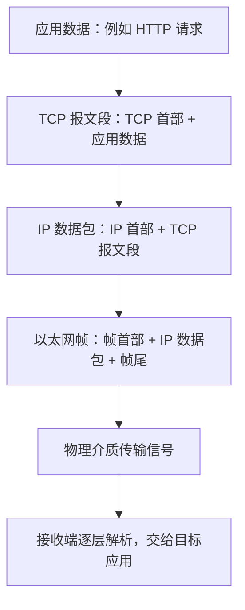

```text
以太网帧
┌──────────────┬───────────┬────────────┬──────────┬────────┐
│ 以太网首部   │ IP 首部   │ TCP 首部   │ 应用数据 │ 帧尾   │
└──────────────┴───────────┴────────────┴──────────┴────────┘
  MAC 等信息    IP 等信息   端口、序号等                  FCS
```

初学时可以先记住三类标识：

| 标识 | 在本笔记中主要用来理解什么 | 例子 |
| --- | --- | --- |
| MAC 地址 | 当前二层链路上的交付与转发 | 发给服务器的网卡，还是网关的接口？ |
| IP 地址 | 网络层上的寻址与路由 | 目标地址是 `192.168.20.20` |
| TCP/UDP 端口 | 主机上的传输端点与应用分用 | TCP `443` 上提供 HTTPS 服务 |

**IP 地址通常配置在网络接口上。** 一台主机可能有多块网卡，一块网卡也可能有多个 IP；“一个 IP 就是一台机器”只是入门时的简化说法。

## 二、IP 地址与内网地址段

### 2.1 IPv4 地址长什么样

IPv4 地址有 **32 位**，常写成四段十进制数，每段 8 位、范围 `0～255`。

```text
192.168.10.130
11000000 . 10101000 . 00001010 . 10000010
   8 位      8 位       8 位       8 位
```

地址通常要和前缀长度一起看，例如 `192.168.10.130/26`。**单看 IP 本身，不能确定它所在的子网大小。**

### 2.2 RFC 1918 规定的三个私有地址块

| 私有地址块 | 完整范围 | 备注 |
| --- | --- | --- |
| `10.0.0.0/8` | `10.0.0.0`～`10.255.255.255` | 常见于企业、云网络与实验环境 |
| `172.16.0.0/12` | `172.16.0.0`～`172.31.255.255` | **不是全部 `172.*` 都属于私有地址** |
| `192.168.0.0/16` | `192.168.0.0`～`192.168.255.255` | 常见于家庭与小型局域网 |

这些地址可以由不同组织重复使用，不作为全球互联网中的唯一地址进行路由。私有地址在企业内部、专线或 VPN 内仍然可以正常被路由。[^rfc1918]

> [!example] 私有地址块不等于你正在使用的子网
> `192.168.0.0/16` 是一个完整的私有地址块。家里的路由器可能只从中划出 `192.168.10.0/24` 作为 LAN 子网。
> 电脑配置为 `192.168.10.10/24`，并不意味着它会把整个 `192.168.0.0/16` 都视为直连网络。

### 2.3 “内网”和“私有地址”不是完全相同的概念

- **内网**描述网络的使用与管理边界，例如公司办公网、家庭 LAN。
- **私有地址**描述 RFC 1918 规定的地址用途。
- 内网可以使用合法分配的公网地址；私有地址也可能跨多个内部子网使用。
- 公网地址具有全球唯一寻址的用途，但是否能访问某项服务，还取决于路由、防火墙、运营商策略以及应用是否监听。

### 2.4 其他容易遇到的地址

| 地址或范围 | 含义 | 看到它时如何理解 |
| --- | --- | --- |
| `127.0.0.0/8`，常用 `127.0.0.1` | 回环地址 | 访问本机；不会因为接了网线就变成访问别的电脑 |
| `169.254.0.0/16` | IPv4 链路本地地址 | 常见于自动获取地址未成功时；不能据此认定已具备正常上网配置 |
| `100.64.0.0/10` | 共享地址空间 | 常见于运营商级 NAT；不属于 RFC 1918 的三个私有地址块 |
| `0.0.0.0` | 含义依上下文变化 | 可出现在尚未取得地址时的源地址中；服务绑定时常表示所有本地 IPv4 地址 |
| `0.0.0.0/0` | 默认路由的目的前缀 | 匹配任意 IPv4 目的地址，后文会讲 |
| `255.255.255.255` | 受限广播地址 | 当前链路广播；普通路由器不转发这种广播 |
| `192.0.2.0/24` 等文档地址块 | 教材、文档与示例专用 | 用于说明原理，不是真实可用的公网分配 |

地址的特殊用途可查 [IANA IPv4 特殊用途地址登记表](https://www.iana.org/assignments/iana-ipv4-special-registry/)。

## 三、子网掩码与 CIDR

### 3.1 子网掩码在划分什么

子网掩码用于区分 IP 地址中的**网络前缀部分**与**主机部分**。现代 CIDR 表达使用从左到右连续的 `1`，后面跟连续的 `0`。[^rfc4632]

```text
IP：        192.168.10.130
掩码：      255.255.255.0
二进制：    11111111.11111111.11111111.00000000
            └──────── 网络前缀 24 位 ────────┘└主机8位┘
CIDR：      192.168.10.130/24
所在子网：  192.168.10.0/24
```

`/24` 表示网络前缀长度为 24 位，不是“有 24 台主机”，也不是“最后一段取 24”。

旧教材中的 A、B、C 类地址属于历史上的分类寻址。现代配置使用 CIDR，应以实际前缀为准，不要因为地址以 `10` 开头就认定本机一定使用 `/8`。

> [!tip] 前缀越长，地址块越小
> `/25` 比 `/24` 多固定一位，地址总数减半；`/23` 比 `/24` 少固定一位，地址总数翻倍。
> 不要只按“小数点前几段相同”判断同网段，`/23`、`/26` 等前缀的边界并不都落在小数点处。

### 3.2 网络地址、广播地址与主机地址

对普通 IPv4 广播子网：

- **网络地址**：主机位全为 `0`，用来标识整个子网。
- **子网广播地址**：主机位全为 `1`，用于向该子网广播。
- **常规可用主机地址**：两者之间的地址。

设前缀长度为 $n$：

$$
\text{地址总数}=2^{32-n}
$$

$$
\text{常规可用主机地址数}=2^{32-n}-2
$$

> [!warning] “减 2”有适用范围
> 上式用于常规 IPv4 广播子网的主机数量计算。`/31` 可用于支持该机制的点到点链路，两端地址都可用；`/32` 表示一个单独的地址，常用于主机路由或回环接口等场景。不要把“减 2”机械套用到它们上面。[^rfc3021]

| 前缀 | 子网掩码 | 地址总数 | 常规可用主机数 |
| --- | --- | ---: | ---: |
| `/16` | `255.255.0.0` | 65,536 | 65,534 |
| `/20` | `255.255.240.0` | 4,096 | 4,094 |
| `/22` | `255.255.252.0` | 1,024 | 1,022 |
| `/23` | `255.255.254.0` | 512 | 510 |
| `/24` | `255.255.255.0` | 256 | 254 |
| `/25` | `255.255.255.128` | 128 | 126 |
| `/26` | `255.255.255.192` | 64 | 62 |
| `/27` | `255.255.255.224` | 32 | 30 |
| `/28` | `255.255.255.240` | 16 | 14 |
| `/29` | `255.255.255.248` | 8 | 6 |
| `/30` | `255.255.255.252` | 4 | 2 |

这里的主机数包括路由器接口、服务器、打印机等一切需要地址的接口，并不全是留给电脑的数量。

### 3.3 完整算一次：192.168.10.130/26

**第一步：把 `/26` 换成掩码。**

```text
前 24 位已经用掉三个 255；最后一段还需要 2 个 1。
11111111.11111111.11111111.11000000
255.255.255.192
```

**第二步：用按位与求网络地址。**

```text
最后一段 IP：     130 = 10000010
最后一段掩码：    192 = 11000000
按位与：          128 = 10000000

网络地址 = IP 地址 AND 子网掩码 = 192.168.10.128
```

**第三步：求整个地址范围。**

主机位有 `32 - 26 = 6` 位，所以每块 `64` 个地址。这个 `/24` 被分成四个 `/26`：

| 子网 | 网络地址 | 广播地址 | 可用主机地址 |
| --- | --- | --- | --- |
| `192.168.10.0/26` | `.0` | `.63` | `.1`～`.62` |
| `192.168.10.64/26` | `.64` | `.127` | `.65`～`.126` |
| `192.168.10.128/26` | `.128` | `.191` | `.129`～`.190` |
| `192.168.10.192/26` | `.192` | `.255` | `.193`～`.254` |

因此，`192.168.10.130/26` 的结果是：

```text
子网：      192.168.10.128/26
掩码：      255.255.255.192
网络地址：  192.168.10.128
广播地址：  192.168.10.191
主机范围：  192.168.10.129 ～ 192.168.10.190
可用数量：  62
网关示例：  192.168.10.129，需要确实有路由器使用该地址
```

> [!tip] 快速找块边界
> 对发生划分的那个字节，可用 `256 - 掩码字节值` 求块大小。本例是 `256 - 192 = 64`，边界为 `0、64、128、192`，130 落在 `128～191`。
> 这个速算法的前提是先找对字节，例如 `/20` 应看第三段，不能仍只盯最后一段。

### 3.4 怎样判断“同网段”

在常规配置下，主机用本地接口的前缀生成直连路由。若没有更特殊的路由影响，可以通过下面的运算理解它如何判断目的地址是否在本地子网：

```text
本机 IP AND 本机掩码
目标 IP AND 本机掩码

结果相同：本机通常把目标视为同子网、可在该链路直接交付。
结果不同：通常需要交给某个网关，由路由继续转发。
```

| A | B | 结论 |
| --- | --- | --- |
| `192.168.10.10/24` | `192.168.10.200/24` | 同一 `/24` 子网 |
| `192.168.10.10/25` | `192.168.10.200/25` | 不同子网：分别属于 `.0/25` 与 `.128/25` |
| `192.168.10.10/23` | `192.168.11.20/23` | 同一子网：`192.168.10.0/23` |

> [!warning] 两端掩码不一致会产生不对称判断
> A 是 `192.168.10.10/24`，B 是 `192.168.10.200/25`。A 会把 B 视为本地目标，B 却把 A 视为其他子网的目标。结果取决于网关、路由等额外配置，不能因为 A 的判断是“同网段”就认为双向通信必然正常。

**数值上属于同一子网，还要具备对应的二层连通性。** 如果 A、B 被放进彼此隔离的 VLAN，即使都配成 `/24`，也不等于可以直接通信。

## 四、直连、交换机、MAC 与 ARP

### 4.1 “直连”有两种常见含义

| 说法 | 具体含义 | 中间能有交换机吗？ |
| --- | --- | --- |
| 物理直连 | 两个设备的接口用线直接相连 | 这条线中间没有交换机 |
| 直连网络或 on-link 路由 | 系统认为某个目标网络就在接口所在链路，无须先交给 IP 网关 | **可以**，也可以经过二层网桥 |

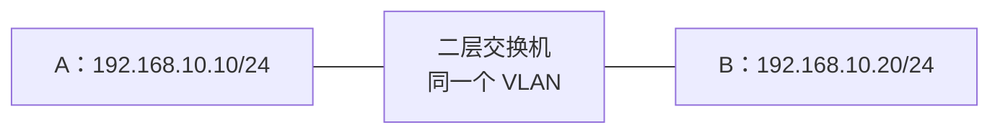

上图虽然经过交换机，但 A 与 B 在网络层上可以直接交付，通常不需要默认网关参与。

网线插好只说明物理链路可能建立。IP、掩码、VLAN、地址冲突、主机防火墙等仍会影响能否通信。

### 4.2 交换机怎样转发帧

普通二层交换机可理解为多端口网桥，主要按 **VLAN 与目的 MAC 地址**转发以太网帧：

1. 从收到帧的**源 MAC**学习这个地址位于哪个端口。
2. 根据**目的 MAC**查转发表，已知时发往相应端口。
3. 未知单播通常在对应 VLAN 内泛洪；广播也在该 VLAN 的转发范围内传播。

二层交换机不会因为看到目的 IP 属于另一个子网，就自动替主机完成三层路由。支持路由的三层交换机则同时具有三层能力。桥与 VLAN 的基础由 IEEE 802.1Q 描述。[^ieee8021q]

### 4.3 ARP：知道下一跳 IP 后，怎样找到 MAC

以普通 IPv4 以太网为例，==先查路由确定下一跳 IP，再利用 ARP 获取这个下一跳的 MAC==。ARP 请求通常广播，正常应答通常单播；已有缓存时不必每次重新询问。[^rfc826]

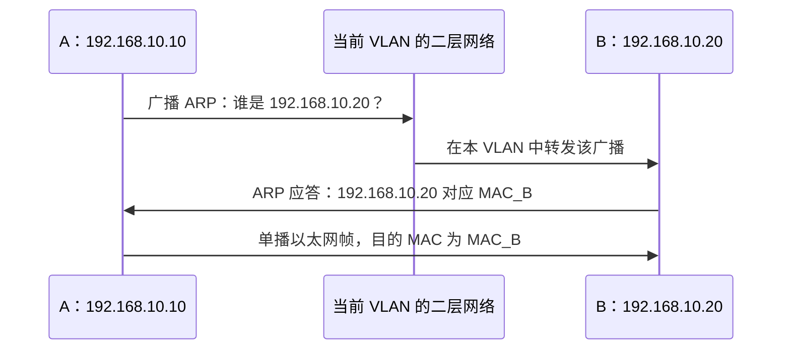

> [!important] ARP 问的是“下一跳”，不一定是最终服务器
> 访问同链路上的 B：查询 B 的 MAC。
> 访问其他网络的服务器：通常查询本地网关的 MAC，**IP 包的目的 IP 仍是服务器 IP**。
> 普通 ARP 广播不会由路由器传播到远端网络，所以本机不会靠广播 ARP 去寻找互联网上服务器的 MAC。

### 4.4 四种表分别记什么

| 表或状态 | 常见所在位置 | 主要内容 | 回答的问题 |
| --- | --- | --- | --- |
| MAC 转发表 | 交换机、网桥 | VLAN + MAC → 端口 | 这个二层帧从哪个端口出去？ |
| ARP/邻居表 | 主机、路由器 | 接口上的下一跳 IP → MAC | 下一跳的链路地址是什么？ |
| 路由表/转发表 | 主机、路由器、三层交换机 | 目的前缀 → 下一跳、出口等 | 这个 IP 包往哪里交？ |
| NAT 映射/连接状态 | 执行 NAT 的设备 | 原始与转换后的地址、端口及关联状态 | 包与回包怎样转换？ |

## 五、网关与路由

### 5.1 先固定后文使用的拓扑

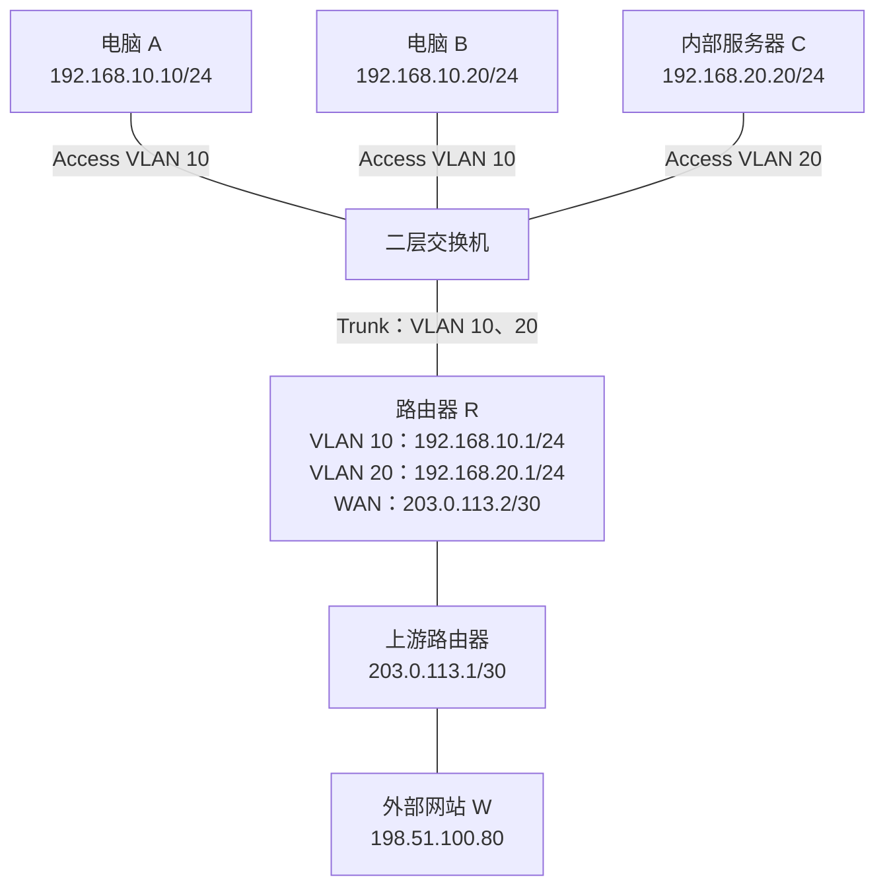

这是一种“单臂路由”示意：R 用一个连接交换机的物理接口，承载两个 VLAN 的逻辑三层接口。

| 设备或接口 | IP/前缀 | 默认网关或默认下一跳 |
| --- | --- | --- |
| A | `192.168.10.10/24` | `192.168.10.1` |
| B | `192.168.10.20/24` | `192.168.10.1` |
| C | `192.168.20.20/24` | `192.168.20.1` |
| R 的 VLAN 10 接口 | `192.168.10.1/24` | 由 R 自身的路由表决定 |
| R 的 VLAN 20 接口 | `192.168.20.1/24` | 由 R 自身的路由表决定 |
| R 的 WAN 接口 | `203.0.113.2/30` | R 的默认路由指向 `203.0.113.1` |

假设上游已具备到 W 所在网络的路由。这里的公网部分是逻辑示例；真实互联网中还会经过更多路由设备。

### 5.2 默认网关是什么

对 A 而言，`192.168.10.1` 是一个可在本链路到达的路由器地址。没有更具体的可用路由时，A 会把需要外发的 IP 包交给它。

- 网关通常与本机接口处在同一子网，才能直接取得其 MAC 并交付帧。
- 网关是 `.1` 或 `.254` 只是常见规划习惯，没有“必须是最后一段 1”的规定。
- 同子网通信通常不依赖默认网关；跨子网通信则需要合适的路由。
- DNS 服务器和默认网关可以是同一地址，也可以完全不同；两者职责不同。

### 5.3 主机也有路由表

配置地址与前缀后，系统通常会产生对应的直连路由。A 的路由表可简化为：

| 目的前缀 | 下一跳 | 出口 |
| --- | --- | --- |
| `192.168.10.0/24` | 在链路上，直接交付 | A 的局域网接口 |
| `0.0.0.0/0` | `192.168.10.1` | A 的局域网接口 |

实际系统还会显示本机、广播、回环等路由，上表省略这些项目。

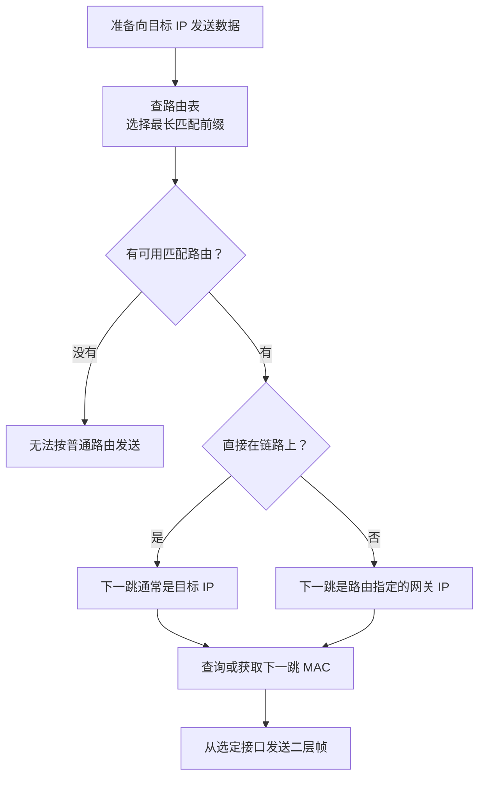

图中已省略发往本机地址的本地交付处理，重点展示普通以太网接口上的外发过程。

### 5.4 最长前缀匹配

普通目的地址路由会选择**匹配目标地址且前缀最长**的可用项。假设目标是 `192.168.20.20`，下面几条前缀都能匹配：[^rfc1812]

| 前缀 | 匹配范围 | 优先关系 |
| --- | --- | --- |
| `0.0.0.0/0` | 任意 IPv4 地址 | 最宽泛 |
| `192.168.0.0/16` | `192.168.*.*` | 比 `/0` 具体 |
| `192.168.20.0/24` | `192.168.20.*` | 比 `/16` 具体 |
| `192.168.20.20/32` | 只匹配这一个地址 | 如果存在且可用，则最具体 |

默认路由不是“所有流量必须先走的一条路”，而是**没有更具体匹配时的兜底项**。

前缀同样长时，系统才需要进一步考虑相应的优先级、度量值或等价多路径等规则。不要把“Metric 更小”理解成一定可以压过更长的匹配前缀。

### 5.5 直连路由、静态路由与动态路由

| 类型 | 如何得到 | 例子 |
| --- | --- | --- |
| 直连路由 | 接口地址、前缀与链路状态等配置生成 | R 直接连接 `192.168.10.0/24` 和 `192.168.20.0/24` |
| 静态路由 | 管理者显式配置 | 将 `10.20.0.0/16` 指向某个内部路由器 |
| 动态路由 | 路由器通过路由协议交换与计算 | OSPF、BGP 等；入门先理解用途即可 |

“静态 IP”描述接口地址如何配置；“静态路由”描述路由如何得到，二者不是一回事。

### 5.6 跨子网通信必须考虑回程

A 访问 C 时：

```text
去程：A → 网关 192.168.10.1 → R 的 VLAN 20 接口 → C
回程：C → 网关 192.168.20.1 → R 的 VLAN 10 接口 → A
```

R 对两个子网都有直连路由，因此这个例子**只需正确路由与放行策略，不需要 NAT**。C 如果缺少到 A 的回程路由，即使收到了请求，也可能无法正确返回。

> [!important] 路由不会自动改掉最终目的 IP
> 在没有 NAT、代理或隧道等额外机制的普通转发中，A 发往 C 的 IP 包仍是 `A 的 IP → C 的 IP`。经过路由器时，TTL 会递减，IPv4 首部校验和随之更新；在新的以太网链路上会重新封装适合该链路的源、目的 MAC。
> 普通二层交换转发不会像三层路由那样递减 IP TTL。

## 六、VLAN：在二层划分网络

### 6.1 VLAN 划分的是广播域

VLAN（Virtual LAN，虚拟局域网）允许在同一台或多台支持 VLAN 的交换机上，划分彼此独立的**二层广播域**。VLAN 10 中的普通广播，不会仅靠二层交换传播到 VLAN 20。[^cisco-vlan]

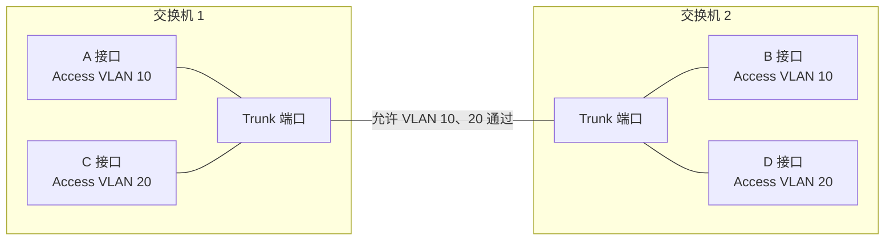

图中 A 与 B 的端口都属于 VLAN 10，只要中间链路与配置允许，它们就可以处于同一个二层广播域。**VLAN 可以跨交换机，不要求所有成员插在同一台交换机上。**

反过来，同一台交换机的两个端口，也可能因为属于不同 VLAN 而在二层隔离。图中的连线表示端口关系，不表示交换机会把 VLAN 10 的帧混入 VLAN 20。

### 6.2 Access、Trunk 与 802.1Q 标签

| 概念 | 常见用途 | 如何理解 |
| --- | --- | --- |
| Access 端口 | 接普通电脑、打印机等终端 | 普通场景下属于一个数据 VLAN，终端发送与接收的以太网帧通常不带 VLAN 标签 |
| Trunk 端口 | 交换机互联、连接路由器或支持 VLAN 的服务器 | 一条链路承载多个被允许的 VLAN，常通过 802.1Q 标签区分 |
| VLAN ID | 标识 VLAN | 通常可用 `1～4094`；ID 不直接决定 IP 地址段 |
| Native VLAN | 某些 Trunk 配置中的未打标签流量归属 | 具体是否打标签取决于设备与配置，两端需要一致理解 |

因此，“Trunk 上所有帧一定带标签”并不严谨；还要考虑 Native VLAN 等配置。上表描述的是常见以太网交换场景。[^cisco-ports]

```text
普通以太网帧：  目的MAC | 源MAC | 类型 | 负载 | FCS
带 802.1Q 标签：目的MAC | 源MAC | 802.1Q标签 | 类型 | 负载 | FCS
                                      ↑
                               其中包含 VLAN ID
```

802.1Q 标签提供 VLAN 等信息，**本身不负责加密**。

### 6.3 VLAN 与 IP 子网是什么关系

| VLAN | IP 子网 |
| --- | --- |
| 二层概念 | 三层概念 |
| 规定哪些端口与帧处在同一个逻辑广播域 | 规定 IP 地址的网络前缀范围 |
| 交换机主要依据 VLAN 与 MAC 转发 | 主机、路由器依据路由与下一跳交付 |
| 例如 VLAN 10 | 例如 `192.168.10.0/24` |

常见规划是 **一个 VLAN 对应一个 IP 子网**，这样广播范围与三层边界清楚。但这不是两个概念在定义上相等：同一 VLAN 可以承载多个 IP 子网，只是配置与排障更复杂。

> [!example] 两个判断题
> 1. VLAN 10 必须使用 `192.168.10.0/24` 吗？**不必。** 配成 `10.30.0.0/24` 也可以，编号只是规划习惯。
> 2. VLAN 10 和 VLAN 20 中的两台主机都配成 `192.168.10.x/24`，就能互通吗？**不能仅凭这项配置实现。** 它们会尝试在各自 VLAN 内 ARP，而普通二层隔离阻止这个请求直接到达对方。

### 6.4 不同 VLAN 怎么通信

需要三层转发能力，常见方式有：

- **路由器的不同物理接口**：每个接口接入相应 VLAN。
- **单臂路由**：路由器通过 Trunk 接入交换机，用子接口分别处理不同 VLAN；前文拓扑就是这个方式。
- **三层交换机的 VLAN 接口（SVI）**：交换机为每个需要路由的 VLAN 提供三层接口。

Trunk 只是承载多个 VLAN，**不会因为配置成 Trunk 就自动完成 VLAN 间路由**。

> [!warning] 划分 VLAN 后，还要看三层策略
> VLAN 提供二层分隔。启用 VLAN 间路由后，如果需要限制办公网、访客网、服务器网之间的访问，还要配置 ACL 或防火墙规则；不能只看“已经分 VLAN”就认定访问权限已经受控。

## 七、NAT：地址与端口怎样转换

### 7.1 NAT 做了什么

NAT（Network Address Translation）按配置改写 IP 地址。家庭共享一个公网 IPv4 的常见方式，还会结合 TCP/UDP 端口转换，通常称为 **NAPT 或 PAT**。[^rfc3022]

可以把两件事分开思考：

```text
路由：这个包往哪个下一跳、哪个接口送？
NAT：这个包的源/目的地址或端口需要怎样改写？
```

设备往往同时执行两者，但它们解决的问题不同。

### 7.2 出站示例：两台电脑共享出口

继续使用前文拓扑。A 与 B 都访问 W 的 TCP 443：

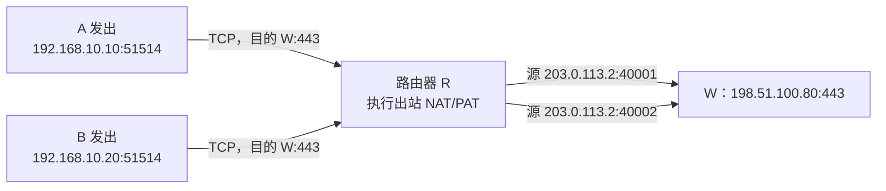

| 连接 | 内侧源地址与端口 | 外侧源地址与端口 | 目的地址与端口 |
| --- | --- | --- | --- |
| A → W | `192.168.10.10:51514` | `203.0.113.2:40001` | `198.51.100.80:443` |
| B → W | `192.168.10.20:51514` | `203.0.113.2:40002` | `198.51.100.80:443` |

回包到达 `203.0.113.2:40001` 后，R 根据映射与连接状态将目的恢复为 A 的 `192.168.10.10:51514`。B 的回包则按另一项映射处理。

这些端口是教学示例，NAT 也可能尽量保留原端口；具体映射规则与设备实现有关。实际状态往往还包含传输协议、远端地址等信息，不能把所有 NAT 都理解成一张只按“外部端口”查询的表。

### 7.3 SNAT、DNAT 与 PAT 怎么区分

| 名称 | 关注点 | 典型场景 |
| --- | --- | --- |
| SNAT，源地址转换 | 改源 IP；也可能结合端口转换 | 内网主机使用出口地址访问外部网络 |
| DNAT，目的地址转换 | 改目的 IP；也可能改目的端口 | 把入口连接导向内部服务器 |
| PAT/NAPT，地址与端口转换 | 转换涉及传输端口 | 多个内部连接共享一个外部 IP |
| 静态一对一映射 | 预先固定地址对应关系 | 一个外部地址对应一个内部地址 |

这些名称观察的是不同维度，不能当成完全互斥的四种操作系统模式。例如，常见出站 SNAT 就可以同时做 PAT。

### 7.4 端口映射：让外部连接内部服务

假设要把 R 外侧的 TCP `8443` 映射到 C 的 TCP `443`：

```text
入口映射规则：203.0.113.2:8443 → 192.168.20.20:443

外侧请求：
源 192.0.2.50:53000 → 目的 203.0.113.2:8443

经过 DNAT 后，进入内部网络：
源 192.0.2.50:53000 → 目的 192.168.20.20:443

匹配该连接的回包经过 R 时，执行反向转换：
内部源 192.168.20.20:443 → 外侧呈现为 203.0.113.2:8443
```

这里展示的是只做上述 DNAT 的情况；有些场景还会附加 SNAT，内部服务器看到的源地址就可能不同。

配置端口映射时，要同时满足：

1. C 的服务确实在相应地址与端口监听。
2. R 到 C 有路由，C 的回程能够经过执行转换的 R。
3. 相关主机与网络防火墙放行。
4. 外部流量确实能到达 R 的入口地址；如果 R 前面还有一层 NAT，也需要处理上游映射或提供其他可达方式。

> [!example] 为什么家里配置映射后，外面仍然连不上
> 如果家庭路由器的 WAN 是 `100.64.0.0/10` 中的地址，可能还处在运营商 NAT 后面。仅修改自己路由器的映射，不能自动让运营商把入口连接转给自己。
> 此外，从内网使用外侧地址测试映射，还可能涉及 NAT 回流（Hairpin NAT）；内外测试结果不能简单等同。

### 7.5 NAT 的边界

- NAT **不提供内容加密**；需要机密性时使用 TLS、SSH 或 VPN 等相应机制。
- 常见出站 NAT 通过状态处理回包；它与设备的防火墙功能有配合，但 NAT 不能代替完整的访问控制。
- 跨内部子网通信可以只用路由；“经过路由器”不代表“一定执行 NAT”。
- 多层 NAT 可以工作，但入口映射、故障定位等更复杂。

## 八、桥接与虚拟机网络模式

### 8.1 桥接的核心是二层转发

网桥把接口接入相应的二层转发结构，按 MAC 等二层信息转发帧。软件网桥、虚拟交换机和普通二层交换机可以放在这个思路下理解。

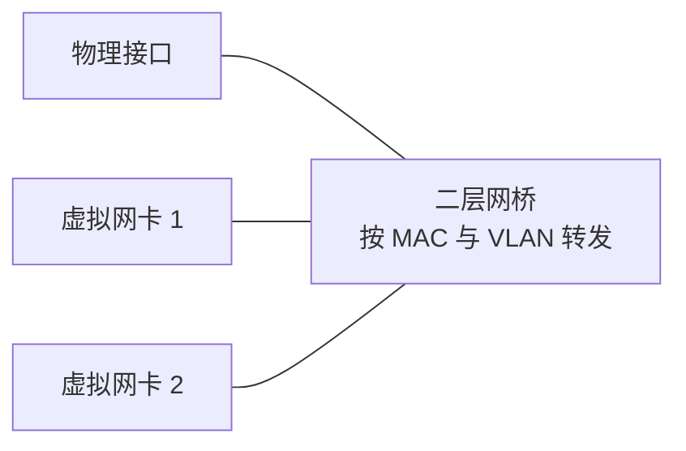

桥接本身不要求新建 IP 子网，不需要像 NAT 那样改写 IP，也不以三层路由的方式递减 TTL。网桥可以有管理 IP，但**网桥自身有 IP**与**为经过的帧做二层转发**是两件事。

若启用了 VLAN 过滤、端口隔离等功能，是否二层互通还取决于对应配置，不能把“接到一座网桥”理解成无条件互通。

### 8.2 虚拟机桥接模式

在常见虚拟机桥接模式下，虚拟机像一台接入现有 LAN 的独立设备：

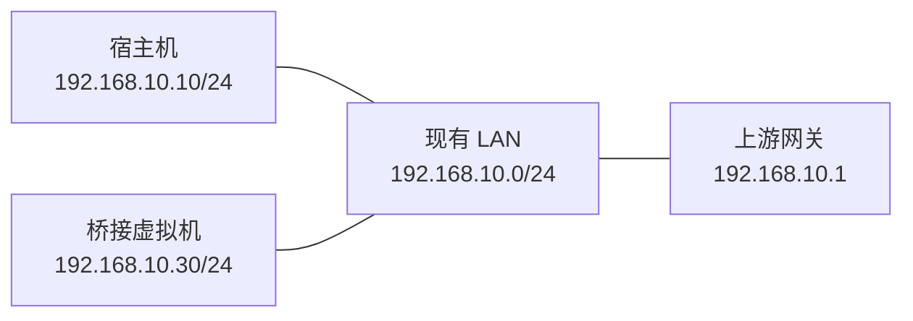

虚拟机通常从现有 LAN 的 DHCP 获取地址，或手动配置为该 LAN 中不冲突的地址。它使用上游网关，宿主机不必充当这台虚拟机的 IP 网关。

**桥接虚拟机不等于拿到了公网 IP。** 如果桥接进入家庭私有 LAN，虚拟机拿到的通常仍是私有地址，访问互联网仍可能经过家庭路由器的 NAT。

无线网卡、接入点的客户端隔离、校园网认证或 MAC 数量限制等，可能影响桥接行为，实际支持情况取决于平台与网络。[^virtualbox]

### 8.3 虚拟机 NAT 模式

在常见 NAT 模式下，虚拟机位于单独的虚拟网络，由虚拟化软件提供的 NAT 功能使用宿主网络连接向外访问：

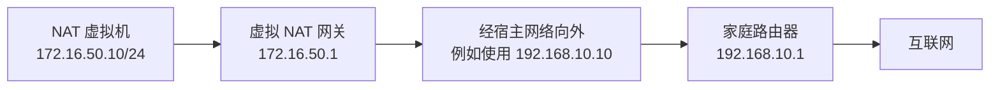

图中地址用于说明关系，不是某个产品必须采用的默认值。虚拟 NAT 可能由用户态网络引擎等实现，也不一定就是宿主操作系统的普通路由转发。

如果家庭路由器也做 NAT，就可能形成“虚拟 NAT + 家庭 NAT”的两层转换。现有 LAN 的其他设备主动访问虚拟机时，通常需要相应的端口映射或其他网络配置。

### 8.4 常见模式对照

| 模式 | 虚拟机通常处在哪里 | 默认向外访问 | 外部或现有 LAN 主动访问虚拟机 | 适合的场景 |
| --- | --- | --- | --- | --- |
| 桥接 Bridged | 现有 LAN | 依赖该 LAN 的网关与策略 | 在地址、路由与策略允许时可直接访问 | 希望虚拟机成为局域网中的独立设备 |
| NAT | 独立虚拟网段或虚拟 NAT 引擎后方 | 通常支持 | 通常需端口映射等配置 | 虚拟机主要需要向外联网 |
| 仅主机 Host-only | 宿主机与虚拟机的专用虚拟网络 | 默认不提供外网出口 | 现有 LAN 通常不能直接访问 | 宿主机与虚拟机之间做实验 |
| 内部网络 Internal | 加入同一内部网络的虚拟机 | 默认不提供外网出口 | 宿主机通常也不在其中 | 只让测试虚拟机相互通信 |

表格描述常见含义；不同产品的细节有差异。特别是 **VirtualBox 的普通 NAT 与 NAT Network 不完全相同**，不能一概断言“选了 NAT 的虚拟机彼此就能互访”。宿主机能否直接访问 NAT 虚拟机，也要看产品是否提供宿主虚拟接口、端口转发等能力。[^virtualbox]

### 8.5 家庭路由器、AP 与光猫的“桥接”

“桥接”这个词还会出现在家庭设备设置里，需要看具体上下文：

| 场景 | 常见含义 |
| --- | --- |
| 家庭路由器的 AP/桥接模式 | 让有线或无线终端接入上游 LAN，通常由上游设备承担网关、DHCP 等职责 |
| 光猫的桥接模式 | 在一些接入方案中，把相应业务交给下游路由器终结，例如由下游路由器进行 PPPoE 拨号 |
| 光猫路由 + 下游路由器路由模式 | 如果两者都执行 NAT，可能出现双层 NAT |

设备页面上的名称不完全统一，具体还取决于业务连接、运营商与固件配置。“桥接”本身不会保证取得公网地址，也不意味着所有管理功能都消失。

> [!tip] 用三个问题辨认网络模式
> 1. 谁给终端分配地址，它属于哪个子网？
> 2. 终端把谁当作网关？
> 3. 流量经过哪些设备时，会发生二层转发、三层路由或地址转换？

## 九、TCP、UDP 与端口

### 9.1 IP 与 TCP/UDP 各管什么

IP 提供跨网络的尽力交付，普通 IP 服务本身不保证数据一定送达、按序到达或只到达一次。TCP、UDP 则在其上提供不同的传输服务。

| 对比项 | TCP | UDP |
| --- | --- | --- |
| 基本交付形式 | 有序字节流 | 数据报，保留报文边界 |
| 是否先建立 TCP 式连接 | 是 | UDP 本身没有这种握手 |
| 协议自身是否提供重传、按序交付 | 提供 | 不提供 |
| 流量与拥塞控制 | TCP 提供相应机制 | UDP 本身不提供，应用或上层协议可实现 |
| 常见使用 | SSH、HTTP/1.1、通常的 HTTP/2 等 | DNS 的常见查询、DHCP、QUIC 等 |

TCP 的字节流与连接机制见 [RFC 9293](https://www.rfc-editor.org/rfc/rfc9293.html)；UDP 的基本语义见 [RFC 768](https://www.rfc-editor.org/rfc/rfc768.html)。

> [!note] UDP 本身不保证可靠，不代表所有基于 UDP 的协议都不可靠
> QUIC 在 UDP 之上实现可靠流、拥塞控制等机制；HTTP/3 使用 QUIC。因此“HTTPS 一律走 TCP”也不准确。[^quic]

### 9.2 端口与连接

TCP 和 UDP 的端口号均为 16 位，但它们属于不同协议的端口空间。TCP 443 与 UDP 443 不是同一个传输端点。

```text
一条 TCP 连接通常用四元组区分：
源 IP、源端口、目的 IP、目的端口

例如：
192.168.10.10:51514 → 198.51.100.80:443

抓包、连接跟踪中常说的五元组：
源 IP、源端口、目的 IP、目的端口、传输层协议
```

客户端源端口通常临时分配。服务器可以用同一个监听端口接受许多连接，因为这些连接的远端地址或端口可以不同。

“端口开放”需要实际有服务监听且访问路径允许；仅仅给电脑配置 IP 或在路由器上添加映射，并不会凭空产生服务。

### 9.3 三次握手

以下是普通 TCP 建连的简化示例，初始序号仅为教学取值：

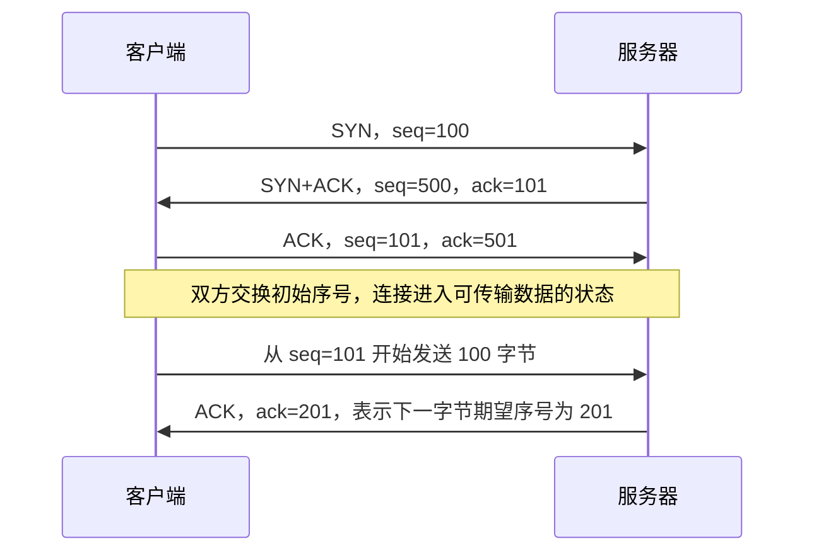

记住：`ack=201` 表示累计确认到了 200，接下来期望 201。SYN 本身占用一个序号，所以第三次握手时客户端序号从 101 开始。

### 9.4 字节流没有应用消息边界

```text
应用先后发送："Hello"、"World"
接收应用可能读到："HelloWorld"
也可能分多次读到："Hel"、"loWor"、"ld"
```

TCP 保证的是连接中的字节顺序。应用应使用长度字段、分隔符或明确的消息格式识别完整消息，不能假定“一次 send 对应一次 recv”。

TCP 确认收到字节，也不表示服务器已经完成业务处理或持久化；TCP 自身也不提供内容加密。

### 9.5 关闭连接为什么常说“四次挥手”

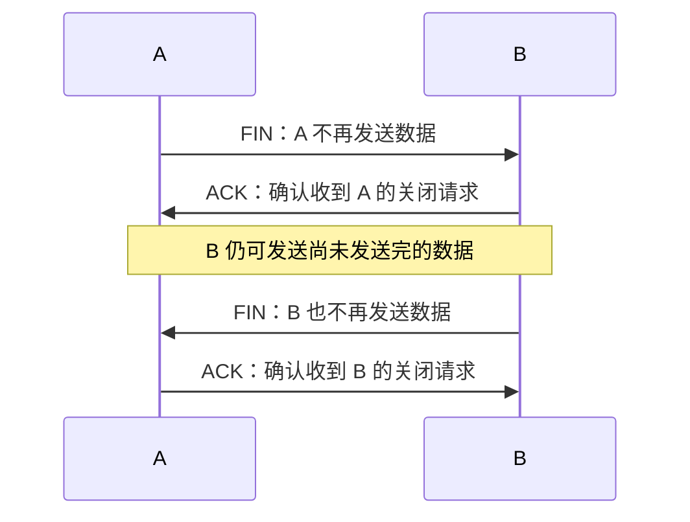

TCP 支持两个方向分别关闭。上图是常见解释模型；ACK 与 FIN 可以合并，连接也可能通过 RST 中止，因此实际抓包不保证恰好出现四个包。

主动关闭的一端通常会经历 TIME_WAIT，以便处理结束阶段的重传并避免旧报文干扰后续连接。入门阶段先理解其目的，不必把它当成“程序一定出错了”。

## 十、DHCP、DNS 与 ICMP

### 10.1 DHCP：自动取得网络配置

DHCP 可以分配或告知客户端 IP、掩码、网关、DNS 等配置。初次获取 IPv4 租约常用 **DORA** 概括：Discover、Offer、Request、ACK。[^dhcp]

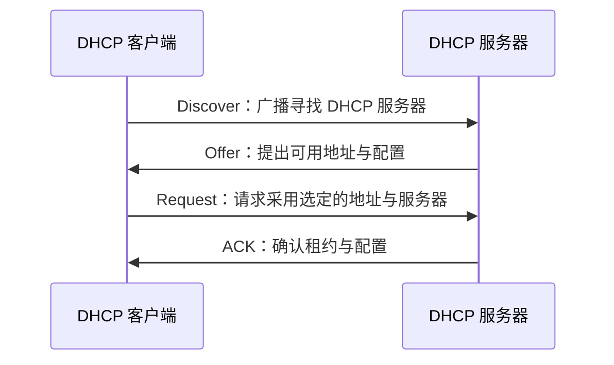

图中省略交换机与可能的中继；Offer、ACK 等具体使用广播还是单播，取决于客户端状态与相关标志。租约续租也不一定重新走完整四步。

IPv4 DHCP 常用 UDP 服务器端口 67、客户端端口 68。路由器通常不转发普通二层广播，跨 VLAN 使用集中式 DHCP 时，常需要 **DHCP Relay（中继）**。

> [!note] DHCP 不一定必须由默认网关提供
> 家庭路由器经常同时提供 DHCP、DNS 转发和网关功能，所以容易把它们混在一起。企业中这些功能完全可以由不同设备提供。

### 10.2 DNS：从名字找到地址等记录

DNS 是分布式名称系统。入门先关注：应用可以查询域名对应的 **A 记录（IPv4）**或 **AAAA 记录（IPv6）**，再选择地址发起连接。DNS 还支持 MX、TXT 等其他记录，不只是“名字换成 IP”。[^dns]

```text
example.com
    ↓ 查询 DNS，或使用已有缓存
得到一个或多个 IP 地址
    ↓ 按路由与下一跳交付规则发送流量
连接实际服务器上的应用端口
```

DNS 查询本身也需要网络连接，同样受路由、ARP/邻居解析等机制影响。不能把 DNS 理解成“网络还没通就能独立完成”的步骤。

传统 DNS 常用 UDP 53，也使用 TCP 53；DNS 还有加密传输方式。因此，抓包时没看到 UDP 53，不足以证明没有发生名称解析。TCP 支持要求可参见 [RFC 7766](https://www.rfc-editor.org/rfc/rfc7766.html)。

### 10.3 ICMP：控制信息与网络诊断

ICMP 属于网际层的控制机制，用于 Echo、目标不可达、超时等信息，并不是运行在 TCP 或 UDP 上的应用。**ICMP 没有 TCP/UDP 端口。**[^icmp]

- `ping` 通常利用 ICMP Echo 请求与应答观察可达性和往返时延。
- `tracert`/`traceroute` 利用逐步变化的 TTL 或 Hop Limit，并结合超时等应答观察路径；不同系统使用的探测报文可能不同。
- 中间设备可能不回应或限制 ICMP，因此 `ping` 失败、追踪出现 `*`，都不能单独证明目标服务不可用。

### 10.4 IPv6 先认识这些差别

| 方面 | IPv4 | IPv6 |
| --- | --- | --- |
| 地址长度 | 32 位 | 128 位 |
| 地址示例 | `192.168.10.10` | `2001:db8::10`，也是文档示例地址 |
| 前缀表达 | 例如 `/24`，也常写点分十进制掩码 | 例如 `/64`，主要使用前缀长度 |
| 邻居解析 | 以太网上通常用 ARP | 使用基于 ICMPv6 的 NDP |
| 广播 | 存在广播 | 不使用 IPv4 式广播，相应功能多用组播等机制 |
| NAT | IPv4 共享出口常见 | 正常全球地址通信通常不依赖 NAT 来节省地址，访问控制仍需要单独配置 |

IPv6 的基本格式见 [RFC 8200](https://www.rfc-editor.org/rfc/rfc8200.html)，邻居发现见 [RFC 4861](https://www.rfc-editor.org/rfc/rfc4861.html)。不要把 IPv4 的“每段 0～255”“可用地址数减 2”等规则照搬到 IPv6。

## 十一、把一次通信完整串起来

### 11.1 场景一：A 访问同子网的 B

```text
A：192.168.10.10/24
B：192.168.10.20/24
共同条件：处于同一 VLAN，接口与访问策略允许通信。
```

1. A 查路由，命中 `192.168.10.0/24` 的直连项。
2. 下一跳就是 B；A 查询或使用 B 的 ARP 缓存。
3. A 发送目的 MAC 为 `MAC_B`、目的 IP 为 `192.168.10.20` 的帧。
4. 交换机在 VLAN 10 内转发；B 收到后按协议交付。

**这条路径通常不经过默认网关，不需要 NAT。**

### 11.2 场景二：A 访问另一个 VLAN 的 C

```text
A：192.168.10.10/24，网关 192.168.10.1
C：192.168.20.20/24，网关 192.168.20.1
```

1. A 查路由，发现目标不属于本地 `/24`，使用默认路由。
2. A 获取网关 `192.168.10.1` 的 MAC，把帧交给 R。
3. R 收到 IP 包，查路由，找到直连的 `192.168.20.0/24`。
4. R 在 VLAN 20 上解析 C 的 MAC，重新封装二层帧，发给 C。
5. C 的回包使用自己的网关，R 再将其转回 A。

| 观察的链路段 | 源 MAC → 目的 MAC | 源 IP → 目的 IP |
| --- | --- | --- |
| A 发向 R | `MAC_A → R 在 VLAN 10 上的 MAC` | `192.168.10.10 → 192.168.20.20` |
| R 发向 C | `R 在 VLAN 20 上的 MAC → MAC_C` | `192.168.10.10 → 192.168.20.20` |

R 的逻辑接口可能使用相同或不同的 MAC，取决于设备实现；表格强调的是**每段链路的二层交付关系**。Trunk 上还可能带有相应 VLAN 标签。

### 11.3 场景三：A 访问外部网站 W

为了清楚观察 TCP，先假设使用 IPv4、HTTPS over TCP，没有应用代理，也没有复用已有连接。真实浏览器还可能使用 HTTP/3、IPv6、缓存或代理。

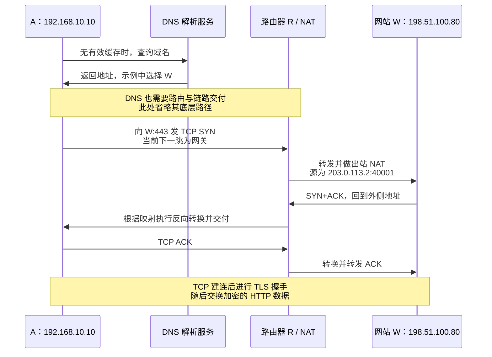

对其中一个出站包，可以分两层看：

| 位置 | 源 IP:端口 | 目的 IP:端口 | 当前以太网帧交给谁 |
| --- | --- | --- | --- |
| A 发出时 | `192.168.10.10:51514` | `198.51.100.80:443` | A 的本地网关 |
| R 的 WAN 发出时 | `203.0.113.2:40001` | `198.51.100.80:443` | R 的上游下一跳 |
| 回包经 R 还原后 | `198.51.100.80:443` | `192.168.10.10:51514` | A 的网卡 |

> [!success] 这个例子串起了哪些知识
> DNS 负责查名字；路由决定下一跳；ARP 解决本链路下一跳的 MAC；交换与 VLAN 决定二层转发范围；NAT 处理地址与端口转换；TCP 提供有序字节流；TLS 保护内容；HTTP 表达应用请求。

## 十二、动手观察与抓包

### 12.1 Windows：查看本机配置

在 PowerShell 中运行：

```powershell
# 地址、掩码、网关、DNS、DHCP 等
ipconfig /all

# IPv4 路由表
route print -4

# ARP 缓存
arp -a

# PowerShell 的 IPv4 邻居视图
Get-NetNeighbor -AddressFamily IPv4

# 查询 A 记录
nslookup -type=A example.com

# 观察到一个真实站点的 TCP 443 是否可连接
Test-NetConnection example.com -Port 443
```

重点记录：

| 输出项目 | 要回答的问题 |
| --- | --- |
| 正在使用的网卡 | 实际流量走的是以太网、Wi-Fi、VPN，还是虚拟网卡？ |
| IPv4 与掩码 | 本地直连子网是什么？ |
| 默认网关 | 没有更具体路由时交给谁？ |
| DNS 服务器 | 名称查询交给谁处理？ |
| `On-link` 路由 | 哪些目标被认为就在当前链路？ |
| ARP/邻居项 | 下一跳地址对应哪个 MAC？ |

`ipconfig` 字段说明可查 [Microsoft 官方文档](https://learn.microsoft.com/en-us/windows-server/administration/windows-commands/ipconfig)。

测试网关与观察路径时，应替换为自己网络中真实的地址：

```powershell
$gatewayAddress = '192.168.10.1'  # 改成 ipconfig 显示的实际网关
ping -4 -n 4 $gatewayAddress
tracert -4 -d example.com
```

`tracert` 的 `-d` 用于跳过对中间地址的名称解析；`*` 只表示对应探测未在等待时间内收到预期应答。[参数说明](https://learn.microsoft.com/en-us/windows-server/administration/windows-commands/tracert)

> [!note] 文档中的示例 IP 与实际联网命令要区分
> `example.com` 用于这里的实际名称查询与联网观察，返回地址以当次 DNS 结果为准。前文的 `198.51.100.80` 只是教学拓扑中的 W，二者没有真实对应关系。

### 12.2 Linux：查看地址、路由与连接

```bash
# IPv4 接口地址
ip -4 addr show

# 路由表
ip -4 route show

# 查看系统对一个示例目标会选择什么路径，不实际发送探测包
ip -4 route get 192.168.20.20

# 邻居表
ip neigh show

# 监听中的 TCP/UDP 套接字
ss -lntu
```

`ip route get` 结果中的 `via` 是下一跳，`dev` 是出口接口，`src` 是选用的本地源地址；结果还可能受 VPN、策略路由等配置影响。

Linux 上的 DNS 查询工具依发行版安装情况而定，例如 `dig example.com A` 或 `nslookup -type=A example.com`。

### 12.3 一个小实验：有交换机，是否一定需要网关

用两台测试虚拟机加入**同一个内部虚拟网络**，或用两台设备接入同一个测试 VLAN；本实验先不接路由器。

| 步骤 | A 的配置 | B 的配置 | 预期观察 |
| --- | --- | --- | --- |
| 1 | `192.168.50.10/24`，不填网关 | `192.168.50.20/24`，不填网关 | 在接口、主机防火墙等允许时，可以同子网通信 |
| 2 | 保持不变 | 改成 `192.168.60.20/24`，仍不填网关 | 单纯存在二层链路，不会自动产生到另一子网的路由 |
| 3 | 保持不变 | 恢复 `192.168.50.20/24` | 恢复同子网通信，再观察 ARP 与路由 |

在步骤 1 中执行 `ping` 并抓包，应该能观察到普通本地交付；没有 ARP 请求时先检查是否已经有缓存。实验应在测试网络中修改地址，避免影响正在使用的管理连接。

### 12.4 Wireshark：观察 ARP、DNS 与 TCP

1. 打开 Wireshark，在主界面选择**实际承载流量的接口**，双击开始抓包。观察以太网 MAC 时，优先使用有线或虚拟以太网接口。
2. 在终端发起一次 `ping`、`nslookup` 或 HTTP 请求。
3. 在窗口顶部的 **显示过滤器（Display Filter）**输入框填入下表表达式，按 Enter。
4. 选中一个包，在下方“包详情”展开 `Ethernet II`、`Internet Protocol Version 4`、`TCP`、`Domain Name System` 等字段。
5. 对比源/目的 MAC、源/目的 IP、端口与标志位，不要只看最右侧摘要。

| 想观察的对象 | 显示过滤器 |
| --- | --- |
| ARP | `arp` |
| IPv4 ICMP | `icmp` |
| 被解析为 DNS 的报文 | `dns` |
| 某台主机的 IPv4 流量 | `ip.addr == 192.168.10.10` |
| TCP 443 | `tcp.port == 443` |
| 首次 SYN，不包括 SYN+ACK | `tcp.flags.syn == 1 and tcp.flags.ack == 0` |
| 所有带 SYN 标志的 TCP 包 | `tcp.flags.syn == 1` |
| FIN 或 RST | `tcp.flags.fin == 1 or tcp.flags.reset == 1` |

这些是**显示过滤器**，与开始抓包前的捕获过滤器语法不同。特别是 `tcp.flags.syn` 只检查字段是否存在；想检查标志是否置位，要写 `tcp.flags.syn == 1`。[Wireshark 官方说明](https://www.wireshark.org/docs/wsug_html_chunked/ChWorkBuildDisplayFilterSection.html)

可以用下面的请求尽量固定为基于 TCP 的 HTTP/1.1，方便观察握手：

```powershell
# Windows 使用 curl.exe，避免与某些 PowerShell 环境的别名混淆
curl.exe --http1.1 -I https://example.com
```

Linux/macOS 通常使用 `curl --http1.1 -I https://example.com`。实际路径可能受代理或 VPN 影响，应结合套接字与路由输出确认。

> [!tip] 抓包时要预先知道“应该看到什么”
> - 访问同子网主机：正常情况下，出站帧的目的 MAC 是对方网卡的 MAC。
> - 访问其他网络：在本机这一跳，目的 MAC 通常是网关的 MAC，目的 IP 仍是远端 IP。
> - 已有 ARP 或 DNS 缓存时，可能看不到新的查询。
> - HTTPS 的应用内容经过加密，不能期待普通抓包直接显示完整 HTTP 请求正文。
> - 只能抓到当前接口可见的流量；在普通交换网络里，本机抓包不会自动看到所有其他主机的单播通信。

### 12.5 连不通时按什么顺序检查

| 顺序 | 先确认什么 | 主要证据 |
| --- | --- | --- |
| 1 | 接口是否启用、链路是否建立 | 系统网卡状态、交换机端口状态 |
| 2 | IP、掩码、VLAN 是否符合规划，是否地址冲突 | 接口配置、VLAN 端口归属、邻居信息 |
| 3 | 下一跳是否正确并可在当前链路解析 | 路由表、ARP/邻居表 |
| 4 | 跨网段的去程与回程是否都有路由 | 两端网关、中间路由器的路由表 |
| 5 | 地址转换与放行规则是否匹配 | NAT 状态、防火墙日志或相应位置的抓包 |
| 6 | 服务是否监听在可访问的地址与端口 | 服务配置、`ss`、TCP 连接测试 |
| 7 | 名称解析是否返回预期地址 | `nslookup`/`dig`，与已知地址路径的对比 |
| 8 | TCP、TLS、应用层具体在哪一步失败 | SYN/SYN+ACK、TLS 错误、应用日志 |

可以穿插使用 `ping` 提供线索，但不要把 ICMP 能否响应当成所有服务是否可用的唯一判据。

## 十三、容易混淆的问题

| 容易记错的说法 | 更准确的理解 |
| --- | --- |
| IP 前三段相同就一定是同网段 | 必须看前缀；`/25` 能把同一个 `/24` 再分成两块 |
| `172.*` 都是私有地址 | RFC 1918 中只有 `172.16.0.0/12` |
| 不属于私有段的就是可用公网地址 | 还有回环、链路本地、组播、文档等特殊用途空间 |
| 末尾 `.0` 和 `.255` 永远不能给主机用 | 是否为网络/广播地址取决于整个主机字段，例如 `/23` 中部分这样的地址可作主机地址 |
| 没有网关就不能联网 | 同链路、同子网通信可以不依赖网关；访问其他网络则要有相应路由 |
| 跨网段一定需要 NAT | 正确路由与回程可以直接实现；NAT 是额外的转换功能 |
| 配置默认网关后，所有包都先交给它 | 更具体的可用路由通常优先于默认路由 |
| 有路由器就一定有 NAT | 路由与 NAT 是不同功能 |
| 同一台交换机上的设备一定能互通 | 还要看 VLAN、地址、端口隔离与主机策略等 |
| 同一个 VLAN 就等于同一个 IP 子网 | 二层与三层概念不同，只是通常一一规划 |
| Trunk 可以自动完成不同 VLAN 间的路由 | Trunk 承载多个 VLAN，三层转发需要另外配置 |
| 桥接和 NAT 都是在改 IP | 桥接处理二层转发，NAT 处理地址或端口转换 |
| 虚拟机桥接后一定使用公网 IP | 它接入什么 LAN，就按该 LAN 的规则取得地址 |
| 给路由器开了端口，服务就出现了 | 仍需服务监听、路由、回程、转换和放行策略共同满足 |
| TCP 可靠，所以业务一定处理成功 | TCP 确认不等于业务执行或落盘成功 |
| UDP 上的所有应用都不可靠 | 上层协议可实现可靠机制，例如 QUIC 的可靠流 |
| ping 不通就代表网页打不开 | ICMP 与具体 TCP/UDP 服务的策略可能不同 |

