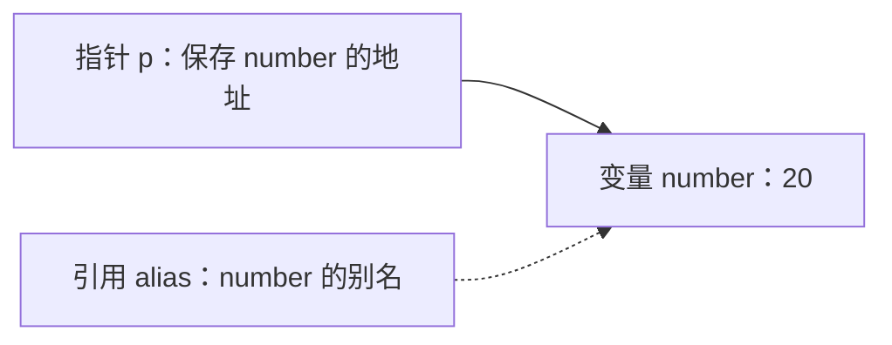
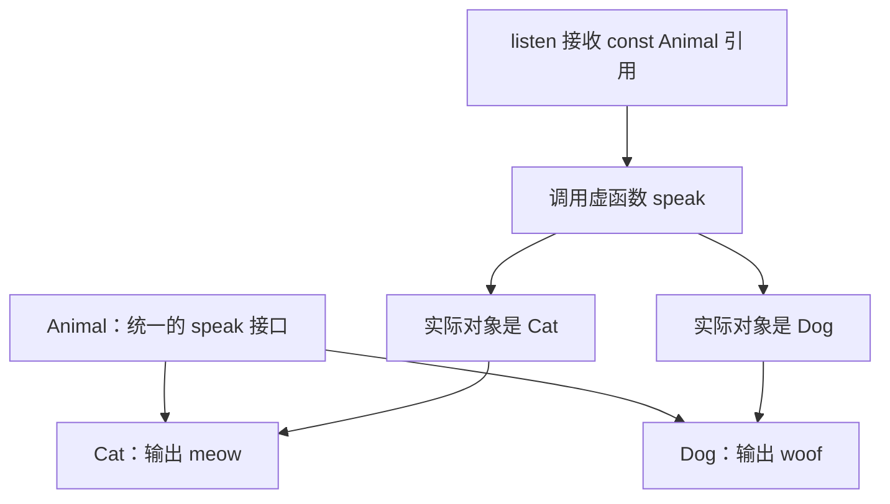
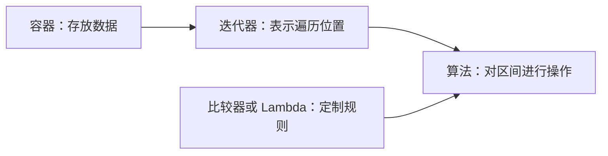
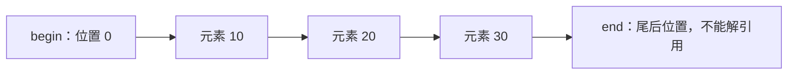

---
tags:
  - 主题/编程语言
  - 技术/Cpp
  - 笔记/基础
---

> [!info] 知识关联
> - **语言对照**：[[C语言基础]] — 比较数组、指针和内存管理的共性与差异。
> - **构建原理**：[[代码是怎么变成可执行程序的]] — 补充预处理、目标文件和链接过程。
> - **结构实践**：[[二叉树]] — 用结点、指针与递归实现树结构。
> - **刷题应用**：[[800]] — 用输入输出和流程控制完成入门题。

# 1 快速入门

先把最基本的程序写出来，再去看变量、函数、类这些东西。

C++ 和 C 有不少相同的语法，学过 C 的话，循环、判断这些可以很快带过。这里主要把 C++ 新增的写法，以及容易和 Java 混淆的地方记清楚。

> [!note] 示例说明
> 本文统一按 **C++17** 编写，不代表 C++ 只有这个版本。
> 标为“完整示例”的代码可以单独保存为 `main.cpp` 编译运行；标为“代码片段”的内容需要放进对应的函数或项目中。不同完整示例分别运行，不要把多个 `main()` 放进同一个程序。

## 1.1 第一个 C++ 程序

还是先输出 Hello World。

**完整示例：**

```cpp
#include <iostream>

int main() {
    std::cout << "Hello, world!" << '\n';
    return 0;
}
```

输出：

```text
Hello, world!
```

简单拆一下这个程序：

| 写法 | 作用 |
| --- | --- |
| `#include <iostream>` | 引入标准输入输出相关的声明 |
| `int main()` | 程序入口，返回类型是 `int` |
| `{ ... }` | 一段代码的作用域 |
| `std::cout` | 标准输出流 |
| `<<` | 这里表示把右边的内容送到输出流 |
| `'\n'` | 换行字符 |
| `return 0;` | 正常结束程序 |

和 Java 不一样，==C++ 的入口函数不需要放在类里面==。

语句一般以分号结束，但是 `#include` 这种预处理指令后面不加分号。

**编译与运行**

如果已经安装 GCC，并且能在终端使用 `g++`，在 `main.cpp` 所在目录执行：

```powershell
g++ -std=c++17 -Wall -Wextra -pedantic main.cpp -o main.exe
.\main.exe
```

这里 `-std=c++17` 指定语言版本，后面几个选项打开常见警告。第二行是 Windows PowerShell 的运行方式；Linux/macOS 可以把输出文件名改成 `main`，然后执行 `./main`。

如果使用 IDE，就新建一个 C++ 控制台项目，把代码放进源文件，并把项目的语言标准设置为 C++17。IDE 最后也要调用编译器。

## 1.2 源文件是怎么变成程序的


例如函数只写了声明，没有提供定义，调用处可能可以通过编译，但链接时会找不到函数实现。

所以看到报错时，先分清楚是**编译错误、链接错误，还是运行时的问题**。这三种情况排查的地方不一样。

## 1.3 注释、命名空间和输入输出

### 1.3.1 注释

**代码片段：**

```cpp
// 单行注释

/*
多行注释
不能用同样的写法再嵌套一层多行注释
*/
```

### 1.3.2 命名空间

`std` 是标准库使用的命名空间，`::` 是作用域解析运算符。

所以 `std::cout` 的意思就是使用 `std` 里面的 `cout`。

有些教程会在开头写 `using namespace std;`，这样后面就能直接写 `cout`、`string`。这里统一保留 `std::`，看代码时也容易分清哪些名字来自标准库。

### 1.3.3 输入输出

**完整示例：**

```cpp
#include <iomanip>
#include <iostream>
#include <string>

int main() {
    std::string name;
    int age{};

    std::cout << "Input name and age: ";
    if (!(std::cin >> name >> age)) {
        std::cerr << "Invalid input\n";
        return 1;
    }

    std::cout << name << " is " << age << " years old.\n";
    std::cout << std::fixed << std::setprecision(2) << 3.1415926 << '\n';
}
```

输入 `Maple 20`，后两行输出是：

```text
Maple is 20 years old.
3.14
```

`>>` 从输入流读取数据，通常会跳过开头的空白。用它读取字符串时，遇到空格就停了。

如果需要读一整行，可以用 `std::getline(std::cin, name)`。

> [!warning] 混用 `>>` 和 `getline`
> 例如先 `std::cin >> age`，输入末尾的换行还在流里，紧接着 `getline` 可能读到空行。
> 可以先调用 `std::cin.ignore(std::numeric_limits<std::streamsize>::max(), '\n');` 丢弃这一行的剩余内容，需要包含 `<limits>`。
> `std::getline(std::cin >> std::ws, name)` 也是常见写法，但它会连开头的空白行和空格一起跳过，是否合适要看输入要求。

`'\n'` 只换行，`std::endl` 会换行并刷新输出缓冲区。普通输出通常用 `'\n'` 就够了。

## 1.4 变量和数据类型

### 1.4.1 基本类型

| 类型 | 用途 | 示例 |
| --- | --- | --- |
| `int` | 一般整数 | `int age{20};` |
| `long long` | 需要较大范围的整数 | `long long count{9000000000LL};` |
| `float` | 单精度浮点数 | `float rate{0.5f};` |
| `double` | 双精度浮点数 | `double price{19.9};` |
| `char` | 一个普通字符代码单元 | `char grade{'A'};` |
| `bool` | 真假值 | `bool passed{true};` |
| `void` | 没有值，常用于函数返回类型 | `void print();` |

> [!note] 不要把数据类型大小记死
> C++ 不保证 `int` 在所有平台都是 4 字节，也不保证 `long` 和指针一样大。可以用 `sizeof` 查看当前实现的大小，用 `<limits>` 中的 `std::numeric_limits<T>` 查看范围。
> 标准保证 `sizeof(char) == 1`，但一个 C++ 字节也不一定在所有平台都是 8 位。整数的最低宽度要求可查 [标准草案的基本类型章节](https://eel.is/c++draft/basic.fundamental)。

`char` 不能简单当成 Java 的 `char`。UTF-8 编码下，一个汉字通常需要多个字节，`std::string` 存放 UTF-8 文本时，`size()` 也不是直接统计汉字个数。

### 1.4.2 初始化

**代码片段，放在函数内部：**

```cpp
int a = 10;
int b(20);
int c{30};
int zero{};          // 初始化为 0
double price{19.9};

// int bad{3.14};    // 错误：花括号初始化禁止这种窄化转换
```

这里后面尽量用 `{}` 初始化，避免不小心把变量放着没管。

> [!warning] 局部变量不会普遍自动变成 0
> 函数里写 `int n;`，再直接读取 `n`，在本文 C++17 的规则下会产生未定义行为。
> 不要照搬 Java 中“字段或数组元素有默认值”的印象。写成 `int n{};`，初始化的含义才明确。

### 1.4.3 常量和自动推导

**代码片段：**

```cpp
const int maxScore{100};
constexpr int daysPerWeek{7};

auto count = 10;      // 推导为 int
auto price = 19.9;    // 推导为 double
auto letter = 'A';    // 推导为 char
```

`const` 表示不能通过这个名字修改对象；`constexpr` 变量还要求使用常量表达式初始化，可用于需要编译期常量的地方。

`auto` 是让编译器根据初始化表达式推导类型，==不是变量可以随时换类型==。例如上面的 `count` 后面依然是 `int`。

普通的 `auto x = other;` 通常会得到一个值，而不是引用。要保留引用关系，需要写 `auto&`，后面会讲。

## 1.5 运算和类型转换

四则运算、比较、`&&`、`||`、`!`、三元运算符的基本写法和 C 很接近。

**完整示例：**

```cpp
#include <iostream>

int main() {
    int a{5};
    int b{2};

    std::cout << a / b << '\n';
    std::cout << static_cast<double>(a) / b << '\n';
    std::cout << std::boolalpha << (a > b && b != 0) << '\n';
}
```

输出：

```text
2
2.5
true
```

两个整数相除，结果还是整数，小数部分向 0 截断。想得到小数，要在做除法之前让一个操作数变成浮点数。

`static_cast<目标类型>(表达式)` 是这里使用的显式类型转换写法。转换能写出来，不代表一定不会丢失精度或超出范围。

**几个容易踩的地方：**

- `=` 是赋值，`==` 才是比较。
- `&&` 和 `||` 有短路求值，右边可能不会执行；`&` 和 `|` 不能直接当成它们的替代品。
- 浮点数可能有精度误差，比较时要根据数据范围和业务要求选择误差容限。
- 整数除以 0、对有符号整数做超出范围的算术，都是未定义行为，不能期待一个固定结果。
- 无符号整数按模运算，但这不代表拿它和负数比较就安全，混合运算会涉及类型转换。

关于有符号与无符号整数运算的区别，可对照 [标准草案的基本类型规则](https://eel.is/c++draft/basic.fundamental)。

> [!warning] 什么叫未定义行为
> 可以理解为：程序触碰了语言规则没有给出行为要求的情况。
> 可能崩溃、输出奇怪结果，也可能暂时看起来正常。==“我这里运行没报错”不能证明代码正确。==

## 1.6 流程控制

### 1.6.1 选择结构

**代码片段，放在函数内部：**

```cpp
int score{85};

if (score >= 90) {
    std::cout << "Excellent\n";
} else if (score >= 60) {
    std::cout << "Pass\n";
} else {
    std::cout << "Fail\n";
}

int option{2};
switch (option) {
case 1:
    std::cout << "Add\n";
    break;
case 2:
    std::cout << "List\n";
    break;
default:
    std::cout << "Unknown\n";
    break;
}
```

这里需要包含 `<iostream>`。

C++17 的 `switch` 不能直接用 `std::string` 做条件，别把 Java 的字符串 `switch` 直接照搬过来。不写 `break` 可能继续执行后面的分支。

### 1.6.2 循环

**代码片段，放在函数内部：**

```cpp
for (int i = 0; i < 3; ++i) {
    std::cout << i << '\n';
}

int n{3};
while (n > 0) {
    --n;
}

do {
    ++n;
} while (n < 1);
```

`break` 结束当前循环，`continue` 跳过本轮剩余部分。`do while` 至少执行一次。

**范围 for**

**完整示例：**

```cpp
#include <iostream>

int main() {
    int scores[]{68, 79, 91};

    for (int score : scores) {
        std::cout << score << ' ';
    }
    std::cout << '\n';

    for (int& score : scores) {
        score += 1;
    }

    for (int score : scores) {
        std::cout << score << ' ';
    }
    std::cout << '\n';
}
```

输出两行分别是 `68 79 91` 和 `69 80 92`，每行最后有一个空格。

第一种写法是把元素复制给循环变量，第二种加了 `&`，直接通过引用修改原来的元素。

# 2 复合类型与函数

## 2.1 数组

**代码片段，放在函数内部：**

```cpp
int scores[3]{68, 79, 91};
int zeros[3]{};             // 三个元素都是 0
int values[]{10, 20, 30};  // 根据初始化列表推导长度

scores[0] = 100;            // 下标从 0 开始
// scores[3] = 60;          // 错误：越界访问
```

原生数组的长度创建后就固定了。`int scores[3]` 的有效下标是 `0`、`1`、`2`。

> [!warning] 原生数组不自动检查下标
> 越界访问是未定义行为，不保证抛异常。需要固定长度的容器，可以使用 `std::array`；需要动态长度的容器，可以使用 `std::vector`，后面会写。
> `int a[n];` 中如果 `n` 只能在运行时确定，这种变长数组写法不属于标准 C++17，即使某些编译器扩展允许它。

**二维数组**

**代码片段：**

```cpp
int matrix[2][3]{
    {1, 2, 3},
    {4, 5, 6}
};
// matrix[1][2] 的值是 6
```

这里是两个元素组成的数组，每个元素又是一个长度为 3 的数组。它和 Java 中可以让每行长度不同的数组结构不能完全画等号。

## 2.2 字符串

C 风格字符串通常是以 `'\0'` 结尾的字符序列；C++ 里日常处理字符串，先使用 `std::string`。

**完整示例：**

```cpp
#include <iostream>
#include <string>

int main() {
    std::string first{"Hello"};
    std::string second{"world"};
    std::string text = first + " " + second;

    text[0] = 'h';
    std::cout << text << '\n';
    std::cout << text.size() << '\n';
    std::cout << std::boolalpha << (first == "Hello") << '\n';

    auto pos = text.find("world");
    if (pos != std::string::npos) {
        std::cout << text.substr(pos, 5) << '\n';
    }
}
```

输出：

```text
hello world
11
true
world
```

这里和 Java 有两个明显区别：

1. `std::string` 的内容可以修改。
2. 两个 `std::string` 用 `==` 比较时，比较的是字符串内容，不需要调用 `equals()`。

不过如果拿两个 C 风格字符串指针直接用 `==` 比较，比较的还是地址。要看清变量类型。

`find()` 没找到时返回 `std::string::npos`，不能把“是否找到”写成 `pos > 0`，因为开头位置 `0` 也是合法结果。

## 2.3 结构体和枚举

结构体可以把有关联的数据放在一起。

**完整示例：**

```cpp
#include <iostream>
#include <string>

struct Student {
    std::string name;
    int score{};
};

enum class Level {
    Beginner,
    Advanced
};

int main() {
    Student student{"Maple", 95};
    Level level{Level::Beginner};

    std::cout << student.name << ": " << student.score << '\n';
    std::cout << std::boolalpha << (level == Level::Beginner) << '\n';
}
```

输出 `Maple: 95` 和 `true`。

`enum class` 是作用域枚举，枚举项要写成 `Level::Beginner`，并且不会随便隐式转换成整数。

`struct` 也能有成员函数、构造函数和继承。它和 `class` 的主要语法区别是默认成员访问权限，以及默认继承权限；不是一个只能存数据、另一个才能写方法。

## 2.4 函数的定义与调用

函数就是把一组操作起个名字，后面通过这个名字来调用。

**完整示例：**

```cpp
#include <iostream>

int add(int a, int b);  // 声明，让后面的代码先知道这个函数

int main() {
    std::cout << add(10, 20) << '\n';
}

int add(int a, int b) { // 定义，提供实际执行内容
    return a + b;
}
```

输出 `30`。

返回类型、函数名、参数列表组成了函数声明的基本部分。没有返回值可以使用 `void`。

如果把函数定义放在调用之前，这里就不必再额外写前置声明。普通函数不允许在另一个函数里面直接定义。

## 2.5 值传递、引用传递和指针传递

**完整示例：**

```cpp
#include <iostream>

void changeValue(int value) {
    value = 100;
    std::cout << "Inside function: " << value << '\n';
}

void changeReference(int& value) {
    value = 200;
}

void changePointer(int* value) {
    if (value != nullptr) {
        *value = 300;
    }
}

int main() {
    int number{10};
    changeValue(number);
    std::cout << number << '\n';
    changeReference(number);
    std::cout << number << '\n';
    changePointer(&number);
    std::cout << number << '\n';
}
```

输出：

```text
Inside function: 100
10
200
300
```

第一行是在函数内部打印的副本，已经变成 `100`；回到 `main()` 再看原变量，仍然是 `10`。

| 形式 | 参数得到什么 | 能否通过它修改原来的整数 |
| --- | --- | --- |
| `int value` | 整数的副本 | 不能 |
| `int& value` | 原对象的别名 | 可以 |
| `int* value` | 指针值的副本 | 可以通过 `*value` 修改所指对象 |
| `const int& value` | 只读引用 | 不能通过该引用修改 |

指针传递本身仍然是复制指针的值。在函数里让参数指针改指别处，不会直接改变调用者的指针变量。

对于较大的只读对象，常用 `const std::string&`、`const std::vector<int>&` 这样的形参，避免为了调用函数复制整个对象。引用和指针的具体写法在第 3 章继续看。

## 2.6 重载和默认参数

**完整示例：**

```cpp
#include <iostream>

int add(int a, int b) {
    return a + b;
}

double add(double a, double b) {
    return a + b;
}

void repeat(char ch, int times = 3) {
    for (int i = 0; i < times; ++i) {
        std::cout << ch;
    }
    std::cout << '\n';
}

int main() {
    std::cout << add(1, 2) << '\n';
    std::cout << add(1.5, 2.5) << '\n';
    repeat('*');
    repeat('#', 2);
}
```

输出是 `3`、`4`、`***`、`##`，各占一行。

同名函数可以通过参数类型或个数区分，==只改变返回类型不能构成重载==。

默认参数从右侧开始补，例如上面的 `times`。声明和定义分开写时，通常把默认值放在给调用者看的声明里，不要重复指定同一个默认值。

## 2.7 多文件怎么组织

稍微大一点的程序，不会把所有内容都塞进 `main.cpp`。

下面是一个**完整的三文件示例**，把三个文件放在同一目录：

**`math_utils.h`：声明**

```cpp
#ifndef MAPLE_MATH_UTILS_H
#define MAPLE_MATH_UTILS_H

int add(int a, int b);

#endif
```

**`math_utils.cpp`：定义**

```cpp
#include "math_utils.h"

int add(int a, int b) {
    return a + b;
}
```

**`main.cpp`：调用**

```cpp
#include <iostream>
#include "math_utils.h"

int main() {
    std::cout << add(3, 4) << '\n';
}
```

一起编译，输出 `7`：

```powershell
g++ -std=c++17 -Wall -Wextra -pedantic main.cpp math_utils.cpp -o main.exe
.\main.exe
```

头文件的包含保护防止同一个头文件在一个翻译单元里被重复展开。普通非 `inline` 函数的定义通常放进 `.cpp`，否则被多个源文件包含后可能出现重复定义。

`#include <...>` 通常用于标准库头文件，`#include "..."` 通常用于项目自己的头文件；不要通过 `#include "math_utils.cpp"` 来代替正常的多文件编译。

# 3 指针、引用与内存管理

这部分是 C++ 和 Java 差别比较大的地方。先把“变量里放的是什么”“对象还活着吗”“谁负责释放”这三个问题分开，就没那么绕了。

## 3.1 指针与解引用

**指针**可以保存对象的地址；通过这个地址，可以间接访问对象。

先记住两个符号：

| 写法 | 这里的含义 |
| --- | --- |
| `int* p` | 声明一个指向 `int` 的指针 |
| `&number` | 取得 `number` 的地址 |
| `*p` | 解引用，访问 `p` 指向的对象 |
| `nullptr` | 空指针值，表示当前没有指向对象 |

**完整示例：通过指针修改变量**

```cpp
#include <iostream>

int main() {
    int number = 10;
    int* p = &number;

    std::cout << *p << '\n';
    *p = 20;
    std::cout << number << '\n';

    p = nullptr;
    if (p == nullptr) {
        std::cout << "empty pointer\n";
    }
}
```

输出：

```text
10
20
empty pointer
```

这里修改 `*p`，就是修改 `number`。但修改 `p` 本身，只是在改变它保存的地址。



> [!warning] 有地址，不等于就能使用
> 解引用空指针、未初始化的指针、已经悬空的指针，都会导致未定义行为。程序可能崩溃，也可能暂时表现正常。`if (p)` 只能检查是否为空，不能证明对象仍然存活。

**代码片段：数组和指针的关系**

```cpp
int values[] = {10, 20, 30};
int* p = values;            // 此处数组转换为指向首元素的指针
// p[1] 和 *(p + 1) 都表示 values[1]
// p + 3 可以表示尾后位置，但不能解引用
// *(p + 3) = 40;           // 错误：越界，不能执行
```

指针加 `1`，表示前进一个所指类型的元素，不是固定前进一个字节。指针算术要限制在同一数组及其尾后位置内。

==数组本身不是指针；数组在很多表达式里会转换为指针。== 例如，直接对本地数组使用 `sizeof`，得到的是整个数组的大小。

## 3.2 引用与 const

**引用**可以先理解为已有对象的另一个名字，声明时就要绑定对象，之后不能改为另一个对象的别名。

**完整示例：指针可以改指向，引用赋值是在改对象**

```cpp
#include <iostream>

int main() {
    int a = 10;
    int b = 20;
    int& alias = a;
    int* p = &a;

    alias = b;             // 把 b 的值赋给 a，引用仍然绑定 a
    p = &b;                // 指针改为指向 b
    *p = 30;

    std::cout << a << ' ' << b << ' ' << alias << '\n';
}
```

输出：

```text
20 30 20
```

引用的语义就是别名，不需要靠“它底层一定是某种指针”来理解。通过正确使用的引用，可以直接操作其绑定的对象。

**`const` 到底限制谁**

| 声明 | 可以修改指针的指向吗 | 可以通过它修改所指对象吗 |
| --- | --- | --- |
| `int* p` | 可以 | 可以 |
| `const int* p` | 可以 | 不可以 |
| `int* const p` | 不可以 | 可以 |
| `const int* const p` | 不可以 | 不可以 |

`const int*` 和 `int const*` 是同一种类型。

**代码片段：const 引用**

```cpp
int score = 80;
const int& view = score;
// view = 90;              // 编译错误：不能通过 const 引用修改
score = 90;               // 原对象不是 const，仍可通过其他途径修改
// 此时 view 读到的也是 90
```

函数只需要读取较大的对象时，常用 `const T&` 参数，避免不必要的拷贝。对于 `int` 这样的小类型，直接按值传递通常更简单。

## 3.3 生命周期与悬空

**生命周期**说的是对象从什么时候开始存在，到什么时候结束。指针变量存在，不代表它指向的对象也存在。

平时说的“局部变量一般在栈上，动态对象一般在堆上”，是常见实现方式。C++ 语言本身更关心自动、静态、动态等存储期，以及对象的生命周期。

| 常见情况 | 存储期 | 需要注意的地方 |
| --- | --- | --- |
| 普通局部变量 | 自动存储期 | 对象通常在离开所在作用域时销毁 |
| 全局变量、`static` 变量 | 静态存储期 | 初始化时机有区别；通常在程序结束时清理 |
| `new` 创建的对象 | 动态存储期 | 对象不会因为指针变量离开作用域而自动销毁 |

**代码片段：这些代码用于识别问题，不要执行危险操作**

```cpp
int* dangling = nullptr;
{
    int local = 10;
    dangling = &local;
}
// local 的生命周期已结束，dangling 已经悬空
// std::cout << *dangling;  // 错误：未定义行为

// int& bad() {
//     int value = 10;
//     return value;       // 错误：返回后，引用绑定的局部对象已销毁
// }
```

同样，容器里的元素也可能失效。例如，`std::vector` 扩容并重新分配存储后，原来指向元素的指针、引用和迭代器都会失效。

还有一种容易混淆的情况：在局部作用域内，用 `const int& r = 42;` 直接绑定临时对象，会延长这个临时对象的生命周期。但不能据此认为“只要用了 const 引用，对象就永远有效”。引用参数、返回引用等情形需要分别判断。

> [!warning] 悬空和内存泄漏是两件事
> 悬空：还保存着访问入口，但对象已经销毁。内存泄漏：对象占用的动态内存没有被释放，也失去了负责管理它的有效途径。一个程序可能同时有这两类问题。

## 3.4 new / delete 基础

先了解手动管理怎么写，再看为什么实际代码更推荐用容器和智能指针。

**完整示例：单个对象和数组要使用对应的释放方式**

```cpp
#include <iostream>

int main() {
    int* number = new int{42};
    std::cout << *number << '\n';
    delete number;
    number = nullptr;

    int* values = new int[3]{1, 2, 3};
    std::cout << values[0] + values[1] + values[2] << '\n';
    delete[] values;
    values = nullptr;
}
```

输出：

```text
42
6
```

`new` 为对象取得存储并初始化它，返回相应指针；`delete` 销毁对象并释放对应存储。普通的 `new` 分配失败时会抛出 `std::bad_alloc`，不是默认返回空指针。

- `new T` / `new T{...}` 对应 `delete`。
- `new T[n]` 对应 `delete[]`。
- 不要对普通局部变量的地址使用 `delete`。
- 同一块动态内存只能按正确方式释放一次。
- `delete nullptr;` 合法，不会释放任何对象。

==把一个指针设为 nullptr，不会自动修改其他指向同一对象的指针。== 其他指针仍然可能悬空。手动释放还容易遗漏提前 `return`、抛异常等路径，所以要学习下面的 RAII。

## 3.5 RAII 与智能指针

**RAII** 的核心是把资源交给对象管理：对象成功取得资源之后，由它在销毁时负责清理。

这里的资源不只有内存，还包括文件、锁等。`std::vector` 管理元素存储，`std::string` 管理字符串存储，文件流管理文件，都是这个思路。

这个资源管理方式也可以对照 [C++ Core Guidelines 的 RAII 规则](https://isocpp.github.io/CppCoreGuidelines/CppCoreGuidelines#Rr-raii) 来理解。


**智能指针怎么选**

| 类型 | 所有权 | 适用场景 |
| --- | --- | --- |
| `std::unique_ptr<T>` | 独占，不能拷贝，可以移动 | 动态对象只有一个管理者，优先考虑 |
| `std::shared_ptr<T>` | 共享，最后一个所有者销毁时清理对象 | 确实需要多个所有者共同管理 |
| `std::weak_ptr<T>` | 不拥有对象，不增加强引用计数 | 观察共享对象、打破共享所有权环 |

**完整示例：独占管理和共享观察**

```cpp
#include <iostream>
#include <memory>

int main() {
    auto number = std::make_unique<int>(42);
    std::cout << *number << '\n';
    // 不能写 auto another = number;，unique_ptr 不允许拷贝

    std::weak_ptr<int> observer;
    {
        auto owner = std::make_shared<int>(10);
        auto anotherOwner = owner;
        observer = owner;
        if (auto locked = observer.lock()) {
            std::cout << *locked << '\n';
        }
    }
    std::cout << std::boolalpha << observer.expired() << '\n';
}
```

输出：

```text
42
10
true
```

`lock()` 尝试取得一个有效的 `shared_ptr`；成功后，这个临时所有者可以让对象在使用期间保持存活。最后一行的 `true` 表示共享对象已经销毁，弱引用没有把它留下来。

> [!tip] 先选普通对象和容器，再考虑智能指针
> 能直接写 `Student student;` 就不必为了“面向对象”而写 `new Student`。确实需要动态对象时，优先用 `make_unique`；只有需要共享所有权时才用 `make_shared`。智能指针的 `get()` 返回的是借用指针，不要再用它创建另一个独立的所有者，也不要手动 `delete`。

两个对象如果通过 `shared_ptr` 互相拥有，强引用计数可能一直降不到零。这种所有权环通常需要把其中适当的一侧改为 `weak_ptr`。

## 3.6 拷贝和移动入门

**拷贝**创建另一份值；**移动**允许目标对象接管源对象的资源，具体行为由类型的实现决定。

对于 `std::string`、`std::vector` 这样的类型，移动通常可以减少复制数据的成本；对于普通 `int`，不需要期待移动带来额外收益。

**完整示例：复制字符串，转移独占所有权**

```cpp
#include <iostream>
#include <memory>
#include <string>
#include <utility>

int main() {
    std::string original = "Maple";
    std::string copied = original;
    copied[0] = 'm';
    std::cout << original << ' ' << copied << '\n';

    std::string moved = std::move(original);
    std::cout << moved << '\n';
    original = "new value";   // 移动后可以重新赋值

    auto first = std::make_unique<int>(99);
    auto second = std::move(first);
    std::cout << *second << '\n';
    std::cout << std::boolalpha << (first == nullptr) << '\n';
}
```

输出：

```text
Maple maple
Maple
99
true
```

==std::move 本身不搬运资源，它主要做类型转换，让后续操作有机会选择移动操作。== 如果类型不支持移动、或者对象带有 `const` 等限制，也可能最终发生拷贝。

移动后的标准库对象通常处于“有效但状态未指定”的状态，具体类型可能有更强保证。上面不能假定移动后的 `original` 一定为空；`unique_ptr` 则保证成功转移后源指针为空。

可以销毁移动后的字符串，也可以给它重新赋值；如果要调用带前置条件的操作，例如 `front()`，仍然要先确认字符串非空。

写自己的类时，如果成员已经使用 `std::string`、`std::vector`、智能指针等来管理资源，通常可以让成员替自己完成清理和相应的拷贝/移动。这叫 **Rule of Zero（零法则）**。但包含 `unique_ptr` 的类默认也不能拷贝；不要把它理解成“所有类都自动支持所有操作”。

# 4 面向对象编程

前面写函数，是把一组操作放在一起。面向对象则是把一类事物的数据，以及操作这些数据的函数，一起放进类里面。

例如学生有姓名、成绩，也有修改成绩、判断是否及格这些操作，这些就可以放进一个 `Student` 类。

## 4.1 类、对象和封装

**类是模板，对象是按照这个模板创建出来的具体实例。**

类里面的数据叫成员变量，函数叫成员函数，和 Java 里的属性、方法可以对应着理解。

先看一个完整示例：

```cpp
#include <iostream>
#include <string>

class Student {
private:
    std::string name_ = "unknown";
    int score_ = 0;

public:
    void setName(const std::string& name) {
        name_ = name;
    }

    bool setScore(int score) {
        if (score < 0 || score > 100) {
            return false;
        }
        score_ = score;
        return true;
    }

    std::string getName() const { return name_; }
    int getScore() const { return score_; }
}; // 注意，这里有分号

int main() {
    Student ming; // 直接创建对象，不需要 new
    ming.setName("Xiao Ming");
    ming.setScore(90);

    Student hong = ming; // 复制出另一个 Student 对象
    hong.setName("Xiao Hong");
    hong.setScore(95);

    std::cout << ming.getName() << ' ' << ming.getScore() << '\n';
    std::cout << hong.getName() << ' ' << hong.getScore() << '\n';
}
```

输出：

```text
Xiao Ming 90
Xiao Hong 95
```

`private` 表示外部代码不能直接访问，`public` 表示允许外部访问。上面把成绩藏起来，通过 `setScore()` 检查输入，避免把成绩设置成负数，这就是封装的作用。

`protected` 主要留给派生类使用，后面讲继承时再看。

> [!important] 和 Java 对照着看
> `Student hong = ming;` 在这里创建了一个新对象，两者的姓名和成绩分别保存。Java 中同样形式的对象变量赋值，是复制引用。
> C++ 的引用写成 `Student&`，指针写成 `Student*`，它们和直接声明的 `Student` 对象要分开看。对于管理裸指针的类，默认复制也不等于自动深拷贝。

`struct` 和 `class` 都可以定义成员变量、成员函数和构造函数。主要区别是默认访问权限：`struct` 默认 `public`，`class` 默认 `private`；默认继承方式也分别是 `public`、`private`。

## 4.2 构造函数、析构函数和 this

构造函数在对象创建时执行，用来把对象初始化到合适的状态；析构函数在对象销毁时执行，常用来释放对象管理的资源。

构造函数与类同名，析构函数是在类名前加 `~`，两者都没有返回类型。析构函数不能带参数。

完整示例：

```cpp
#include <iostream>
#include <string>

class Trace {
private:
    std::string name_;

public:
    explicit Trace(const std::string& name) : name_(name) {
        std::cout << "create " << name_ << '\n';
    }

    void rename(const std::string& name_) {
        this->name_ = name_; // 左边是成员，右边是参数
    }

    ~Trace() {
        std::cout << "destroy " << name_ << '\n';
    }
};

int main() {
    Trace first("A");
    {
        Trace second("B");
    } // second 在这里销毁
    std::cout << "leave inner block\n";
} // first 在这里销毁
```

输出：

```text
create A
create B
destroy B
leave inner block
destroy A
```

这里的 `: name_(name)` 叫**成员初始化列表**，它在进入构造函数体之前，就用参数初始化成员。这里 `name_` 是成员变量，括号里的 `name` 是参数。

**初始化列表和函数体里的赋值不是一回事。** `const` 成员、引用成员，以及没有默认构造函数的成员，都需要在初始化时处理；也可以在允许的情况下使用类内成员初始值。

`this` 是指向当前对象的指针，所以 C++ 写 `this->name_`，Java 则写 `this.name`。上面的参数与成员同名，使用 `this->` 就能明确访问成员。

`explicit` 在这里用于阻止不希望发生的隐式转换。这样需要 `Trace` 时，就明确创建 `Trace("A")`，不会直接把字符串当成一个 `Trace` 对象传入。

> [!warning] 初始化顺序看声明顺序
> 基类先初始化，然后按成员在类中声明的顺序初始化，最后才执行构造函数体。调整初始化列表的书写顺序，不会改变成员的实际初始化顺序。
> 同一作用域中的局部对象，在正常离开作用域时按构造完成的相反顺序销毁。

如果自己声明了带参数的构造函数，编译器就不会再自动提供无参数构造函数。需要无参数创建时，可以另外定义，合适的情况下也可以使用 `Trace() = default;`，但要保证成员仍然能正确初始化。

## 4.3 const 成员函数和 static 成员

成员函数后面的 `const`，表示它不能通过当前对象修改普通的非 `mutable` 成员变量。读取姓名、计算面积这些操作，一般适合写成 `const` 成员函数。

`static` 成员属于类，由对象共享；静态成员函数没有 `this`，不能直接访问某个对象的非静态成员。

完整示例：

```cpp
#include <iostream>

class Result {
private:
    int score_;
    inline static int passingScore_ = 60; // C++17：可以直接在类内定义

public:
    explicit Result(int score) : score_(score) {}

    bool passed() const {
        return score_ >= passingScore_;
    }

    void setScore(int score) { score_ = score; }

    static void setPassingScore(int score) {
        passingScore_ = score;
    }
};

int main() {
    const Result result(70);
    std::cout << std::boolalpha << result.passed() << '\n';
    Result::setPassingScore(80); // 用类名访问静态成员函数
    std::cout << result.passed() << '\n';
    // result.setScore(90); // 编译错误：const 对象不能调用这个非 const 成员函数
}
```

输出是 `true`、`false`，各占一行。对象自己的成绩没有变，但全班共用的及格线变了。

> [!tip] 两个 const 的位置
> `const Result result(70)` 修饰对象；`bool passed() const` 修饰成员函数。
> ==const 对象只能调用它的 const 成员函数，静态成员函数不受这个限制。==

## 4.4 继承

继承表示“是一种”的关系。例如学生是一种人，可以让 `Student` 继承 `Person`，复用人的姓名等公共行为。

完整示例：

```cpp
#include <iostream>
#include <string>

class Person {
private:
    std::string name_;

public:
    explicit Person(const std::string& name) : name_(name) {}
    const std::string& getName() const { return name_; }
};

class Student : public Person {
private:
    int grade_;

public:
    Student(const std::string& name, int grade)
        : Person(name), grade_(grade) {}

    void introduce() const {
        std::cout << getName() << ", grade " << grade_ << '\n';
    }
};

int main() {
    Student ming("Xiao Ming", 3);
    ming.introduce();
}
```

输出 `Xiao Ming, grade 3`。

`class Student : public Person` 表示公开继承。`Person(name)` 先初始化基类部分，再初始化自己的 `grade_`。

基类的 `private` 成员仍属于对象的基类部分，但派生类代码不能直接访问它，所以这里通过 `getName()` 读取姓名。`protected` 成员允许派生类成员函数访问，类外仍不能随意访问。

基类构造先执行，派生类构造后执行；销毁时反过来，先执行派生类析构，再执行基类析构。

如果关系是“拥有一个”，通常直接把另一个类型作为成员更合适。例如汽车拥有发动机，可以在 `Car` 里放一个 `Engine` 成员，而不是让汽车继承发动机。

## 4.5 多态、虚函数和抽象类

假设猫和狗都是动物，都有“发出声音”的行为，但具体声音不同。我们希望通过同一个动物接口，调用到实际动物的实现。

这里需要 **`virtual` 虚函数**，派生类使用 **`override`** 明确表示重写，编译器也会帮忙检查函数签名是否匹配。

完整示例：

```cpp
#include <iostream>
#include <memory>

class Animal {
public:
    virtual void speak() const = 0; // 纯虚函数
    virtual ~Animal() = default;
};

class Cat : public Animal {
public:
    void speak() const override { std::cout << "meow\n"; }
};

class Dog : public Animal {
public:
    void speak() const override { std::cout << "woof\n"; }
};

void listen(const Animal& animal) {
    animal.speak(); // 根据实际对象类型调用
}

int main() {
    Cat cat;
    Dog dog;
    listen(cat);
    listen(dog);

    std::unique_ptr<Animal> pet = std::make_unique<Cat>();
    pet->speak();
} // pet 自动释放它管理的 Cat
```

输出：

```text
meow
woof
meow
```

`= 0` 表示纯虚函数。`Animal` 有尚未实现的纯虚函数，所以是抽象类，不能直接创建 `Animal` 对象，但可以使用指向它的指针或引用。派生类实现全部纯虚函数后，才能实例化。



==通过基类指针或引用调用虚函数时，会根据实际对象类型选择实现。== 普通非虚函数不具备这种运行时分派行为。若把派生对象按值复制成一个可实例化的基类对象，会发生对象切片，派生类特有的部分不会保留下来。

> [!warning] 多态基类的析构函数
> 如果要通过基类指针删除派生类对象，基类析构函数必须是虚函数，否则会产生未定义行为。上面的 `unique_ptr<Animal>` 最终也通过基类指针执行删除，所以 `Animal` 声明了虚析构函数。
> 这里讨论的是普通 `delete` 和默认删除器的用法；实际写这种可由基类接口拥有的类时，直接保留虚析构函数最清楚。

C++ 没有 Java 的 `interface` 关键字，通常用以纯虚函数为主的抽象基类表达类似接口的设计。C++ 也支持多继承，入门时先把单继承和对象生命周期理解清楚。

## 4.6 运算符重载

运算符重载就是给自定义类型定义 `+`、`==` 等操作。例如两个坐标相加，可以返回一个新的坐标。

完整示例：

```cpp
#include <iostream>

struct Point {
    int x;
    int y;

    Point operator+(const Point& other) const {
        return Point{x + other.x, y + other.y};
    }
};

int main() {
    Point a{1, 2};
    Point b{3, 4};
    Point c = a + b; // 相当于 a.operator+(b)
    std::cout << c.x << ' ' << c.y << '\n';
}
```

输出 `4 6`。这里返回新对象，`a` 和 `b` 本身没有被修改。

重载不能改变运算符的优先级和操作数个数，也不能创造新运算符。至少一个操作数要涉及类或枚举类型，不能重新定义两个 `int` 相加的规则。

> [!tip] 让符号符合直觉
> 坐标相加、字符串拼接这种操作适合用 `+`。如果运算符背后做了读文件、修改全局状态等难以预料的事情，直接写成有明确名字的函数更容易读懂。

# 5 模板与 STL

## 5.1 模板是什么

如果同一套操作想同时用于 `int`、`double` 等类型，不一定要分别复制一份代码，可以把类型也作为参数。

这就是模板最基本的用途，和 Java 泛型解决的问题有相似之处，不过具体机制不一样。

**完整示例：函数模板和类模板**

```cpp
#include <iostream>
#include <string>

template <typename T>
T larger(T a, T b) {
    return a > b ? a : b;
}

template <typename T>
class Box {
private:
    T value;

public:
    explicit Box(const T& initial) : value(initial) {}

    const T& get() const {
        return value;
    }
};

int main() {
    std::cout << larger(3, 5) << '\n';
    std::cout << larger(1.5, 2.5) << '\n';

    Box<std::string> box{"hello"};
    std::cout << box.get() << '\n';
}
```

输出：

```text
5
2.5
hello
```

`typename T` 表示这里的 `T` 是一个类型参数。编译器根据具体类型实例化相应的代码，因此传进去的类型也必须支持模板实际用到的操作。

例如 `larger()` 用了 `>`，传入的对象就需要支持这种比较。

`larger(1, 2.5)` 不能像上面那样直接推导出同一个 `T`，可以明确写 `larger<double>(1, 2.5)`。

> [!tip] 模板定义通常放在头文件
> 使用模板的地方通常需要看到模板的完整定义，才能根据具体类型实例化。入门时把模板定义放进头文件，比照搬普通函数“头文件声明、源文件定义”的组织方式更合适。
> C++ 模板不能直接套用 Java 泛型的类型擦除模型。

## 5.2 STL 的基本组成

学习时说的 STL，主要围绕**容器、迭代器、算法**这几部分展开。日常使用中也经常顺带讨论标准库的其他工具，但 STL 不等于整个 C++ 标准库。



先记一个选择表：

| 需求 | 常见选择 | 对应头文件 |
| --- | --- | --- |
| 长度固定的连续数组 | `std::array` | `<array>` |
| 长度可变的连续数组 | `std::vector` | `<vector>` |
| 经常从头尾插入、删除 | `std::deque` | `<deque>` |
| 按键排序的键值对 | `std::map` | `<map>` |
| 按键查询、通常不需要排序 | `std::unordered_map` | `<unordered_map>` |
| 去重并按键排序 | `std::set` | `<set>` |
| 去重、通常不需要排序 | `std::unordered_set` | `<unordered_set>` |
| 后进先出 | `std::stack` | `<stack>` |
| 先进先出 | `std::queue` | `<queue>` |
| 总是取优先级最高的元素 | `std::priority_queue` | `<queue>` |

默认比较规则下，`map`、`set` 按键从小到大排列；无序容器的遍历顺序不能作为程序逻辑的依据。

## 5.3 array 和 vector

**完整示例：**

```cpp
#include <array>
#include <iostream>
#include <vector>

int main() {
    std::array<int, 3> fixed{10, 20, 30};
    std::vector<int> scores{68, 79, 91};

    scores.push_back(85);
    scores[0] = 100;
    scores.pop_back();

    std::cout << fixed.size() << '\n';
    std::cout << scores.size() << '\n';
    std::cout << scores.at(0) << '\n';

    for (const auto& score : scores) {
        std::cout << score << ' ';
    }
    std::cout << '\n';
}
```

输出前三行是 `3`、`3`、`100`，最后一行是 `100 79 91`，末尾有一个空格。

`std::vector` 可以理解为会管理自身存储空间的动态数组，元素连续存放。`push_back()` 在末尾添加，`pop_back()` 删除末尾元素，但不返回被删除的值。

`array` 和 `vector` 的 `operator[]` 都不做边界检查，`at()` 越界时会抛出 `std::out_of_range`。

**size 和 capacity**

- `size()`：目前实际有多少个元素。
- `capacity()`：目前分配的存储空间最多容纳多少个元素。
- `reserve(n)`：容量不够时预留空间，不会因此创建 `n` 个元素。
- `resize(n)`：把元素数量调整为 `n`，可能新增元素，也可能销毁末尾元素。

**代码片段，放在函数内部，需要 `<vector>`：**

```cpp
std::vector<int> values;
values.reserve(100);   // size() 仍然是 0
// values[0] = 1;      // 错误：当前还没有第 0 个元素
values.push_back(1);  // 现在 size() 是 1
values.resize(3);     // 现在是 {1, 0, 0}
```

另外，`std::vector<int> a(3, 10)` 是三个 `10`，而 `std::vector<int> b{3, 10}` 是两个元素 `3` 和 `10`。花括号有时会优先匹配初始化列表，不能把两种写法一律当成等价。

> [!warning] 扩容后，旧地址可能失效
> `vector` 重新分配存储空间时，指向旧元素的指针、引用和迭代器都会失效。即使没有重新分配，插入点及其后的迭代器和引用也有失效规则。
> 所以不要保存一个元素地址，再随意 `push_back()` 后继续使用旧地址。具体规则可查 [标准草案的 vector 修改操作](https://eel.is/c++draft/vector.modifiers)。

## 5.4 迭代器与区间

迭代器表示容器中的一个位置，可以把它理解成一种用于遍历的工具，但不是所有迭代器都是普通指针。

`begin()` 指向第一个元素，`end()` 指向最后一个元素的后面。

==标准库算法经常使用左闭右开的区间 `[begin, end)`。==



**完整示例：遍历以及边遍历边删除**

```cpp
#include <iostream>
#include <vector>

int main() {
    std::vector<int> numbers{1, 2, 3, 4};

    for (auto it = numbers.begin(); it != numbers.end();) {
        if (*it % 2 == 0) {
            it = numbers.erase(it);
        } else {
            ++it;
        }
    }

    for (auto it = numbers.begin(); it != numbers.end(); ++it) {
        std::cout << *it << ' ';
    }
    std::cout << '\n';
}
```

输出 `1 3`，末尾有一个空格。

`erase()` 返回被删元素之后的位置；如果删除的是最后一个元素，则返回 `end()`。这里用返回值继续遍历，不能对已经失效的旧迭代器继续 `++`。

## 5.5 map 和 set

**完整示例：统计名字出现次数并去重**

```cpp
#include <iostream>
#include <map>
#include <set>
#include <string>

int main() {
    std::map<std::string, int> counts;
    ++counts["Bob"];
    ++counts["Alice"];
    ++counts["Bob"];

    for (const auto& [name, count] : counts) {
        std::cout << name << ": " << count << '\n';
    }

    if (counts.find("Tom") == counts.end()) {
        std::cout << "Tom not found\n";
    }

    std::set<int> numbers{3, 1, 3, 2};
    for (int number : numbers) {
        std::cout << number << ' ';
    }
    std::cout << '\n';
}
```

输出：

```text
Alice: 1
Bob: 2
Tom not found
1 2 3 
```

`const auto& [name, count]` 是 C++17 的**结构化绑定**，把一个键值对拆成两个名字。

> [!warning] `map[key]` 可能插入新元素
> 当键不存在时，`counts["Tom"]` 会创建这个键，对这里的 `int` 值进行值初始化，得到 `0`。
> 只是想查询是否存在时，用 `find()`；想查值且不存在就报错，可以用 `at()`。本文采用 C++17，所以不用 C++20 才加入的 `contains()`。

`map`、`set` 按键查询通常是对数复杂度；`unordered_map`、`unordered_set` 平均查询复杂度是常数级，但最坏可能退化为线性，不能说成任何时候都更快。

## 5.6 栈、队列和优先队列

这三个属于容器适配器：对底层容器提供特定的操作方式。

**代码片段，放在函数内部，需要 `<stack>` 和 `<queue>`：**

```cpp
std::stack<int> stack;
stack.push(10);
stack.push(20);
int last = stack.top();       // 20
stack.pop();                 // 删除 20，不返回它

std::queue<int> queue;
queue.push(10);
queue.push(20);
int first = queue.front();    // 10
queue.pop();                 // 删除 10

std::priority_queue<int> heap;
heap.push(10);
heap.push(30);
heap.push(20);
int largest = heap.top();     // 30，默认是大根堆
```

调用 `top()`、`front()`、`pop()` 之前，要保证容器非空。可以先检查 `empty()`。

## 5.7 常用算法与 Lambda

不必每次自己重新写排序、查找，可以先看看 `<algorithm>`。

**完整示例：**

```cpp
#include <algorithm>
#include <iostream>
#include <numeric>
#include <vector>

int main() {
    std::vector<int> numbers{5, 1, 3, 3, 2};
    std::sort(numbers.begin(), numbers.end());

    auto it = std::lower_bound(numbers.begin(), numbers.end(), 3);
    if (it != numbers.end() && *it == 3) {
        std::cout << "First 3 at index " << (it - numbers.begin()) << '\n';
    }

    int sum = std::accumulate(numbers.begin(), numbers.end(), 0);
    std::cout << "Sum: " << sum << '\n';

    int limit{3};
    auto count = std::count_if(numbers.begin(), numbers.end(),
        [limit](int value) { return value >= limit; });
    std::cout << "At least 3: " << count << '\n';

    std::sort(numbers.begin(), numbers.end(),
        [](int a, int b) { return a > b; });

    for (int value : numbers) {
        std::cout << value << ' ';
    }
    std::cout << '\n';
}
```

输出：

```text
First 3 at index 2
Sum: 14
At least 3: 3
5 3 3 2 1 
```

`lower_bound()` 返回按比较规则第一个“不小于目标值”的位置，不保证一定找到了相等元素，所以这里还要判断 `it != end()` 和 `*it == 3`。

这里先按升序排序，再使用默认比较规则二分查找。入门时按这个顺序使用最清楚；更严格的前提是区间对查找条件满足分区要求，见 [标准草案的二分查找章节](https://eel.is/c++draft/alg.binary.search)。

**Lambda 怎么看**

**代码片段：**

```cpp
// [捕获列表](参数列表) { 函数体 }
auto square = [](int value) { return value * value; };
// square(4) 的结果是 16
```

上面 `[limit]` 是把外部变量 `limit` 按值捕获，Lambda 内部持有一份副本。

`[&limit]` 表示按引用捕获，对原变量的生命周期有要求。如果 Lambda 被保存起来，等原变量销毁后再访问，就会出现悬空问题。

排序比较器表达的是“左边应该排在右边之前”，不要写成 `a >= b`。相等元素不能互相排在对方之前，否则不满足算法要求的严格弱序。

`accumulate` 的初始值还会影响累加结果类型。需要更大整数范围时，可以用 `0LL`，避免先用 `int` 累加再赋给 `long long`。

# 6 异常处理与文件 IO

## 6.1 抛出和捕获异常

程序遇到无法按正常流程继续的情况，可以通过异常把错误交给调用者处理。

**完整示例：**

```cpp
#include <iostream>
#include <stdexcept>
#include <string>
#include <vector>

double divide(double a, double b) {
    if (b == 0.0) {
        throw std::invalid_argument("divisor is zero");
    }
    return a / b;
}

int main() {
    try {
        std::cout << divide(10.0, 0.0) << '\n';
    } catch (const std::invalid_argument& error) {
        std::cout << error.what() << '\n';
    }

    std::vector<int> values{10, 20};
    try {
        std::cout << values.at(5) << '\n';
    } catch (const std::out_of_range&) {
        std::cout << "index out of range\n";
    }
}
```

输出：

```text
divisor is zero
index out of range
```

- `throw`：抛出异常。
- `try`：放可能抛出异常的操作。
- `catch`：匹配并处理异常。
- `what()`：获取标准异常携带的说明。

通常用 `const std::exception&` 或具体异常类型的 `const` 引用来捕获，避免复制和对象切片。有多个 `catch` 时，把具体类型写在基类类型之前。

> [!note] 异常不会替所有错误兜底
> 数组越界、悬空指针等未定义行为，不会因为包了一层 `try` 就自动变成可捕获的 C++ 异常。
> C++ 也没有 Java 那种要求调用者声明或捕获的受检异常机制。

发生异常并展开调用栈时，已经完整构造的局部对象会按规则析构，这也是 RAII 能释放资源的重要原因。

## 6.2 文件读写

先从文本文件开始：

| 类型 | 用途 |
| --- | --- |
| `std::ifstream` | 读文件 |
| `std::ofstream` | 写文件 |
| `std::fstream` | 读写文件 |

**完整示例：先写入，再逐行读取**

```cpp
#include <fstream>
#include <iostream>
#include <string>

int main() {
    {
        std::ofstream output("cpp_basics_demo.txt");
        if (!output) {
            std::cerr << "Cannot open output file\n";
            return 1;
        }

        output << "Maple 95\n";
        output << "Alice 88\n";
        output.close();
        if (!output) {
            std::cerr << "Write failed\n";
            return 1;
        }
    }

    std::ifstream input("cpp_basics_demo.txt");
    if (!input) {
        std::cerr << "Cannot open input file\n";
        return 1;
    }

    std::string line;
    while (std::getline(input, line)) {
        std::cout << line << '\n';
    }
    if (!input.eof()) {
        std::cerr << "Read failed\n";
        return 1;
    }
}
```

正常输出：

```text
Maple 95
Alice 88
```

这里会在**程序当前工作目录**创建 `cpp_basics_demo.txt`。这个目录不一定是源文件所在目录，取决于终端或 IDE 的运行配置。

`std::ofstream` 默认的打开方式会截断已有文件，也就是覆盖原来的内容。如果想追加，可以写 `std::ofstream output("cpp_basics_demo.txt", std::ios::app);`。

文件流对象析构时会关闭文件。示例手动调用 `close()`，是为了在继续读取之前完成关闭，并检查写入和关闭过程中报告的错误。

> [!warning] 不要写 `while (!input.eof())`
> EOF 状态通常要在读取尝试之后才更新，先检查 EOF 容易让循环多处理一次旧数据。
> 直接把读取操作放进条件：`while (std::getline(input, line))` 或 `while (input >> value)`。
> 文件流默认通过状态位报告常见 IO 失败，不是每次失败都会自动抛出异常。

# 7 综合练习：一个简单的成绩册

前面的东西拆开看都不复杂，这里把它们放到同一个程序里：

1. 输入学生人数，再输入姓名和成绩。
2. 用类封装成绩册，用 `vector` 保存数据。
3. 检查成绩范围，计算平均分。
4. 按分数降序输出，相同分数按姓名升序排列。

这里约定姓名不含空格，只用英文或拼音，先避免输入分隔和终端编码干扰练习。

**完整示例：**

```cpp
#include <algorithm>
#include <exception>
#include <iomanip>
#include <iostream>
#include <stdexcept>
#include <string>
#include <vector>

struct Student {
    std::string name;
    int score{};
};

class GradeBook {
private:
    std::vector<Student> students;

public:
    void add(const std::string& name, int score) {
        if (score < 0 || score > 100) {
            throw std::invalid_argument("score must be between 0 and 100");
        }
        students.push_back(Student{name, score});
    }

    double average() const {
        if (students.empty()) {
            return 0.0;
        }

        double total{};
        for (const auto& student : students) {
            total += student.score;
        }
        return total / static_cast<double>(students.size());
    }

    void printRanking() const {
        auto ranking = students; // 复制一份，保留原来的录入顺序
        std::sort(ranking.begin(), ranking.end(),
            [](const Student& a, const Student& b) {
                if (a.score != b.score) {
                    return a.score > b.score;
                }
                return a.name < b.name;
            });

        for (const auto& student : ranking) {
            std::cout << student.name << ' ' << student.score << '\n';
        }
    }
};

int main() {
    int count{};
    if (!(std::cin >> count) || count < 1 || count > 100) {
        std::cerr << "Student count must be between 1 and 100\n";
        return 1;
    }

    GradeBook book;
    try {
        for (int i = 0; i < count; ++i) {
            std::string name;
            int score{};
            if (!(std::cin >> name >> score)) {
                std::cerr << "Invalid student input\n";
                return 1;
            }
            book.add(name, score);
        }

        book.printRanking();
        std::cout << "Average: " << std::fixed << std::setprecision(2)
                  << book.average() << '\n';
    } catch (const std::exception& error) {
        std::cerr << error.what() << '\n';
        return 1;
    }
}
```

输入：

```text
3
Maple 95
Alice 88
Bob 95
```

输出：

```text
Bob 95
Maple 95
Alice 88
Average: 92.67
```

这里 `printRanking()` 标成 `const`，所以没有直接修改成绩册里的 `students`，而是复制一份再排序。这个小细节正好把**值语义、const 成员函数、容器和算法**串起来了。

可以再试两个错误输入：人数填 `0`，程序会报告人数范围错误；给某个学生输入 `101` 分，`add()` 会抛异常，并由 `main()` 里的 `catch` 输出说明。

# 8 容易混淆的地方

## 8.1 和 Java 对照着看

| 问题 | C++ 这里的写法或规则 | Java 中常见的情况 |
| --- | --- | --- |
| 入口放在哪里 | 全局 `int main()` | 类中的 `public static void main(...)` |
| 普通对象变量 | `Student a;` 直接创建对象 | `Student a;` 声明引用变量，实例通常由 `new` 创建 |
| 对象赋值 | 由类型的赋值运算符决定，普通值类型通常复制内容 | 对象引用赋值，两个变量可能引用同一实例 |
| 字符串内容比较 | `std::string` 可以用 `==` | `String` 内容通常用 `equals()` |
| 动态数组 | `std::vector<T>` | `ArrayList<T>` 等集合 |
| 越界访问 | 原生数组及 `vector[]` 不自动检查，可能产生未定义行为 | 数组访问有运行时边界检查 |
| 对象销毁 | 与生命周期和所有权有关，常用 RAII | 常通过垃圾回收管理对象内存，外部资源仍需关闭 |
| 动态多态 | 基类指针或引用调用虚函数 | 普通可重写实例方法通常支持动态分派 |
| 泛型机制 | 模板实例化，具体类型需要支持相关操作 | 常见泛型基于类型擦除，有自己的类型约束 |

这张表只是帮助迁移已有知识，不表示两个语言中对应的工具行为完全相同。

## 8.2 写代码时的检查清单

- 变量有没有初始化，整数范围够不够？
- 除法是在整数类型里先算完了，还是提前转换成浮点数？
- 下标有没有越界，容器是不是空的？
- 这里拿到的是副本、引用，还是指针？
- 保存的引用或指针指向的对象，还活着吗？
- 容器修改后，之前的迭代器是否还有效？
- 资源能不能交给 `string`、`vector`、智能指针或文件流管理？
- 排序和查找是否使用了一致的规则？
- 输入或文件操作失败时，有没有检查状态？
- 编译器警告有没有看清楚原因？

==C++ 基础里，除了语法，更需要分清“对象是什么、谁拥有它、它什么时候销毁”。==

## 8.3 延伸查阅

这些资料适合遇到细节时查，不用一开始就逐条背：

- [C++ Core Guidelines：RAII 与资源管理](https://isocpp.github.io/CppCoreGuidelines/CppCoreGuidelines#Rr-raii)，理解为什么优先用对象管理资源。
- [C++ 标准草案：基本类型](https://eel.is/c++draft/basic.fundamental)，核对整数宽度、范围和运算规则。
- [C++ 标准草案：vector 修改操作](https://eel.is/c++draft/vector.modifiers)，核对扩容、插入与迭代器失效条件。
- [C++ 标准草案：二分查找算法](https://eel.is/c++draft/alg.binary.search)，核对查找前提和返回结果。

标准草案链接会随标准继续发展，其中可能出现比 C++17 更新的语法。本文示例使用的仍然是开头约定的 C++17 范围。
