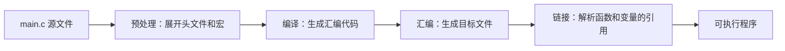
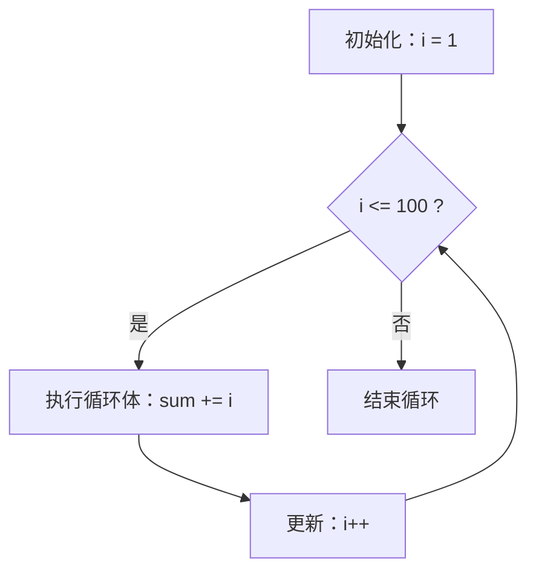
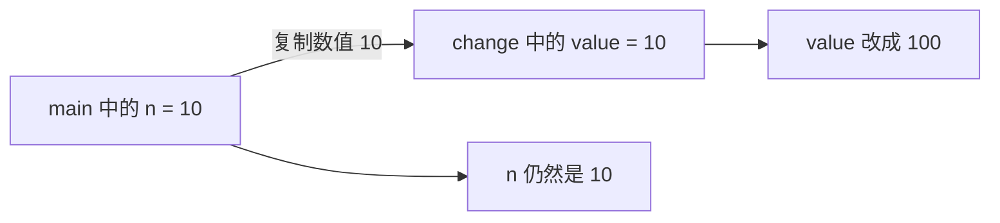
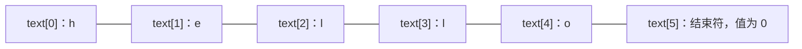
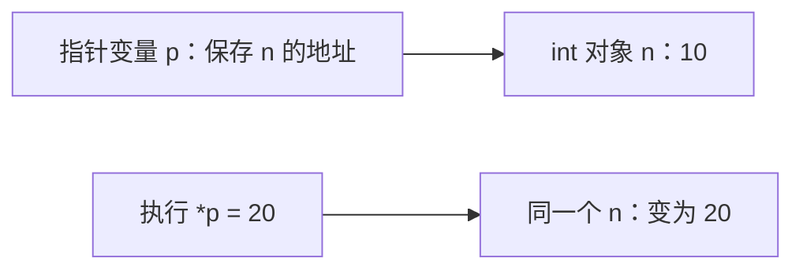
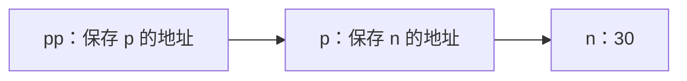
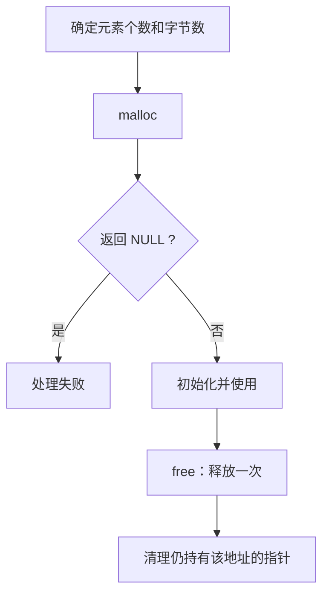
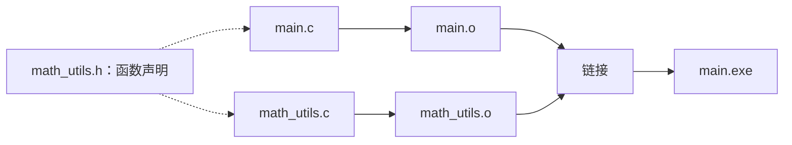

---
tags:
  - 主题/编程语言
  - 技术/C
  - 笔记/基础
---

> [!info] 知识关联
> - **原理补充**：[[代码是怎么变成可执行程序的]] — 把头文件、多文件编程与预处理、编译、链接串起来。
> - **语言对照**：[[C++基础]] — 比较指针与内存管理，以及类、引用和 STL 的新增用法。
> - **实际应用**：[[数据结构基础]] — 用结构体、指针与动态内存实现数据结构。
> - **语言对照**：[[java基础]] — 比较值传递、对象引用和内存管理方式。

# 1 快速入门

先从一个能运行的程序开始，再慢慢看变量、函数和内存这些东西。

这里主要按照 **C17** 来写，代码文件使用 `.c` 后缀。C 和 C++ 是两门语言，编译这些例子时使用 `gcc`，不要用 `g++` 把它们当成 C++。

> [!note] 阅读顺序
> 前面的变量、选择和循环，可以边看边敲。后面的数组、字符串、指针和动态内存要放在一起理解，这几块才是 C 语言比较容易绕的地方。
>
> 每个包含 `main` 的单文件例子都可以单独保存运行；只展示几行的代码片段，则是用来说明某个语法。

## 1.1 第一个 C 程序

输出 hello world。

```c
#include <stdio.h>

int main(void) {
    printf("Hello, World!\n");
    return 0;
}
```

运行结果：

```text
Hello, World!
```

简单拆一下这几行代码。

| 代码 | 作用 |
| --- | --- |
| `#include <stdio.h>` | 引入标准输入输出头文件，其中声明了 `printf` 等函数 |
| `int main(void)` | 定义程序的入口函数，返回值类型为 `int`，`void` 表示不接收参数 |
| `{ }` | 把一组语句放进一个代码块 |
| `printf(...)` | 调用函数，把内容输出到标准输出，平常看到的就是终端 |
| `\n` | 转义字符，表示换行 |
| `return 0;` | 从 `main` 返回，向运行环境报告程序成功结束 |

和 Java 对照一下，C 不需要先定义一个类，再把入口方法放进去。这里直接定义 `main` 函数就可以了。

> [!tip] 分号放在哪里
> 变量声明、赋值、函数调用、`return` 这些语句通常以 `;` 结束。
> `#include` 后面不加分号，`if`、`for` 的代码块后面也不要随手补一个分号。

### 1.1.1 编译和运行

假设文件名是 `main.c`，当前终端已经进入它所在的目录，并且安装好了 GCC。

Windows PowerShell：

```powershell
gcc -std=c17 -Wall -Wextra -Wpedantic -g main.c -o main.exe
.\main.exe
```

Linux / macOS，已安装 GCC 时：

```sh
gcc -std=c17 -Wall -Wextra -Wpedantic -g main.c -o main
./main
```

| 选项 | 含义 |
| --- | --- |
| `-std=c17` | 按 C17 标准编译 |
| `-Wall -Wextra -Wpedantic` | 打开一组常用警告，帮助发现可疑写法 |
| `-g` | 加入调试信息，方便后面打断点 |
| `-o main.exe` | 指定输出文件名 |

这几个参数先照着写就行。编译器给了警告，也要看一下，尤其是类型不匹配、没有初始化、没有返回值这些提示。

### 1.1.2 代码是怎么运行起来的



这部分仓库里已经有一篇单独的笔记：代码是怎么变成可执行程序的。

这里先记住：**头文件让编译器知道接口，链接阶段再解决函数实现在哪里的问题。**

## 1.2 注释和命名

```c
// 单行注释

/*
 * 多行注释
 * 可以用来解释一段代码
 */
```

变量、函数这些名字，称为标识符。

- 入门时使用英文字母、数字和下划线，不能以数字开头。
- 区分大小写，`score` 和 `Score` 是两个名字。
- 不能使用 `int`、`return`、`if` 这些关键字。
- 普通名字可以写成 `student_count`，尽量让名字体现用途。
- 自己的名字不要以下划线开头，避免碰到实现保留的名称。

## 1.3 变量和数据类型

### 1.3.1 定义变量

变量可以先理解成一块有名字、有类型的存储空间。

```c
#include <stdio.h>

int main(void) {
    int a = 100;
    int b = 6000;
    int sum = a + b;

    printf("Sum of a and b is: %d\n", sum);
    return 0;
}
```

输出：

```text
Sum of a and b is: 6100
```

`int a = 100;` 是定义变量并初始化。之后再写 `a = 200;`，才是对已有变量赋值。

也可以交换两个变量的值：

```c
int a = 100;
int b = 6000;
int temp = a;

a = b;
b = temp;
```

这里需要临时变量。直接写 `a = b; b = a;`，第一步就把原来的 `a` 覆盖掉了。

### 1.3.2 常用基本类型

| 类型 | 用途 | 示例 |
| --- | --- | --- |
| `char` | 保存一个字节大小的字符或小整数 | `char grade = 'A';` |
| `short` | 短整型 | `short count = 12;` |
| `int` | 常用整型 | `int age = 20;` |
| `long` | 长整型 | `long total = 1000L;` |
| `long long` | 至少能表示 64 位有符号整数的范围 | `long long n = 9000000000LL;` |
| `float` | 单精度浮点数 | `float price = 3.14f;` |
| `double` | 双精度浮点数 | `double pi = 3.1415926;` |
| `_Bool` / `bool` | 布尔值 | `bool finished = false;` |

在 C17 中，使用 `bool`、`true` 和 `false`，需要引入 `<stdbool.h>`。

```c
#include <stdbool.h>
#include <stdio.h>

int main(void) {
    int age = 20;
    bool is_adult = age >= 18;

    printf("%d\n", is_adult);
    return 0;
}
```

输出为 `1`。C 的关系运算得到的结果是 `int` 类型的 `0` 或 `1`；赋给 `bool` 后保存为布尔值。

**类型大小**

C 的类型大小不能直接套 Java 的结论。

```c
#include <limits.h>
#include <stdio.h>

int main(void) {
    printf("bits per byte: %d\n", CHAR_BIT);
    printf("sizeof(char): %zu\n", sizeof(char));
    printf("sizeof(int): %zu\n", sizeof(int));
    printf("sizeof(long): %zu\n", sizeof(long));
    printf("sizeof(double): %zu\n", sizeof(double));
    printf("int range: %d ~ %d\n", INT_MIN, INT_MAX);
    return 0;
}
```

`sizeof` 得到对象或类型占用的字节数，结果类型是 `size_t`，输出时用 `%zu`。

> [!warning] 不要把常见大小当成语言规定
> `sizeof(char)` 一定是 `1`，但一个 C 字节包含多少位，要看 `CHAR_BIT`；常见环境是 8 位。
>
> 常见桌面环境的 `int` 是 4 字节，但 C 标准没有把它固定成 4。64 位 Windows 和 64 位 Linux 的 `long` 大小也可能不同。
>
> 真正需要精确位宽时，可以查看 `<stdint.h>` 中的 `int32_t`、`uint64_t` 等类型；精确宽度类型只在实现支持对应类型时提供。

### 1.3.3 有符号和无符号

普通 `int` 是有符号整数，可以表示正数、负数和零。

`unsigned int` 是无符号整数，只表示非负数。

```c
int temperature = -10;
unsigned int count = 100U;
```

无符号类型不是“更安全的整数”。它有自己的运算规则，而且和负数混合比较时很容易绕。

> [!warning] 整数溢出
> **有符号整数运算超出可表示范围，是未定义行为。** 不能把它理解成一定会绕回负数。
>
> 无符号整数运算按照它的取值范围做模运算，例如 `unsigned int` 的 `0U - 1U` 得到 `UINT_MAX`。
>
> 无符号数与有符号数混用时，还会发生类型转换。不要用“有负数，所以肯定更小”来判断表达式。

**整数的不同进制**

```c
int decimal = 26;      // 十进制
int octal = 032;       // 八进制，以 0 开头
int hexadecimal = 0x1A; // 十六进制，以 0x 开头
```

这三个变量存的是同一个数值，只是源码的写法不同。

C17 没有标准的 `0b` 二进制字面量；有的编译器支持扩展，但这里先不使用。

### 1.3.4 初始化和常量

```c
int score = 0;
const double PI = 3.1415926;
```

`const` 表示不能通过这个名字给对象重新赋值。

```c
// PI = 3.0; // 错误：PI 是只读的
```

> [!warning] 局部变量不会自动变成 0
> 普通局部变量 `int n;` 没有初始化时，值是不确定的，不能直接拿来计算或输出。
>
> 具有静态存储期的对象，例如全局变量和 `static` 局部变量，没有显式初始化时会按规则初始化为零值。
>
> 这和 Java 数组元素有默认值的习惯不同。写 C 时，先把初始化做好。

## 1.4 运算

### 1.4.1 算术运算和类型转换

```c
#include <stdio.h>

int main(void) {
    int a = 7;
    int b = 2;

    printf("%d\n", a / b);
    printf("%d\n", a % b);
    printf("%.1f\n", (double)a / b);
    return 0;
}
```

输出：

```text
3
1
3.5
```

两个整数相除，得到的仍然是整数，商向零截断。`%` 是取余运算，只能用于整数。

`(double)a` 是强制类型转换，先把 `a` 转成 `double`，再参与除法。

注意这两种写法的顺序：

```c
double x = 7 / 2;         // 先做整数除法，得到 3，再变成 3.0
double y = (double)7 / 2; // 先转成浮点数，结果为 3.5
```

给浮点数赋值，并不会让前面已经完成的整数除法重新计算。

> [!warning] 除数和浮点数
> 整数除法、取余的除数不能为 `0`；有符号整数的除法结果也必须能表示。
>
> 浮点数往往不能精确表示十进制小数，例如 `0.1`。比较计算结果时，要结合数值大小和业务精度选择误差范围，不能随便把所有 `==` 都换成某个固定阈值。

### 1.4.2 比较、逻辑和三元运算

| 运算符 | 含义 |
| --- | --- |
| `==`、`!=` | 相等、不相等 |
| `>`、`>=`、`<`、`<=` | 大小比较 |
| `&&` | 逻辑与 |
| `\|\|` | 逻辑或 |
| `!` | 逻辑非 |
| `条件 ? 值1 : 值2` | 条件成立取值 1，否则取值 2 |

在条件判断中，**零为假，非零为真**。

```c
int age = 20;
int is_adult = age >= 18;
int is_teenager = age >= 13 && age <= 19;
int n = -100;
int absolute = n >= 0 ? n : -n;
```

这里 `n` 固定为 `-100`，所以取负数没有问题；如果写一个接受任意 `int` 的绝对值函数，还要考虑 `INT_MIN` 的相反数可能无法用 `int` 表示。

`&&` 和 `||` 会短路：

```c
if (divisor != 0 && value / divisor > 2) {
    // 左边不成立，就不会计算右边的除法
}
```

> [!warning] C 不支持连写数学不等式
> 想判断 `0 < x < 10`，应该写成 `x > 0 && x < 10`。
>
> `0 < x < 10` 会先算 `0 < x`，得到 `0` 或 `1`，再拿这个结果和 `10` 比较。

### 1.4.3 自增、自减和位运算

```c
int i = 3;
int a = i++; // a 得到 3，之后 i 变成 4
int b = ++i; // i 先变成 5，b 得到 5
```

如果只是单独写一行 `i++;` 或 `++i;`，这里最终都是让 `i` 加一。

不要把多次修改同一个变量塞到一条表达式里：

```c
// i = i++;                 // 未定义行为
// printf("%d %d", i++, i++); // 未定义行为
```

**位运算**

| 运算符 | 含义 | 示例 |
| --- | --- | --- |
| `&` | 按位与 | 两个位都是 1，结果才是 1 |
| `\|` | 按位或 | 至少有一个位是 1，结果就是 1 |
| `^` | 按位异或 | 两个位不同，结果为 1 |
| `~` | 按位取反 | 每一位翻转 |
| `<<`、`>>` | 左移、右移 | 移动二进制位 |

例如用不同的二进制位表示权限：

```c
unsigned int read_flag = 1U << 0;
unsigned int write_flag = 1U << 1;
unsigned int flags = read_flag | write_flag;

if ((flags & read_flag) != 0U) {
    // 有读取权限
}

flags &= ~write_flag; // 清除写入权限
```

`&` 和 `&&` 不一样，`|` 和 `||` 也不一样。位运算通常优先使用无符号整数；移位次数不能为负，也不能达到或超过左操作数经整数提升后的位宽。

# 2 输入和输出

## 2.1 printf 格式化输出

```c
#include <stdio.h>

int main(void) {
    int age = 20;
    double score = 95.678;
    char grade = 'A';

    printf("age: %d, score: %.2f, grade: %c\n", age, score, grade);
    printf("progress: 80%%\n");
    return 0;
}
```

输出：

```text
age: 20, score: 95.68, grade: A
progress: 80%
```

| 格式 | 对应的数据 |
| --- | --- |
| `%d` | `int` |
| `%u` | `unsigned int` |
| `%ld` | `long` |
| `%lld` | `long long` |
| `%f` | `double`；传入的 `float` 会自动提升为 `double` |
| `%.2f` | 保留两位小数的浮点数输出 |
| `%c` | 单个字符；`char` 传参时会提升为 `int` |
| `%s` | 以 `\0` 结尾的字符串 |
| `%zu` | `size_t`，例如 `sizeof` 的结果 |
| `%p` | 指针地址，需要传入 `void *` |
| `%%` | 输出百分号本身，不消耗参数 |

> [!warning] 格式和实参必须匹配
> `printf` 不会像字符串拼接那样自动理解所有类型。
>
> 比如用 `%d` 输出 `double`，属于未定义行为，不能只当成“输出格式不好看”。

## 2.2 scanf 读取输入

先读取一个年龄和一个分数。

```c
#include <stdio.h>

int main(void) {
    int age = 0;
    double score = 0.0;

    printf("Input age and score: ");
    fflush(stdout);

    if (scanf("%d %lf", &age, &score) != 2) {
        fprintf(stderr, "Invalid input\n");
        return 1;
    }

    printf("age = %d, score = %.1f\n", age, score);
    return 0;
}
```

输入：

```text
20 95.5
```

得到：

```text
age = 20, score = 95.5
```

这里有三个地方需要注意。

1. `&age` 是取变量的地址，`scanf` 需要知道把读到的数据写到哪里。
2. 返回值是成功匹配并赋值的项目数，这里应该是 `2`，所以要检查。
3. 读取 `double` 使用 `%lf`，读取 `float` 使用 `%f`；这和 `printf` 的规则不同。

| 类型 | printf 输出 | scanf 输入 |
| --- | --- | --- |
| `int` | `%d` | `%d`，传 `int *` |
| `float` | `%f` | `%f`，传 `float *` |
| `double` | `%f` | `%lf`，传 `double *` |
| `long long` | `%lld` | `%lld`，传 `long long *` |

**读取字符**

```c
char choice = '\0';
if (scanf(" %c", &choice) == 1) {
    printf("choice = %c\n", choice);
}
```

`%c` 前面的空格会跳过空白字符，包括前一次输入留下的换行。`%c` 本身不会跳过这些空白。

**读取一个单词**

```c
char name[20];
if (scanf("%19s", name) == 1) {
    printf("%s\n", name);
}
```

这里最多读取 19 个字符，最后留一个位置给 `\0`。`name` 是数组，传参时会转换成指向首元素的指针，这里不写 `&name`。

> [!warning] scanf 的使用范围
> `%s` 遇到空格就停止，不能直接读取 `hello world` 这样的一整行。
>
> 对数值输入，返回值检查可以发现格式不匹配，但不能可靠解决超出目标类型范围的问题。处理不可信输入时，更适合先用 `fgets` 读一行，再用 `strtol` 等函数检查范围和剩余字符。
>
> 不要用 `fflush(stdin)` 清空输入，它不是可移植的标准 C 用法。上面的 `fflush(stdout)` 是刷新输出，让没有换行的提示及时显示。

## 2.3 fgets 读取一整行

```c
#include <stdio.h>
#include <string.h>

int main(void) {
    char line[100];

    printf("Input a line: ");
    fflush(stdout);

    if (fgets(line, sizeof line, stdin) == NULL) {
        fprintf(stderr, "No input\n");
        return 1;
    }

    line[strcspn(line, "\n")] = '\0';
    printf("You entered: %s\n", line);
    return 0;
}
```

输入 `hello world`，就能完整读到这两个单词。

`fgets` 最多读取“容量减一”个字符，并在成功时补上 `\0`。如果读到了换行，换行也会放进数组。

`strcspn(line, "\n")` 找到第一个换行的位置；如果没有换行，就得到字符串长度。把对应位置改成 `\0`，就去掉了末尾换行。

> [!note] 数组装不下一整行怎么办
> `fgets` 限制的是一次读取的长度。输入太长时，剩余内容还在输入流中，下一次读取会继续读到它。
>
> 上面是单次读取示例；写菜单程序时，需要决定是分段处理、拒绝超长行，还是把这一行剩余字符读掉。
>
> 如果先使用 `scanf` 再使用 `fgets`，前面留下的换行可能被后者直接读到。入门时尽量统一输入方式。

## 2.4 getchar 和 EOF

```c
#include <stdio.h>

int main(void) {
    int ch;

    while ((ch = getchar()) != EOF) {
        putchar(ch);
    }

    return ferror(stdin) ? 1 : 0;
}
```

这段代码把输入的字符逐个输出，直到输入结束。也可以在文件或管道重定向输入时观察。

`getchar` 返回 `int`，因为它既要表示读到的字符，又要表示特殊值 `EOF`。

**接收结果用 `int`，不要先存进 `char` 再和 `EOF` 比较。** `EOF` 也可能表示读取失败，所以需要时还要检查 `ferror`。

# 3 流程控制

## 3.1 if 选择

```c
#include <stdio.h>

int main(void) {
    int score = 75;

    if (score >= 90) {
        printf("Excellent\n");
    } else if (score >= 60) {
        printf("Pass\n");
    } else {
        printf("Fail\n");
    }

    return 0;
}
```

这段输出 `Pass`。

多个条件按从上到下的顺序判断，命中一个分支后，就不会再执行后面的分支。

> [!warning] 赋值和比较
> `if (score = 60)` 是先赋值，再判断赋值结果；这里的 `60` 非零，所以条件成立。
>
> 判断是否相等要写 `if (score == 60)`。另外也别写成 `if (条件);`，这个分号会变成一条空语句。

## 3.2 switch 选择

```c
#include <stdio.h>

int main(void) {
    int option = 2;

    switch (option) {
        case 1:
            printf("Add\n");
            break;
        case 2:
            printf("Search\n");
            break;
        case 3:
        case 4:
            printf("Other operation\n");
            break;
        default:
            printf("Unknown option\n");
            break;
    }

    return 0;
}
```

输出 `Search`。

C 的 `switch` 使用整数类型的控制表达式，`case` 后面要是整数常量表达式，不能直接拿字符串做 `case`。

`break` 用来退出 `switch`。没有 `break` 时，执行会继续落到后面的分支，这叫贯穿。上面 `case 3` 和 `case 4` 共用一段代码，就是有意利用这个特点。

## 3.3 while、do while 和 for

**while：先判断，再执行**

```c
int i = 1;
while (i <= 3) {
    printf("%d\n", i);
    i++;
}
```

**do while：先执行一次，再判断**

```c
int i = 1;
do {
    printf("%d\n", i);
    i++;
} while (i <= 3);
```

注意 `do while` 最后有一个分号。

**for：把初始化、条件和更新写在一起**

```c
#include <stdio.h>

int main(void) {
    int sum = 0;

    for (int i = 1; i <= 100; i++) {
        sum += i;
    }

    printf("%d\n", sum);
    return 0;
}
```

输出 `5050`。



## 3.4 break 和 continue

- `break`：结束当前最内层的循环或 `switch`。
- `continue`：跳过当前这一轮剩余的循环体，进入下一轮。对于 `for`，仍然先执行更新表达式，再判断条件。

```c
for (int i = 1; i <= 10; i++) {
    if (i == 3) {
        continue;
    }
    if (i == 6) {
        break;
    }
    printf("%d ", i);
}
```

依次输出 `1 2 4 5`。

# 4 函数

## 4.1 定义和调用

函数就是把一组操作起一个名字，需要时再调用。

```c
#include <stdio.h>

int add(int a, int b); // 函数声明

int main(void) {
    int result = add(10, 20);
    printf("%d\n", result);
    return 0;
}

int add(int a, int b) { // 函数定义
    return a + b;
}
```

输出 `30`。

这里分清三个东西：

- **声明**：告诉编译器函数名、返回值类型和参数类型，末尾有分号。
- **定义**：写出函数实际执行的代码，包含函数体。
- **调用**：传入实参，执行函数，并在需要时使用返回值。

`int add(int a, int b)` 中，`a` 和 `b` 是形参；调用时的 `10` 和 `20` 是实参。

> [!tip] 没有参数、没有返回值
> 没有参数写 `void show(void)`；返回值类型 `void` 表示不返回数据，可以用 `return;` 提前结束。
>
> 在 C17 中，声明 `int f();` 不表示“明确没有参数”，而是没有提供参数类型信息。明确无参数要写 `int f(void);`。
>
> 标准 C 不支持 Java 那样的函数重载，同名函数不能靠参数不同来区分。

## 4.2 值传递

先看一个看起来想修改变量、实际上没有改到的例子。

```c
#include <stdio.h>

void change(int value) {
    value = 100;
    printf("inside: %d\n", value);
}

int main(void) {
    int n = 10;
    change(n);
    printf("outside: %d\n", n);
    return 0;
}
```

输出：

```text
inside: 100
outside: 10
```

调用 `change(n)`，传过去的是 `n` 的值的副本。形参 `value` 是另一个变量，改它不会自动改到外面的 `n`。



**C 的函数参数全部是值传递。** 后面传指针时，复制的是地址；通过这个地址，函数才可以访问调用者的对象。

## 4.3 作用域和 static

```c
#include <stdio.h>

int global_count = 0; // 文件作用域

void count_calls(void) {
    static int calls = 0; // 只初始化一次，函数结束后仍保留值
    int local = 0;        // 每次调用都会重新执行这个初始化

    calls++;
    local++;
    global_count++;
    printf("calls = %d, local = %d\n", calls, local);
}

int main(void) {
    count_calls();
    count_calls();
    printf("global = %d\n", global_count);
    return 0;
}
```

输出：

```text
calls = 1, local = 1
calls = 2, local = 1
global = 2
```

| 写法 | 名字在哪里可见 | 对象能存活多久 |
| --- | --- | --- |
| 普通局部变量 | 所在代码块内，从声明处开始 | 通常到该次代码块执行结束 |
| `static` 局部变量 | 仍然只在所在代码块内 | 整个程序运行期间 |
| 文件作用域变量 | 从声明处到当前源文件结束 | 整个程序运行期间 |

**作用域描述名字在哪里能用，生命周期描述对象什么时候存在，这两件事要分开看。**

文件作用域变量如果再加上 `static`，还会使名字具有内部链接，只能由当前翻译单元直接引用；多文件部分再展开。

## 4.4 递归

递归就是函数调用自己。先看阶乘：

```c
#include <stdio.h>

long long factorial(int n) {
    if (n <= 1) {
        return 1;
    }
    return n * factorial(n - 1);
}

int main(void) {
    int n = 5;
    printf("%lld\n", factorial(n));
    return 0;
}
```

输出 `120`。

`factorial(5)` 会展开成 `5 * 4 * 3 * 2 * 1`。

> [!warning] 递归的两个边界
> 必须有终止条件，每一次调用还要向终止条件靠近。
>
> 这个示例只讨论 `0 ~ 20` 的输入，不把负数当成有效阶乘输入，也不继续计算超出 `long long` 保证范围的结果。递归太深还可能耗尽调用所需的空间。

# 5 数组和字符串

## 5.1 一维数组

数组是连续存放的、同一种元素类型的数据。

```c
#include <stdio.h>

int main(void) {
    int scores[] = {68, 79, 91, 85, 62};
    size_t length = sizeof scores / sizeof scores[0];

    for (size_t i = 0; i < length; i++) {
        printf("%d ", scores[i]);
    }
    printf("\n");

    printf("length = %zu\n", length);
    return 0;
}
```

输出：

```text
68 79 91 85 62
length = 5
```

数组下标从 `0` 开始。长度为 `5`，有效下标就是 `0 ~ 4`。

```c
int a[5] = {1, 2}; // 后面三个元素初始化为 0
int b[5] = {0};    // 所有元素初始化为 0
int c[] = {1, 2, 3}; // 编译器根据初始化列表确定长度为 3
int d[5];         // 普通局部数组，不会自动把元素清零
```

> [!warning] 数组边界
> C 不会自动帮你检查下标。`scores[5]` 已经超出这个数组的元素范围，读写它属于未定义行为。
>
> 访问越界不一定立刻崩溃，暂时输出“正常”也不能证明代码正确。
>
> 数组定义后不能整体赋值，不能写 `a = b;`。要复制元素，可以循环，或在明确字节数和不重叠等前提下使用 `memcpy`。

## 5.2 数组传给函数

```c
#include <stdio.h>

int sum_array(const int values[], size_t length) {
    int sum = 0;
    for (size_t i = 0; i < length; i++) {
        sum += values[i];
    }
    return sum;
}

int main(void) {
    int values[] = {10, 20, 30};
    size_t length = sizeof values / sizeof values[0];

    printf("%d\n", sum_array(values, length));
    return 0;
}
```

输出 `60`。

函数参数里的 `const int values[]` 会被调整为 `const int *values`。它没有携带数组长度，所以这里单独传入 `length`。

**`sizeof 数组 / sizeof 数组[0]` 只适用于这里真正的数组对象。** 在这个函数内部对 `values` 使用 `sizeof`，得到的是指针大小，不是调用者整个数组的大小。

`const` 表示函数不通过 `values` 修改数组元素。

## 5.3 二维数组

```c
#include <stdio.h>

int main(void) {
    int matrix[2][3] = {
        {1, 2, 3},
        {4, 5, 6}
    };

    for (size_t row = 0; row < 2; row++) {
        for (size_t col = 0; col < 3; col++) {
            printf("%d ", matrix[row][col]);
        }
        printf("\n");
    }
    return 0;
}
```

输出：

```text
1 2 3
4 5 6
```

可以把它看成“有两个元素的大数组，每个元素又是一个包含三个 `int` 的数组”。

它按行连续存储。把这种数组传给函数时，常见的固定列数写法是：

```c
void show_matrix(int matrix[][3], size_t rows);
```

这里要知道每行有多少个元素，函数才能计算 `matrix[row][col]` 的位置。它对应的是指向一行的指针，不是 `int **`。

## 5.4 字符和字符串

这是 C 和 Java 差别比较明显的地方。

**C 没有内置的 `String` 类。字符串通常是一串以 `'\0'` 结尾的字符。**

```c
#include <stdio.h>
#include <string.h>

int main(void) {
    char letter = 'A';
    char text[] = "hello";

    printf("%c\n", letter);
    printf("%s\n", text);
    printf("sizeof = %zu\n", sizeof text);
    printf("strlen = %zu\n", strlen(text));
    return 0;
}
```

输出：

```text
A
hello
sizeof = 6
strlen = 5
```



`sizeof text` 算整个数组的存储空间，包含末尾的 `\0`。

`strlen(text)` 从开头数到第一个 `\0`，不把结束符算进去。

| 写法 | 含义 |
| --- | --- |
| `'A'` | 整数字符常量，在 C 中类型是 `int`，可以赋给 `char` |
| `"A"` | 字符串字面量，包含 `'A'` 和 `'\0'` |
| `'\0'` | 值为 0 的空字符，用作字符串结束标记 |
| `'0'` | 数字字符 0，和空字符不是一回事 |
| `NULL` | 空指针常量宏，常用来表达指针没有指向对象 |

**字符串数组与字符串字面量**

```c
char a[] = "hello";
a[0] = 'H'; // 可以：a 是用字面量内容初始化的可修改数组

const char *b = "hello";
// b[0] = 'H'; // 不可以通过 b 修改
```

`a` 自己拥有一个数组，内容可以修改。`b` 是指针，指向字符串字面量。

> [!warning] 字符串的前提
> 修改字符串字面量属于未定义行为，即使有的 C 编译器允许写 `char *p = "hello";`，也不能通过它修改字面量。
>
> `char text[5] = "hello";` 在 C 中可以初始化，但这个数组没有位置存放结束符，不能交给 `printf("%s", text)` 或 `strlen(text)` 当普通字符串使用。
>
> 字节数组只有满足结束符等要求时，才能被相应的字符串函数安全处理。

另外，`char` 不等于一个完整的中文字符。UTF-8 的一个中文字符通常需要多个字节，`strlen` 计算的是结束符前的**字节数**，不是界面上看到的字数。

## 5.5 常用字符串操作

先引入 `<string.h>`。

| 函数 | 作用 | 需要注意 |
| --- | --- | --- |
| `strlen(s)` | 获取字符串长度 | 必须有可访问的结束符 |
| `strcmp(a, b)` | 比较两个字符串 | 相等返回 0，否则返回负数或正数，不保证是 -1 / 1 |
| `strcpy(dst, src)` | 复制字符串，包括结束符 | 目标容量必须足够，源和目标不能重叠 |
| `strcat(dst, src)` | 追加字符串 | 目标原本要有结束符，剩余容量足够，不能重叠 |
| `strchr(s, ch)` | 查找字符 | 找不到返回 `NULL` |
| `memcpy(dst, src, n)` | 复制 n 个字节 | 两段区域不能重叠，也不会自动补结束符 |
| `memmove(dst, src, n)` | 复制 n 个字节 | 允许源区域和目标区域重叠 |

**比较内容**

```c
#include <stdio.h>
#include <string.h>

int main(void) {
    char first[] = "hello";
    char second[] = "hello";

    if (strcmp(first, second) == 0) {
        printf("same content\n");
    }
    return 0;
}
```

输出 `same content`。

这里不写 `first == second`。在这种表达式里，数组会转换为指针，`==` 比较的是地址，不是字符内容。

**拼接带数值的字符串**

C 不能像 Java 那样直接用 `"age = " + age` 来拼字符串。可以使用 `snprintf`：

```c
#include <stdio.h>

int main(void) {
    char message[32];
    int age = 20;

    int written = snprintf(message, sizeof message, "age = %d", age);
    if (written < 0 || (size_t)written >= sizeof message) {
        fprintf(stderr, "Formatting failed or text was truncated\n");
        return 1;
    }

    printf("%s\n", message);
    return 0;
}
```

输出 `age = 20`。

`snprintf` 的返回值表示：假如空间足够，原本需要写入多少个字符，不含结束符。因此返回值大于等于容量，就说明发生了截断。

> [!tip] 名字带 n，不代表自动安全
> `strncpy` 在达到长度限制时不一定补 `\0`，不能把它当成“自动安全的 strcpy”。
>
> 处理字符串时要同时考虑：源内容是否有效、目标容量、结束符、是否重叠。只换一个函数名不够。

# 6 指针

## 6.1 地址、指针和解引用

先举一个例子。

```c
#include <stdio.h>

int main(void) {
    int n = 10;
    int *p = &n;

    printf("n = %d\n", n);
    printf("*p = %d\n", *p);
    printf("&n = %p\n", (void *)&n);
    printf("p = %p\n", (void *)p);

    *p = 20;
    printf("n = %d\n", n);
    return 0;
}
```

前两行输出的值都是 `10`。接下来打印的两个地址相同，具体地址每次运行可能不同。最后输出 `n = 20`。

| 写法 | 含义 |
| --- | --- |
| `int n = 10;` | 定义一个 `int` 对象 |
| `&n` | 取得 `n` 的地址 |
| `int *p` | 定义一个指向 `int` 的指针变量 |
| `p = &n` | 把 `n` 的地址存进 `p` |
| `*p` | 解引用，通过 `p` 访问它指向的对象 |



可以先这样理解：**`p` 保存地址，`*p` 访问这个地址所指向的对象。**

声明里的 `*` 和表达式里的 `*`，语境不同：

```c
int *p; // 声明 p 是指针
// *p = 1; // 此时还没有让 p 指向有效对象，不能解引用
```

> [!warning] 一行声明多个变量
> `int *p, q;` 中，只有 `p` 是指针，`q` 是 `int`。
>
> 要定义两个指针，可以写 `int *p, *q;`。入门时分成两行更清楚。

指针的类型也有作用。`int *`、`double *` 等类型会影响解引用时访问的对象类型，以及指针加一时移动多少。

不能随便把某个地址强转成另一种指针，就认为里面的对象也跟着转换了类型。

## 6.2 用指针修改外部变量

前面普通参数的 `change` 没有修改外面的变量，这次传入它的地址。

```c
#include <stdio.h>

void swap(int *a, int *b) {
    int temp = *a;
    *a = *b;
    *b = temp;
}

int main(void) {
    int x = 10;
    int y = 20;

    swap(&x, &y);
    printf("x = %d, y = %d\n", x, y);
    return 0;
}
```

输出：

```text
x = 20, y = 10
```

传进去的是两个地址的副本，但这两个地址仍然指向 `main` 中的 `x` 和 `y`。

所以修改 `*a`，就是修改 `x`；修改 `*b`，就是修改 `y`。

> [!note] 参数约定
> 这个 `swap` 要求传入两个有效的 `int` 对象地址，不能传 `NULL` 或失效地址。
>
> 是否允许空指针、失败时如何返回，都是函数接口需要说明的事情。检查 `p != NULL` 也只能排除空指针，不能证明任意非空地址有效。

## 6.3 数组和指针的关系

```c
#include <stdio.h>

int main(void) {
    int numbers[] = {10, 20, 30};
    int *p = numbers;

    printf("%d\n", numbers[1]);
    printf("%d\n", *(p + 1));
    printf("%d\n", p[2]);
    return 0;
}
```

输出：

```text
20
20
30
```

`numbers` 在这里转换成指向首元素的指针，所以 `p` 指向 `numbers[0]`。

`p + 1` 指向下一个 `int` 元素，不是简单地移动一个字节。`p[i]` 对应 `*(p + i)`。

但是，**数组本身不是一个可以重新指向别处的指针变量**。

```c
int numbers[3] = {10, 20, 30};
int *p = numbers;

p++;       // 可以，p 现在指向第二个元素
// numbers++; // 错误，数组名不能这样修改
```

| 表达式 | 类型或含义 |
| --- | --- |
| `numbers` | 在大多数表达式中转换成 `int *`，指向第一个元素 |
| `&numbers[0]` | `int *`，首元素地址 |
| `&numbers` | `int (*)[3]`，指向整个数组的指针 |
| `sizeof numbers` | 整个数组的字节数，此处不发生数组到指针的转换 |
| `sizeof p` | 指针变量本身的大小 |

`&numbers` 和 `&numbers[0]` 对应相同的起始存储位置，但类型不同，做 `+ 1` 时的含义也不同。

**指针移动的边界**

```c
int values[3] = {10, 20, 30};
int *begin = values;
int *end = values + 3;

for (int *p = begin; p != end; p++) {
    printf("%d\n", *p);
}
```

`end` 是数组最后一个元素之后的位置，可以用来判断遍历是否结束，不能通过 `*end` 读取元素。

指针运算要限制在同一个数组及其尾后位置内。不能把指针当成任意整数，在不相关的对象之间随便移动、相减或比较大小。

## 6.4 空指针、野指针和悬空指针

| 名称 | 常见情况 | 应对方式 |
| --- | --- | --- |
| 空指针 | `int *p = NULL;`，没有指向对象 | 使用前判断接口是否允许为空，不能解引用 |
| 野指针 | 常用来称呼未初始化等指向不明的指针 | 声明时初始化，使用前建立有效指向 |
| 悬空指针 | 原来指向的对象已结束生命周期 | 不能继续访问，重新建立有效指向 |

例如，不能返回普通局部变量的地址：

```c
// 错误示例，不要这样写
int *bad_pointer(void) {
    int local = 10;
    return &local;
}
```

函数结束以后，`local` 就不再是一个有效对象。调用者不能再通过这个返回值访问它。

如果只需要一个整数，直接返回 `int`；如果需要把结果写进调用者提供的空间，就传入指针和容量。

## 6.5 const 和指针

这三种写法容易混，拆开看。

```c
int a = 10;
int b = 20;

const int *p1 = &a; // 指向只读 int 的指针，p1 自己可以改变指向
p1 = &b;
// *p1 = 30;       // 不允许通过 p1 修改对象

int *const p2 = &a; // 指针本身不能改，指向的 int 可以改
*p2 = 30;
// p2 = &b;        // 不允许改变 p2 的指向

const int *const p3 = &a; // 指向只读 int 的只读指针
// p3 = &b;              // 不允许
// *p3 = 40;             // 不允许
```

`const int *p` 和 `int const *p` 是同一种写法。

这里的“不能修改”，说的是通过这个访问方式受到限制。`p1` 指向的 `a` 本身并没有被定义为 `const`，仍然可以用 `a = 50;` 修改。

如果对象本来就定义为 `const int a = 10;`，再强行去掉 `const` 修改它，就属于未定义行为。

## 6.6 二级指针

指针变量本身也是对象，也有地址。

```c
#include <stdio.h>

int main(void) {
    int n = 10;
    int *p = &n;
    int **pp = &p;

    **pp = 30;
    printf("%d\n", n);
    return 0;
}
```

输出 `30`。



`*pp` 访问的是 `p`，`**pp` 再通过 `p` 访问 `n`。

当函数需要修改调用者的“指针变量本身”，就可能需要二级指针。只传 `int *p`，然后在函数里给 `p` 换一个地址，改到的仍然只是形参副本。

## 6.7 函数指针

普通指针可以指向对象，函数指针可以指向函数，用来决定“这次调用哪一段操作”。

```c
#include <stdio.h>

int add(int a, int b) {
    return a + b;
}

int multiply(int a, int b) {
    return a * b;
}

int main(void) {
    int (*operation)(int, int) = add;
    printf("%d\n", operation(3, 4));

    operation = multiply;
    printf("%d\n", operation(3, 4));
    return 0;
}
```

输出先是 `7`，再是 `12`。

`int (*operation)(int, int)` 表示：`operation` 是一个指针，指向“接收两个 `int`、返回 `int`”的函数。

括号不能省。`int *operation(int, int)` 声明的则是一个返回 `int *` 的函数。

# 7 结构体和自定义类型

## 7.1 struct 结构体

数组把同一种类型的数据放到一起，结构体则把描述同一个事物的不同数据放到一起。

比如一个学生有姓名、年龄和分数。

```c
#include <stdio.h>

struct Student {
    char name[20];
    int age;
    double score;
};

int main(void) {
    struct Student student = {
        .name = "Xiao Ming",
        .age = 20,
        .score = 95.5
    };

    printf("%s, %d, %.1f\n", student.name, student.age, student.score);

    struct Student *p = &student;
    p->score = 98.0;
    printf("%.1f\n", student.score);
    return 0;
}
```

输出：

```text
Xiao Ming, 20, 95.5
98.0
```

注意结构体定义最后的 `;`。

| 写法 | 用途 |
| --- | --- |
| `student.score` | 通过结构体对象访问成员 |
| `p->score` | 通过结构体指针访问成员 |
| `(*p).score` | 和 `p->score` 等价 |

`.name = ...` 这样的写法叫指定初始化，可以直接标明初始化哪个成员。

> [!note] 结构体可以整体赋值
> 同类型的结构体对象可以写 `copy = student;`，其中的数组成员也会随结构体一起复制。
>
> 如果成员是指针，复制的是指针值，不会自动把指向的数据再复制一份。这会影响后续的修改和释放。

## 7.2 typedef

`typedef` 用来给类型起一个别名，不会创建 Java 那样的类。

```c
typedef struct Student {
    char name[20];
    int age;
    double score;
} Student;

Student first = {.name = "Alice", .age = 20, .score = 90.0};
Student second = first;
```

后面就可以直接写 `Student`，不必每次都写 `struct Student`。

结构体数组：

```c
Student students[] = {
    {.name = "Alice", .age = 20, .score = 90.0},
    {.name = "Bob", .age = 21, .score = 85.0}
};
```

## 7.3 enum 枚举

枚举适合给一组状态命名，避免代码里到处都是不明含义的数字。

```c
typedef enum {
    STATUS_OK = 0,
    STATUS_NOT_FOUND = 1,
    STATUS_INVALID = 2
} Status;

Status status = STATUS_OK;
```

没有显式指定时，第一个枚举常量默认从 `0` 开始，后面依次加一。

C 的枚举不像 Java 枚举那样自带对象、方法等机制，不能直接套用 Java 的用法。

## 7.4 union 联合体

结构体的各成员分别占用存储，联合体的各成员则共用同一块存储。

```c
union Number {
    int integer;
    double decimal;
};

union Number value = {.integer = 10};
value.decimal = 3.14; // 现在用同一块存储保存 double
```

写入 `decimal` 后，不能再期待 `integer` 仍然保存着原来的 `10`。

入门时按照“最后写入哪个成员，就通过哪个成员读取”的规则使用；需要保存多种类型时，通常再配一个 `enum`，记录当前存的是哪一种。

## 7.5 结构体大小和对齐

```c
struct Example {
    char flag;
    int count;
};
```

`sizeof(struct Example)` 不一定等于两个成员的大小之和。

实现可能在成员之间和结构体末尾加入填充，以满足对齐要求。因此不要把“结构体的原始内存”直接当成固定的网络协议或跨平台文件格式。

# 8 动态内存

## 8.1 先分清对象能活多久

前面的局部数组，例如 `int values[10];`，通常随着所在函数的这次执行结束而失效。

如果需要在运行时决定空间大小，或者需要让空间跨越某次函数调用继续使用，就会接触动态分配。

| 常见对象 | 典型存储期 | 如何结束 |
| --- | --- | --- |
| 普通局部变量 | 自动存储期 | 离开对应的执行作用域后结束 |
| 全局变量、`static` 变量 | 静态存储期 | 持续整个程序运行期 |
| `malloc` 等分配的对象 | 分配存储期 | 释放相应空间后结束 |

大家常说普通局部变量在“栈”上，动态内存在“堆”上，这是常见实现方式。理解生命周期时，先看语言层面的存储期，不要只凭地址高低判断。

## 8.2 malloc 和 free

先根据元素个数，申请一块能放下多个整数的空间。

```c
#include <stdint.h>
#include <stdio.h>
#include <stdlib.h>

int main(void) {
    size_t count = 5;
    int *values = NULL;

    if (count == 0 || count > SIZE_MAX / sizeof *values) {
        fprintf(stderr, "Invalid allocation size\n");
        return 1;
    }

    values = malloc(count * sizeof *values);
    if (values == NULL) {
        fprintf(stderr, "Allocation failed\n");
        return 1;
    }

    for (size_t i = 0; i < count; i++) {
        values[i] = (int)i * 10;
        printf("%d ", values[i]);
    }
    printf("\n");

    free(values);
    values = NULL;
    return 0;
}
```

输出：

```text
0 10 20 30 40
```

`malloc`、`free` 在 `<stdlib.h>` 中声明。

这里最关键的是这几步：

1. **计算字节数**：元素个数乘上单个元素大小，注意乘法不能溢出。
2. **检查返回值**：分配失败时得到 `NULL`。
3. **先写入，再读取**：`malloc` 返回的空间没有自动初始化。
4. **用完释放**：把动态空间交还给分配器。

`sizeof *values` 根据指向的元素类型计算大小，这里不会真的解引用空指针。这样写也避免以后改了指针类型，却忘记修改 `sizeof(int)`。

在 C 中，`malloc` 返回的 `void *` 可以转换为对象指针，不需要写强制类型转换，但一定要正确包含 `<stdlib.h>`。



> [!warning] free 的使用边界
> 只能释放分配函数返回的有效分配指针，不能释放局部变量地址，也不能释放 `p + 1` 这样的中间地址。
>
> `free(NULL)` 可以调用。对同一块尚未重新分配的空间重复 `free`，或者释放后继续访问，都属于未定义行为。
>
> `values = NULL` 只清理这个变量；如果还有别的指针保存着旧地址，它们也已经失效，不会自动跟着变成 `NULL`。

## 8.3 calloc

`calloc` 接收“元素个数”和“单个元素大小”，并把分配空间的所有位初始化为零。

```c
int *values = calloc(5, sizeof *values);
if (values == NULL) {
    // 处理分配失败
} else {
    // 这里的五个 int 元素都为 0
    free(values);
}
```

对整数数组，这样可以得到初始值为零的元素。

不要把“所有位为零”一概当成所有类型的语义初始化：C 标准不保证空指针和浮点零在所有实现上都使用全零位表示。

## 8.4 realloc 调整大小

`realloc` 可以调整原有动态空间的大小，可能留在原位置，也可能搬到新位置。

```c
#include <stdint.h>
#include <stdio.h>
#include <stdlib.h>

int main(void) {
    size_t old_count = 3;
    int *values = malloc(old_count * sizeof *values);
    if (values == NULL) {
        return 1;
    }

    for (size_t i = 0; i < old_count; i++) {
        values[i] = (int)i + 1;
    }

    size_t new_count = 5;
    if (new_count == 0 || new_count > SIZE_MAX / sizeof *values) {
        free(values);
        return 1;
    }

    int *new_values = realloc(values, new_count * sizeof *values);
    if (new_values == NULL) {
        free(values); // 非零大小的 realloc 失败，原分配仍然有效
        return 1;
    }
    values = new_values;

    for (size_t i = old_count; i < new_count; i++) {
        values[i] = 0; // 新增部分不会自动初始化
    }
    for (size_t i = 0; i < new_count; i++) {
        printf("%d ", values[i]);
    }
    printf("\n");

    free(values);
    return 0;
}
```

输出：

```text
1 2 3 0 0
```

不能直接写成下面这样，再在失败时只处理 `values`：

```c
// values = realloc(values, new_size);
// 如果返回 NULL，就把仍然有效的原分配地址丢掉了，容易造成内存泄漏
```

先用临时指针接结果，成功后再更新原指针。

> [!warning] realloc 成功后
> 后续统一使用返回的新指针。原指针，以及以前指向旧块内部的指针，都不能继续使用；即使新块看起来还在相同地址，也应按这个规则处理。
>
> 这里刻意不使用零大小分配或 `realloc(p, 0)`，先避开这些特殊规则。

## 8.5 内存泄漏和所有权

内存泄漏就是：动态空间还没有释放，但程序已经失去管理它的有效途径，或者在该释放的时候没有释放。

```c
// 错误示例
int *p = malloc(100 * sizeof *p);
p = NULL; // 如果没有其他地方保存原分配地址，这块空间就丢失了
```

写代码时，可以给动态空间明确一个“由谁负责释放”的约定：

- 函数只借用调用者的数组，就不要擅自释放它。
- 函数返回新分配的空间，要说明调用者负责释放。
- 出错提前返回时，也要释放已经成功申请的资源。
- 结构体里放了动态指针，要说明结构体复制后，谁拥有对应空间。

这不是 C 自动执行的机制，而是写程序时必须维护的规则。

# 9 文件操作

## 9.1 打开和关闭

文件操作先记住一条线：**打开 → 读写 → 关闭**。

```c
#include <stdio.h>

int main(void) {
    FILE *file = fopen("notes.txt", "w");
    if (file == NULL) {
        perror("fopen");
        return 1;
    }

    if (fprintf(file, "Hello, file!\n") < 0) {
        perror("fprintf");
        fclose(file);
        return 1;
    }

    if (fclose(file) == EOF) {
        perror("fclose");
        return 1;
    }
    return 0;
}
```

运行后，会在**程序当前工作目录**下创建 `notes.txt`，内容为：

```text
Hello, file!
```

当前工作目录不一定等于源文件所在目录，尤其是从 IDE 启动程序时。

> [!warning] w 模式会截断原文件
> 如果 `notes.txt` 已存在，使用 `"w"` 成功打开后，原内容就会被清空。试验时在单独目录里运行。
>
> `FILE *` 表示标准库管理的文件流。使用 `fclose` 关闭，不要拿它去调用 `free`。关闭以后也不能继续用它读写。

| 模式 | 含义 |
| --- | --- |
| `"r"` | 读文本，文件必须已经存在 |
| `"w"` | 写文本，创建文件或截断原文件 |
| `"a"` | 追加文本，不存在则创建，写入发生在末尾 |
| `"rb"` | 读二进制文件 |
| `"wb"` | 写二进制文件，创建或截断 |

Windows 文本模式可能转换换行等内容。复制图片、压缩包等原始字节时，用二进制模式。

`perror` 会根据当前错误状态输出系统错误说明，是排查打开失败等问题的常见方式；在实际工程中也要结合具体函数对错误报告的保证。

## 9.2 按行读取

先运行上一节的程序，生成 `notes.txt`，再运行这个读取程序。

```c
#include <stdio.h>

int main(void) {
    FILE *file = fopen("notes.txt", "r");
    if (file == NULL) {
        perror("fopen");
        return 1;
    }

    char line[128];
    while (fgets(line, sizeof line, file) != NULL) {
        if (fputs(line, stdout) == EOF) {
            fprintf(stderr, "Output failed\n");
            fclose(file);
            return 1;
        }
    }

    int read_failed = ferror(file);
    int close_failed = fclose(file) == EOF;
    if (read_failed || close_failed) {
        fprintf(stderr, "Read or close failed\n");
        return 1;
    }
    return 0;
}
```

这里让“实际读取结果”控制循环，而不是提前猜测文件是否结束。

> [!warning] 不要用 while (!feof(file)) 控制读取
> `feof` 只有在读取操作遇到文件末尾后，才会反映结束状态。
>
> 先判断它，再盲目读取，容易在最后一轮使用没有更新的旧数据。应该先读，再检查返回值；结束后再用 `ferror` 判断是否遇到读取错误。

## 9.3 fread 和 fwrite

处理原始字节可以使用 `fread` 和 `fwrite`：

```c
#include <stdio.h>

int main(void) {
    FILE *file = fopen("data.bin", "wb");
    if (file == NULL) {
        perror("fopen");
        return 1;
    }

    unsigned char data[] = {0x41, 0x42, 0x43};
    size_t written = fwrite(data, sizeof data[0], 3, file);
    int close_failed = fclose(file) == EOF;

    if (written != 3 || close_failed) {
        fprintf(stderr, "Write failed\n");
        return 1;
    }
    return 0;
}
```

成功时写出三个字节 `41 42 43`，这里按十六进制表示。

`fwrite` 的参数依次是：数据地址、单个元素的大小、元素个数、文件流。返回值是成功写入的**元素数**，`fread` 也是如此。

如果单个元素大小就是 `1`，返回值数值上才等于本次处理的字节数。

> [!note] 保存整数和结构体
> 直接把 `int` 数组或结构体用 `fwrite` 写入文件，得到的是当前实现的对象表示。
>
> 类型大小、字节序、填充都可能影响结果。需要在其他平台读取时，要明确设计格式，例如固定字段宽度、字节顺序，或者使用文本格式。

# 10 预处理和多文件编程

## 10.1 include 和常用头文件

```c
#include <stdio.h>  // 标准库头文件
#include "math_utils.h" // 自己项目的头文件
```

`#include` 发生在预处理阶段，可以理解为把找到的头文件内容放到当前位置，再继续处理。

尖括号和双引号的查找规则由实现决定；通常标准库用尖括号，项目自己的头文件用双引号。

| 头文件 | 常见用途 |
| --- | --- |
| `<stdio.h>` | 输入输出、文件操作 |
| `<stdlib.h>` | 动态内存、数值转换、排序等 |
| `<string.h>` | 字符串和内存块操作 |
| `<stdbool.h>` | C17 的布尔类型宏 |
| `<stddef.h>` | `size_t`、`NULL`、`offsetof` 等 |
| `<stdint.h>` | 精确或最小宽度整数类型、`SIZE_MAX` 等 |
| `<limits.h>` | 整数类型范围、`CHAR_BIT` |
| `<math.h>` | 数学函数 |
| `<errno.h>` | 部分库函数报告错误时使用的 `errno`、`ERANGE` 等 |
| `<assert.h>` | `assert` 断言，帮助发现内部逻辑错误 |

头文件通常放声明、类型和宏定义，实现放在 `.c` 文件里。

“头文件绝对不能有函数定义”也太绝对：例如 `static inline` 函数可以有合理用途。入门阶段先遵循“接口放头文件，普通函数实现放源文件”的组织方式。

## 10.2 宏定义

```c
#define MAX_STUDENTS 100
#define SQUARE(x) ((x) * (x))
```

宏做的是预处理替换，不是普通函数调用。

```c
int result = SQUARE(1 + 2); // 展开为 ((1 + 2) * (1 + 2))，结果是 9
```

参数和整个表达式加括号，是为了避免替换后运算优先级变化。

但括号不能解决所有问题：

```c
// int result = SQUARE(i++); // 展开后多次修改 i，产生未定义行为
```

对于这种简单计算，通常写一个普通函数或 `static inline` 函数更清楚，参数只求值一次，还有类型检查。

另外，在 C17 中，`const int n = 10;` 一般不是整数常量表达式，不能照搬成 `case n:`；需要这种编译期整数值时，可以考虑 `enum` 或合适的宏。

## 10.3 条件编译

```c
#ifdef DEBUG
    fprintf(stderr, "debug information\n");
#endif
```

定义了 `DEBUG` 宏，这部分代码才参与后续编译。

GCC 可以通过 `-DDEBUG` 定义它：

```powershell
gcc -std=c17 -Wall -Wextra -Wpedantic -DDEBUG main.c -o main.exe
```

这和 `if` 不一样：`if` 是程序执行时的分支，条件编译决定的是哪些代码会进入后续编译。

## 10.4 拆成多个文件

先做一个很小的加法模块。

文件结构：

```text
c_demo/
├── main.c
├── math_utils.c
└── math_utils.h
```

**math_utils.h：提供声明**

```c
#ifndef MATH_UTILS_H
#define MATH_UTILS_H

int add(int a, int b);

#endif
```

`#ifndef`、`#define`、`#endif` 是头文件保护，避免同一次预处理里重复展开主体内容。

**math_utils.c：提供实现**

```c
#include "math_utils.h"

int add(int a, int b) {
    return a + b;
}
```

**main.c：使用这个接口**

```c
#include <stdio.h>
#include "math_utils.h"

int main(void) {
    printf("%d\n", add(10, 20));
    return 0;
}
```

在这三个文件所在目录执行：

```powershell
gcc -std=c17 -Wall -Wextra -Wpedantic -g main.c math_utils.c -o main.exe
.\main.exe
```

输出 `30`。Linux / macOS 可把输出名改为 `main`，再执行 `./main`。



> [!warning] 头文件保护的范围
> 它解决的是一个翻译单元内部的重复包含，不会把不同 `.c` 文件中的外部定义自动合并。
>
> 不要把普通的外部变量定义、普通函数定义放进这个公共头文件，再由多个源文件包含，否则可能出现重复定义。
>
> 也不要靠 `#include "math_utils.c"` 组织常规模块；包含头文件，再把需要的 `.c` 文件一起交给构建过程。

## 10.5 extern 和文件作用域的 static

如果确实需要多个源文件共享变量，可以这样组织：

```c
// counter.h
#ifndef COUNTER_H
#define COUNTER_H

extern int global_count; // 声明，不在这里分配一个新定义

#endif
```

```c
// counter.c
#include "counter.h"

int global_count = 0; // 整个程序中提供一个定义
```

其他源文件包含 `counter.h` 后就可以使用这个名字，链接时也要加入 `counter.c`。

如果只想让当前源文件内部使用：

```c
static int local_count = 0;

static int next_count(void) {
    local_count++;
    return local_count;
}
```

在文件作用域，`static` 让这里的变量名和函数名具有内部链接。

再回头对照函数里的 `static int calls`：那里的重点是保留对象的值。**同一个关键字在不同位置，作用要结合上下文看。**

# 11 综合练习：学生成绩统计

前面的内容拆开看比较零散，这里把输入、结构体、数组和函数串一下。

需求先定小一点：

- 输入 3 位学生的姓名和成绩。
- 姓名允许包含空格，但不允许空姓名，最多 31 字节。
- 成绩是 `0 ~ 100` 的整数。
- 输出平均分和最高分学生；并列时保留最先输入的那位。

输入统一用 `fgets`，数值再用 `strtol` 转换，避免把输入错误和合法的 `0` 混在一起。

```c
#include <ctype.h>
#include <errno.h>
#include <stdio.h>
#include <stdlib.h>
#include <string.h>

enum {
    STUDENT_COUNT = 3,
    NAME_CAPACITY = 32
};

typedef struct {
    char name[NAME_CAPACITY];
    int score;
} Student;

// 成功读到完整的一行返回 1；超长、输入结束或读取失败返回 0
static int read_line(char *buffer, size_t capacity) {
    // 本例内部只传入容量为 32 或 64 的数组，满足 fgets 的 int 参数范围
    if (capacity < 2 || fgets(buffer, (int)capacity, stdin) == NULL) {
        return 0;
    }

    size_t length = strcspn(buffer, "\n");
    if (buffer[length] == '\n') {
        buffer[length] = '\0';
        return 1;
    }

    // 数组刚好装满时，下一个字符可能就是换行；也接受无换行的最后一行
    int ch = getchar();
    if (ch == '\n') {
        return 1;
    }
    if (ch == EOF) {
        return !ferror(stdin);
    }

    // 还有正文，说明超长；读掉这一行剩余部分，避免影响下一次输入
    while ((ch = getchar()) != '\n' && ch != EOF) {
    }
    return 0;
}

static int parse_score(const char *text, int *score) {
    char *end = NULL;
    errno = 0;
    long value = strtol(text, &end, 10);

    if (text == end || errno == ERANGE) {
        return 0;
    }

    while (isspace((unsigned char)*end)) {
        end++;
    }

    if (*end != '\0' || value < 0 || value > 100) {
        return 0;
    }

    *score = (int)value;
    return 1;
}

static double average_score(const Student *students, size_t count) {
    int total = 0;
    for (size_t i = 0; i < count; i++) {
        total += students[i].score;
    }
    return (double)total / count;
}

static size_t highest_score_index(const Student *students, size_t count) {
    size_t best = 0;
    for (size_t i = 1; i < count; i++) {
        if (students[i].score > students[best].score) {
            best = i;
        }
    }
    return best;
}

int main(void) {
    Student students[STUDENT_COUNT] = {0};
    char line[64];

    for (size_t i = 0; i < STUDENT_COUNT; i++) {
        printf("Student %zu name: ", i + 1);
        fflush(stdout);
        if (!read_line(students[i].name, sizeof students[i].name)
            || students[i].name[0] == '\0') {
            fprintf(stderr, "Invalid or too long name\n");
            return 1;
        }

        printf("Student %zu score: ", i + 1);
        fflush(stdout);
        if (!read_line(line, sizeof line)
            || !parse_score(line, &students[i].score)) {
            fprintf(stderr, "Invalid score\n");
            return 1;
        }
    }

    size_t best = highest_score_index(students, STUDENT_COUNT);
    printf("Average: %.2f\n", average_score(students, STUDENT_COUNT));
    printf("Highest: %s, %d\n", students[best].name, students[best].score);
    return 0;
}
```

依次输入：

```text
Alice
90
Bob
80
Xiao Ming
100
```

最后得到：

```text
Average: 90.00
Highest: Xiao Ming, 100
```

简单拆一下：

1. `read_line` 只负责读完整的一行，遇到超长内容会读掉剩余部分并报告失败。
2. `parse_score` 检查是否真的读到了数值、是否越界、后面是否还夹着其他字符。
3. `average_score` 和 `highest_score_index` 只负责统计，不掺杂输入操作。
4. `const Student *` 表示统计函数不通过这个参数修改学生信息。

`strtol` 会跳过开头空白，`end` 指向转换停止的位置。例如 `90abc` 能读出前面的 `90`，但这里会继续检查剩余内容，所以仍然判为无效输入。

`isspace` 的参数要么是 `EOF`，要么能表示为 `unsigned char`。这里先转成 `unsigned char`，避免在 `char` 有符号的环境里传入不合法的负值。

> [!note] 这些函数的使用前提
> 本例的统计函数约定 `count > 0`，学生数组有效，分数已验证，当前固定只有 3 位学生，因此 `int total` 不会溢出。
>
> 输入面向普通交互式文本，不接收含嵌入式 `'\0'` 的二进制数据。
>
> 如果改成通用库函数，就要重新设计空数组、超大数量和总分溢出的处理，不能只把数组长度改成用户输入。
>
> 姓名容量按字节计算，“最多 31 字节”不能直接换成“最多 31 个汉字”。

还可以继续练几个小改动：

- 增加输出所有及格学生的功能。
- 按成绩从高到低排序，交换结构体对象。
- 把输入得到的数据保存为文本文件，再读回来。
- 把固定人数改为动态分配，同时补上人数验证和释放逻辑。

# 12 常见问题和回头复习

## 12.1 未定义行为到底是什么

前面多次提到了“未定义行为”，英文是 Undefined Behavior，简称 UB。

意思是：**对这种情况，C 标准不再规定程序必须表现成什么样。**

可能崩溃、可能输出奇怪结果，也可能这次看起来正常，换个编译选项就变了。不能把“我运行了一遍没有问题”当成判断依据。

| 情况 | 示例 |
| --- | --- |
| 数组越界访问 | 长度为 3，却读写 `a[3]` |
| 解引用空指针 | `int *p = NULL;` 后执行 `*p = 1;` |
| 访问已释放对象 | `free(p)` 后继续读 `*p` |
| 修改字符串字面量 | 通过指针改写 `"hello"` 的字符 |
| 有符号整数溢出 | 在对应类型不能表示结果时继续计算 |
| 格式与实参不匹配 | 用 `%d` 输出 `double` |
| 同一对象的未排序修改 | `i = i++;` |

## 12.2 编译错误、链接错误和运行问题

| 阶段 | 常见现象 | 优先检查 |
| --- | --- | --- |
| 编译 | 缺分号、类型不匹配、标识符未声明 | 语法、头文件、声明是否在使用之前 |
| 链接 | `undefined reference` 等未定义符号 | 是否漏编译某个 `.c`、是否漏链接依赖库 |
| 链接 | `multiple definition` 等重复定义 | 是否把外部定义放进公共头文件 |
| 运行 | 崩溃、乱码、数值异常 | 下标、地址、生命周期、初始化、格式符 |
| 逻辑 | 正常退出但答案不对 | 整数除法、循环边界、条件、输入处理 |

定位问题时，先看编译器报告的第一个错误。后面的很多错误可能都是它引起的。

如果程序能编译但运行不对，可以先打印关键变量，或者在调试器里设置断点，观察变量值和调用过程。

GCC / Clang 的部分环境还支持 AddressSanitizer、UndefinedBehaviorSanitizer，例如：

```sh
gcc -std=c17 -Wall -Wextra -Wpedantic -g -fsanitize=address,undefined main.c -o main
./main
```

需要工具链提供对应的运行库，部分 Windows GCC 发行版可能没有。它们能帮助发现许多越界和 UB 问题，但不能证明程序完全正确。

## 12.3 和 Java 放在一起看

| 关注点 | C | Java |
| --- | --- | --- |
| 组织代码 | 函数、结构体、头文件和源文件等 | 通常围绕类、接口、包组织 |
| 函数参数 | 值传递，指针参数也复制指针值 | 值传递，对象参数复制引用值 |
| 数组长度 | 数组转换成指针后需要另外传长度 | 数组对象有 `length` |
| 字符串 | 常用以 `\0` 结尾的字符序列 | `String` 对象 |
| 字符串比较 | 常用 `strcmp(a, b) == 0` | 常用 `a.equals(b)` |
| 数组边界 | 通常不会自动检查，越界是 UB | 越界抛异常 |
| 动态空间 | 明确管理申请和释放 | 对象内存主要由垃圾回收管理 |
| 整数溢出 | 有符号整数溢出是 UB | `int`、`long` 普通算术按固定位宽回绕 |
| `char` | 一个 C 字节，常用于字符编码的字节 | 16 位 UTF-16 代码单元 |

Java 的引用和 C 的指针可以拿来辅助理解“间接访问”，但不能把两者的权限和运算规则完全等同。

## 12.4 几句话记住容易忘的点

- 定义局部变量时先初始化。
- `=` 是赋值，`==` 是比较。
- `scanf` 需要写入地址，而且要检查返回值。
- `printf` 和 `scanf` 的格式规则不要混记。
- 数组不是指针；传进函数的数组形参通常已经调整成指针。
- 字符串容量要给 `\0` 留一个位置。
- `sizeof` 看对象或类型的大小，`strlen` 看字符串结束符前的字节数。
- 指针能不能使用，要看它指向的对象是否有效，不能只看是否非空。
- 分配失败要处理，释放后的空间不能再访问。
- 文件打开可能失败，读写和关闭也可能失败。

## 12.5 参考资料和关联笔记

这篇按 C17 的常用基础规则整理。遇到标准细节时，可以对照：

- [WG14 N1570：C11 委员会草案](https://www.open-std.org/jtc1/sc22/wg14/www/docs/n1570.pdf)：这里涉及的数组转换、生命周期、值传递、输入输出和内存管理等基础规则，在 C17 中仍适用；它本身不是 C17 标准全文。
- [GCC：Warning Options](https://gcc.gnu.org/onlinedocs/gcc/Warning-Options.html)：编译警告选项的说明。
- [GNU C Library：Changing Block Size](https://sourceware.org/glibc/manual/latest/html_node/Changing-Block-Size.html)：`realloc` 的行为和失败处理。

仓库内还可以接着看 java基础、数据结构基础，以及 代码是怎么变成可执行程序的。
