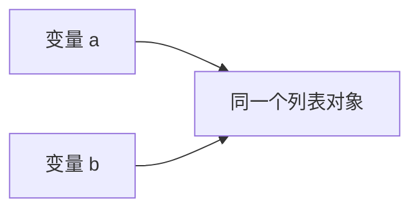
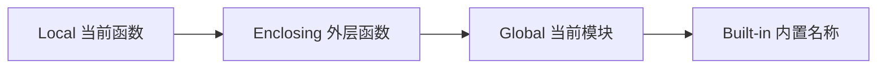
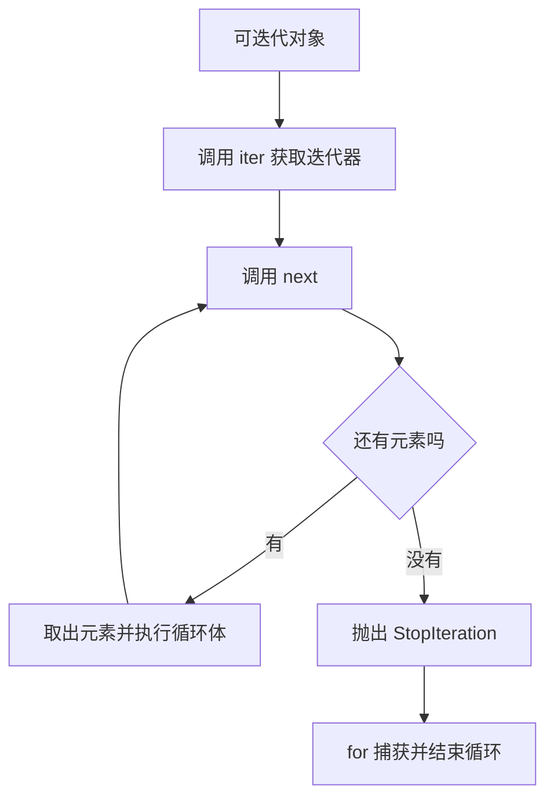
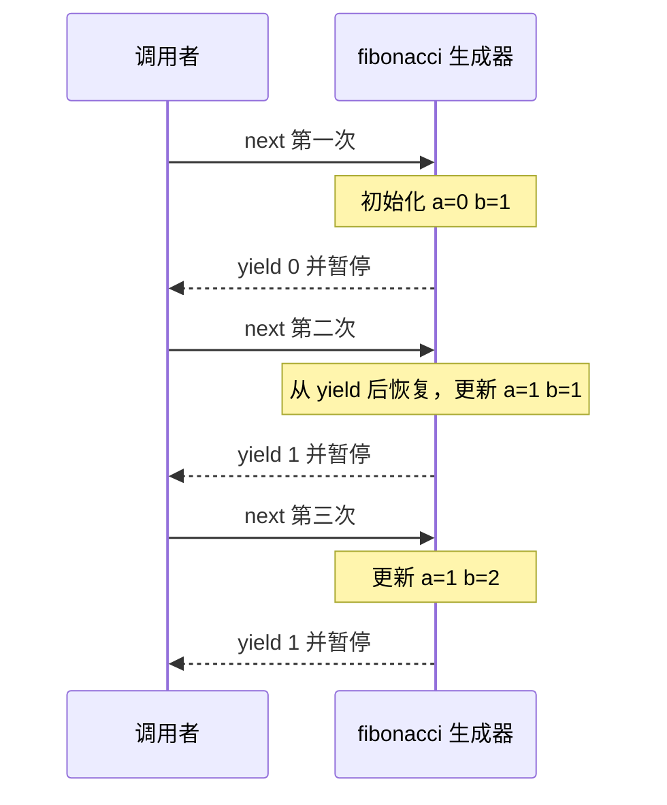
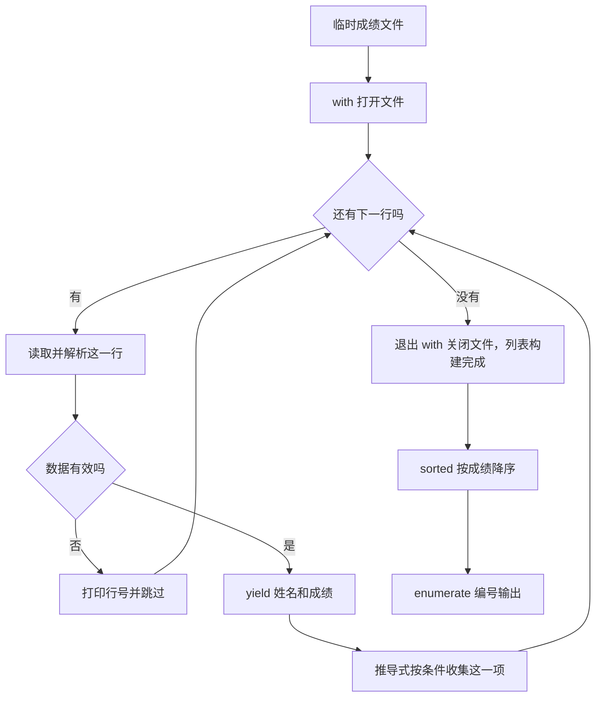

---
tags:
  - 主题/编程语言
  - 技术/Python
  - 笔记/基础
---

> [!info] 知识关联
> - **结构基础**：[[数据结构基础]] — 把列表、字典和集合的使用与数据组织、复杂度联系起来。
> - **语言对照**：[[数据容器]] — 比较 Python 内置容器与 Java 集合接口。
> - **脚本应用**：[[信息收集]] — 阅读信息收集笔记中的 Python requests 脚本。

# 1 快速入门

前面的基础语法，比如选择、循环这些，和 Java、C 里面的思路差不多，敲一敲就能理解了。这里先把 Python 的写法过一遍，后面主要整理容器、函数、推导式、迭代器、生成器和装饰器。

> [!note] 阅读说明
> 本文使用 Python 3，示例按 Python 3.10 及以上版本的语法编写。没有特别说明时，每个代码块单独运行；标成“接上面的例子”的代码需要接在前一个代码块后面。
> 原来的学习截图保留，代码和输出也写成文本，后面查笔记就不用只盯着图片看了。

## 1.1 第一个 Python 程序

新建一个 `hello.py` 文件，写入：

```python
print("Hello, world!")
```

在这个文件所在的目录打开终端，执行：

```powershell
python hello.py
```

输出：

```text
Hello, world!
```

这里就能看出和 Java 的区别了：不用先定义 `class`，也不用先写 `public static void main`，文件顶层的语句就可以直接执行。

**缩进就是代码块**

```python
score = 85

if score >= 60:
    print("及格了")
    print("这两行属于同一个 if")

print("这一行已经在 if 外面了")
```

Java 用 `{}` 划出代码块，Python 用缩进。`if`、`for`、`def`、`class` 等语句的头部通常以冒号结尾，下一层代码再缩进。

> [!warning] 缩进要统一
> 通常每层缩进使用 4 个空格，不要混着用 Tab 和空格。缩进错误不只是排版问题，它可能直接报错，也可能改变程序的执行逻辑。

单行注释使用 `#`。三引号写出来的是字符串，放在函数、类或模块开头时可以作为文档字符串，不要把它和专门的多行注释语法混为一谈。

## 1.2 变量和数据类型

```python
name = "Maple"
age = 18
height = 1.75
is_student = True
nothing = None

print(type(name))  # <class 'str'>
print(type(age))   # <class 'int'>

age = "十八"
print(type(age))   # <class 'str'>
```

Python 不需要像 Java 那样写 `int age = 18`。这里可以先理解成：**对象有类型，变量名绑定到对象上**。同一个变量名之后可以重新绑定到另一种类型的对象。

| 类型 | 例子 | 先记住什么 |
| --- | --- | --- |
| `int` | `18`、`0xff`、`0b1010` | 整数，不是固定的 32 位或 64 位范围，大小仍受内存等资源限制 |
| `float` | `3.14`、`1.5e3` | 浮点数，计算可能有精度误差 |
| `bool` | `True`、`False` | 注意首字母大写 |
| `str` | `"hello"`、`'你好'` | 单双引号都可以，没有单独的 `char` 类型 |
| `NoneType` | `None` | 表示没有值，常用来表示“还没设置” |
| `list` | `[1, 2, 3]` | 列表 |
| `tuple` | `(1, 2, 3)` | 元组 |
| `set` | `{1, 2, 3}` | 集合 |
| `dict` | `{"name": "Maple"}` | 字典，保存键值对 |

类型转换直接使用对应的函数：

```python
print(int("123"))      # 123
print(float("3.14"))   # 3.14
print(str(123))        # 123，这里得到的是字符串
print(bool(""))       # False
print(bool("False"))  # True，非空字符串的真假值为真
```

`int("abc")` 不能转换成整数，会抛出 `ValueError`，后面的异常处理会用到。

## 1.3 运算和比较

```python
print(7 / 2)    # 3.5，普通除法
print(7 // 2)   # 3，向下取整除法
print(-7 // 2)  # -4，向负无穷方向取整
print(7 % 2)    # 1，取余
print(2 ** 3)   # 8，乘方

age = 18
print(16 <= age < 25)               # True，可以连续比较
print(age >= 18 and age < 60)       # True
print(age < 18 or age >= 60)        # False
print(not False)                   # True
print("成年" if age >= 18 else "未成年")  # 成年，条件表达式
```

Python 的逻辑运算写成 `and`、`or`、`not`，不是 Java 中的 `&&`、`||`、`!`，也没有 `i++`，需要写 `i += 1`。

**`==` 和 `is`**

```python
a = [1, 2]
b = [1, 2]
c = a

print(a == b)  # True，内容相等
print(a is b)  # False，不是同一个对象
print(a is c)  # True，两个名字绑定到同一个对象

value = None
print(value is None)  # True
```

这里和 Java 的习惯要区分一下。Python 中比较列表、字符串等对象的内容通常用 `==`；判断是不是同一个对象用 `is`。判断空值常写 `value is None`。

**浮点数误差**

```python
import math

print(0.1 + 0.2 == 0.3)                 # False
print(math.isclose(0.1 + 0.2, 0.3))      # True
```

`isclose()` 按容差判断是否足够接近。比较接近 0 的数时，通常还需要根据场景设置 `abs_tol`。

## 1.4 字符串和切片

```python
name = "Maple"
score = 95.5
print(f"{name} 的成绩是 {score:.1f}")  # Maple 的成绩是 95.5

text = "python"
print(text[0])     # p
print(text[-1])    # n，负数索引从末尾开始
print(text[1:4])   # yth
print(text[:3])    # pyt
print(text[::2])   # pto
print(text[::-1])  # nohtyp

print("  hello  ".strip())          # hello
print("a,b,c".split(","))           # ['a', 'b', 'c']
print("-".join(["a", "b", "c"]))   # a-b-c
print("hello".replace("l", "L"))    # heLLo
```

切片格式是 `序列[开始:结束:步长]`，正向切片的结束位置不包含在结果中。列表、元组也支持切片。

字符串不可变，不能写 `text[0] = "P"`。像 `replace()`、`upper()` 这些操作会返回新字符串，不会直接改掉原字符串。

## 1.5 输入、选择和循环

**输入**

```python
age = int(input("请输入年龄："))
print(f"明年你 {age + 1} 岁")
```

`input()` 返回的是字符串，要拿来做数值运算就先转换。

**选择和循环**

```python
score = 85

if score >= 90:
    print("优秀")
elif score >= 60:
    print("及格")
else:
    print("继续努力")

for i in range(1, 4):
    print(i)  # 依次输出 1、2、3

count = 0
while count < 3:
    count += 1

print(count)  # 3
```

`range(1, 4)` 不包含 4。`range` 本身不是列表，也不是生成器，是一个可迭代的范围对象，不需要先把范围里的所有整数存成列表。

`break` 结束当前这一层循环，`continue` 跳过本轮剩余代码。`pass` 则是什么都不做，先占住一个语法位置，后面再补代码。

> [!tip] Python 里哪些值会被当成假
> 常见的有 `False`、`None`、数值 `0`，以及空字符串、空列表、空元组、空集合和空字典。
> `and`、`or` 有短路行为，而且返回参与运算的某个操作数，不保证返回 `bool`。例如 `"" or "默认值"` 的结果是 `"默认值"`。

# 2 常用容器

## 2.1 先分清四种结构

这四个东西刚开始容易混，这里先放在一起看。

| 结构 | 写法 | 是否可变 | 顺序 | 元素或键能否重复 | 和 Java 的粗略类比 |
| --- | --- | --- | --- | --- | --- |
| 列表 `list` | `[1, 2]` | 可变 | 有顺序，可按索引访问 | 元素可以重复 | `ArrayList` |
| 元组 `tuple` | `(1, 2)` | 元组本身不可变 | 有顺序，可按索引访问 | 元素可以重复 | 固定的一组数据，没有完全对应的常用类型 |
| 集合 `set` | `{1, 2}` | 可变 | 不保证遍历顺序，不能按索引访问 | 元素不重复 | `HashSet` |
| 字典 `dict` | `{"a": 1}` | 可变 | 保留插入顺序 | 键不重复，值可以重复 | `Map`，顺序特性可类比 `LinkedHashMap` |

> [!warning] 空集合不是 `{}`
> `{}` 是空字典，空集合要写 `set()`。集合元素和字典的键必须是**可哈希对象**，例如整数、字符串；列表、字典和普通集合不能直接放在这些位置。元组能否哈希，还取决于里面的元素。

## 2.2 列表 list

可以先把列表看成能动态增删的数组，不过它可以放不同类型的对象。

```python
numbers = [3, 1, 2]

numbers.append(4)         # 末尾添加一个元素
numbers.extend([5, 6])    # 把可迭代对象中的元素逐个加入
numbers.insert(0, 0)     # 在索引 0 处插入
numbers.remove(3)        # 删除第一个等于 3 的元素
last = numbers.pop()     # 删除并返回最后一个元素

print(last)              # 6
print(numbers)           # [0, 1, 2, 4, 5]
print(numbers[1:3])      # [1, 2]
```

`append([5, 6])` 是把整个列表当成**一个元素**加进去，`extend([5, 6])` 才是分别加入 5 和 6。

**排序**

```python
numbers = [3, 1, 2]
new_numbers = sorted(numbers)

print(numbers)      # [3, 1, 2]，原列表不变
print(new_numbers)  # [1, 2, 3]，得到新列表

result = numbers.sort(reverse=True)
print(numbers)      # [3, 2, 1]，直接修改原列表
print(result)       # None
```

这里特别注意：`append()`、`sort()` 等原地修改列表的方法返回 `None`，不要写成 `numbers = numbers.sort()`，否则变量最后绑定的就是 `None` 了。[列表方法的官方说明](https://docs.python.org/3/tutorial/datastructures.html#more-on-lists)

## 2.3 元组 tuple

```python
point = (10, 20)
x, y = point
print(x, y)  # 10 20，解包

single = (1,)
not_tuple = (1)
print(type(single))     # <class 'tuple'>
print(type(not_tuple))  # <class 'int'>
```

只有一个元素的时候，后面的逗号不能少。真正让这里成为元组的是逗号，而不只是括号。

**元组不可变，不代表它引用的对象也不可变**

```python
data = ([1, 2], "hello")
data[0].append(3)
print(data)  # ([1, 2, 3], 'hello')

# data[0] = [9]  # TypeError，不能替换元组中的这个位置
```

元组里的第一个位置仍然引用原来的列表，只是那个列表自己的内容变了。

## 2.4 集合 set

```python
a = {1, 2, 3}
b = {3, 4}

a.add(5)
a.discard(2)  # 不存在也不会报错

print(sorted(a))      # [1, 3, 5]
print(sorted(a | b))  # [1, 3, 4, 5]，并集
print(sorted(a & b))  # [3]，交集
print(sorted(a - b))  # [1, 5]，差集
print(3 in a)         # True，成员判断
```

集合适合去重和判断成员是否存在。这里用 `sorted()` 展示结果，是为了让输出顺序固定，集合本身不保证这个顺序。

## 2.5 字典 dict

字典保存的是一组键值对，和 Java 的 `Map` 比较像。

```python
student = {"name": "Maple", "score": 90}

student["score"] = 95
student["age"] = 18

print(student["name"])                # Maple
print(student.get("city", "未填写"))  # 未填写
print("score" in student)             # True，默认判断键

for key, value in student.items():
    print(key, value)
```

输出：

```text
Maple
未填写
True
name Maple
score 95
age 18
```

`student["city"]` 在键不存在时会抛出 `KeyError`；`get()` 可以给默认值。`keys()` 取键视图，`values()` 取值视图，`items()` 取键值对视图。

字典从 Python 3.7 开始在语言层面保证插入顺序，但它不是按键自动排序的。给已有键赋新值也不会自动把它移到最后。

## 2.6 赋值、浅拷贝和深拷贝

**赋值不会复制对象**

```python
a = [1, 2]
b = a
b.append(3)

print(a)       # [1, 2, 3]
print(a is b)  # True
```

可以画成这样：



**浅拷贝只复制外面这一层**

```python
import copy

original = [[1, 2], [3, 4]]
shallow = original.copy()
deep = copy.deepcopy(original)

shallow[0].append(99)

print(original)             # [[1, 2, 99], [3, 4]]
print(shallow)              # [[1, 2, 99], [3, 4]]
print(deep)                 # [[1, 2], [3, 4]]
print(original is shallow)  # False，外层是两个列表
```

`list.copy()`、`[:]` 都是浅拷贝，里面的子列表还是共用的。`deepcopy()` 对这种嵌套列表会递归复制内部对象；函数、文件等对象还有各自的规则，不能理解成什么对象都能无条件复制。[浅拷贝与深拷贝的官方说明](https://docs.python.org/3.13/library/copy.html)

## 2.7 遍历和解包

```python
names = ["Bob", "Tom", "Alice"]
scores = [80, 90, 95]

for index, name in enumerate(names, start=1):
    print(index, name)

for name, score in zip(names, scores):
    print(name, score)

first, *middle, last = [1, 2, 3, 4]
print(first, middle, last)  # 1 [2, 3] 4
```

`enumerate()` 适合同时取下标和元素，`zip()` 把多个可迭代对象按位置配对，默认在最短的那个用完时结束。遍历字典的键值对就用前面的 `items()`。

# 3 函数

## 3.1 定义和返回值

```python
def add(a, b):
    """返回两个数的和。"""
    return a + b


def get_user():
    return "Maple", 18


print(add(2, 3))  # 5
name, age = get_user()
print(name, age)  # Maple 18
```

函数通过 `def` 定义。不写 `return`，或者只写一个 `return`，最终都返回 `None`。

所谓返回多个值，这里实际上是返回一个元组，再在调用处解包。

## 3.2 位置参数、关键字参数和默认参数

```python
def introduce(name, age=18):
    return f"{name}，{age} 岁"


print(introduce("Maple"))              # Maple，18 岁
print(introduce("Maple", 20))          # Maple，20 岁
print(introduce(age=20, name="Maple"))  # Maple，20 岁
```

位置参数按顺序传，关键字参数按参数名传，默认参数允许调用时省略这个值。

**不要拿可变对象当成普通默认值**

```python
def collect_bad(value, items=[]):
    items.append(value)
    return items


print(collect_bad(1))  # [1]
print(collect_bad(2))  # [1, 2]，沿用了同一个默认列表
```

默认值在执行函数定义时求值，不是每次调用都重新创建。这种需要独立列表的场景可以这样写：

```python
def collect(value, items=None):
    if items is None:
        items = []
    items.append(value)
    return items


print(collect(1))  # [1]
print(collect(2))  # [2]
```

这也是为什么这里判断的是 `is None`。如果写成 `if not items`，调用者主动传入的空列表也会被替换掉。[默认参数的官方说明](https://docs.python.org/3/tutorial/controlflow.html#default-argument-values)

## 3.3 可变参数：`*args` 和 `**kwargs`

原来的学习截图：

![[Pasted image 20260324213532.png]]

一个 `*` 收集额外的位置参数，得到元组；两个 `**` 收集额外的关键字参数，得到字典。

```python
def show_args(*args, **kwargs):
    print(args)
    print(kwargs)


show_args(1, 2, 3, name="Maple", age=18)
```

输出：

```text
(1, 2, 3)
{'name': 'Maple', 'age': 18}
```

下面是原来参数不同的练习输出，收集成元组和字典的规则是一样的：

![[Pasted image 20260324213702.png]]

`args`、`kwargs` 是习惯用的名字，起作用的是前面的 `*` 和 `**`。

**调用时反过来，表示解包**

```python
def add(a, b):
    return a + b


numbers = [2, 3]
options = {"a": 4, "b": 5}

print(add(*numbers))   # 5，相当于 add(2, 3)
print(add(**options))  # 9，相当于 add(a=4, b=5)
```

> [!tip] 定义时收集，调用时展开
> `def func(*args, **kwargs)` 是把传入的参数收起来。
> `func(*args, **kwargs)` 是把已有的可迭代对象和映射展开后传进去。参数展开后仍然要符合被调用函数的参数要求。

## 3.4 仅限位置参数和仅限关键字参数

```python
def connect(host, /, port=3306, *, timeout=5):
    return host, port, timeout


print(connect("localhost", 3307, timeout=10))
# ('localhost', 3307, 10)

# connect(host="localhost")       # 错误，host 只能按位置传
# connect("localhost", 3307, 10)   # 错误，timeout 只能按关键字传
```

`/` 前面的参数只能按位置传；裸 `*` 后面的参数只能按关键字传。中间的 `port` 两种方式都可以。

## 3.5 参数传递和作用域

```python
def change(numbers, count):
    numbers.append(3)
    count = 100


values = [1, 2]
n = 10
change(values, n)

print(values)  # [1, 2, 3]
print(n)       # 10
```

这里函数参数名绑定到了传入的对象。`append()` 修改的是共用的列表；`count = 100` 是让函数内部的名字重新绑定，不会把外面的 `n` 一起改掉。

因此不要简单记成“列表按引用传递，整数按值传递”，关键是看代码是在**修改对象**还是**重新绑定名字**。

查找变量时，可以先记住 LEGB：



如果在函数内部给某个名字赋值，默认把它当作局部变量。确实需要重新绑定模块变量时使用 `global`，重新绑定外层函数的变量时使用 `nonlocal`。

## 3.6 lambda 和闭包

原来的 lambda 和闭包练习：

![[Pasted image 20260324215023.png]]

**lambda：简单的匿名函数**

```python
students = [("Bob", 80), ("Alice", 95), ("Tom", 90)]
result = sorted(students, key=lambda item: item[1], reverse=True)
print(result)  # [('Alice', 95), ('Tom', 90), ('Bob', 80)]
```

这里的 `lambda item: item[1]` 就是一个接收 `item`，返回成绩的函数。`lambda` 的函数体只能写一个表达式，复杂逻辑还是用 `def`。

**闭包：内部函数保留对外层变量的引用**

```python
def make_adder(base):
    def add(value):
        return base + value
    return add


add_ten = make_adder(10)
print(add_ten(5))  # 15
print(add_ten(8))  # 18
```

`make_adder()` 已经返回了，但返回的内部函数仍然能访问 `base`。后面的装饰器就会用到这个结构。

# 4 Python 推导式

推导式可以从一个可迭代对象构建出新的数据。先把普通循环写明白，再换成推导式，就比较好理解。

## 4.1 列表推导式

基本格式：

```text
[表达式 for 变量 in 可迭代对象]
[表达式 for 变量 in 可迭代对象 if 条件]
```

原来写的这个例子：

```python
names = ["Bob", "Tom", "alice", "Jerry", "Wendy", "Smith"]
new_names = [name.upper() for name in names if len(name) > 3]
print(new_names)
```

输出：

```text
['ALICE', 'JERRY', 'WENDY', 'SMITH']
```

接上面的例子，展开以后相当于：

```python
new_names = []

for name in names:
    if len(name) > 3:
        new_names.append(name.upper())

print(new_names)
```

读的时候先看 `for name in names`，再看过滤条件，最后看前面放进新列表的表达式。

```python
multiples = [i for i in range(30) if i % 3 == 0]
print(multiples)  # [0, 3, 6, 9, 12, 15, 18, 21, 24, 27]
```

![[Pasted image 20260323210109.png]]

**后面的 `if` 负责筛选，前面的 `if ... else ...` 负责决定值**

```python
numbers = [-2, -1, 0, 1, 2]

positive = [x for x in numbers if x > 0]
labels = ["正数" if x > 0 else "非正数" for x in numbers]

print(positive)  # [1, 2]，有些元素被过滤掉了
print(labels)    # ['非正数', '非正数', '非正数', '正数', '正数']
```

**多个 for 的顺序**

```python
matrix = [[1, 2], [3, 4]]
flat = [number for row in matrix for number in row]
print(flat)  # [1, 2, 3, 4]
```

对应先遍历每一行，再遍历行里的元素，和普通嵌套循环从外到内的顺序一致。

## 4.2 集合推导式

```python
numbers = [1, 1, 2, 2, 3]
squares = {x * x for x in numbers}
print(sorted(squares))  # [1, 4, 9]
```

把 `[]` 换成 `{}`，这里得到集合，重复结果会被去掉。

## 4.3 字典推导式

原来这里看着有点绕，主要是前面的表达式变成了 `键: 值`。

![[Pasted image 20260323213428.png]]

```python
names = ["Bob", "Alice", "Tom"]
lengths = {name: len(name) for name in names}
print(lengths)  # {'Bob': 3, 'Alice': 5, 'Tom': 3}

scores = {"Bob": 80, "Alice": 95, "Tom": 50}
passed = {name: score for name, score in scores.items() if score >= 60}
print(passed)   # {'Bob': 80, 'Alice': 95}
```

第二个例子里，`scores.items()` 每次提供一个键值对，解包到 `name, score`，满足条件后再组成新的键值对。

> [!warning] 重复键会覆盖
> 推导式如果生成了相同的键，后面的值会覆盖前面的值。例如 `{x % 2: x for x in range(4)}` 得到 `{0: 2, 1: 3}`。它不会自动把同一类的值收集成列表。

## 4.4 小括号得到的是生成器表达式

```python
numbers = (x * x for x in range(4))
print(type(numbers))  # <class 'generator'>
print(next(numbers)) # 0
print(list(numbers)) # [1, 4, 9]，0 已经取过了

values = tuple(x * x for x in range(4))
print(values)        # (0, 1, 4, 9)
```

原来筛选偶数时，也观察到了同样的现象：

![[Pasted image 20260323212314.png]]

![[Pasted image 20260323212602.png]]

所以这里不要记成“元组推导式”。`(表达式 for ...)` 创建的是生成器，想得到元组，需要再用 `tuple()` 收集结果。

> [!tip] 推导式写到看不懂的时候就拆开
> 简单的映射和筛选适合推导式；条件和嵌套很多的时候，普通循环更方便检查逻辑。列表、集合、字典推导式会立即构建容器，生成器表达式则按需产生结果。

# 5 迭代器与生成器

## 5.1 可迭代对象和迭代器

**可迭代对象**可以交给 `iter()` 获取迭代器，列表、元组、字符串、字典、集合、`range` 都是常见例子。

**迭代器**记录当前遍历位置，通过 `next()` 逐个返回元素，用完后抛出 `StopIteration`。迭代器本身也可迭代，并且 `iter(迭代器)` 返回它自己。

```python
numbers = [10, 20, 30]
it = iter(numbers)

print(next(it))  # 10
print(next(it))  # 20
print(next(it))  # 30
print(next(it, "没有了"))  # 没有了，耗尽时返回默认值

print(iter(it) is it)  # True
# next(numbers)       # TypeError，列表本身不是迭代器
```

这里的列表还是那个列表，记录取到哪里的是 `it`。

| 对象 | 可以 `for` 遍历 | 可以直接 `next()` | 用完之后 |
| --- | --- | --- | --- |
| 列表、元组、字符串 | 可以 | 不可以，需要先 `iter()` | 通常可以重新取得迭代器再次遍历 |
| 迭代器 | 可以 | 可以 | 同一个迭代器不能自动从头再来 |
| 生成器对象 | 可以 | 可以 | 同样会耗尽，需要重新创建才能再来一遍 |

## 5.2 for 循环实际上做了什么

```python
numbers = [1, 2, 3]
it = iter(numbers)

while True:
    try:
        value = next(it)
    except StopIteration:
        break
    print(value)
```

这就是 `for value in numbers` 背后的基本过程。不需要像原来的例子那样用 `sys.exit()`，这里只要结束当前循环就可以了。



这个流程也解释了为什么字典、列表、文件这些不同对象，都能用同一种 `for` 写法遍历。[迭代器协议的官方说明](https://docs.python.org/3/tutorial/classes.html#iterators)

## 5.3 创建一个迭代器

原来的练习截图，目标是依次产生 1 到 20：

![[Pasted image 20260324121606.png]]

这里把实现重新整理一下：**初始状态放在 `__init__()`，`__iter__()` 不负责把进度重置。**

```python
class MyNumbers:
    def __init__(self, limit):
        self.current = 1
        self.limit = limit

    def __iter__(self):
        return self

    def __next__(self):
        if self.current > self.limit:
            raise StopIteration

        value = self.current
        self.current += 1
        return value


numbers = MyNumbers(20)
print(next(numbers))           # 1
print(next(numbers))           # 2
print(list(numbers))           # [3, 4, 5, 6, 7, 8, 9, 10, 11, 12, 13, 14, 15, 16, 17, 18, 19, 20]
print(list(numbers))           # []，已经耗尽了
print(list(MyNumbers(3)))       # [1, 2, 3]，新对象有自己的初始状态
```

- `__init__()`：初始化这个对象的状态。
- `__iter__()`：返回迭代器，这里返回自己。
- `__next__()`：返回下一个**元素**；没有元素时抛出 `StopIteration`。

如果把 `self.current = 1` 放在 `__iter__()` 里，每次调用 `iter()` 都可能把进度重置，这不适合上面这个一次向前推进的迭代器。

## 5.4 生成器函数和 yield

自己实现迭代器，需要写 `__iter__()`、`__next__()`，还要自己保存状态。生成器可以用更少的代码完成同类事情。

```python
def count_up_to(limit):
    current = 1
    while current <= limit:
        yield current
        current += 1


numbers = count_up_to(3)
print(next(numbers))  # 1
print(next(numbers))  # 2
print(next(numbers))  # 3
print(list(numbers))  # []，继续执行后发现条件不满足，生成器结束
```

这里需要区分两个东西：

- `count_up_to` 是**生成器函数**，函数体里使用了 `yield`。
- `count_up_to(3)` 返回的是**生成器对象**，它也是迭代器。

调用生成器函数时，先拿到生成器对象，函数体里的代码还没有开始执行。等到 `next()` 或 `for` 推进它时，才开始执行。

**yield 可以先理解成：交出一个值，然后在这里暂停。**

下次调用 `next()`，从上次暂停的 `yield` 后面接着执行，局部变量和执行位置都会保留。函数执行到 `return` 或自然结束时，迭代也就结束了。[生成器的官方说明](https://docs.python.org/3/tutorial/classes.html#generators)

## 5.5 斐波那契数列：把 yield 的执行过程走一遍

这里约定清楚：**`n` 表示生成多少项**，生成 6 项就调用 `fibonacci(6)`。

```python
def fibonacci(n):
    a, b = 0, 1
    for _ in range(n):
        yield a
        a, b = b, a + b


f = fibonacci(6)
print(next(f))  # 0
print(next(f))  # 1
print(next(f))  # 1
print(list(f))  # [2, 3, 5]，把剩下的三项取完

print(list(fibonacci(6)))  # [0, 1, 1, 2, 3, 5]
print(list(fibonacci(0)))  # []
```

`_` 在这里就是一个普通变量名，只是约定表示“这个循环变量我不打算使用”。

**再看每一次 next 到底做了什么**

下面跟踪的是新建的 `f = fibonacci(6)` 连续调用 `next(f)` 的过程，不是接着上面已经耗尽的 `f` 继续运行。

| 操作 | 执行过程 | 交出的值 | 暂停时的 `a, b` |
| --- | --- | --- | --- |
| 创建 `f` | 只创建生成器对象，尚未执行函数体 | 无 | 尚未初始化 |
| 第 1 次 `next(f)` | 初始化 `a=0, b=1`，进入第一轮，停在 `yield a` | `0` | `0, 1` |
| 第 2 次 `next(f)` | 先执行更新，得到 `a=1, b=1`，下一轮再次暂停 | `1` | `1, 1` |
| 第 3 次 `next(f)` | 更新为 `a=1, b=2`，下一轮再次暂停 | `1` | `1, 2` |
| 第 4 次 `next(f)` | 更新为 `a=2, b=3` | `2` | `2, 3` |
| 第 5 次 `next(f)` | 更新为 `a=3, b=5` | `3` | `3, 5` |
| 第 6 次 `next(f)` | 更新为 `a=5, b=8` | `5` | `5, 8` |
| 第 7 次 `next(f)` | 执行最后一次更新，循环结束，函数结束 | 抛出 `StopIteration` | 不再暂停 |

`a, b = b, a + b` 会先计算右边的值，再分别绑定到左边，所以第二项使用的是更新前的 `a` 和 `b`。



> [!warning] return 和 yield 要分清
> 普通函数的 `return` 结束本次函数调用；生成器里的 `yield` 交出一个值并暂停。
> 生成器里的 `return` 则结束整个生成器，不会像 `yield` 那样再产生一项。不要在生成器体内主动 `raise StopIteration` 来模拟结束，直接 `return` 或让函数自然结束即可。

## 5.6 惰性计算和一次性消费

```python
squares = (x * x for x in range(4))

print(sum(squares))   # 14
print(list(squares))  # []，sum 已经把它用完了
```

生成器按需计算，适合逐行读文件、处理一长串数据，不必先把所有结果构成列表。不过一旦用 `list()` 把它完整收集起来，结果列表仍然需要对应的内存。

还有一个容易忽略的点：生成器表达式会在创建时求值最左边的可迭代部分，而每一项的计算通常在推进时才发生。不要把“惰性”理解成创建时完全不做任何事。

# 6 Python 装饰器

## 6.1 先看函数也能作为值传递

```python
def greet(name):
    return f"你好，{name}"


say_hello = greet
print(say_hello("Maple"))  # 你好，Maple
```

这里的 `greet` 是函数对象，`greet("Maple")` 才是调用函数。函数可以赋值给变量、作为参数传给另一个函数，也可以作为返回值。

装饰器就是利用这个特点，接收原函数，再返回一个函数或其他可调用对象，扩展原来的行为。

## 6.2 一个完整的装饰器

比如希望调用函数前后都输出一条日志：

```python
from functools import wraps


def log_call(func):
    @wraps(func)
    def wrapper(*args, **kwargs):
        print(f"开始调用 {func.__name__}")
        result = func(*args, **kwargs)
        print(f"调用结束，结果是 {result}")
        return result
    return wrapper


@log_call
def add(a, b):
    """返回两个数的和。"""
    return a + b


result = add(2, 3)
print(result)
print(add.__name__)
```

输出：

```text
开始调用 add
调用结束，结果是 5
5
add
```

这里按顺序拆开看：

1. 执行函数定义时，创建原来的 `add` 函数。
2. 把它交给 `log_call`，`log_call` 返回内部的 `wrapper`。
3. 名字 `add` 重新绑定到这个包装函数。
4. 之后调用 `add(2, 3)`，实际先执行 `wrapper`，它再调用保存下来的原函数。

`@log_call` 的核心等价关系就是：

```text
add = log_call(add)
```

**注意这里返回的是 `wrapper`，不是 `wrapper()`。** 返回前者是把函数交出去；写成后者就变成当场调用它了。

`wrapper` 中还要 `return result`，否则原函数虽然算出了结果，外面接到的却会变成 `None`。上面这个简单日志例子里，如果原函数抛出异常，“调用结束”那句也不会执行；需要无论成功失败都执行的代码，应放进 `finally`。

## 6.3 为什么需要 wraps

不加 `@wraps(func)`，装饰后的函数名通常会变成 `wrapper`，文档字符串等信息也会丢失。

`functools.wraps` 帮忙保留原函数的名称、文档等元信息，并提供 `__wrapped__` 指向原函数，方便查看和调试。它不会替你调用原函数，也不会自动保留返回值，那仍然由包装函数负责。[wraps 的官方说明](https://docs.python.org/3/library/functools.html#functools.wraps)

> [!note] 和 Java 注解怎么联系
> 两者都有 `@` 的外观，可以用这个帮助记忆写法。Python 函数装饰器的关键是执行一次装饰调用，把结果绑定回函数名；Java 注解通常用于携带元数据，需要编译器、框架或其他代码读取后产生作用。学这里时，要把 `func = decorator(func)` 这一步想明白。

## 6.4 带参数的装饰器

如果日志前缀也想自己指定，就再加一层函数，先接住配置参数：

```python
from functools import wraps


def log_with(prefix):
    def decorator(func):
        @wraps(func)
        def wrapper(*args, **kwargs):
            print(f"[{prefix}] 调用 {func.__name__}")
            return func(*args, **kwargs)
        return wrapper
    return decorator


@log_with("学习记录")
def greet(name):
    return f"你好，{name}"


print(greet("Maple"))
```

输出：

```text
[学习记录] 调用 greet
你好，Maple
```

相当于：

```text
greet = log_with("学习记录")(greet)
```

三层分别负责：外层接配置，中间接原函数，内层接真正调用时的参数。

## 6.5 多个装饰器的顺序

```python
from functools import wraps


def mark(label):
    def decorator(func):
        @wraps(func)
        def wrapper(*args, **kwargs):
            print(f"{label} 进入")
            result = func(*args, **kwargs)
            print(f"{label} 退出")
            return result
        return wrapper
    return decorator


@mark("A")
@mark("B")
def task():
    print("执行任务")


task()
```

输出：

```text
A 进入
B 进入
执行任务
B 退出
A 退出
```

装饰后的嵌套关系相当于 `task = mark("A")(mark("B")(task))`：靠近函数的 B 先包上去，A 包在外面；调用时先进入 A，再进入 B，最后按相反方向返回。

这里说的是**应用装饰器的顺序**。像 `mark("A")`、`mark("B")` 这些装饰器表达式本身在定义阶段按从上到下的顺序求值，不要把这两个阶段混在一起。

# 7 面向对象编程

## 7.1 类、对象和 self

```python
class Student:
    school = "Python 学习小组"

    def __init__(self, name, score):
        self.name = name
        self.score = score

    def introduce(self):
        return f"我叫 {self.name}，成绩是 {self.score}"


student = Student("Maple", 95)
print(student.introduce())  # 我叫 Maple，成绩是 95
print(Student.school)      # Python 学习小组
```

`class` 定义类，`Student(...)` 创建实例。`self` 表示当前实例，可以联系 Java 的 `this` 来理解，不过 Python 的实例方法需要显式写出这个参数。

调用 `student.introduce()` 时，不需要再手动传 `self`，Python 会把当前实例作为第一个参数传进去。

`__init__()` 是初始化方法，通常拿来设置初始属性。严格说对象创建还涉及 `__new__()`，基础阶段先掌握 `__init__()` 就够了。

## 7.2 类属性和实例属性

`Student.school` 这种定义在类体里的属性由类持有；`self.name` 这种在实例上设置的属性，保存各个对象自己的数据。

尤其注意列表这样的可变数据：

```python
class Student:
    def __init__(self, name):
        self.name = name
        self.courses = []


a = Student("Bob")
b = Student("Alice")
a.courses.append("Python")

print(a.courses)  # ['Python']
print(b.courses)  # []
```

如果把 `courses = []` 直接定义在类体里，再通过实例对它 `append()`，就可能出现所有实例共用同一个列表的情况。

## 7.3 继承、覆写和 super

```python
class Animal:
    def __init__(self, name):
        self.name = name

    def speak(self):
        return "发出声音"


class Dog(Animal):
    def __init__(self, name, breed):
        super().__init__(name)
        self.breed = breed

    def speak(self):
        return f"{self.name}：汪汪"


dog = Dog("小黑", "柴犬")
print(dog.speak())               # 小黑：汪汪
print(isinstance(dog, Animal))   # True
```

子类在括号里指定父类，重新定义同名方法可以覆写父类行为。这个单继承例子中，`super().__init__(name)` 调用父类的初始化逻辑。

Python 还支持多继承，`super()` 实际按照方法解析顺序（MRO）继续查找，先不要把它机械理解为永远只找“直接父类”。

**鸭子类型**

很多时候，函数只关心传进来的对象能不能完成某个操作，不要求它必须继承某个特定类。比如函数里只调用 `animal.speak()`，不同类型只要提供合适的 `speak()` 就能参与。这种使用方式常被称为鸭子类型。

## 7.4 封装和 property

Python 没有与 Java 完全对应的 `private` 访问限制。`_name` 通常是“内部使用”的约定，`__name` 会触发名称改写，也不是安全隔离机制。

如果希望赋值时自动检查数据，可以使用 `property`：

```python
class Student:
    def __init__(self, score):
        self.score = score

    @property
    def score(self):
        return self._score

    @score.setter
    def score(self, value):
        if not 0 <= value <= 100:
            raise ValueError("成绩必须在 0 到 100 之间")
        self._score = value


student = Student(90)
student.score = 95
print(student.score)  # 95
# student.score = 120  # 会抛出 ValueError
```

这里外面仍然像操作属性一样写 `student.score`，实际读取和赋值会经过对应的方法。

## 7.5 实例方法、类方法和静态方法

| 方法 | 装饰器 | 自动接收的第一个参数 | 常见用途 |
| --- | --- | --- | --- |
| 实例方法 | 无 | `self`，当前实例 | 处理某个对象的数据 |
| 类方法 | `@classmethod` | `cls`，调用所针对的类 | 备用构造方式、处理类相关逻辑 |
| 静态方法 | `@staticmethod` | 无 | 与这个类相关的工具逻辑 |

```python
class Student:
    def __init__(self, name, score):
        self.name = name
        self.score = score

    @classmethod
    def from_text(cls, text):
        name, score = text.split(",")
        return cls(name, int(score))

    @staticmethod
    def is_valid_score(score):
        return 0 <= score <= 100


student = Student.from_text("Maple,95")
print(student.name, student.score)       # Maple 95
print(Student.is_valid_score(120))      # False
```

## 7.6 常见特殊方法

双下划线方法让自定义对象参与 Python 的内置操作，前面的迭代器就是例子。

| 方法 | 对应操作 | 用途 |
| --- | --- | --- |
| `__init__` | 实例初始化 | 设置初始状态 |
| `__str__` | `str(obj)`、`print(obj)` | 适合阅读的字符串表示 |
| `__repr__` | `repr(obj)` | 适合调试的对象表示 |
| `__len__` | `len(obj)` | 获取长度 |
| `__iter__`、`__next__` | `iter(obj)`、`next(obj)` | 迭代协议 |
| `__enter__`、`__exit__` | `with` | 上下文管理协议 |

# 8 异常处理、with 和文件操作

## 8.1 捕获异常

```python
raw = "abc"

try:
    number = int(raw)
    result = 10 / number
except ValueError as error:
    print(f"输入不是有效整数：{error}")
except ZeroDivisionError:
    print("除数不能是 0")
else:
    print(f"结果是 {result}")
finally:
    print("本次处理结束")
```

- `try`：放可能抛出异常的代码。
- `except`：处理匹配的异常；多个分支时，具体异常放前面。
- `else`：`try` 正常执行完、没有异常时执行。
- `finally`：正常退出、发生异常或通过 `return` 离开时，都会执行这里的清理代码。

常见异常：

| 异常 | 常见原因 |
| --- | --- |
| `ValueError` | 类型能接收，但具体值不合适，例如 `int("abc")` |
| `TypeError` | 类型或参数用法不合适，例如 `1 + "2"` |
| `IndexError` | 列表等序列的索引越界 |
| `KeyError` | 访问不存在的字典键 |
| `FileNotFoundError` | 要读取的文件不存在 |
| `StopIteration` | 迭代器已经没有下一项 |

> [!warning] 不要随手把异常全部吞掉
> 优先捕获能实际处理的具体异常。直接 `except: pass` 很容易把真正的代码问题藏起来。`finally` 适合做清理，也不要随手在里面写 `return`，它可能覆盖原来的返回值或异常。

## 8.2 主动抛出异常

```python
def check_score(score):
    if not 0 <= score <= 100:
        raise ValueError("成绩必须在 0 到 100 之间")
    return score


try:
    check_score(120)
except ValueError as error:
    print(error)  # 成绩必须在 0 到 100 之间
```

`raise` 用来抛出异常。如果在 `except` 内处理了一部分工作后还想把原异常继续交给外面，直接写 `raise` 即可。

## 8.3 with：把资源的进入和退出配成一对

基本格式：

```text
with 返回上下文管理器的表达式 as 变量:
    代码块
```

最常见的场景是打开文件：

```python
from pathlib import Path
from tempfile import TemporaryDirectory


with TemporaryDirectory() as directory:
    path = Path(directory) / "example.txt"

    with open(path, "w", encoding="utf-8") as file:
        file.write("你好，Python\n")

    with open(path, "r", encoding="utf-8") as file:
        content = file.read()

    print(content, end="")  # 你好，Python
    print(file.closed)     # True，离开内层 with 时已关闭
```

这里用临时目录，是为了直接运行示例时不留下文件。平时写脚本可以把 `path` 换成自己要操作的路径。

这个和 Java 的 try-with-resources 很像，都是把资源使用结束后的清理交给语言结构来管理。文件对象退出 `with` 时会关闭文件。

## 8.4 with 背后的协议

```python
class StudySession:
    def __enter__(self):
        print("开始学习")
        return self

    def __exit__(self, exc_type, exc_value, traceback):
        print("收拾桌面")
        return False


with StudySession() as session:
    print("写一段 Python")
```

输出：

```text
开始学习
写一段 Python
收拾桌面
```

流程是：

1. 求值表达式，取得上下文管理器。
2. 调用 `__enter__()`，把它的返回值绑定给 `as` 后面的变量。
3. 执行代码块。
4. 退出代码块时调用 `__exit__()`；如果代码块有异常，也会把异常信息传进去。

`__exit__()` 在有异常时返回真值，表示抑制这个异常；返回 `False` 或 `None` 则让异常继续向外传播。`with` 本身不是把错误自动忽略掉。

> [!note] 成功进入，才谈退出
> 只有 `__enter__()` 成功返回后，才保证后面会调用该上下文管理器的 `__exit__()`。如果 `__enter__()` 自己抛出异常，不会再调用它自己的 `__exit__()`。[with 协议的官方说明](https://docs.python.org/3.13/reference/compound_stmts.html#the-with-statement)

## 8.5 文件模式和编码

| 模式 | 含义 | 文件不存在时 |
| --- | --- | --- |
| `r` | 只读 | 报错 |
| `w` | 写入，已有文件会被截断 | 创建 |
| `a` | 追加到末尾 | 创建 |
| `x` | 只创建新文件，已有文件会报错 | 创建 |
| `rb`、`wb` | 二进制读、写 | 分别遵循 `r`、`w` 的规则 |

文本文件明确写 `encoding="utf-8"`；二进制模式操作的是 `bytes`，不要再传文本编码参数。

```python
text = "你好"
data = text.encode("utf-8")

print(type(data))            # <class 'bytes'>
print(data.decode("utf-8"))  # 你好
```

`str` 是文本，`bytes` 是字节序列。编码是文本转字节，解码是字节转文本；读取文件、处理网络数据时很常见。

大文本文件可以直接 `for line in file` 逐行处理，不一定要 `read()` 把全文一次读进内存。

## 8.6 把 yield、装饰器和 with 连起来

前面几个知识点可以在 `contextlib.contextmanager` 这里连到一起：

```python
from contextlib import contextmanager


@contextmanager
def study_session():
    print("开始学习")
    try:
        yield "Python"
    finally:
        print("收拾桌面")


with study_session() as subject:
    print(f"正在学习 {subject}")
```

输出：

```text
开始学习
正在学习 Python
收拾桌面
```

这里 `yield` 前面是进入阶段，交出的值绑定给 `subject`；`with` 代码块执行完后，再恢复生成器，执行后面的退出阶段。

`@contextmanager` 把这个生成器函数转换成创建上下文管理器的工厂函数。它要求生成器在正常使用中**恰好 yield 一次**，清理操作放在 `finally` 中，代码块发生异常时也能处理退出。[contextmanager 的官方说明](https://docs.python.org/3.13/library/contextlib.html#contextlib.contextmanager)

# 9 模块、包和虚拟环境

## 9.1 模块和 import

前面已经用了不少 `import`。可以先把一个 `.py` 文件理解成一个模块，把经常复用的函数放进去，其他文件导入后就能调用。

下面是一个**多文件例子**，按文件名分别保存，不是把两个代码块都贴进同一个文件。

在同一个目录中新建 `math_tools.py`：

```python
def add(a, b):
    return a + b
```

再新建 `main.py`：

```python
import math_tools
from math_tools import add

print(math_tools.add(2, 3))  # 5
print(add(4, 5))             # 9
```

在该目录运行 `python main.py` 即可。

`import math_tools` 绑定模块名，再用 `math_tools.add()` 访问；`from math_tools import add` 则把函数名直接导入当前命名空间。需要别名时可以写 `import math_tools as tools`。

尽量不要使用 `from xxx import *`，否则回头看代码时，很难确认某个名字是从哪里来的。

> [!warning] 文件名别和要导入的模块重名
> 不要把正在练习的脚本随手命名为 `json.py`、`random.py`、`typing.py`。当前目录参与模块搜索，重名文件可能遮蔽原本想导入的模块，产生循环导入或缺少属性等问题。[模块搜索路径的官方说明](https://docs.python.org/3.13/tutorial/modules.html#the-module-search-path)

## 9.2 包和项目结构

普通包通常用目录加 `__init__.py` 来组织多个模块：

```text
python-study/
├── main.py
└── tools/
    ├── __init__.py
    └── math_tools.py
```

其中 `__init__.py` 可以先留空，`math_tools.py` 放前面的 `add()` 函数，然后把 `main.py` 改为：

```python
from tools.math_tools import add

print(add(2, 3))  # 5
```

这里可以和 Java 的包联系起来理解：都是用来组织代码、划分命名空间。Python 还有不要求 `__init__.py` 的命名空间包，入门先掌握上面这种普通包即可。

## 9.3 `if __name__ == "__main__"`

```python
def main():
    print("开始执行程序")


if __name__ == "__main__":
    main()
```

直接运行这个文件时，`__name__` 是 `"__main__"`，会调用 `main()`；作为普通模块导入时，`__name__` 是模块名，条件不成立。

这适合把“可复用的定义”和“直接运行时的入口逻辑”放在同一个文件里。需要注意，导入仍然会执行模块的顶层代码，所以想避免导入时发生的演示调用，应放进入口判断下面。[入口判断的官方说明](https://docs.python.org/3.13/library/__main__.html#name-main)

## 9.4 虚拟环境和 pip

项目多了之后，可能一个项目需要某个库的一个版本，另一个项目又需要不同版本。虚拟环境就是给项目分开管理解释器环境和依赖包。

在项目目录打开 PowerShell：

```powershell
python -m venv .venv
.\.venv\Scripts\Activate.ps1
python -m pip --version
```

第一行创建环境，第二行在当前终端激活，第三行查看当前解释器对应的 pip。

如果 PowerShell 的脚本执行策略阻止激活，也可以直接调用虚拟环境里的解释器，不需要先修改系统设置：

```powershell
.\.venv\Scripts\python.exe -m pip --version
.\.venv\Scripts\python.exe main.py
```

**安装和记录依赖**

下面以安装一个第三方库为例，需要联网。使用前确认当前终端已经激活对应项目的虚拟环境：

```powershell
python -m pip install requests
python -m pip freeze | Set-Content -Encoding utf8 requirements.txt
python -m pip install -r requirements.txt
```

`pip freeze` 记录当前环境里已安装的包版本，方便在另一个环境中按清单安装；它不是对 Python 版本、操作系统和所有外部条件的完整锁定。

退出已激活的环境可以运行 `deactivate`。`.venv` 通常不直接提交到代码仓库，保留项目代码和依赖清单，需要时重新创建。[虚拟环境的官方说明](https://docs.python.org/3.13/library/venv.html)

# 10 常用工具和标准库

## 10.1 常用内置函数

| 函数 | 用途 | 例子 |
| --- | --- | --- |
| `len()` | 长度 | `len([1, 2])` 得到 `2` |
| `sum()` | 求和 | `sum([1, 2, 3])` 得到 `6` |
| `min()`、`max()` | 最小值、最大值 | `max([1, 3, 2])` 得到 `3` |
| `sorted()` | 返回排序后的新列表 | `sorted([3, 1, 2])` |
| `enumerate()` | 同时取序号和元素 | `enumerate(names, start=1)` |
| `zip()` | 按位置配对 | `zip(names, scores)` |
| `any()` | 是否至少有一个真值 | `any([False, True])` 得到 `True` |
| `all()` | 是否全部为真值 | `all([True, False])` 得到 `False` |
| `isinstance()` | 判断类型及其子类关系 | `isinstance("hello", str)` 得到 `True` |

`any([])` 是 `False`，`all([])` 是 `True`。`any()` 和 `all()` 都可以短路，不一定把整个可迭代对象都读完。

不要为了图方便把变量命名成 `list`、`str`、`sum`、`dict`，否则同一作用域里再使用这些内置名称时，可能拿到的是自己定义的变量。

## 10.2 pathlib：处理路径

```python
from pathlib import Path

path = Path("notes") / "python.md"

print(path.name)    # python.md
print(path.stem)    # python
print(path.suffix)  # .md
print(path.parent.name)  # notes
```

这里的 `/` 是路径拼接，不是字符串里的除法。`Path` 可以减少手动拼 Windows 反斜杠或其他系统分隔符的麻烦。

常见操作有 `exists()` 判断存在、`is_file()` 判断文件、`mkdir(parents=True, exist_ok=True)` 创建目录、`glob("*.md")` 查找匹配文件。

> [!note] 相对路径从哪里算
> `Path("data.json")` 通常相对于程序运行时的**当前工作目录**，不一定是脚本所在目录。普通脚本里如果要按脚本位置找文件，可以使用 `Path(__file__).resolve().parent / "data.json"`。交互式环境不一定有 `__file__`。

## 10.3 json：对象和 JSON 文本互转

```python
import json

student = {"name": "小明", "score": 95, "passed": True}
text = json.dumps(student, ensure_ascii=False)
print(text)  # {"name": "小明", "score": 95, "passed": true}

result = json.loads(text)
print(result["name"])    # 小明
print(result["passed"])  # True
```

记忆一下四个名字：

| 函数 | 方向 |
| --- | --- |
| `dumps()` | Python 对象 → JSON 字符串 |
| `loads()` | JSON 字符串 → Python 对象 |
| `dump()` | Python 对象 → 文件对象 |
| `load()` | 文件对象 → Python 对象 |

这里的 `s` 可以联系 string 来记。JSON 文本不是 Python 字典的随意打印形式：字符串使用双引号，布尔值是 `true`、`false`，空值是 `null`。Python 里分别对应 `True`、`False`、`None`。默认的 JSON 编码器也不能直接处理任意自定义对象。[JSON 模块的官方说明](https://docs.python.org/3.13/library/json.html)

## 10.4 re：正则表达式

```python
import re

text = "Python: 95, Java: 90"
numbers = re.findall(r"\d+", text)
print(numbers)  # ['95', '90']

print(re.fullmatch(r"[A-Za-z_][A-Za-z0-9_]*", "user_01") is not None)
# True，这里检查的是约定的 ASCII 名称格式
```

`findall()` 收集匹配结果；`search()` 查找第一个匹配位置；`fullmatch()` 要求整个字符串符合模式；`sub()` 用于替换。

正则里反斜杠比较多，通常使用 `r"..."` 原始字符串，避免同时处理过多的 Python 字符串转义。上面名称检查只是一个自定义规则，Python 自己的合法标识符还支持 Unicode，并且关键字另有约束。

## 10.5 collections：计数器和队列

```python
from collections import Counter, deque

counts = Counter(["python", "java", "python", "c"])
print(counts["python"])       # 2
print(counts.most_common(1))  # [('python', 2)]

queue = deque(["任务1", "任务2"])
queue.append("任务3")
print(queue.popleft())  # 任务1
print(list(queue))      # ['任务2', '任务3']
```

`Counter` 适合统计出现次数。`deque` 支持两端高效增删，做队列时比反复对列表 `pop(0)` 更合适。

## 10.6 类型提示

```python
def average(scores: list[float]) -> float:
    if not scores:
        raise ValueError("成绩列表不能为空")
    return sum(scores) / len(scores)


print(average([80.0, 90.0]))  # 85.0
```

`scores: list[float]` 表示参数预期是浮点数列表，`-> float` 表示返回值预期是浮点数。这些提示主要帮助阅读、编辑器提示和静态检查，Python 不会仅凭这段类型标注就在运行时自动拦住所有错误输入。

# 11 小实操：读取成绩并筛选

把前面几个知识点串一下：读取文本文件，逐行解析成绩，跳过有问题的记录，筛出及格学生，再按分数排序。

下面代码可以整体保存为 `score_demo.py`，运行 `python score_demo.py`。示例自行创建临时文件并清理，不需要事先准备数据，也不会覆盖现有文件。

```python
from functools import wraps
from pathlib import Path
from tempfile import TemporaryDirectory


def log_call(func):
    @wraps(func)
    def wrapper(*args, **kwargs):
        print(f"开始调用 {func.__name__}")
        result = func(*args, **kwargs)
        print(f"结束调用 {func.__name__}")
        return result
    return wrapper


def read_scores(path):
    with open(path, "r", encoding="utf-8") as file:
        for line_number, line in enumerate(file, start=1):
            line = line.strip()
            if not line:
                continue

            try:
                name, raw_score = line.split(",")
                name = name.strip()
                score = int(raw_score)
                if not name or not 0 <= score <= 100:
                    raise ValueError("姓名或分数不符合要求")
            except ValueError:
                print(f"跳过第 {line_number} 行：{line}")
                continue

            yield name, score


@log_call
def get_passed_students(path):
    students = [
        {"name": name, "score": score}
        for name, score in read_scores(path)
        if score >= 60
    ]
    return sorted(students, key=lambda student: student["score"], reverse=True)


def main():
    with TemporaryDirectory() as directory:
        path = Path(directory) / "scores.txt"
        path.write_text(
            "Bob,80\nAlice,95\nTom,50\nWrong,abc\nLily,90\n",
            encoding="utf-8",
        )

        students = get_passed_students(path)

        for index, student in enumerate(students, start=1):
            print(f"{index}. {student['name']}：{student['score']}")


if __name__ == "__main__":
    main()
```

输出：

```text
开始调用 get_passed_students
跳过第 4 行：Wrong,abc
结束调用 get_passed_students
1. Alice：95
2. Lily：90
3. Bob：80
```

这里可以按这条线理解：



- `read_scores()` 是生成器函数，解析成功才 `yield` 一条记录。
- 推导式把生成器完整消费完，生成及格学生列表；读到文件末尾时也会退出 `with` 并关闭文件。
- `lambda` 提供排序依据，装饰器记录函数调用前后，`enumerate()` 负责输出排名序号。

这里的输入格式约定为“姓名,整数分数”，姓名不含逗号；它是一个简单文本练习。如果要处理带引号、字段内逗号等完整 CSV 规则，应使用标准库 `csv`。

> [!warning] 生成器里的 with 什么时候退出
> 上面的推导式会完整消费生成器，所以文件会及时关闭。如果只调用一次 `next()` 就停下，生成器会暂停在 `yield`，此时可能仍处在 `with` 里面，文件也可能还开着。
> 自己持有生成器、需要提前停止时，可以对它调用 `close()` 来触发退出清理；`for` 中的 `break` 本身不保证自动关闭一个仍被持有的生成器。

# 12 易错点速查

| 容易混的地方 | 正确理解 |
| --- | --- |
| `=`、`==`、`is` | 分别是赋值、值相等比较、对象身份比较 |
| `True`、`False`、`None` | 首字母大写，和 Java 的写法不同 |
| `{}` 和 `set()` | 前者是空字典，后者是空集合 |
| `(1)` 和 `(1,)` | 前者是整数，后者是单元素元组 |
| `b = a` | 绑定到同一个对象，不是自动复制 |
| `a.copy()` | 浅拷贝，嵌套的可变对象仍可能共用 |
| `items = items.append(x)` | `append()` 返回 `None`，直接写 `items.append(x)` |
| 默认参数 `items=[]` | 默认列表可能被多次调用共用 |
| `(x for x in data)` | 生成器表达式，不是元组推导式 |
| 可迭代对象和迭代器 | 能 `for` 遍历，不代表能直接 `next()` |
| 生成器再次遍历得到空结果 | 同一个生成器已经被消费了，需要重新创建 |
| `return wrapper` 和 `return wrapper()` | 前者返回函数，后者调用函数后返回它的结果 |
| `@decorator` | 核心是把函数交给装饰器，再把结果绑定回函数名 |
| `with` | 管理进入和退出，不会默认吞掉所有异常 |
| `open(path, "w")` | 会截断已有文件，写之前确认目标路径 |
| `input()` | 返回字符串，数值运算前需要转换 |
| 类型提示 | 不等于运行时自动进行类型校验 |
