# 信息安全概论：课程梳理与复习重点

> [!abstract] 全课程主线
> **先明确保护目标与风险，再用密码、认证、访问控制和网络防护实现安全，最后通过安全开发、运行管理和法律制度持续保证安全。**
> 读每一章都可以问：保护什么资产？应对什么威胁？保障什么安全属性？依赖什么前提？还剩哪些风险？

> [!important] 复习等级怎么用
> - **P1 核心**：优先掌握定义、原理、比较、计算与案例分析，能脱离笔记复述。
> - **P2 理解**：能说明工作过程、适用场景、优缺点，能识别概念。
> - **P3 拓展**：历史、产品举例、细节与发展趋势，第一轮可略读。
>
> 等级依据课件教学要求、重复强调内容、例题和知识依赖关系整理，属于**复习建议**，不是教师公布的考试范围。第1章明确要求“深刻理解信息安全含义、掌握安全分析与对策”，这两部分优先级尤其高。

> [!note] 文档范围与使用方法
> 本文按10章重组13份课件，共1,036页，包含两份旧版PPT与两份访问控制课件。合并重复内容，保留主要知识、计算例题、比较关系与案例答题思路。源文件编号和页数见[[#附录C 课件来源与回看位置]]。
> 标有“补充理解”“准确性提示”“版本更新”的内容用于补足必要前提或纠正简化表述。案例、薪资、产品宣传和历史统计不作为现状结论复述。
> 支持 Obsidian 原生属性、标题双链、`==高亮==`、Callout、任务清单、数学公式与 Mermaid，无需安装社区插件。直接把本文件放入笔记库，切换到阅读视图即可。

## 导航

- [[#复习总览]]
- [[#第1章 信息安全概述]]
- [[#第2章 密码学]]
- [[#第3章 信息认证技术]]
- [[#第4章 访问控制]]
- [[#第5章 软件安全与恶意程序]]
- [[#第6章 网络安全]]
- [[#第7章 防火墙技术]]
- [[#第8章 软件安全开发生命周期]]
- [[#第9章 信息安全实践与职业规划]]
- [[#第10章 信息安全相关法律法规]]
- [[#附录A 跨章节易混点与准确性提示]]
- [[#附录B 综合案例与考前自测]]
- [[#附录C 课件来源与回看位置]]

## 复习总览

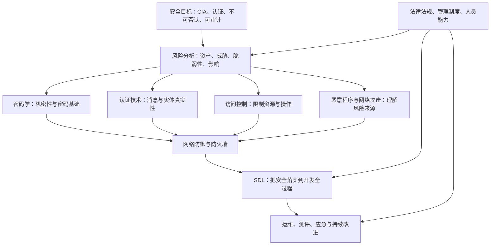

| 章节 | P1核心抓手 | 建议练习方式 |
| --- | --- | --- |
| 1 概述 | CIA；资产、威胁、脆弱性、风险；PDRR对策 | 给教务系统做风险分析 |
| 2 密码学 | 密码体制；对称与非对称；DES、SM4；DH、RSA | 手算课件例题，画算法流程 |
| 3 认证 | Hash、MAC、签名区别；口令与盐；质询应答；Kerberos基本过程 | 按安全属性比较方案，分析重放 |
| 4 访问控制 | 认证与授权；DAC、MAC、RBAC；ACL；BLP与Biba | 判断主客体能否读写 |
| 5 软件与恶意程序 | 病毒、蠕虫、木马、Bot；病毒结构；软件保护目标 | 类型辨析，匹配检测与防护 |
| 6 网络安全 | 威胁分类；DoS/DDoS；扫描、监听、注入、社会工程 | 按“原理—危害—防御”答题 |
| 7 防火墙 | 三项基本要求；包过滤与代理；状态检测；DMZ | 画拓扑，解释允许与拒绝规则 |
| 8 SDL | 各阶段安全活动；六项设计原则；STRIDE；常见Web漏洞 | 从漏洞追溯到设计、编码和测试 |
| 9 实践与职业 | 等保工作流程 | 岗位与能力对应；其余以P2为主 |
| 10 法律法规 | 三部法律的对象、目的与制度；个人信息处理规则 | 情境判断并说明理由 |

**推荐复习顺序**：先学第1章的目标与风险，再连读第2—4章的技术基础，之后学第5—7章的攻击与防御，最后用第8—10章连接工程、管理和合规。

---

## 第1章 信息安全概述

课件定位：S1，核心为第25—48页。第48页列出本章教学要求。

### 1.1 信息安全保护什么｜P1

信息安全通过技术措施和管理措施，保护**信息及承载信息的系统**，应对偶然事件和恶意行为造成的泄露、篡改、破坏与服务中断。

保护对象包括硬件、软件、数据、网络、业务服务和人员相关的信息。信息在**存储、传输、处理**三个状态下都需要保护。

| 属性 | 核心问题 | 典型破坏 | 常见措施 |
| --- | --- | --- | --- |
| 机密性 Confidentiality | 未授权者能否获知信息？ | 窃听、隐私泄露、数据库被导出 | 加密、访问控制、最小知悉 |
| 完整性 Integrity | 信息或系统是否被未授权改变？ | 成绩被改、程序被植入代码、交易被伪造 | MAC、数字签名、权限控制、可信校验 |
| 可用性 Availability | 授权用户能否及时、正常使用？ | DDoS、断电、勒索加密、设备故障 | 冗余、备份、容灾、限流、应急恢复 |
| 鉴别性／真实性 Authenticity | 实体或消息来源是否真实？ | 冒充用户、假网站、伪造通知 | 身份认证、证书、消息认证 |
| 不可否认性 Non-repudiation | 行为发生后能否抵赖？ | 否认签署合同、否认发出订单 | 数字签名、可信时间与证据管理 |
| 可审计性／可追责性 | 能否记录并追溯行为？ | 共用账号、删改日志、无法定位责任人 | 唯一身份、审计日志、日志保护 |

==CIA是三项基本属性，其他属性在此基础上扩展。==

完整性还要区分：**数据完整性**关注数据是否被非法改变，**系统完整性**关注系统是否被非法操纵、能否按既定功能运行。

> [!example] 同一个教务系统可以出现不同安全问题
> 成绩被他人看到：机密性受损。成绩被改高：完整性受损。选课时系统瘫痪：可用性受损。有人冒充教师：真实性受损。教师否认提交过成绩：涉及不可否认性。多人共用管理员账号导致无法追责：可审计性不足。

### 1.2 安全风险分析｜P1

| 概念 | 含义 | 教务系统例子 |
| --- | --- | --- |
| 资产 Asset | 有价值、需要保护的对象 | 成绩数据、账户、选课服务、服务器 |
| 威胁 Threat | 可能导致损失的主体、行为或事件 | 黑客攻击、内部滥用、停电、误操作 |
| 脆弱性 Vulnerability | 可被利用的弱点 | 弱口令、未修补漏洞、权限过大、无备份 |
| 风险 Risk | 威胁作用于资产并造成损失的可能性及后果 | 弱口令被利用后，成绩被批量修改 |
| 控制／对策 Control | 降低发生可能性或损失的措施 | MFA、最小权限、补丁、告警、恢复演练 |
| 剩余风险 | 采取措施后仍存在的风险 | 新漏洞、账号被接管、备份也被破坏 |

可用下面的关系帮助理解，但不能把它当成通用的精确计算公式：

$$
\text{风险水平}\approx\text{发生可能性}\times\text{影响程度}
$$

课件中的“威胁＋漏洞＝风险”强调两者的联系。完整分析还要考虑资产价值、暴露情况、已有控制与损失后果。

**案例答题步骤**：识别资产 → 识别威胁 → 查找脆弱性 → 说明受损属性与影响 → 提出防护、检测、响应和恢复措施 → 评价剩余风险。

### 1.3 信息安全研究内容与保障手段｜P2

课件从计算机外部安全、内部安全、网络安全展开，也从研究性质划分为：

- **基础理论**：密码理论、安全理论与安全模型。
- **应用技术**：安全实现、安全平台、认证、访问控制、防火墙、漏洞检测。
- **安全管理**：标准、策略、测评、制度和人员管理。

保障安全要同时考虑**技术、管理、人员和贯穿生命周期的工程过程**。采购安全产品只完成了其中一部分，后续还要持续配置、更新、监测和验证。

### 1.4 动态安全模型｜P2

| 模型 | 组成与记忆重点 |
| --- | --- |
| PDR | Protection防护、Detection检测、Response响应 |
| PPDR | 在Policy策略指导下，组织防护、检测、响应 |
| PDRR | 防护、检测、响应、Recovery恢复 |
| IPDRR | Identify识别、Protect防护、Detect检测、Respond响应、Recover恢复 |
| WPDRRC | Warning预警、防护、检测、响应、恢复、Counterattack反击；课件同时强调人员、策略、技术 |
| ASA自适应安全框架 | 预测、防御、检测、响应，随环境与威胁变化持续调整 |

课件第35页另以国王安全举例使用 **PDRRP**：保护、检测、反应、恢复、惩罚（Punish）。不要将它与PPDR或PDRR混成同一个缩写。

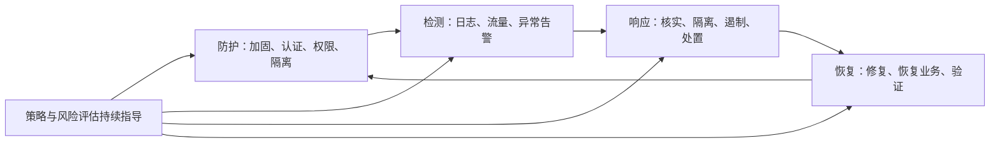

课件的“一个中心、三重防护”指：**安全管理中心**统筹管控，保护**安全计算环境、安全区域边界、安全通信网络**。

### 1.5 本章复习检查

- [ ] 能用自己的例子解释CIA，并区分数据完整性与系统完整性。
- [ ] 能区分资产、威胁、脆弱性、风险和对策。
- [ ] 能为实验室服务器或教务系统各写一组PDRR措施。
- [ ] 能解释为什么安全需要动态维护，为什么需要技术与管理共同作用。

> [!question]- 自测：有备份是否就保证了可用性？
> 不能。还要考虑备份是否完整、隔离、可恢复，恢复所需时间能否满足业务要求，以及网络、算力、电力等依赖是否可用。存在备份和能及时恢复业务是不同要求。

---

## 第2章 密码学

课件定位：S2、S3。S2讲概念、古典密码、DES与SM4；S3讲公钥密码、DH、RSA及发展趋势。

### 2.1 密码学与密码体制｜P1

**密码学 Cryptology**包括密码编码学与密码分析学。前者设计密码方案，后者分析其安全性、寻找恢复明文或密钥的方法。现代密码学不仅用于保密，也用于完整性、认证、数字签名与密钥建立。

密码体制可以记为五元组：

$$
S=(\mathcal P,\mathcal C,\mathcal K,E,D)
$$

其中，$\mathcal P$是明文空间，$\mathcal C$是密文空间，$\mathcal K$是密钥空间，$E$和$D$分别是加密与解密算法。基本正确性要求为：

$$
C=E_{K_e}(M),\qquad D_{K_d}(C)=M
$$

**柯克霍夫原则**：评估安全性时应假设算法和系统设计已被攻击者了解，安全主要依赖密钥保密，不能只依靠算法不公开。

### 2.2 密码算法分类与比较｜P1

| 比较项 | 对称密码 | 非对称／公钥密码 |
| --- | --- | --- |
| 密钥关系 | 加解密使用相同或可容易互推的密钥 | 使用相关联的公钥、私钥，不能由公钥轻易算出私钥 |
| 秘密管理 | 通信双方都要保护共享密钥 | 私钥保密，公钥可公开，但需要验证其归属 |
| 主要优点 | 通常速度快，适合大量数据 | 有利于密钥建立、数字签名与开放环境通信 |
| 主要困难 | 初始密钥分发、多用户密钥管理 | 计算开销、可信公钥获取、私钥保护 |
| 典型内容 | DES、SM4、AES、流密码 | RSA、椭圆曲线类算法；DH用于密钥协商 |

**对称密码再分两类**：分组密码以固定长度数据块为单位处理，如DES、SM4；流密码生成密钥流，逐比特或逐字节结合明文处理。流密码、分组密码和分组密码工作模式是不同层面的概念。

如果$n$个用户两两共享不同的长期对称密钥，且没有KDC等额外机制，则：

$$
\text{密钥总数}=\frac{n(n-1)}2,\qquad\text{每人保存}=n-1
$$

> [!warning] 两项常见误解
> 公钥可以公开，但**“拿到一个公钥”不等于“确认了对方身份”**，还要验证证书或通过可信渠道核验公钥。
> 对称密码可以用于MAC与身份认证。它的局限是共享密钥双方难以凭MAC向第三方证明“究竟是谁生成了消息”，不能简单说“对称密码不能认证”。

### 2.3 密码分析的攻击模型｜P1

| 模型 | 攻击者获得或可调用的资源 | 记忆关键词 |
| --- | --- | --- |
| 唯密文攻击 | 算法和截获的密文 | 只有密文 |
| 已知明文攻击 | 一些明文及其对应密文 | 已有配对样本 |
| 选择明文攻击 CPA | 可选择明文，获得其加密结果 | 可调用加密接口 |
| 选择密文攻击 CCA | 在模型限制内选择密文并获得解密结果 | 可调用解密接口 |
| 选择文本攻击 | 课件指结合选择明文与选择密文的能力 | 两类能力组合 |

攻击复杂度分为**数据复杂度**与**计算／处理复杂度**。穷举攻击通过枚举密钥尝试解密，统计分析则利用明文语言特征、算法结构或其他可利用规律。

课件S2第36页的选择密文攻击应理解为“解密黑盒”，不要照抄为加密黑盒。

### 2.4 古典密码｜P1概念，P2计算

**置换**改变符号的位置，符号本身保持不变。**代换**用其他符号替换明文符号。单表代换始终使用同一张代换表，多表代换随位置或密钥选择不同的代换表。

| 方法 | 关键原理 | 需要会什么 |
| --- | --- | --- |
| 凯撒密码 | 字母按固定偏移量移动 | 模26加解密 |
| 维吉尼亚密码 | 按重复密钥选择不同移位表 | 密钥对齐后逐位模加 |
| 栅栏／转置密码 | 按约定写入、换序读出 | 明确写入与读出规则 |

约定`A=0,…,Z=25`，凯撒密码为：

$$
c=(m+k)\bmod26,\qquad m=(c-k)\bmod26
$$

课件例：`please confirm receipt`在$k=3$时得到`SOHDVH FRQILUP UHFHLSW`。

维吉尼亚密码为：

$$
c_i=(m_i+k_i)\bmod26,\qquad m_i=(c_i-k_i)\bmod26
$$

其中密钥通常循环使用。解题时先写字母编号，再对齐密钥，最后逐位计算，不能把同一字母在不同位置都替换成同一个密文字母。

**置换小例**：若约定密文依次读取明文第`3、5、1、6、4、2`位，则`ABCDEF`变为`CEAFDB`，解密按逆置换`3、6、1、5、2、4`读取。

> [!tip] 混淆与扩散
> **混淆 Confusion**使密钥与密文之间的关系复杂化，代换尤其是非线性变换有助于实现。
> **扩散 Diffusion**把明文的统计特征分散到密文多个位置，减少局部规律暴露。S2第50页“扩散是增加明文冗余度”的说法不准确，应理解为扩散、隐藏明文的统计冗余。

### 2.5 DES｜P1

课件对DES展开较多，重点掌握参数、整体流程、Feistel轮函数、S盒查表和密钥顺序。

| 项目 | DES参数 |
| --- | --- |
| 算法类别 | 对称分组密码，Feistel结构 |
| 分组长度 | 64 bit |
| 输入密钥长度 | 64 bit，其中8 bit为奇偶校验位 |
| 有效密钥长度 | **56 bit** |
| 轮数 | **16轮** |
| 每轮子密钥 | 48 bit |
| 左右半块 | 各32 bit |

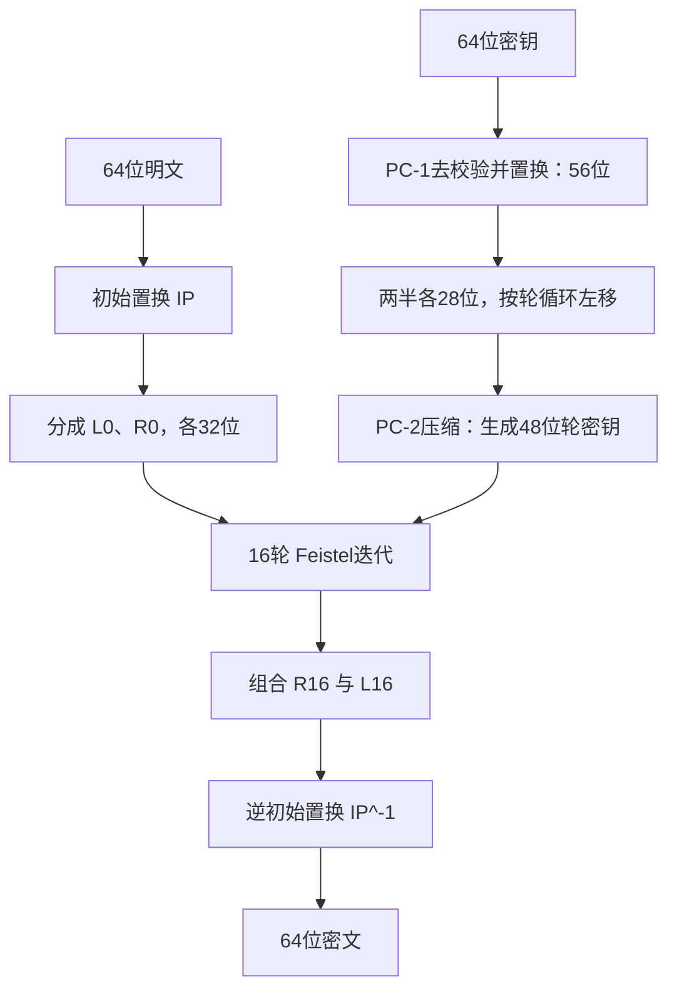

**一轮的递推公式**：

$$
L_i=R_{i-1}
$$

$$
R_i=L_{i-1}\oplus f(R_{i-1},K_i)
$$

这里的$\oplus$是**按位异或**，不能当作普通加法。

**轮函数$f$的四步**：

1. **E扩展**：32 bit扩展成48 bit。
2. **轮密钥加**：与48 bit子密钥异或。
3. **S盒代换**：分成8组，每组6 bit，经各自S盒输出4 bit，总计32 bit。
4. **P置换**：对32 bit重排，再参与上面的左右半块异或与交换。

**S盒怎么查**：输入$b_1b_2b_3b_4b_5b_6$，首尾两位$b_1b_6$确定行，中间四位$b_2b_3b_4b_5$确定列，表中数值转成4位二进制输出。行号为0—3，列号为0—15。

**密钥扩展**：64位输入经PC-1得到56位，分成两个28位半部，按移位表循环左移，再经PC-2得到48位子密钥。第1、2、9、16轮左移1位，其余轮左移2位。

**解密**沿用同一Feistel结构，将子密钥按$K_{16},K_{15},\ldots,K_1$逆序使用。理解结构即可，不必把S盒当作需要独立求逆的部件。

**课件整体验证例**（S2第95—106页）：

```text
明文：0123456789ABCDEF
密钥：133457799BBCDFF1
密文：85E813540F0AB405
```

> [!warning] DES学习时的边界
> 课件中间演算存在个别不一致，复习应以递推关系、标准参数和最终测试向量为准。不要机械背诵每一行中间二进制值。
> DES密钥过短，已不适合现代安全应用。“补零即可处理所有不足一块的数据”也不完整，实际方案必须明确工作模式、填充、IV／Nonce以及完整性保护。双重DES、三重DES在本课作为历史扩展理解，不据此为新系统选型。

### 2.6 国密SM4与算法分类｜P1

SM4是**对称分组密码**，分组长度128 bit，密钥长度128 bit，进行32轮迭代。把一个分组看成四个32位字。

$$
X_{i+4}=X_i\oplus T(X_{i+1}\oplus X_{i+2}\oplus X_{i+3}\oplus rk_i),\quad i=0,\ldots,31
$$

其中$T=L\circ\tau$：$\tau$是非线性S盒变换，$L$是线性变换。若$B=\tau(A)$，则：

$$
L(B)=B\oplus(B\lll2)\oplus(B\lll10)\oplus(B\lll18)\oplus(B\lll24)
$$

$\lll$表示32位循环左移。输出是最后四个字**反序**排列：

$$
(Y_0,Y_1,Y_2,Y_3)=(X_{35},X_{34},X_{33},X_{32})
$$

密钥扩展产生32个轮密钥，扩展中的线性变换使用循环左移13、23位，与加密轮函数中的2、10、18、24位不同。解密结构与加密相同，轮密钥按$rk_{31},\ldots,rk_0$逆序使用。

| 比较项 | DES | SM4 |
| --- | --- | --- |
| 分组长度 | 64 bit | 128 bit |
| 有效密钥长度 | 56 bit | 128 bit |
| 迭代轮数 | 16 | 32 |
| 处理结构 | 两个32位半块的Feistel迭代 | 四个32位字的迭代，课件称非平衡Feistel结构 |
| 解密关键 | 轮密钥逆序 | 轮密钥逆序 |

**国密名称辨析**：SM2是椭圆曲线公钥密码算法体系，SM3是密码杂凑算法，SM4是对称分组密码，SM9是标识密码算法体系。S2、S3中的算法汇总图不能据版面位置推断SM3属于加密算法。

S2第120页要求实现SM4加解密，并用GB/T 32907-2016附录示例验证。若考核包含实验，除了会调用程序，还应能说明输入编码、密钥、明密文格式与测试向量的作用。

### 2.7 公钥密码的数学思想｜P2

**单向函数**：正向容易计算，逆向在给定条件下很难计算。**陷门单向函数**：知道某个秘密信息时，逆向计算也变得容易，这个秘密就是“陷门”。

RSA中，已知大素数$p,q$很容易求$n=pq$，从足够大的$n$反求$p,q$则可能很困难。DH中，模指数运算容易，合适群参数下的离散对数问题困难。

> [!warning] 数学表述要准确
> 不是所有模运算都难以求逆。“$3x\bmod n$”若表示普通乘法，不能拿它说明离散对数困难。课件要讨论的是$g^x\bmod p$的逆问题。
> RSA不依赖“素数检测困难”，生成和检测素数并非其安全基础。还要避免把“已知分解可以破解RSA”直接说成“RSA安全性与大数分解已被严格证明等价”。

### 2.8 Diffie-Hellman密钥协商｜P1

**目标**：双方通过公开通信计算同一个共享秘密，不直接传输这个共享秘密本身。

公开参数为素数$p$和生成元$g$。A、B分别选择秘密指数$a,b$：

$$
A=g^a\bmod p,\qquad B=g^b\bmod p
$$

交换公开量$A,B$后：

$$
K_A=B^a\bmod p,\qquad K_B=A^b\bmod p
$$

由于两者都等于$g^{ab}\bmod p$，所以得到相同的共享秘密。

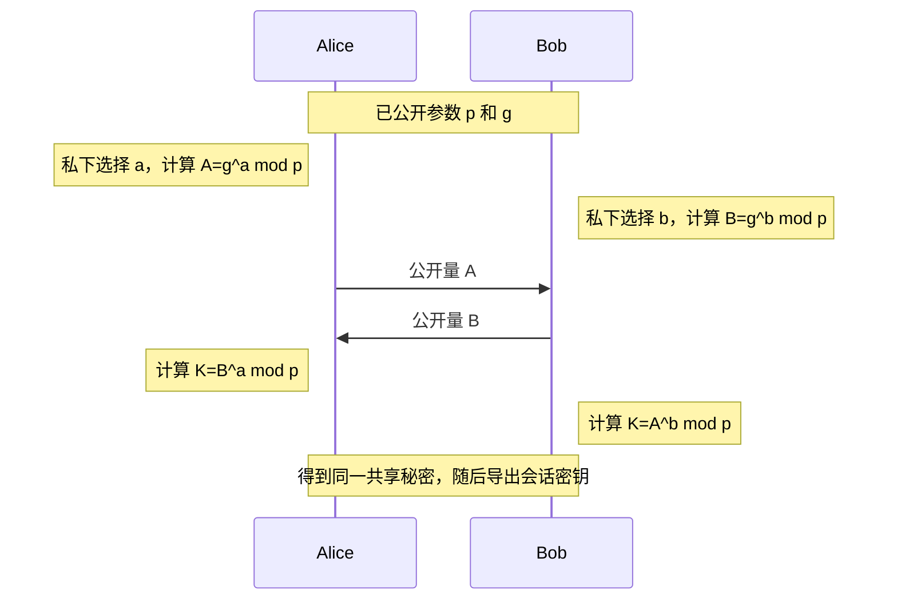

**课件例题**（S3第34—35页）：$p=97,g=5,a=36,b=58$。

$$
A=5^{36}\bmod97=50,\qquad B=5^{58}\bmod97=44
$$

$$
K=44^{36}\bmod97=50^{58}\bmod97=75
$$

复习必须能区分：$p,g,A,B$可以公开，$a,b$必须保密，最终的$K$也必须保密。实际协议通常再对共享秘密做密钥派生，不把小整数例题直接用于真实通信。

> [!warning] DH的关键限制
> **裸DH不认证对方身份，可能受到中间人攻击。**攻击者可分别与双方建立秘密。必须把协商过程与可信证书、签名、预共享认证等机制结合。DH是密钥协商，不能直接说成消息加密算法。

### 2.9 RSA｜P1

**教材式RSA步骤**：

1. 选择不同的大素数$p,q$，计算$n=pq$。
2. 计算$\varphi(n)=(p-1)(q-1)$。
3. 选择$e$，使$1<e<\varphi(n)$且$\gcd(e,\varphi(n))=1$。
4. 求$d$，使$ed\equiv1\pmod{\varphi(n)}$，即$d$是$e$的模逆。
5. 公钥是$(e,n)$，私钥包含$d$及相关秘密参数。

加密、解密分别为：

$$
c=m^e\bmod n,\qquad m=c^d\bmod n,\qquad0\le m<n
$$

**完整课件例题**（S3第45—48页）：

$$
p=47,\quad q=61,\quad n=2867,\quad\varphi(n)=2760
$$

选择$e=167$，解得$d=1223$，可验证：

$$
167\times1223=204241=74\times2760+1
$$

把消息`123456789`按课件约定分成`123、456、789`，每组都小于$n$：

| 明文块$m_i$ | $m_i^{167}\bmod2867$ | 解密结果$c_i^{1223}\bmod2867$ |
| --- | --- | --- |
| 123 | 1770 | 123 |
| 456 | 1321 | 456 |
| 789 | 1297 | 789 |

为了能恢复块边界，密文可按固定4位表示成`1770 1321 1297`。解密后按明文3位块恢复`123456789`。

**计算题检查顺序**：核对素数 → 算$n$和$\varphi(n)$ → 检查$e$互素 → 求逆得到$d$ → 检查分组小于$n$ → 模幂运算 → 用解密结果反验。

> [!tip] 模幂运算怎么做
> 使用重复平方并逐次取模，避免先算出巨大整数。例如把指数写成二进制，计算$m,m^2,m^4,m^8,\ldots$的模$n$结果，再组合对应项。求$d$可用扩展欧几里得算法。

> [!warning] 教材RSA与实际RSA
> 上面的“直接模幂”用于理解与手算，不是完整的安全加密方案。实际RSA加密和签名还需要规范编码与填充，不能互相替代。课件提到的历史密钥长度、固定速度比例，以及“SSH、HTTPS全部使用RSA”等表述，不应作为当前系统设计依据。

### 2.10 混合密码体制与发展趋势｜P1理解，P3拓展

**混合体制**用公钥机制完成认证或密钥建立，再用对称密码保护大量业务数据，兼顾开放环境中的密钥管理与处理效率。

不要机械理解为“所有连接都用RSA加密并传输一个会话密钥”。密钥也可以通过经过认证的DH类协议共同导出。

**量子密码／QKD**：课件重点是先利用量子密钥分发建立密钥，再通过经典信道传输加密后的消息。它主要处理密钥分发问题。理论安全结论依赖协议、设备模型与认证等前提，不能由“使用量子信道”推出整个实际系统绝对安全。

**人工智能与密码学**：AI可用于异常检测、侧信道分析、口令猜测等研究；安全技术也用于保护AI数据、模型与隐私。记住这两个方向即可，不把“用了AI”当作密码被通用破解的证据。

### 2.11 本章复习检查

- [ ] 能写密码体制五元组，说明柯克霍夫原则。
- [ ] 能比较对称、公钥、分组、流密码，准确区分SM2／SM3／SM4。
- [ ] 能辨别唯密文、已知明文、选择明文与选择密文攻击。
- [ ] 能完成凯撒或简单置换题，解释混淆与扩散。
- [ ] 能背出DES的64／56／48／32／16分别指什么，画出轮函数。
- [ ] 能说明SM4的128位分组、128位密钥、32轮与逆序轮密钥。
- [ ] 能独立重做DH与RSA课件例题，并说明裸DH的身份认证问题。

> [!question]- 自测：非对称密码为什么没有取代对称密码？
> 两者适合承担不同任务。公钥机制便于密钥建立和签名，对称密码通常更适合大批量数据处理，因此实际系统经常组合使用。公钥机制本身也需要解决公钥真实性和私钥保护问题。

---

## 第3章 信息认证技术

课件定位：S4、S5。S4讲Hash、消息认证、数字签名；S5主要讲身份认证、认证协议、Kerberos和零知识证明。

### 3.1 三类认证问题｜P1

| 技术 | 主要回答的问题 | 典型使用 |
| --- | --- | --- |
| 消息认证 | 消息是否来自声称的来源，内容是否完整？ | 验证接口报文、交易数据 |
| 数字签名 | 谁对这份消息签署，内容是否保持一致，能否形成抗抵赖证据？ | 电子合同、软件发布签名 |
| 身份认证 | 当前交互者是否掌握与其声称身份绑定的凭据？ | 登录、设备接入、双向认证 |

消息认证与身份认证有联系，但不能等同。一个很久以前签过名的文件，不能独自证明签名者此刻正在与系统交互。

### 3.2 Hash函数与安全性质｜P1

密码杂凑／散列函数把任意长度消息$M$映射成固定长度摘要：

$$
h=H(M)
$$

| 性质 | 攻击者的目标 | 识别方法 |
| --- | --- | --- |
| 原像抗性 | 给定$h$，找一个$M$使$H(M)=h$ | 从摘要找输入 |
| 第二原像抗性，课件称弱抗碰撞 | 给定$M$，找不同的$M'$使$H(M')=H(M)$ | 固定一个消息后找替身 |
| 碰撞抗性，课件称强抗碰撞 | 找任意一对不同消息$M,M'$使摘要相同 | 两个消息都可挑 |

**雪崩效应**指输入微小变化通常导致输出大量比特变化。对于理想$n$位摘要，通用原像搜索约需$2^n$量级工作，而生日型碰撞搜索约需$2^{n/2}$量级工作。这是理想模型下的估算，不代表MD5等具体算法仍达到这个强度。

> [!warning] 两个必须纠正的理解
> **碰撞一定存在。**输入空间远大于固定长度输出空间，安全性要求是难以有效找到碰撞，不能说“不同消息绝不产生相同摘要”。
> **Hash没有密钥，自己不能证明消息是谁发的。**若攻击者能同时替换文件与摘要，单独比较摘要不能抵御主动篡改。可信摘要来源、MAC或数字签名提供了额外的真实性保证。

### 3.3 MD5工作过程｜P1参数，P2细节

| 项目 | MD5 |
| --- | --- |
| 输出长度 | **128 bit，即16字节，通常写成32位十六进制字符** |
| 消息分组 | 512 bit，即64字节 |
| 内部状态 | 4个32位字A、B、C、D |
| 每分组压缩 | 4轮，每轮16步，共64步 |
| 主要操作 | 布尔函数、模$2^{32}$加、循环左移、消息字与常数混合 |

**流程**：填充 → 附加原始长度 → 初始化状态 → 对所有512位分组迭代压缩 → 按规定字节序输出摘要。前一分组的状态参与后一分组计算，因此最终摘要与整个消息有关。

设原始消息长度为$L$ bit：

1. 追加一个`1`位。
2. 追加若干`0`，直到当前长度$\equiv448\pmod{512}$。
3. 追加64 bit的原始长度$L\bmod2^{64}$，采用MD5规定的低位字节在前表示。

即使原始长度已经是448模512，仍然要执行追加`1`的填充过程，不能直接省略。

**课件填充例题**（S4第10—12页）：

| 原始长度 | 附加的`1`与`0`总长度 | 末尾长度字段 | 最终长度 | 分组数 |
| --- | --- | --- | --- | --- |
| 704 bit | 256 bit，即1个`1`、255个`0` | 64 bit | 1024 bit | 2 |
| 960 bit | 512 bit，即1个`1`、511个`0` | 64 bit | 1536 bit | 3 |

960位原文加64位虽然刚好达到1024位，但还没有加入必需的`1`位填充，所以实际需要新增一个分组。

> [!note]- MD5内部细节，第二轮复习展开
> 四个初始状态字为`67452301`、`EFCDAB89`、`98BADCFE`、`10325476`（十六进制）。它们是32位字的数值表示，最终摘要输出还要按字节序处理。
> 四轮分别使用不同布尔函数F、G、H、I，消息字取用顺序、移位量与常数也随步骤变化。每轮16步，完成一个分组后还与该分组输入时的链接状态进行模加。通常先掌握结构与位数，再按教师要求复习具体步函数，无需优先死背64个常数。

> [!warning] MD5的使用现状
> S4将“MD5碰撞几乎不可能”作为特点，这是过时表述。MD5已不适用于依赖抗碰撞性的安全用途，特别是数字签名。文件MD5可用于某些非对抗性差错检查，但不能据此证明文件可信。相关安全说明见[RFC 6151](https://www.rfc-editor.org/rfc/rfc6151.html)。

### 3.4 消息认证码MAC｜P1

通信双方共享秘密密钥$K$，发送方计算：

$$
t=\operatorname{MAC}_K(M)
$$

接收方对收到的$M'$重新计算$t'=\operatorname{MAC}_K(M')$并验证标签。密钥不泄露、算法与协议使用正确时，可抵御不知道密钥的第三方伪造。

MAC主要提供**消息完整性与共享密钥持有者范围内的来源认证**，通常不提供机密性。收发双方都能生成合法MAC，因此难以用它向第三方区分到底是谁生成消息，不能替代数字签名的公开验证与抗抵赖作用。

**HMAC**是基于Hash的标准消息认证结构。不要把任意`H(M||K)`或`H(K||M)`拼接都当作安全的通用MAC方案。课件的拼接形式用于解释“认证值与消息、秘密有关”的思想。

> [!tip] 防重放需要认证消息的新鲜性
> 一份原样重放的旧报文仍可能通过MAC或签名验证。将Nonce、序列号、时间戳、会话标识等纳入认证范围，并在接收方检查，才能识别重复或过期报文。时间戳方案还依赖时钟与接收窗口管理。

### 3.5 Hash、MAC、数字签名与加密比较｜P1

| 项目 | 普通Hash | MAC | 数字签名 | 普通公钥加密 |
| --- | --- | --- | --- | --- |
| 主要秘密 | 无 | 收发双方共享密钥 | 签名者私钥 | 接收者私钥 |
| 谁能生成 | 任何人 | 掌握共享密钥者 | 掌握签名私钥者 | 任何持有接收者公钥者 |
| 谁能验证／恢复 | 任何人可重算摘要 | 掌握共享密钥者可验证 | 持可信公钥者可验签 | 接收者持私钥解密 |
| 主要目标 | 摘要与差错／一致性检查 | 完整性与来源认证 | 完整性、来源认证、支持不可否认性 | 机密性 |
| 单独提供机密性 | 否 | 否 | 否 | 是，需正确安全方案 |
| 自动防重放 | 否 | 否 | 否 | 否 |

==收件人公钥加密，收件人私钥解密；发件人私钥签名，发件人公钥验签。==

“只有Bob能解开密文”说明接收者保密性，不说明密文一定由Alice生成，因为任何人都能使用Bob的公钥加密。

### 3.6 数字签名｜P1

签名通常对消息摘要经过规范编码后的结果执行签名算法，验证者用可信公钥检查签名与消息是否匹配。


**直接数字签名**：发送方与接收方直接签名、验证。风险包括私钥失窃、签名时间争议与身份绑定不可信。

**仲裁数字签名**：引入可信第三方验证、转送或记录，帮助解决争议。要同时分析第三方信任、可用性、隐私与密钥保护问题。

**RSA教材式签名**：

$$
s=h^d\bmod n,\qquad v=s^e\bmod n
$$

比较$v$与消息对应的摘要代表值$h$。课件小例中$e=3,d=7,n=33,h=4$，签名$s=16$，验签$16^3\bmod33=4$。这是模幂演示，实际签名还需规范编码，不能把任意Hash值直接代入小模数。

**签名的前提**：私钥由签名者有效控制，公钥与身份可信绑定，算法与摘要安全，消息编码与验证规则明确，必要时有可信时间、证书有效性与撤销记录。

> [!warning] “无法篡改、无法重复使用”应怎样理解
> 签名不能阻止别人改动文件，而是让改动后的文件无法通过原签名验证。对原消息和签名的复制、重放仍可能发生。它也不是所有电子签名的唯一实现方式，不能把数字签名、电子签名和扫描签名图片混为一谈。

### 3.7 DSA数字签名｜P2

课件还讲了DSA，重点是**每次签名需要新的秘密随机数、输出两个签名分量、公钥用于验证**。下面用常见记号$k,r,s$，对应课件中的随机数$r$和签名分量$t,s$。

公共参数$p,q,g$，私钥$x$，公钥$y=g^x\bmod p$。签名时选秘密随机数$k$：

$$
r=(g^k\bmod p)\bmod q
$$

$$
s=k^{-1}(H(M)+xr)\bmod q
$$

验证时：

$$
w=s^{-1}\bmod q,\quad u_1=H(M)w\bmod q,\quad u_2=rw\bmod q
$$

$$
v=(g^{u_1}y^{u_2}\bmod p)\bmod q
$$

检查签名分量取值有效，并判断$v=r$。

课件例：$p=23,q=11,g=6,x=10,y=4,k=9,H(M)=13$，得到$r=5,s=7$；验证时$w=8,u_1=5,u_2=7,v=5$，所以通过。

**高频理解点**：签名随机数泄露、重复或生成不当可能暴露私钥。DSA在这里按课件算法原理学习，不作为新系统算法推荐。

### 3.8 身份认证因素与口令保护｜P1

身份认证系统包含**示证者、验证者、攻击者**，必要时加入可信第三方。认证可以是本地或远程、单向或双向。

| 因素 | 含义 | 例子 | 主要风险 |
| --- | --- | --- | --- |
| 所知 | 你知道的秘密 | 口令、PIN | 猜测、钓鱼、泄露、重放 |
| 所有 | 你持有的物品或认证器 | 智能卡、硬件令牌 | 丢失、被盗、实现被攻破 |
| 所是 | 你的生物特征 | 指纹、虹膜、人脸 | 误识别、仿冒、隐私与难撤销 |

**双因素／多因素认证**组合不同类别的因素，例如银行卡＋PIN。两个不同的口令仍属于同一类别，不能仅因有“两项输入”就称为双因素。

口令面临在线猜测、离线猜测、字典攻击、窃听、恶意软件记录、肩窥、社会工程和撞库等风险。**在线攻击**受服务器限速等控制影响，**离线攻击**是在取得验证数据后自行猜测，不再逐次请求服务器。

**口令存储的核心结构**：

$$
v=\operatorname{PasswordKDF}(\text{password},\text{salt},\text{cost})
$$

保存随机盐、算法／参数与验证值。登录时使用相同参数计算并比较，避免明文保存。盐通常不需要保密，作用是让相同密码也生成不同验证值，降低预计算表和跨账户复用猜测结果的收益。

**盐不能阻止对单个账户持续猜测。**仍需使用合适的口令派生算法、足够成本、强且独立的口令，并结合MFA、泄露口令检查与在线限速。一次快速的`SHA256(password||salt)`不等同于完整的现代口令保护方案。

> [!warning] 课件口令建议的准确性
> S5中的“Salt攻击”段落实际上在解释盐如何增加攻击者的成本；不要据此理解为“加盐本身是一种攻击”。“保存密文一定比保存Hash更安全”也不能成立，口令验证通常应采用专用的加盐口令哈希方案。
> 定期强制改密属于课件历史建议。NIST SP 800-63B-4不要求无原因的周期换密，而强调安全存储、长度、限速和在存在泄露证据时换密。真实系统还需遵循适用的组织制度。[NIST身份认证指南](https://pages.nist.gov/800-63-4/sp800-63b.html)

**生物认证的两个阶段**：注册时采集并建立模板，认证时采集样本与模板匹配。准确性、稳定性、采集便利性、活体检测和模板保护共同影响效果。不能只依赖“生物特征唯一”就断言不可伪造，泄露后也难像口令一样更换。

### 3.9 质询应答、重放与反射｜P1

**质询应答**让验证者先产生新鲜挑战，示证者利用秘密生成与本次挑战绑定的回答，验证者核验其是否掌握秘密。

下面是帮助理解的单向认证简写，响应额外绑定双方身份和方向：

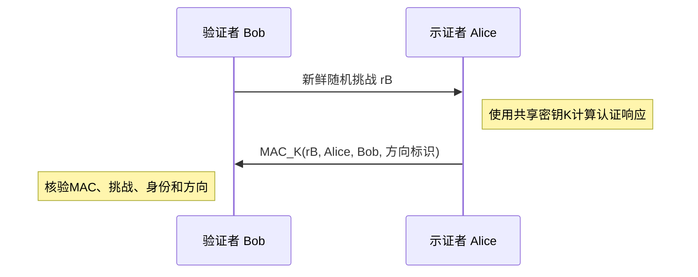

- **Nonce**是一次使用的值，应满足协议的新鲜性要求；作为挑战时通常还要求不可预测。
- **重放攻击**利用截获的旧认证报文冒充当前参与者。防御依赖挑战、序列号、有效期、时间戳和重放缓存。
- **反射攻击**把一个方向上的挑战拿到另一个会话／方向，让验证者替攻击者计算回答。应区分通信方向、角色、身份，必要时使用不同方向密钥。

课件的对称加密、MAC、数字签名认证方案都可以围绕这个思路理解：**秘密不直接暴露，回答与当前挑战和通信上下文绑定**。

### 3.10 Needham-Schroeder与KDC｜P2

**KDC密钥分发中心**与各用户分别共享长期密钥，需要通信时为双方生成会话密钥。

若有$n$个终端用户，另加一个KDC，则通常需要$n$把用户—KDC长期密钥。课件的$n-1$是把KDC也计入$n$个参与方后的计数，答题先说明$n$代表谁。

以下是对称密钥版Needham-Schroeder的教材式简写。A与T共享$K_{AT}$，B与T共享$K_{BT}$，$N_A,N_B$为随机挑战：

```text
1. A → T：A, B, N_A
2. T → A：E_KAT(N_A, B, K_AB, Ticket_B)
   其中 Ticket_B = E_KBT(K_AB, A)
3. A → B：Ticket_B
4. B → A：E_KAB(N_B)
5. A → B：E_KAB(N_B - 1)
```

**理解各字段的作用**：$N_A$关联请求与响应；Ticket由B的长期密钥保护，让A能转交但不能任意伪造；后两步验证双方掌握会话密钥。

原始方案的重要问题是：攻击者若掌握旧会话密钥和旧票据，可能重放旧票据冒充A。**验证“知道某个密钥”还不够，还要确认密钥与票据的新鲜性。**

会话密钥是短期用途密钥，不等同于一次一密密码本的密钥。两者不能因为课件使用了“一次一密”字样就混同。

### 3.11 Kerberos｜P1基本过程，P2字段

课件先演示简单认证对话的缺陷，再逐步引入TGS、票据和认证器，最后给出Kerberos。不要把中间的明文口令示例当作完整Kerberos流程。

| 角色／对象 | 作用 |
| --- | --- |
| C | 客户端 |
| AS | 认证服务器，完成初始认证相关工作 |
| TGS | 票据授予服务器，签发访问具体服务的票据 |
| V | 业务／应用服务器 |
| KDC | 通常承载AS与TGS的可信密钥分发体系 |
| TGT | 票据授予票据，用于向TGS申请后续服务票据 |
| Service Ticket | 面向指定业务服务器的票据 |
| Authenticator认证器 | 客户端为本次访问生成的、用会话密钥保护的认证数据 |

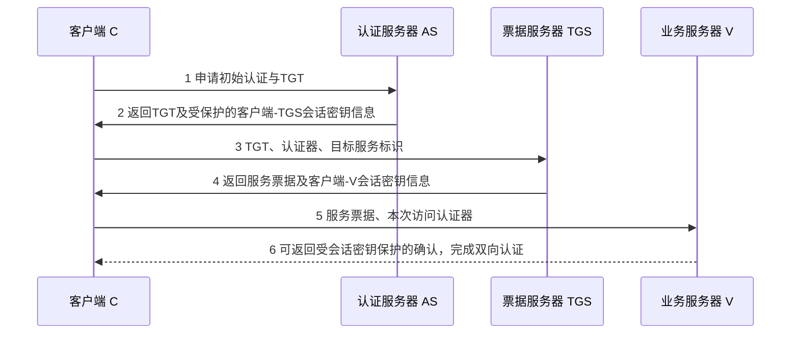

**必须理解的四点**：

1. 用户不必把口令直接发送给每个业务服务器，也不必为每次服务重新输入口令。
2. 票据由目标服务器能识别的密钥保护；客户端使用会话密钥生成认证器，证明当前持有相应凭据。
3. 有效期、时间戳、认证器和重放检测共同工作。只给票据加有效期，不能自动消除有效期内的重放。
4. 传统课件方案以对称密码为基础，依赖KDC可信、长期密钥和客户端安全、合理时钟同步等条件。

> [!question]- 为什么“截获一张票据”不应直接等于“拿到了完整登录能力”？
> 设计上还要证明持有对应会话密钥，生成本次访问的认证器。若会话密钥、客户端缓存等也被窃取，风险会显著扩大，所以票据缓存、终端和密钥都必须保护。

### 3.12 零知识证明｜P2

目标是在不暴露秘密本身的情况下，让验证者相信某个命题成立或证明者掌握所需秘密。常用的三个性质是：**完备性**、**可靠性／健全性**、**零知识性**。

课件“洞穴问题”的直觉：证明者可利用秘密门从指定一侧走出。验证者每轮随机指定出口。不知道秘密的冒充者每轮碰巧成功的概率为$1/2$，独立重复$n$轮后为$2^{-n}$。

> [!warning] 类比与正式零知识证明要区分
> 不展示钥匙、提供学校证明、服务器保存密码Hash，这些可以帮助理解“少暴露信息”，但不能据此认定它们是严格的密码学零知识证明。
> 普通密码登录通常仍把密码交给服务器处理。公钥解密挑战也不能在没有进一步证明的情况下直接归为正式零知识协议。正式定义还要求验证者不能从交互中学到超出命题真实性的额外知识。

### 3.13 本章复习检查

- [ ] 能说明Hash三项安全性质，正确解释碰撞。
- [ ] 能记住MD5的128位输出、512位分组、4轮64步，并完成填充计算。
- [ ] 能从机密性、完整性、认证、抗抵赖、防重放五个角度比较Hash、MAC、签名、加密。
- [ ] 能说出多因素的三种类别，并解释盐的作用和局限。
- [ ] 能画质询应答过程，说明Nonce、方向与身份绑定的作用。
- [ ] 能用自己的话说明KDC、TGT、服务票据与认证器。
- [ ] 能解释“用Hash保存密码”为什么不等于零知识证明。

---

## 第4章 访问控制

课件定位：S6、S7，以82页的S6为主。S7内容高度重合，S6额外包含IIS检查流程；两份中的安全等级次序应统一理解为“公开＜秘密＜机密＜绝密”。

### 4.1 认证、授权与访问控制｜P1

**身份认证**解决“你是谁／是否持有该身份凭据”。**授权**规定某主体可以对哪些资源做什么。**访问控制**在实际请求发生时执行这些限制。

认证成功的用户仍可能越权。访问控制既要阻止非法用户，也要阻止合法用户以未经授权的方式使用资源。

| 要素 | 含义 |
| --- | --- |
| 主体 Subject | 提出访问请求的实体，如用户、进程、服务 |
| 客体 Object | 被访问和保护的资源，如文件、数据库、设备 |
| 操作／权限 | 读、写、执行、删除、管理等 |
| 安全策略 | 规定什么访问可以被允许的规则 |
| ADF | 访问控制决策功能，依据策略作出允许／拒绝决定 |
| AEF | 访问控制执行功能，保证实际访问服从决策 |

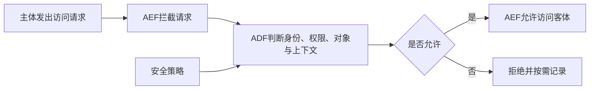

**策略**描述允许什么，**机制**描述如何实施。策略需要覆盖申请、批准、实际执行、变更和撤销全过程。

### 4.2 访问矩阵、ACL与能力表｜P1

访问矩阵以主体为行、客体为列，每个单元格记录允许的操作。例如：

| 主体＼客体 | 文件A | 文件B | 设备C |
| --- | --- | --- | --- |
| 用户甲 | 读、写 | 读 | 无 |
| 用户乙 | 读 | 无 | 使用 |
| 用户丙 | 无 | 读、写 | 无 |

- **ACL访问控制表**按客体组织，相当于看矩阵的一列：“谁可以怎样访问这个对象？”
- **能力表 Capability List，课件称ACCL**按主体组织，相当于看一行：“这个主体可以访问哪些对象、有什么权限？”

ACL便于查一个对象允许谁访问与撤销某人的对象权限；能力方式便于主体携带授权凭据，但要防伪造、篡改和未经允许的转移，并处理撤销与全局追踪。课件提到两者在集中式／分布式系统中的常见使用，实际并不存在绝对的部署限制。

### 4.3 DAC、MAC与RBAC｜P1

| 模型 | 决策依据 | 权限主要由谁控制 | 优点 | 主要局限 |
| --- | --- | --- | --- | --- |
| DAC自主访问控制 | 主体身份与被授予的权限 | 资源所有者／具有授权权力者 | 灵活、易用 | 授权扩散、信息流难控，可能被恶意程序利用 |
| MAC强制访问控制 | 主客体安全标签、等级与规则 | 系统统一强制策略 | 适于严格分级与受控信息流 | 灵活性较低，标签和策略管理复杂 |
| RBAC基于角色的访问控制 | 用户被分配的角色及角色权限 | 组织通过角色集中授权 | 贴合岗位、便于变更与职责分离 | 角色设计不当会造成过度授权或角色过多 |

**DAC例子**：文件所有者将读权限授予某个用户，之后可撤回。风险是恶意程序可能借助该用户的已有权限读取并传播信息。

**MAC例子**：主体被赋予安全许可，文件被赋予密级与范畴，即使文件所有者愿意分享，也必须满足系统强制规则。

**RBAC例子**：先给“审计员”角色配置查询权限，再给员工分配审计员角色。人员调岗时变更角色，减少逐条修改资源权限的工作量。

### 4.4 BLP保密性模型｜P1

Bell-LaPadula模型主要保护**机密性**，核心目标是阻止敏感信息流向低安全等级。

只考虑有序密级时：

$$
\text{允许读：}L(O)\le L(S)
$$

$$
\text{允许写：}L(S)\le L(O)
$$

==BLP：不上读，不下写；可向下读、向上写，同级在满足其他条件时也可访问。==

**加入范畴**后，安全标签为$(L,C)$，其中$L$是有序等级，$C$是类别集合。定义支配关系：

$$
(L_1,C_1)\succeq(L_2,C_2)
\iff L_1\ge L_2\ \land\ C_1\supseteq C_2
$$

- **读**：主体标签支配客体标签，即$S\succeq O$。
- **写**：客体标签支配主体标签，即$O\succeq S$。
- 课件的正式规则还要求主体具有相应的**自主型读／写权限**，强制条件通过不代表自动获权。

**课件类型判定题**：张三为`(机密，{研发部，生产部})`。下表只判定BLP强制条件，假设所需DAC权限已具备；DocD是补充练习。

| 客体 | 能读？ | 能写？ | 原因 |
| --- | --- | --- | --- |
| DocA＝`(秘密，{研发部})` | 是 | 否 | 主体支配客体，反向不成立 |
| DocB＝`(机密，{生产部，财务部})` | 否 | 否 | 两个范畴集互不包含 |
| DocC＝`(机密，{生产部})` | 是 | 否 | 主体可覆盖其范畴，客体不能覆盖主体范畴 |
| DocD＝`(绝密，{研发部，生产部})` | 否 | 是 | 客体支配主体，允许信息流向更高密级 |

> [!tip] BLP解题顺序
> 先写明保护机密性，再判断读或写所需的支配方向，最后分别检查**密级比较、范畴包含、DAC权限**。不要只看“同级”或只看密级高低。

### 4.5 Biba完整性模型｜P1

Biba主要保护**完整性**，防止低可信数据污染高可信主体与高可信数据。课件采用的严格完整性读写规则与BLP相反：

$$
\text{允许读：}I(S)\le I(O),\qquad
\text{允许写：}I(O)\le I(S)
$$

==Biba：不下读，不上写；向上读、向下写。==

| 模型 | 保护属性 | 读的方向 | 写的方向 | 直觉 |
| --- | --- | --- | --- | --- |
| BLP | 机密性 | 向下读 | 向上写 | 秘密不流向低密级 |
| Biba严格完整性模型 | 完整性 | 向上读 | 向下写 | 低可信信息不污染高可信信息 |

保密等级与完整性等级不是同一个维度。若对同一排序简单同时施加两套相反约束，可能把跨级读写限制得过严，实际系统需结合业务设计。

MAC可限制某些恶意程序造成的信息泄露或污染，但不能概括为“可以防住所有木马”，还要考虑策略覆盖、实现漏洞与隐蔽信道等问题。

### 4.6 RBAC与访问控制原则｜P1

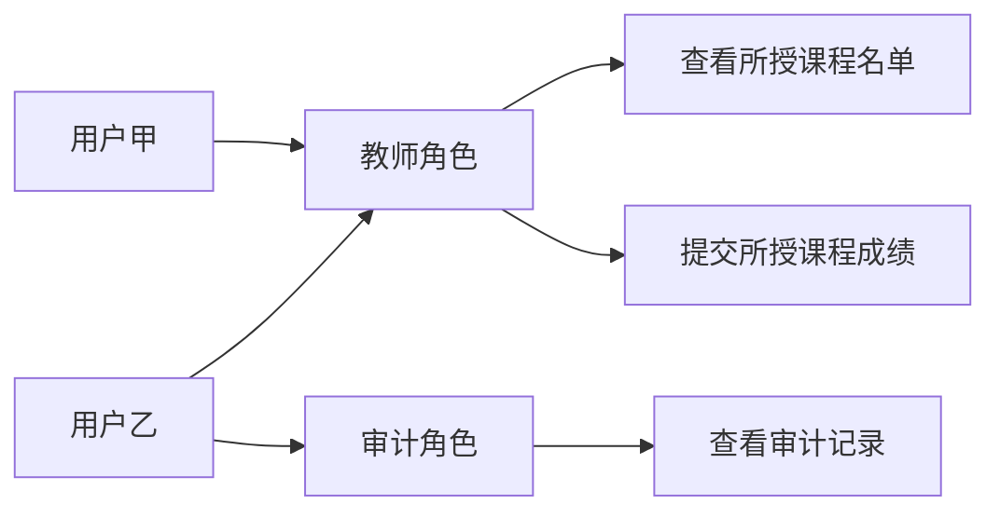

**组Group**通常表示用户集合，**角色Role**表示某类工作职责及其权限集合。角色可以分配给用户或组，二者在实现上可关联，但概念不同。

| 原则 | 关键含义 | 例子 |
| --- | --- | --- |
| 最小特权 | 只授予完成任务必需的操作权限 | 报表账号只有查询权 |
| 最小知悉／最小泄漏 | 只让主体接触工作所需信息 | 教师只看本人授课学生的必要信息 |
| 职责分离 | 不相容职责交给不同主体 | 申请付款与批准付款分离 |
| 多人负责 | 关键操作需要多方共同参与 | 重要密钥恢复需多人批准 |
| 默认拒绝与逐次检查 | 未明确允许的访问不放行，对每个请求执行授权 | 隐藏按钮之后，后端仍检查权限 |

课件S6第23—25页的IIS示例体现：地址限制、身份认证、Web权限、文件系统权限等可以逐层检查。具体HTTP错误码与实现版本有关，复习重点是**身份检查与资源授权需要分别落实**。

### 4.7 本章复习检查

- [ ] 能说明主体、客体、操作、策略、ADF、AEF。
- [ ] 能区分ACL按列、能力表按行。
- [ ] 能比较DAC、MAC与RBAC的授权依据和适用场景。
- [ ] 能完成含等级与范畴的BLP判定，不遗漏DAC权限。
- [ ] 能准确写出BLP与Biba的读写方向并解释原因。
- [ ] 能为学生、教师、教务员、审计员设计合理的角色权限。

---

## 第5章 软件安全与恶意程序

课件定位：S8。第4—71页讲恶意代码，第73—112页讲软件安全与保护机制，第113—125页讲安全测试、工程、培训与监理，其中课件将部分内容列为自学。

### 5.1 恶意代码分类｜P1

恶意代码是带有攻击意图的软件、脚本或代码片段。**病毒是恶意代码的一类**。课件有时广义使用“病毒”，做类型比较时应采用下表中的较严格概念。

| 类型 | 关键识别点 | 自我复制／宿主 | 常见危害 |
| --- | --- | --- | --- |
| 计算机病毒 Virus | 感染其他程序、文件或启动区域 | 通常依附宿主，能够复制感染 | 破坏文件、篡改数据、影响系统 |
| 蠕虫 Worm | 作为独立程序通过网络等传播 | 可自我复制，通常不要求文件型宿主 | 快速扩散、耗尽资源，也可携带其他载荷 |
| 特洛伊木马 Trojan | 伪装成有用或无害软件，暗含恶意功能 | 自我复制不是其定义特征 | 窃密、远控、下载其他恶意代码 |
| Bot／僵尸程序 | 受远程命令控制，被用于协同活动 | 是否传播取决于具体实现 | DDoS、垃圾邮件、盗取数据 |
| 逻辑炸弹 | 满足时间、状态等条件后执行恶意功能 | 通常依附程序 | 删除、破坏或中断服务 |
| 后门 Backdoor | 绕过正常认证或控制路径 | 可为独立程序或隐藏功能 | 未授权访问、持久控制 |
| 勒索软件 | 以加密、锁定或泄露威胁勒索 | 传播方式不固定 | 业务中断、数据损失、信息泄露 |

这些名称可能描述不同维度：一个程序可以通过蠕虫方式传播，安装后门，再执行勒索载荷。分类不总是互斥的。Bot强调受控执行行为，不能由名字直接推断绝不复制。

### 5.2 计算机病毒的特征、结构与传播｜P1

**五项课件特征**：传染性、破坏性、隐蔽性、寄生性、可触发性。可触发性表示特定条件满足后启动相应行为，不等于所有病毒都会立即破坏数据。

| 模块 | 作用 |
| --- | --- |
| 引导／控制模块 | 获得执行机会，装入或激活病毒代码，控制后续流程 |
| 感染模块 | 寻找目标、检查是否已感染、把病毒代码传播到目标 |
| 破坏模块 | 达到触发条件时执行设计的恶意载荷 |

这是一种通用结构，具体样本可能合并模块或缺少某类明显功能。

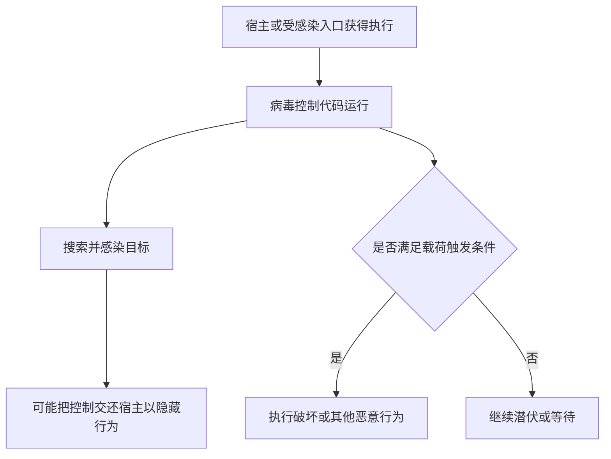

**主要类型**：文件型感染可执行文件并改变执行入口；引导型感染启动相关区域，在启动路径中运行；宏病毒利用文档中的宏等执行能力。仅仅“读写过磁盘”或“打开任意文档”并不必然执行病毒，要分析是否经过受感染的执行路径、宏策略或漏洞触发条件。

**命名识别，P2**：课件以`前缀.病毒名.变种`说明命名习惯，常见前缀有`Trojan`、`Worm`、`Macro`、`Script`、`Win32`等。不同厂商命名并不完全一致，不能仅凭前缀认定全部行为。

### 5.3 蠕虫、木马与Bot的工作过程｜P1

**蠕虫**：课件归纳为漏洞扫描 → 攻击利用 → 现场处理 → 复制传播。防御要覆盖补丁、暴露面、网络分区、流量检测与感染主机隔离。蠕虫造成的危害可以超过网络拥塞，还可能包括窃密和破坏。

**木马**：课件过程为配置 → 传播 → 运行 → 信息泄露 → 建立连接 → 远程控制。重点理解伪装、诱导执行、隐蔽驻留与控制通信。传统远控木马采用C/S思路，但现代控制通道不一定由攻击者直接连接受害机，也可能由受害机主动对外连接。

**Bot与Botnet**：Bot是被控制的单个程序／节点，Botnet是组织起来的受控节点集合。控制通信通常称为**C2／C&C命令与控制通道**。阻断控制、清除恶意程序、修复入口和重新保护凭据要配合进行。

### 5.4 反病毒与恶意代码防护｜P1

反病毒处理可以概括为**检测 → 识别 → 清除／修复**，还要验证恢复情况并防止再次感染。

| 方法 | 依据 | 优点 | 局限 |
| --- | --- | --- | --- |
| 特征码扫描 | 已知代码或模式 | 对已知样本识别较直接 | 依赖更新，可能漏检新变种 |
| 启发式检测 | 可疑结构、指令与规则 | 可发现部分未知或变形样本 | 可能误报 |
| 行为监测 | 进程、文件、注册表、网络等活动 | 关注实际恶意行为 | 依赖可见性、规则与上下文 |
| 完整性校验 | 文件或代码相对可信基线的变化 | 能发现被改动的对象 | 基线必须可信，正常更新也会引起变化 |
| 沙箱／虚拟机分析 | 隔离执行并观察行为 | 便于动态分析 | 可能被识别环境或延时行为规避 |
| 云端关联分析 | 多源样本与行为情报 | 可共享识别能力 | 依赖联网、隐私与服务可用性 |

课件的“四代反病毒”按**简单扫描器、启发式扫描器、活动陷阱、全功能防护**记忆。实际产品经常结合多种技术，代际划分用于理解演进。

**分层防护思路**：可信来源下载与签名校验、补丁、最小权限、宏与脚本控制、邮件防护、网络隔离、终端检测、离线或隔离备份、恢复演练、人员培训。

> [!warning] 病毒处理不要机械照搬旧操作
> “系统文件夹看起来为空就是中毒”“删除或改名系统命令解释器即可防蠕虫”“建立autorun.inf文件夹就能防所有U盘病毒”等不能作为通用结论。
> 发现异常先核实和隔离扩散路径，按应急流程保留必要信息、查明入口、清除或重建、恢复验证并修补。查杀完成不代表账号、凭据和系统配置一定恢复可信。

### 5.5 软件安全的保护范围｜P1

软件安全贯穿整个生命周期，既保护程序与数据，也要求软件受到恶意输入、异常操作和攻击时仍符合安全要求。

| 范围 | 关注点 |
| --- | --- |
| 软件自身 | 代码、数据、功能完整，减少后门、缺陷与不可信调用 |
| 存储 | 介质可靠、文件系统保护、加密与访问控制 |
| 通信 | 传输机密性、完整性、认证与安全下载 |
| 使用 | 身份、授权、许可、操作与管理控制 |
| 运行 | 正确执行、隔离、异常处理、时间依赖、更新与补丁 |

“实现了正确功能”不等于安全。功能测试主要检查应该发生的行为是否正确，安全测试还要检查**不应被允许的行为能否发生**。

### 5.6 软件保护的四项目标｜P1

| 目标 | 含义 | 课件中的机制 |
| --- | --- | --- |
| 防复制 | 限制非法复制、分发 | 载体标记、安装控制、许可与序列号、程序分块 |
| 防执行 | 让未授权副本难以运行 | 软件狗、加密卡、硬件绑定、授权校验 |
| 防暴露 | 增加非法阅读、逆向和理解的成本 | 程序加密、混淆、反调试、反跟踪、部分压缩封装 |
| 防篡改 | 检测或阻止非法修改 | 完整性校验、签名、可信基线、自保护 |

**软件狗／加密狗**：硬件保存秘密或提供计算功能，软件中的校验逻辑与之交互，满足条件才能运行。安全性还取决于软件校验点、通信和硬件实现，并非插入硬件就不可破解。

**反跟踪**通过检测调试、时间差、控制流干扰等提高分析成本。课件中的磁盘特殊标记、DOS中断技巧等按历史机制了解，P3即可。

**压缩与加密不同**：压缩主要减少表示长度，不能单独提供保密性。普通校验和与密码学完整性保护也不同，攻击者若能同时改程序和校验值，校验机制可能失效。

### 5.7 安全测试、工程、培训与监理｜P2

课件列出安全测试的功能验证、漏洞扫描与模拟攻击，以及静态、动态、文档、接口、出错处理和异常检测。软件安全工程把需求、设计、编码、测试、变更分析等活动组织起来；培训与监理保证人员、开发环境和流程真正落实要求。

这一部分与[[#第8章 软件安全开发生命周期]]联动复习：第5章建立保护目标，第8章具体说明开发各阶段怎样落实。

### 5.8 本章复习检查

- [ ] 能比较病毒、蠕虫、木马、Bot，并说明分类可能重叠。
- [ ] 能解释病毒五项特征与三个模块。
- [ ] 能概述蠕虫传播和远控木马的工作过程，匹配阻断措施。
- [ ] 能比较特征检测、行为检测、完整性校验与沙箱。
- [ ] 能将软件保护手段归到防复制、防执行、防暴露、防篡改。

---

## 第6章 网络安全

课件定位：S9。第3—19页为基本概念与体系，第21—32页为风险与攻击分类，第33—64页为攻击方式，第65页为综合案例思考。

### 6.1 网络安全目标与体系｜P1

网络安全保护分布环境中的设备、系统、数据及其处理、存储、传输、访问，保障CIA与可审计性。保护内容包括运行系统、系统信息、信息传播与信息内容。

| 层次 | 主要问题 | 代表控制 |
| --- | --- | --- |
| 物理与环境 | 断电、设备丢失、线路破坏、环境故障 | 机房管理、电力保障、环境监测 |
| 设备与计算 | 操作系统缺陷、配置错误、恶意代码 | 补丁、加固、权限、终端检测 |
| 网络与通信 | 窃听、路由与边界问题、非法接入 | 安全通信、分区、防火墙、流量监测 |
| 应用与数据 | 注入、越权、弱认证、泄露 | SDL、认证授权、数据保护、备份 |
| 管理与人员 | 制度不落实、职责冲突、安全意识弱 | 培训、审计、职责分离、应急制度 |

**OSI七层，P2**：物理、数据链路、网络、传输、会话、表示、应用。TCP/IP常用网络接口、网际、传输、应用四层表示。复习重点是协议分层与安全机制所处位置，以及不同层的控制互相配合。

**OSI安全服务，P1识别**：鉴别、访问控制、数据机密性、数据完整性、抗抵赖。

**课件列举的特定安全机制，P2**：加密、数字签名、访问控制、数据完整性、鉴别交换、业务流填充、公证。安全服务是要实现的目标，安全机制是实现目标的方法，二者不是一一对应。

### 6.2 网络风险分析｜P1

资产、威胁、脆弱性的概念与第1章相同。网络中要额外考虑资产暴露、网络路径、跨区访问、协议和服务依赖，不能仅根据“存在多少漏洞”评价风险。

课件的安全处理过程为：**评估 → 策略制定 → 实施 → 培训 → 审计**，审计结果应反馈到下一轮改进。

评估时可关注资产与补丁覆盖、权限是否过大、检测是否有效、事件发现与恢复所需时间、备份恢复演练结果。扫描结果需要结合漏洞可利用性、资产重要程度和已有控制分析。

### 6.3 攻击分类与安全属性｜P1

| 攻击 | 核心行为 | 主要受损属性 | 例子 |
| --- | --- | --- | --- |
| 截取 Interception | 非法获取信息 | 机密性 | 窃听明文口令 |
| 篡改 Modification | 非法改变信息 | 完整性 | 修改交易金额 |
| 阻断 Interruption | 阻止正常服务 | 可用性 | 破坏线路、DDoS |
| 伪造 Fabrication | 生成虚假信息或身份 | 真实性与完整性 | 伪造订单、冒充服务器 |
| 抵赖／否认 | 否认已发生的行为 | 不可否认性、可追责性 | 否认签署交易 |

**被动攻击**主要观察与获取，如窃听、流量分析，往往较难察觉。**主动攻击**改变内容、状态或服务，如篡改、伪造、重放、拒绝服务。不同分类维度可以交叉，一次攻击也可能影响多个安全属性。

### 6.4 网络攻击的一般过程｜P2

课件从目标探测、端口扫描、网络监听讲到入侵、获取权限、提升权限和隐藏痕迹。复习时把攻击链用于寻找防御点：

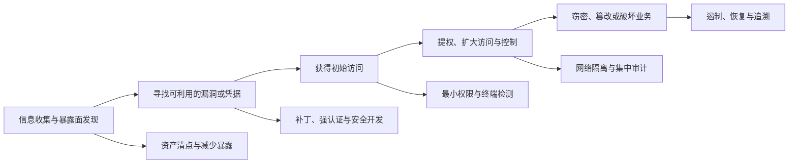

### 6.5 扫描、监听与漏洞利用｜P1原理，P2细节

| 技术 | 主要目的／原理 | 复习时注意 |
| --- | --- | --- |
| 主机发现 | 判断地址上是否存在可达设备 | 不回应不一定代表主机不存在 |
| TCP连接扫描 | 完成TCP连接判断端口情况 | 可能被网络策略影响 |
| SYN扫描 | 根据SYN请求的响应判断状态，不完成正常连接 | 不是“必然无日志”或不可被检测 |
| FIN扫描 | 利用不同TCP状态下的响应差异 | 行为依赖协议栈和过滤策略 |
| ACK扫描 | 主要分析过滤规则、可达性与状态检查 | 不能直接把有响应解释为端口开放 |
| UDP扫描 | 根据应用响应、ICMP错误等推断状态 | 无响应可能是开放或被过滤 |
| OS／服务识别 | 根据协议与应用响应推断实现 | 结果是推断，需交叉验证 |
| 网络监听 | 在可见范围内捕获、分析流量 | 混杂模式不会自动获得全网流量 |

课件S9第40—41页对扫描结果做了简化。尤其是**UDP无响应不等于确定开放**，结果受到过滤、丢包、限速与服务行为影响。详见[Nmap端口扫描技术文档](https://nmap.org/book/man-port-scanning-techniques.html)。

**缓冲区溢出**：写入超出缓冲区边界的数据，可能破坏相邻数据、控制信息甚至改变执行流程。防御包括边界检查、安全接口、内存安全实践和系统缓解机制。S9的`gets()`例子用于展示不限制输入长度的危险。

**SQL注入**：把不可信数据拼接进SQL结构，导致数据被数据库解释成指令的一部分。关键防御是参数化查询、必要的白名单约束与最小权限。前端过滤可以改善体验，但不能替代服务端安全控制，详见第8章。

**监听防护**：保护通信机密性、验证通信对象并管理网络接入。加密能保护内容，但流量大小、时间等元数据仍可能暴露一定信息。

### 6.6 DoS与DDoS｜P1

**DoS**使合法用户无法正常使用服务；**DDoS**使用分布式攻击来源协同实施。攻击可能耗尽链路、连接状态、CPU、内存或应用处理资源，也可能触发实现缺陷。

| 方式 | 核心原理 | 主要防护思路 |
| --- | --- | --- |
| SYN Flood | 大量半连接请求占用连接状态或处理资源 | SYN相关防护、合理超时、限速、清洗 |
| UDP／ICMP Flood | 大流量或大量请求耗尽链路和处理能力 | 上游过滤、限速、清洗、容量与弹性 |
| Smurf | 伪造受害者源地址，利用广播网络的ICMP应答反射放大 | 禁止不必要的定向广播、源地址验证、过滤放大路径 |
| Teardrop泪滴 | 恶意重叠分片触发某些老旧协议栈重组缺陷 | 修补实现、分片规范化与异常检测 |
| LAND，课件列举 | 构造源、目的相同等异常报文，触发某些旧实现的问题 | 补丁和异常报文检查 |
| 分布式洪泛 | 多个受控节点共同向目标施压 | 多点检测、边缘与上游协同、弹性和应急策略 |

**不要只写“安装防火墙”**：如果接入链路已经被打满，主机本地丢包无法恢复上游带宽。需要结合网络运营商、清洗或边缘防护等上游措施。正常的ICMP与UDP也有合法用途，不能把协议本身等同于攻击。

### 6.7 APT与社会工程｜P1理解

**APT高级持续性威胁**强调有目标、有组织、长期活动，可能组合钓鱼、凭据窃取、漏洞利用、持久控制与横向移动。它描述攻击活动特征，不是某一种病毒名称。

**社会工程**利用信任、紧迫感、权威、好奇心等影响人的判断，例如仿冒银行短信、虚假登录页、恶意附件、冒充熟人或管理员。

防御要同时考虑人和系统：独立渠道核实、限制高权限操作、MFA、邮件与终端防护、培训与可执行的上报流程。培训应配合技术控制，不能把事件完全归因为用户不小心。

### 6.8 本章复习检查

- [ ] 能把四类基本攻击映射到CIA与真实性。
- [ ] 能解释主动与被动攻击的区别。
- [ ] 能说明扫描、监听与漏洞利用分别在做什么，避免把推测当确定结论。
- [ ] 能比较DoS和DDoS，讲清SYN、Smurf、泪滴的原理与防护。
- [ ] 能按“攻击链—受损属性—防护—检测—响应—恢复”分析课件案例。

---

## 第7章 防火墙技术

课件定位：S10，共26页。重点在第2—8页定义与边界、第10—18页技术、第20—25页体系结构。

### 7.1 防火墙的定位与基本要求｜P1

防火墙是在不同信任程度的网络、主机或安全域之间，按统一安全策略控制通信的软硬件系统，是访问控制的一种实现。它既可控制外到内，也可控制内到外以及部门之间的访问。

**三项基本要求**：

1. 受控边界之间的通信流量经过相应检查点，不能任意绕过。
2. 只有符合安全策略的通信才能通过。
3. 防火墙自身要具有足够的安全性，管理与配置也必须受保护。

常见能力包括访问限制、集中策略、日志审计、连接管理，以及部分产品提供的VPN、NAT、恶意流量检测等。**并非所有防火墙都具备课件列出的全部功能**，NAT本身也不等于完整的安全策略。

### 7.2 包过滤、状态检测与应用代理｜P1

| 技术 | 检查依据／工作位置 | 优点 | 主要限制 |
| --- | --- | --- | --- |
| 静态包过滤 | 网络层／传输层报头：地址、协议、端口、标志等 | 处理直接、通常性能较好 | 对应用语义了解有限，规则设计易出错 |
| 状态检测 | 报头与已建立连接／会话状态 | 可区分新建、返回流量，动态放行相关通信 | 需要维护状态，仍不必然理解全部业务内容 |
| 应用代理 | 理解指定应用协议，由代理终止并转发交互 | 可做更细的命令、身份与内容控制，审计详细 | 处理开销、协议兼容与部署维护成本 |

课件把包过滤分成静态与动态，动态包过滤演进为状态检测。应用代理在客户与真实服务器之间建立代理关系，隔开两端直接的应用会话。不同产品的透明性和配置方式不同，不能一概说必须安装客户端软件。

### 7.3 防火墙局限｜P1

- **绕过检查点的流量**不受该检查点保护，如私接外网或未纳入策略的通道。
- **相同安全区内部的行为**若不经过相应控制点，边界防火墙可能看不到。
- **被允许的业务流量**仍可能携带漏洞利用、被盗凭据或恶意操作。
- **加密流量的应用内容**能否检查取决于架构与产品能力，不能默认可见。
- 无法单独解决所有终端、业务逻辑、社会工程、未知漏洞和带宽耗尽问题。

“防火墙完全不能应对内网攻击”“所有防火墙只工作在网络层”都过于绝对。准确说法是：**控制效果取决于部署位置、经过的流量、检查能力与策略**。

### 7.4 体系结构与DMZ｜P1

| 术语／结构 | 含义与特点 |
| --- | --- |
| 堡垒主机 Bastion Host | 位于暴露位置、经过加固、承担对外服务或代理职责的主机 |
| 双宿主主机 | 至少有两个网络接口，连接不同网络；需正确配置转发与代理策略 |
| 路由器型防火墙 | 用路由设备上的过滤等能力实施边界控制 |
| 单宿主屏蔽主机 | 过滤路由器配合单网卡堡垒主机；路由与过滤策略失效可能直接暴露内网 |
| 双宿主屏蔽主机 | 配合双接口堡垒主机，进一步约束访问路径 |
| 屏蔽子网 | 增加外围子网，外网、外围服务与内网分区控制 |
| DMZ非军事区 | 处于外网与内网之间、放置对外服务的独立安全区域 |

DMZ的目标是让对外服务即使被攻破，也不能任意访问内网。DMZ中的服务器仍需要补丁、权限与监测。它可以由两个防火墙构成，也可用合适的多接口防火墙划分，以下展示两道边界的思路。


### 7.5 规则理解例题｜P1

以下为教学示例，具体端口与业务依赖需按真实系统确定。应先允许确有需要的通信，再拒绝其他通信，并结合状态检测处理合法返回流量。

| 来源 | 目的 | 服务／条件 | 决策与理由 |
| --- | --- | --- | --- |
| 外网用户 | DMZ Web服务器 | HTTPS业务端口 | 允许公开业务访问 |
| 外网任意来源 | 内网数据库 | 直接连接 | 拒绝，数据库不应直接对公网开放 |
| DMZ Web服务器 | 指定内网数据库 | 确需的数据库端口 | 按最小范围允许，不开放整个内网 |
| DMZ服务器 | 内网任意主机 | 其他不必要通信 | 拒绝，降低失陷后的横向移动风险 |
| 管理区主机 | 指定管理接口 | 经认证的运维连接 | 受限允许并记录审计 |
| 其他未明确允许的通信 | 其他区域 | 任意 | 默认拒绝 |

答题要说明**方向、源、目的、协议／端口、连接状态、动作和日志**。规则存在先后顺序、重叠或遮蔽时，还应检查实际匹配结果。

### 7.6 本章复习检查

- [ ] 能写出防火墙三项基本要求。
- [ ] 能比较静态包过滤、状态检测、应用代理。
- [ ] 能画出外网—DMZ—内网拓扑，说明为何数据库不直接对外开放。
- [ ] 能指出绕行、内部流量、合法通道滥用等局限。
- [ ] 能把最小权限原则写成清晰的网络访问规则。

---

## 第8章 软件安全开发生命周期

课件定位：S11。第17—42页为各阶段安全活动，第45—53页为设计原则，第54—85页为Web问题，第86—95页为STRIDE，第96—98页为渗透测试和其他漏洞。

### 8.1 为什么需要SDL｜P1

**SDL，Security Development Lifecycle**，将安全活动纳入软件需求、设计、编码、测试、发布与运行维护全过程。课件主要以微软SDL展开。

安全缺陷可能来自需求遗漏、架构信任假设、编码错误、配置、第三方依赖和后续变更。发布前扫描与渗透测试有价值，但如果只在最后阶段发现架构问题，整改可能非常困难。

**核心理解**：安全是一组持续执行的开发活动，需要明确责任、可验证要求、流程与响应机制。

### 8.2 各阶段安全活动与产出｜P1

| 阶段 | 主要活动 | 应能拿出什么证据／产出 |
| --- | --- | --- |
| 培训与准备 | 安全知识、编码规范、职责与工具准备 | 培训记录、规范、人员分工 |
| 需求 | 明确资产、角色、数据、合规要求、安全目标与风险 | 可验收的安全需求和风险清单 |
| 设计 | 威胁建模、信任边界、权限与数据流设计、减少攻击面 | 数据流图、威胁与缓解措施、设计审查 |
| 编码 | 服务端输入校验、安全API、参数化、权限边界、异常与日志控制 | 代码审查结果、实现与修复记录 |
| 测试 | 认证授权、输入与注入、会话、数据、通信、部署等验证 | 测试用例、发现、修复与回归结果 |
| 发布与部署 | 安全配置、密钥与证书、最小权限、必要文档 | 发布检查、配置基线、部署说明 |
| 运行与响应 | 监测、漏洞报告、评估、补丁、恢复与复盘 | 响应流程、补丁与验证记录、改进项 |

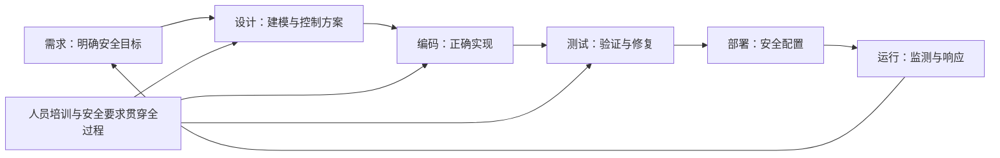

**安全需求必须可验证**：不要只写“系统要安全”。可以写“学生只能读取自己的成绩”“修改成绩需要有权限的教师操作并记录操作者、对象与时间”“会话退出后原令牌失效”等。

### 8.3 六项安全设计原则｜P1

| 原则 | 核心意思 | 应用例子 |
| --- | --- | --- |
| 攻击面最小化 | 减少可被访问、触发与滥用的接口和功能 | 关闭不用的服务，限制管理接口暴露 |
| 基本隐私 | 按合法目的最小化处理个人信息并保护数据 | 不为无关功能收集通讯录 |
| 最小权限 | 进程、账户和用户仅持有必要权限 | Web服务不以系统最高权限运行 |
| 默认安全 | 初始配置即采取较安全设置 | 默认关闭调试与危险功能，访问默认拒绝 |
| 纵深防御 | 在不同环节组合措施，避免单点失效 | 参数化＋数据库最小权限＋监测＋备份 |
| 威胁建模 | 从设计与数据流系统识别威胁并验证缓解措施 | 对跨信任边界的请求分析冒充、篡改等风险 |

“纵深防御”应体现不同环节的控制，不是重复购买同类产品。“基本隐私”还应结合第10章的合法性、必要性与个人权利要求。

### 8.4 安全编码关键点｜P1

**输入边界**：不只检查表单，还要检查路径、请求头、Cookie、文件、消息队列、外部API和数据库中再次读出的不可信内容。按业务定义校验类型、长度、范围、格式与可接受值，必要时规范化后再验证。

**指令与数据分离**：SQL用参数化查询；操作系统命令尽量使用安全API和参数数组；文件访问限制到允许的目录与文件。不要只依靠删掉少数字符或检查字符串长度。

**输出上下文**：HTML正文、属性、JavaScript、CSS、URL等需要不同的安全处理。若业务允许富文本，应使用合适的净化机制，不能把所有内容简单按一种转义方式处理。

**权限边界**：每个接口、每个对象、每次敏感操作都执行服务端授权。前端隐藏按钮、改成难猜ID、限制菜单显示都不能替代授权。

**异常和日志**：失败时按安全默认处理，避免“发生异常反而授权成功”；对外不泄露堆栈、SQL、密钥等细节，对内记录足够的安全审计信息，并防止日志注入与敏感信息泄露。

> [!warning] 课件表述的三个修正
> “禁止JavaScript进行任何校验”应理解为**不能仅依赖客户端校验**。客户端校验可用于体验，服务端必须独立执行安全校验。
> “限制长度即可防SQL注入／XSS”不成立，必须使用各自针对性的措施。
> “对所有危险字符统一转义”不能替代参数化与按上下文输出编码，不同解释器的规则不同。

### 8.5 课件列举的十类Web问题｜P1

这十类用于对应课件内容，**不表示当前最新版OWASP Top 10的条目或排名**。

| 问题 | 根本原因／表现 | 关键防护 |
| --- | --- | --- |
| 1 XSS跨站脚本 | 不可信内容进入可执行的浏览器上下文 | 上下文输出编码、安全DOM接口、必要时富文本净化；CSP等作为补充 |
| 2 注入 | 数据被SQL、命令等解释器当作指令 | 参数化、安全API、白名单、最小权限 |
| 3 恶意文件执行／包含 | 由不可信输入决定包含、上传或执行的文件 | 路径约束、类型与内容校验、隔离存储、禁止上传区执行 |
| 4 不安全直接对象引用IDOR | 换对象ID即可访问他人资源，服务端缺少对象级授权 | 每次检查主体与对象的授权关系 |
| 5 CSRF跨站请求伪造 | 浏览器自动携带身份凭据，攻击者诱导其提交不受信任请求 | CSRF令牌、来源检查、合理SameSite策略、敏感操作确认 |
| 6 信息泄露与错误处理不当 | 对外返回堆栈、内部路径、SQL或账户存在信息 | 统一错误、内部安全记录、关闭调试、避免不必要披露 |
| 7 认证与会话管理缺陷 | 登录、令牌、会话生命周期或注销实现不当 | 成熟机制、TLS、令牌保护、会话轮换、超时与失效 |
| 8 不安全的敏感数据存储 | 明文、弱算法、不当密钥管理等 | 合适算法与密钥管理、最小化保存、口令专用哈希 |
| 9 不安全通信 | 敏感内容在传输中可被窃听或篡改，或未验证对端 | 正确使用TLS并验证证书，保护必要后端链路 |
| 10 URL访问限制失效 | 只在界面隐藏入口，后台仍能直接调用 | 对每条受保护路由及其业务操作执行服务端授权 |

#### XSS与CSRF的区别

| 比较项 | XSS | CSRF |
| --- | --- | --- |
| 核心机制 | 不可信脚本在目标站点上下文执行 | 诱导浏览器以用户已有身份发出请求 |
| 是否必须在目标页面执行恶意脚本 | 是，需形成相应脚本执行上下文 | 不一定 |
| 主要处理重点 | 防止数据变成可执行内容 | 验证敏感请求来源与用户意图 |
| 联系 | 严重XSS可能绕过同站点内的CSRF防护 | 仅修复CSRF不能修复XSS |

课件列出的XSS类型包括**存储型、反射型、DOM型**。前两项主要描述载荷存放／传递方式，DOM型强调客户端处理路径，不必强行理解为完全互斥的三类。

XSS防护应按执行上下文处理，不能只删除`script`字样。进一步可查[OWASP XSS防护说明](https://cheatsheetseries.owasp.org/cheatsheets/Cross_Site_Scripting_Prevention_Cheat_Sheet.html)。

#### SQL参数化的安全写法

```java
String sql = "SELECT account_balance FROM user_data WHERE user_name = ?";
try (PreparedStatement ps = connection.prepareStatement(sql)) {
    ps.setString(1, requestedUserName);
    try (ResultSet rs = ps.executeQuery()) {
        // 读取经过授权、允许向当前用户返回的结果
    }
}
```

占位符让参数作为数据参与执行。**参数化不代替授权**，查询他人账户仍要检查权限。动态表名、列名等结构通常不能作为普通值参数绑定，应使用固定映射或白名单；存储过程内部若拼接不可信SQL，同样可能有注入风险。[OWASP SQL注入防护说明](https://cheatsheetseries.owasp.org/cheatsheets/SQL_Injection_Prevention_Cheat_Sheet.html)

#### CSRF令牌与会话

CSRF令牌应不可预测，绑定适当会话或请求，由服务端验证。使用表单字段、请求头等合适方式传送，避免放在URL中泄露到日志、历史和Referer。S11第71页把令牌加到URL的代码只作为旧课件示例理解。[OWASP CSRF防护说明](https://cheatsheetseries.owasp.org/cheatsheets/Cross-Site_Request_Forgery_Prevention_Cheat_Sheet.html)

会话还要考虑：登录或权限变化后轮换会话标识；退出、超时或吊销后令牌失效；Cookie按场景设置Secure、HttpOnly、SameSite等属性。HttpOnly减少脚本读取Cookie的风险，但不能让站点自动免疫XSS。

### 8.6 STRIDE威胁建模｜P1

| 字母 | 威胁 | 对应安全诉求 | 教务系统例子 | 缓解思路 |
| --- | --- | --- | --- | --- |
| S | Spoofing仿冒 | 身份真实性 | 冒充教师提交成绩 | 强认证、MFA、凭据保护 |
| T | Tampering篡改 | 完整性 | 改请求中的成绩、改数据库记录 | 授权、完整性保护、输入与变更控制 |
| R | Repudiation抵赖 | 可审计与不可否认 | 否认修改过成绩 | 受保护审计日志、必要的签名与时间证据 |
| I | Information Disclosure信息泄露 | 机密性 | 学生读取全校成绩 | 对象级授权、最小化返回、加密 |
| D | Denial of Service拒绝服务 | 可用性 | 选课接口资源被耗尽 | 限流、容量、隔离、恢复与上游防护 |
| E | Elevation of Privilege权限提升 | 授权边界 | 普通账号执行管理员操作 | 最小权限、服务端授权、权限隔离 |

这些对应关系可参照[微软STRIDE威胁说明](https://learn.microsoft.com/en-us/azure/security/develop/threat-modeling-tool-threats)。

**建模四步**：绘制数据流图 → 识别威胁 → 提出缓解措施 → 安全验证并留档。需求、架构与数据流发生变化时再次建模。

**数据流图DFD五项要点**：外部实体、处理过程、数据流、数据存储，以及必须额外标明的**信任边界**。

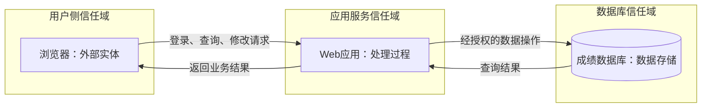

图中不同区域之间的连线跨越信任边界，必须考虑身份、授权、输入、通信保护与故障影响，不能因为是“内网调用”就默认可信。

课件提供的逐元素启发式映射为：外部实体重点看S、R；数据流看T、I、D；处理过程看全部STRIDE；数据存储看T、I、D，日志类存储还关注R。它帮助避免遗漏，实际分析仍需结合业务，不是穷尽所有威胁的保证。

### 8.7 安全测试与响应｜P1

| 测试对象 | 应覆盖的内容 |
| --- | --- |
| 认证与授权 | 正常和失败登录、MFA、水平／垂直越权、权限变更 |
| 数据与隐私 | 存储与传输保护、最小返回、对象访问、泄露风险 |
| 输入与解释器 | 输入校验、SQL注入、XSS、文件与命令处理 |
| 会话 | 固定、劫持、超时、退出、吊销、令牌保护 |
| 系统与网络 | 补丁、配置、端口、隔离、防火墙与监测策略 |
| 可用性与响应 | 异常、资源限制、告警、备份恢复、补丁回归 |

测试方法可从黑盒、白盒、静态检查、动态运行、漏洞扫描和授权模拟攻击等角度组织。扫描报告需要验证，渗透测试需要明确授权与边界，并形成修复、回归与风险确认。

**安全响应过程**：接收漏洞／事件报告 → 评估影响与优先级 → 采取临时缓解 → 开发和测试补丁 → 发布与部署 → 验证 → 复盘并更新需求、设计、规范和测试。

### 8.8 其他漏洞概念｜P2

课件还列举远程代码执行、栈溢出、安全绕过、0day／nday、文件上传和外挂相关逻辑问题。重点辨认“根因、运行边界与后果”：

- 远程代码／命令执行可能来自多种缺陷，不是仅因缺少绝对路径。
- 文件上传除了扩展名，还要考虑实际内容、解析行为、存储位置、执行权限与访问控制。
- 关键游戏或业务逻辑仅由客户端裁决，可能被篡改，重要规则应由可信服务端验证。
- 0day不能按“由项目外部人员发现”来定义，关注的是漏洞被知晓、修补和利用的时间关系。公开与修复是不同事件，不能仅按公开与否做机械判断。

### 8.9 本章复习检查

- [ ] 能给SDL每个阶段写出安全活动及对应产出。
- [ ] 能说明六项设计原则，并为SQL注入设计纵深防御。
- [ ] 能区分输入校验、参数化、输出编码、认证与授权。
- [ ] 能比较XSS与CSRF，解释IDOR与URL越权的根因。
- [ ] 能背出STRIDE六项并与安全属性、措施对应。
- [ ] 能画带信任边界的DFD，给出威胁、措施与验证用例。

---

## 第9章 信息安全实践与职业规划

课件定位：S12，共22页。重点为安全运维、软件逆向、等保测评；本章以P2理解为主，等保工作流程建议按P1掌握。

### 9.1 三类方向与知识关联｜P2

| 方向 | 主要工作 | 与课程的联系 |
| --- | --- | --- |
| 安全运维与防御 | 资产、配置、补丁、告警、日志、应急与恢复 | 第1章风险、第5章恶意程序、第6—7章网络防护 |
| 授权安全评估／红队 | 从攻击者视角验证暴露面和控制缺陷，形成整改依据 | 第3—4章认证授权、第6章攻击、第8章漏洞与测试 |
| 软件逆向 | 静态或动态分析程序结构、流程、行为与缺陷 | 程序设计、汇编、操作系统、第5章软件保护 |
| 等保测评与安全合规 | 按对象、等级、要求检查技术与管理措施，推动整改 | 第1章体系、第8章工程过程、第10章法律制度 |

课件用红队、蓝队帮助理解攻击视角与防护视角。实际岗位职责可能交叉，红队评估也不等于日常运维的全部内容。

基础能力可沿**程序设计、操作系统、计算机网络、数据库、Web原理**建立，再结合日志分析、测试、逆向或合规方向深化。报告应能说明资产、问题、证据、影响、修复与复测结果。

课件提到终端防护、Goby等工具，重点是知道终端防护和资产识别的用途，产品宣传、价格、下载链接和旧版本依赖不作为需要记忆的知识结论。

### 9.2 等级保护工作流程｜P1

课件归纳的五个阶段：

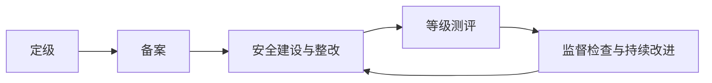

| 阶段 | 关注问题 |
| --- | --- |
| 定级 | 什么对象需要保护，受到破坏会影响谁、影响多严重？ |
| 备案 | 按适用规定完成有关材料与备案程序 |
| 建设与整改 | 根据等级要求落实技术、管理与组织措施 |
| 测评 | 用证据检查控制是否满足要求、是否有效 |
| 检查与改进 | 持续运行、监督、修复与复核 |

**定级先看受侵害客体与侵害程度**，不按设备数量、采购金额或企业名气简单决定。系统发生重大变化后也要重新审视保护要求。

### 9.3 五级保护概念｜P2

课件引用的五级保护能力名称如下：

| 等级 | 课件名称 | 记忆重点 |
| --- | --- | --- |
| 一级 | 用户自主保护级 | 基础自主保护 |
| 二级 | 系统审计保护级 | 增强审计能力 |
| 三级 | 安全标记保护级 | 进一步引入安全标记与强制控制思想 |
| 四级 | 结构化保护级 | 更严格的结构化保护要求 |
| 五级 | 访问验证保护级 | 最高等级的严格保护要求 |

等级越高，对安全保护能力和管理的要求总体越严格。上表用于识别课件中的名称，不能只依据某一个技术功能给系统定级。

> [!warning] 等保表述与标准年份
> 课件“不做等保＝违法”是提醒履行法定义务的简化说法。具体对象、等级、备案、测评等要求应依据适用制度判断，不能理解成所有单位都要走完全相同的手续。
> S12混合列出多个年份的标准，部分编号还存在笔误。复习先掌握制度、流程与标准用途。课件涉及GB/T 22239-2019基本要求、GB/T 25070-2019安全设计技术要求、GB/T 28448-2019测评要求等；实施项目时另行核对适用的现行版本。

### 9.4 实践与职业伦理｜P2

CTF、实验靶场、课程项目、授权评估与实习可以把知识变成能力。实践要明确授权、范围、时间与数据处理约束，并形成可复现、可修复、可复测的记录。

证书可帮助建立知识框架和说明学习经历，不能代替实际能力，也不能据此保证收入或就业。课件中的人才缺口、薪资和产品描述具有特定时间背景，不作为考试核心或当前求职结论。

### 9.5 本章复习检查

- [ ] 能解释安全运维、授权评估、软件逆向、等保测评各做什么。
- [ ] 能按顺序写出等保五阶段并说明每阶段目的。
- [ ] 能识别五级保护的课件名称，知道定级要结合影响判断。
- [ ] 能说明授权边界、保密、负责任报告与修复复测的重要性。

---

## 第10章 信息安全相关法律法规

课件定位：S13。第4—25页为网络安全法，第27—61页为数据安全法，第63—96页为个人信息保护法，第97—113页为日常安全防护。

> [!important] 法律版本基准：2026-11-22
> 课件的《网络安全法》主要使用2016年通过、2017年施行的原版内容。2025年10月28日通过的修改决定已于**2026年1月1日**施行，新增内容、责任规定与条文顺序有所调整。复习历史日期时保留原施行时间，讨论现行条文时注明版本，避免混用条号。[全国人大常委会修改决定，网信办发布](https://www.cac.gov.cn/2025-10/29/c_1763461514768457.htm)

### 10.1 三部法律对照｜P1

| 法律 | 主要保护／规范对象 | 课程中的核心制度 | 时间节点 |
| --- | --- | --- | --- |
| 网络安全法 | 网络建设、运营、维护、使用及安全监管 | 等级保护、关基保护、运营者义务、监测预警与应急 | 2016-11-07通过，2017-06-01原法施行；2025年修正内容自2026-01-01施行 |
| 数据安全法 | 数据处理活动及其安全监管，兼顾开发利用 | 分类分级、重要数据、风险监测、处理者义务、政务数据安全与开放 | 2021-06-10通过，2021-09-01施行 |
| 个人信息保护法 | 自然人个人信息权益与个人信息处理活动 | 处理规则、敏感信息、个人权利、处理者义务、跨境提供 | 2021-08-20通过，2021-11-01施行 |

三部法律相互衔接，同一个平台可能同时承担网络安全、数据安全与个人信息保护义务。不是有了其中一部，就可以忽略另外两部。

上述对象、制度和日期可对照[现行网络安全法](https://www.cac.gov.cn/2025-12/29/c_1768735112911946.htm)、[数据安全法官方文本](https://www.samr.gov.cn/zw/zfxxgk/fdzdgknr/bgt/art/2023/art_33654085364e45e2a878c70a06934414.html)、[个人信息保护法官方文本](https://www.cac.gov.cn/2021-08/20/c_1631050028355286.htm)。

### 10.2 网络安全法的课程重点｜P1

**立法目的**包括保障网络安全、维护网络空间主权和国家安全、社会公共利益，保护合法权益，促进信息化健康发展。

**网络运营者的保护义务**需要落实到组织、制度、技术与日常运行。课件重点包括等级保护、数据与个人信息保护、漏洞和事件处置、用户信息管理与配合依法监管。

**关键信息基础设施保护**是在等级保护基础上，对一旦遭到破坏、丧失功能或数据泄露可能严重危害国家安全、国计民生、公共利益的重要设施实施重点保护。课件举公共通信、能源、交通、金融、电子政务等领域帮助理解。

**“三同步”**：相关安全保护措施与关键信息基础设施同步规划、同步建设、同步使用。它体现安全不能等系统建好后再随意补装。

**公民与组织**既享有合法权益、举报等权利，也不得非法侵入、干扰正常功能、窃取数据或为危害网络安全活动提供违法支持。

**版本对照只记关键位置**：

| 内容 | 课件所用原版条号 | 2025年修正后的条号 |
| --- | --- | --- |
| 网络安全等级保护制度 | 第21条 | 第23条 |
| 关基个人信息与重要数据境内存储相关规定 | 第37条 | 第39条 |
| 禁止非法获取、出售或提供个人信息 | 第44条 | 第46条 |

原版为7章79条，修正后的公布文本为7章81条。具体义务、例外和处罚应查对应版本，不能把课件旧条号与现行罚则拼接使用。[现行公布文本](https://www.cac.gov.cn/2025-12/29/c_1768735112911946.htm)

### 10.3 数据安全法｜P1

**数据**是以电子或者其他方式记录的信息，范围不限于个人信息，也不限于电子数据。**数据处理**包括收集、存储、使用、加工、传输、提供、公开等活动。**数据安全**强调有效保护、合法利用以及持续保障能力。

课件主要制度可按以下脉络记忆：

1. **分类分级保护**：结合数据重要性与受损后果差异化保护，重要数据、国家核心数据有更严格要求。
2. **风险治理**：监测、预警、评估、报告、应急处置与相应审查制度配合。
3. **处理者义务**：全流程管理制度、培训、技术措施、风险监测、及时补救与事件处置。
4. **重要数据特别义务**：按规定设置责任、开展风险评估与报告，并关注出境管理。
5. **数据交易与获取**：来源合法、审查与记录，不能以非法手段获取数据或损害合法权益。
6. **政务数据**：依法履职处理，保护数据，同时依法推进开放利用。

**外部提供要区分两种情形**：一般的数据跨境活动，和外国司法、执法机构要求提供数据，适用的程序与义务不能直接混为一谈。后者在《数据安全法》**第36条**规定主管机关处理请求，以及境内组织、个人未经批准不得提供相关境内存储数据的要求。S13第52页引用为第33条应纠正。[数据安全法第36条](https://www.samr.gov.cn/zw/zfxxgk/fdzdgknr/bgt/art/2023/art_33654085364e45e2a878c70a06934414.html)

本法为7章55条。课件部分“影响分析”材料保留了早期稿件的条号，复习制度含义优先，引用条文再核对官方文本。

### 10.4 个人信息与敏感个人信息｜P1

**个人信息**与已识别或者可识别的自然人有关，包含直接或结合其他信息识别个人的记录。姓名、账号、联系方式、行为轨迹等是否属于个人信息，要结合可识别性判断。

| 概念 | 关键区别 |
| --- | --- |
| 个人信息 | 与已识别或可识别自然人有关的信息 |
| 敏感个人信息 | 泄露或非法使用易危害人格尊严、人身或财产安全，要求更严格保护 |
| 去标识化 | 在不借助额外信息时难以识别，但可能借助额外信息恢复关联 |
| 匿名化 | 无法识别特定自然人且不能复原；匿名化后的信息不纳入本法个人信息范围 |

课件重点列举的敏感个人信息包括生物识别、宗教信仰、特定身份、医疗健康、金融账户、行踪轨迹，以及**不满14周岁未成年人的个人信息**。不能扩大成“所有未满18周岁的信息都因年龄自动属于这一类别”。处理不满14周岁未成年人信息，还涉及监护人同意和专门处理规则。[个人信息保护法第28—31条](https://www.cac.gov.cn/2021-08/20/c_1631050028355286.htm)

### 10.5 个人信息处理规则与个人权利｜P1

**原则**：合法、正当、必要、诚信；目的明确、合理；处理与目的直接相关；公开透明；保证信息质量；采取保护措施。

课件的“三最”有助记忆：**影响最小、范围最小、保存时间最短必要**。保存期限仍要结合适用法律要求判断。

**告知与同意**是重要机制。基于同意处理时，应做到充分知情、自愿明确，提供便捷撤回方式。拒绝或撤回非必要信息的同意，不应成为拒绝基本产品或服务的理由；为提供产品或服务所必需的处理另行依法判断。

> [!warning] 同意不是唯一的合法性基础
> 第13条还规定订立、履行合同所必需，依法实施人力资源管理，履行法定职责或义务，紧急情况下保护生命健康与财产安全，合理公共利益新闻报道，合理处理已公开信息，以及其他法定情形。判断具体处理是否合法，不能只检查“有没有弹窗勾选”。[个人信息保护法第13—16条](https://www.cac.gov.cn/2021-08/20/c_1631050028355286.htm)

**敏感个人信息**要求特定目的、充分必要性与严格保护，依法落实相应单独同意、额外告知等要求。用于自动化决策时，还应关注透明、公平及不得在交易条件上实施不合理差别待遇。

**个人权利**包括知情、决定、限制或拒绝处理，依法查阅、复制、更正、补充、删除，撤回同意和要求解释处理规则等。处理者需要提供相应申请、投诉和权利行使渠道。

**处理者义务**包括制度、分类管理、适当技术措施、权限控制、教育培训、应急处置，以及适用情形下的影响评估、合规审计和责任安排。跨境提供个人信息还要符合相应法定条件，不等于“一律禁止出境”或“同意了就可以任意出境”。

### 10.6 法律责任与情境判断｜P1

责任类型包括**行政责任、民事责任，构成犯罪时依法承担刑事责任**。处罚与行为、后果、情节、责任主体和适用法律有关。

课件提到个人信息保护法情节严重情形的行政罚款上限：**5000万元以下或者上一年度营业额5%以下**，还可能有其他措施与对责任人员的处罚。不能把它说成每次泄露都会直接按5%罚款。[个人信息保护法第66条](https://www.cac.gov.cn/2021-08/20/c_1631050028355286.htm)

| 场景 | 分析抓手 |
| --- | --- |
| 手电筒功能要求无关通讯录权限 | 与目的直接相关吗？是否必要、过度收集？拒绝后能否继续使用基本功能？ |
| 平台为业务需要处理金融账户 | 属敏感信息，应检查具体目的、必要性、保护措施和适用程序 |
| 删掉姓名但保留可关联账号与设备标识 | 未必匿名化，仍可能识别或重新关联个人 |
| 把成绩查询ID改成他人ID即可查看 | 对象级授权缺陷，同时涉及个人信息保护义务 |
| 同意隐私政策后平台任意转卖信息 | 不能由一次笼统同意推出无限制处理权限 |
| 发生泄露后只修复漏洞、不评估和报告 | 还要分析适用的补救、告知、报告等义务 |

### 10.7 日常安全防护｜P2

课件最后把法律与个人实践相连：使用独立强口令和适当MFA；离开终端锁屏；确认软件、附件和网页来源；保持系统与安全工具更新；按制度使用移动介质；保护敏感文件；备份重要数据；异常及时上报；设备维修与报废遵循数据保护流程。

重点记住措施的目的，不照搬旧版操作系统界面、固定改密周期、过时破解时间统计或某个单一U盘防毒技巧。

### 10.8 本章复习检查

- [ ] 能比较网络安全法、数据安全法、个人信息保护法的对象与核心制度。
- [ ] 能记住三部法律的主要施行日期，并注明网络安全法的版本变化。
- [ ] 能解释数据分类分级、重要数据、关基保护与处理者义务。
- [ ] 能区分个人信息、敏感个人信息、去标识化、匿名化。
- [ ] 能解释告知、同意、撤回、必要性与其他合法性基础。
- [ ] 能用“目的—必要性—合法基础—保护措施—权利保障”分析处理情境。

---

## 附录A 跨章节易混点与准确性提示

### A.1 高频概念对照

| 易混项 | 正确区分 |
| --- | --- |
| 编码、压缩、加密、Hash | 编码改变表示；压缩减少表示长度；加密依密钥保护机密性；Hash生成摘要，不能按密钥解密 |
| Hash与MAC | Hash没有共享秘密；MAC利用密钥提供消息认证 |
| MAC的两种含义 | 第3章为Message Authentication Code消息认证码；第4章为Mandatory Access Control强制访问控制 |
| 数字签名与公钥加密 | 签名者私钥签、其公钥验；收件人公钥加密、其私钥解密 |
| 认证与授权 | 认证核验身份凭据，授权决定能访问的资源与操作 |
| 消息认证与身份认证 | 前者关注消息完整性和来源，后者关注交互实体 |
| 完整性与机密性 | 信息没有被非法改变，不等于没有被别人看到 |
| 完整性与新鲜性 | 旧消息原样重放仍可完整，需额外验证新鲜性 |
| IV／Nonce与salt | 都可能公开，但分别用于不同密码／认证或口令处理场景，不能互换要求 |
| 会话密钥与一次一密 | 短期使用的会话密钥，不等同于满足一次一密全部条件的随机密钥材料 |
| ACL与能力表 | ACL从客体看主体，能力表从主体看客体 |
| BLP与Biba | BLP保密：下读上写；Biba严格完整性：上读下写 |
| 组与角色 | 组通常是用户集合，角色是职责与权限集合 |
| 漏洞与威胁 | 漏洞是弱点，威胁是可能造成损失的因素，风险还考虑后果和已有控制 |
| 恶意代码与病毒 | 恶意代码范围更大，病毒是其中一类 |
| XSS与CSRF | XSS使脚本在目标上下文运行；CSRF借用浏览器自动携带的用户凭据发请求 |
| 扫描与渗透测试 | 扫描发现候选问题，渗透测试结合授权边界验证实际攻击路径与影响 |
| 防火墙、终端防护与安全开发 | 分别控制网络流量、终端行为和软件缺陷，应组合使用 |
| 去标识化与匿名化 | 前者可能借助额外信息重新关联，后者要求不可识别且不可复原 |
| 数据安全与个人信息保护 | 数据范围更广，个人信息保护特别关注自然人的权益和处理规则 |

### A.2 回看课件时需要避免的误记

以下针对影响理解或实际使用的重要表述，其他细小排版、拼写和历史问题不逐项展开。

| 课件位置 | 容易误记的表述 | 建议记法 |
| --- | --- | --- |
| S2第36页 | 选择密文攻击的黑盒名称不一致 | 选择密文获得解密结果，区别于CPA加密接口 |
| S2第50页 | 扩散等于增加明文冗余 | 扩散把统计关系分散、隐藏到密文多个位置 |
| S2第53、119页 | DES有时只写64位密钥 | 64位输入含8位校验，有效密钥56位 |
| S2第95—107页 | 个别中间值与末轮组合、补齐说法不严谨 | 记标准结构、末轮交换、逆序子密钥和测试向量，实际需明确模式与填充 |
| S2、S3算法汇总图 | 按图的位置把SM3当作对称加密 | SM2公钥、SM3杂凑、SM4分组密码 |
| S3第10页 | 对称密码无法解决身份认证 | 可用于MAC与认证，难提供公开可验证的个人签名证据 |
| S3第19、37页 | 模运算都不可逆、素数检测很困难 | 难题要准确描述为合适参数下的离散对数、大整数分解等 |
| S3第24—36页 | DH自然保证双方身份 | 裸DH还需要认证，防中间人替换公开量 |
| S4第6页 | 不同消息绝不会碰撞 | 碰撞存在，要求难以有效找到 |
| S4第20—21页 | MD5仍满足安全抗碰撞，可直接安全保存密码 | 按历史算法学习，不用于安全签名或简单快速口令存储 |
| S4第26—33页 | 普通加密或任意Hash拼接自动提供认证 | 应采用有明确安全保证的认证结构与协议 |
| S4第38—40页 | 数字签名等于所有电子签名，无法重复使用 | 数字签名是密码技术；复制重放需另外检查新鲜性 |
| S5第19、26—32页 | 周期改密、Salt攻击、密文必然比Hash安全 | 区分历史政策、加盐防预计算、专用口令派生和离线猜测 |
| S5第79—80页 | KDC密钥数和会话“一次一密”容易混淆 | 先定义参与者数量；会话密钥不等于一次一密密码本 |
| S5第106—113页 | 普通Hash登录、出示证明信就是正式零知识证明 | 类比只能帮助理解，正式协议还需满足安全定义 |
| S6、S7安全等级举例 | 个别页面密级次序不同 | 本章例题统一按公开＜秘密＜机密＜绝密，范畴另按集合包含判断 |
| S8病毒清除与软件保护部分 | 单一现象可判中毒，压缩等于保密 | 异常需核实；压缩不能替代加密或可信认证 |
| S9第40—44页 | UDP无响应即开放，SYN／监听必然无迹可查 | 扫描是条件推断，流量可见性和检测能力要具体分析 |
| S10第7—8页 | 每个防火墙都查毒，或全部只看网络层 | 依据实际部署位置、能力和策略判断 |
| S11第20—24页 | 长度限制、前端禁用或统一转义即可防注入 | 服务端校验＋参数化＋按上下文输出处理，各司其职 |
| S11第71页 | CSRF令牌通用地放进URL | 采用适当表单／请求头等机制，避免URL泄露 |
| S12第20—22页 | 所有单位等保手续完全相同，旧标准号均可直接采用 | 区分保护对象、等级、适用要求与标准版本 |
| S13网络安全法部分 | 原版条号可以直接对应现行文本 | 标注2016原版或2025修正版本，注意2026施行节点 |
| S13第52页 | 外国司法执法调取对应数据安全法第33条 | 正式文本对应第36条 |
| S13第75、79页 | 所有未成年人信息因年龄都敏感，个保法只有7章 | 年龄条款为不满14周岁；个保法为8章74条 |

---

## 附录B 综合案例与考前自测

### B.1 通用案例答题框架

建议按下面七步组织，避免只罗列产品名称：

1. **资产与业务**：保护的数据、系统、服务和用户是谁？
2. **攻击路径与脆弱性**：威胁通过哪个入口，利用什么技术或管理弱点？
3. **受损属性与影响**：分别分析CIA、真实性、不可否认性与可审计性。
4. **预防／防护**：认证、授权、补丁、隔离、安全开发与人员制度如何落实？
5. **检测与响应**：观察什么证据，怎样确认、告警、隔离与处置？
6. **恢复与验证**：修复、恢复、凭据处理、回归测试及剩余风险是什么？
7. **工程与合规**：哪个SDL环节应补强，涉及哪些数据与个人信息保护义务？

课件中的国家授时中心、西北工业大学等思考题可用此框架。事件事实、时间、归因、工具数量等应以题干及可靠材料为准，不能用推测补全攻击细节。

### B.2 案例一：学生修改参数看到了他人成绩

**题干**：学生登录后访问成绩接口，将请求中的学号改成他人学号，系统返回了他人的成绩。网站使用HTTPS，前端也隐藏了查看他人成绩的按钮。

> [!question]- 参考分析
> **根因**：后端只检查“已登录”，没有检查当前用户是否有权访问目标学号，属于对象级授权缺陷，常表现为IDOR／水平越权。
> **属性**：首先破坏机密性与个人信息权益；若还能提交修改请求，则涉及完整性。
> **为何现有措施无效**：HTTPS保护传输链路，不能修复服务端授权逻辑；隐藏按钮不能阻止直接请求接口。
> **整改**：服务端从可信会话取得主体身份；逐次检查主体与目标记录关系；按角色与数据范围限制查询；最小化返回字段；记录必要访问审计；检测异常枚举。
> **SDL**：需求阶段定义“学生只能查本人”；设计阶段建立对象授权；编码实现；测试使用两个不同学生账号做越权回归。
> **STRIDE**：泄露对应I，若修改则涉及T，越过更高权限边界还可能涉及E。多个维度可以同时分析。

### B.3 案例二：钓鱼附件引发服务器勒索与停机

**题干**：员工运行伪装成文档的附件，终端出现异常外连，随后部分服务器文件被加密。各部门共用一个管理员账号，在线备份也能被该账号直接修改。

> [!question]- 参考分析
> **路径**：社会工程诱导执行恶意程序，终端失陷后可能利用凭据与网络访问扩大影响。题干未提供的漏洞、组织归因或传播细节不能凭空认定。
> **资产与属性**：业务文件、凭据、服务器与服务可用性受威胁；可能同时存在完整性破坏和数据外泄风险。
> **脆弱性**：附件信任与执行控制不足；管理员共用导致权限过大、难以追责；网络隔离不足；备份与生产使用相同高权限控制，缺乏隔离。
> **防护**：可信来源与邮件防护、终端检测、最小权限、MFA、凭据隔离、分区访问与独立受保护备份。
> **检测与响应**：核实告警，限制扩散，保留必要日志和样本信息，排查受影响资产及被盗凭据，按应急预案协调处置。
> **恢复**：先确认入口和控制路径已修复，再从可信备份恢复或重建，轮换受影响凭据并验证业务；不要把“文件解密了”当成环境恢复可信的充分条件。
> **管理与法律**：取消共用管理员身份，建立审计、演练和数据事件评估处置机制，按适用要求落实告知、报告等义务。

### B.4 案例三：合同只有Hash，双方对内容产生争议

**题干**：发送方通过邮件给出合同和一串Hash值，接收方保存后表示合同金额已被改动。双方都无法证明保存的Hash来自最初发送方。

> [!question]- 参考分析
> Hash可以表达内容摘要，但单独不能证明是谁生成，也不能在摘要来源不可信时可靠解决主动篡改与双方争议。
> 共享密钥MAC可抵抗不持有密钥的第三方伪造，但双方都能计算MAC，仍难向第三方证明由谁发出。
> 数字签名结合可信身份绑定、私钥保护、必要的可信时间和证据保存，更适合建立可公开验证的签署证据。若还要保密合同内容，需另外配置加密保护。
> 若需证明本次交易意图，还应绑定合同版本、交易标识、双方身份、时间或其他上下文，防止把旧签名消息误用到新业务。

### B.5 计算与判定练习

**先独立做，再展开答案。**

> [!question]- 题1：20个用户两两使用不同共享密钥，没有KDC，共需要多少把？若另设KDC，每人只与KDC共享长期密钥呢？
> 两两共享为$20\times19/2=190$把，每人保存19把。另设KDC时需要20把用户—KDC长期密钥，按需生成的会话密钥另算。

> [!question]- 题2：凯撒密码中，A＝0，偏移量3，`SECURITY`加密结果是什么？
> `VHFXULWB`。逐字母加3并模26，`Y`回绕成`B`。

> [!question]- 题3：DES的S盒输入为101011，应查哪一行哪一列？输出几位？
> 首尾位为`11`，即第3号行；中间四位为`0101`，即第5号列。输出为4位。这里使用从0开始的行列号，还需给出对应S盒表才能求具体值。

> [!question]- 题4：DH取p＝97、g＝5、a＝36、b＝58，公开量和共享秘密分别是什么？
> $A=50$，$B=44$，双方共享秘密$K=75$。公开$p,g,A,B$，保密$a,b,K$。这个计算本身没有提供身份认证。

> [!question]- 题5：RSA取p＝47、q＝61、e＝167，求n、φ(n)、d，并加密明文块123。
> $n=2867$，$\varphi(n)=2760$，$d=1223$，因为$167\times1223\equiv1\pmod{2760}$。密文$123^{167}\bmod2867=1770$。真实加密还需完整方案，不能直接部署这个小例子。

> [!question]- 题6：MD5原文长448 bit，填充后有多少个512位分组？
> 必须先追加1位，再补511个0，最后附加64位长度，总计1024 bit，2组。不能因为原文已是448模512就跳过填充。

> [!question]- 题7：主体为“机密，{财务，研发}”，客体为“秘密，{财务}”，在课件BLP规则下能读、能写吗？
> 强制条件允许读，不允许写，因为主体支配客体。最终读取还需要对应DAC读权限。写入低密级、少范畴客体会造成向下泄露风险。

> [!question]- 题8：主体完整性为高，客体完整性为低，按严格Biba规则能读、能写吗？
> 不能读低完整性客体，可以向低完整性客体写；最终还需满足其他授权约束。目的在于防止高可信主体被低可信数据污染。

### B.6 判断题与简答抓手

| 判断命题 | 结论 | 一句话理由 |
| --- | --- | --- |
| 加密后消息一定不能被篡改 | 错 | 普通加密不自动提供完整性认证 |
| 文件与下载页Hash一致就必然可信 | 错 | 要看Hash算法、摘要来源与渠道是否可信 |
| 签名验证成功就证明消息刚刚发出 | 错 | 需另验时间、Nonce、序列号和业务上下文 |
| 盐必须像口令一样保密 | 错 | 通常与验证值保存，作用在于差异化与提高攻击成本 |
| 两个口令就是双因素认证 | 错 | 两者均属于“所知”因素 |
| 用户已登录即可访问任意记录 | 错 | 必须执行对象与操作授权 |
| 同密级的主体和客体在BLP下总能互相读写 | 错 | 还要看范畴包含与自主权限 |
| MAC策略能防住全部木马 | 错 | 控制范围、实现与其他攻击路径仍有边界 |
| 防火墙策略只需控制外网访问内网 | 错 | 出站、跨区与管理流量也需要按风险控制 |
| 存储过程天然没有SQL注入 | 错 | 内部拼接不可信SQL同样可能不安全 |
| 删掉姓名的数据都属于匿名数据 | 错 | 其他字段可能识别或重新关联个人 |
| 用户同意后即可无限期保存任意信息 | 错 | 仍受目的、必要性、期限和其他法定义务约束 |

**简答优先练习**：CIA是什么；风险分析如何做；对称与公钥密码为何组合；MAC为何难替代签名；Kerberos的票据与认证器做什么；DAC／MAC／RBAC如何选择；BLP／Biba方向为何相反；病毒／蠕虫／木马如何区分；防火墙为何需要DMZ；SDL怎样落实；STRIDE如何识别威胁；三部法律怎样衔接。

### B.7 最后一轮速记

```text
CIA：机密性、完整性、可用性。
风险：资产、威胁、脆弱性、可能性、影响、控制与剩余风险。
DES：64位分组，56位有效密钥，16轮，48位轮密钥。
SM4：128位分组，128位密钥，32轮，解密轮密钥逆序。
DH：公开交换模指数结果，双方计算同一秘密，裸协议需认证。
RSA：n=pq，φ(n)=(p-1)(q-1)，ed≡1 mod φ(n)。
MD5：128位摘要，512位分组，4轮64步；抗碰撞用途已不安全。
MAC：共享密钥认证；签名：私钥签、公钥验；都需另外考虑重放。
认证：所知、所有、所是；授权：主体能对客体做什么。
BLP：保密，下读上写；Biba：完整，上读下写；同时注意其他权限条件。
防火墙：路径受控、按策略放行、自身安全；静态、状态、代理；DMZ隔离。
SDL：需求、设计、编码、测试、部署、响应；培训持续进行。
STRIDE：仿冒、篡改、抵赖、泄露、拒绝服务、提权。
等保：定级、备案、建设整改、测评、检查改进。
法律：网络安全、数据安全、个人信息保护，按对象和处理活动共同落实。
```

---

## 附录C 课件来源与回看位置

### C.1 源文件索引

源文件目录：`D:/library/schoolClass/信息安全概论/`。

页码以**文件内从1开始的幻灯片顺序**为准，可能与页面角落手写／继承的页码不同。13份合计1,036页，包含两份访问控制的重复内容，不能把总页数当作去重后的知识量。

| 编号 | 文件名 | 页数 | 重点回看位置 |
| --- | --- | --- | --- |
| S1 | `1-信息安全概述.pptx` | 61 | 25—28属性，33—40风险与对策，41—47模型，48教学要求 |
| S2 | `第2章密码学-1.pptx` | 123 | 23—37概念，38—49古典密码，50—109 DES，110—120 SM4，121—123小结 |
| S3 | `第2章密码学-2new.pptx` | 60 | 4—22公钥动机与比较，24—35 DH，37—48 RSA，49—59趋势 |
| S4 | `第3章+信息认证技术-1new.ppt` | 70 | 5—21 Hash／MD5，22—33消息认证，34—70签名与比较 |
| S5 | `第3章+消息认证技术-2new.ppt` | 113 | 7—60认证因素与口令，63—78质询应答，79—88 N-S，89—105 Kerberos，106—113零知识 |
| S6 | `第4章+访问控制.pptx` | 82 | 5—12基本要素，23—25 IIS例，26—46策略与DAC，47—69 MAC／BLP／Biba，70—81 RBAC与原则 |
| S7 | `第4章+访问控制 (1).pptx` | 78 | 与S6基本相同，页码有位移；用于核对矩阵与策略示例 |
| S8 | `第5章+软件安全与恶意程序new.pptx` | 125 | 4—38恶意代码与反病毒，41—71蠕虫／木马／Bot，73—112软件保护，113—125测试与工程 |
| S9 | `第6章+网络安全.pptx` | 65 | 3—19体系，21—32风险与分类，33—47攻击过程，48—56 DoS，57—64 APT／社会工程 |
| S10 | `第7章+防火墙技术.pptx` | 26 | 2—8概述与局限，10—18过滤与代理，20—25结构与DMZ |
| S11 | `第8章+软件安全开发生命周期.pptx` | 98 | 17—42安全活动，45—53原则，54—85 Web问题，86—95 STRIDE，96—98补充漏洞 |
| S12 | `第9章+信息安全实践与职业规划.pptx` | 22 | 12运维，17逆向，20—22等保 |
| S13 | `第10章+-+信息安全相关法律法规.pptx` | 113 | 4—25网安法，27—61数安法，63—96个保法，97—113日常防护 |

### C.2 外部核对材料的用途

正文中的官方链接用于核对**版本、算法安全现状与防护方法的关键边界**，不是新增考试范围：法律链接对应第10章的日期、条号与规则；RFC 6151对应MD5安全性；NIST对应口令保护建议；Nmap对应扫描结果解释；微软与OWASP对应STRIDE和Web防护。

MD5原始结构可进一步对照[RFC 1321](https://www.rfc-editor.org/rfc/rfc1321.html)。RSA中“模幂原语”与“完整加密／签名方案”的区别可对照[RFC 8017](https://www.rfc-editor.org/rfc/rfc8017.html)。两者用于理解教材式计算与实际安全方案之间的距离。

### C.3 复习进度

- [ ] 第一轮：逐章理解概念，能解释各机制解决什么问题及其前提。
- [ ] 第二轮：完成P1例题、对照表与综合案例，检查错因。
- [ ] 第三轮：合上正文，用本章检查清单和附录B口述或默写。
- [ ] 把老师后续明确划定的范围补到对应章节，将个人错题与薄弱点另加标注。

> [!tip] 在Obsidian继续维护
> 可以在薄弱内容后增加`#待复习`、`#易错`，在掌握后勾选任务；也可以用`> [!question]-`建立折叠自测。本文内部链接均指向本文件标题，移到新的笔记库后仍可使用。
